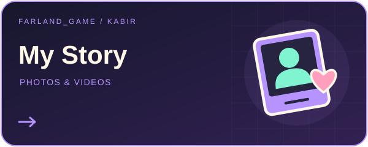
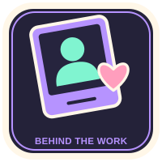

# Moje osobiste archiwum — Kabir za Farland_game 📸🎬

<!-- PROJECT_VISUAL_HEADER -->

[← Farland_game / Portfolio](https://github.com/FarlandGame#portfolio-directory)
<!-- PROJECT_VISUAL_HEADER_END -->

**Bardiya Alizadeh · Kabir · Farland_game**

[English](https://github.com/FarlandGame/Personal-Portfolio/blob/main/README.md) · [日本語](https://github.com/FarlandGame/Personal-Portfolio/blob/main/docs/README.ja.md) · [فارسی](https://github.com/FarlandGame/Personal-Portfolio/blob/main/docs/README.fa.md) · [Deutsch](https://github.com/FarlandGame/Personal-Portfolio/blob/main/docs/README.de.md) · [Français](https://github.com/FarlandGame/Personal-Portfolio/blob/main/docs/README.fr.md) · [Español](https://github.com/FarlandGame/Personal-Portfolio/blob/main/docs/README.es.md) · [Português (Brasil)](https://github.com/FarlandGame/Personal-Portfolio/blob/main/docs/README.pt-BR.md) · [Italiano](https://github.com/FarlandGame/Personal-Portfolio/blob/main/docs/README.it.md) · [Nederlands](https://github.com/FarlandGame/Personal-Portfolio/blob/main/docs/README.nl.md) · [Polski](https://github.com/FarlandGame/Personal-Portfolio/blob/main/docs/README.pl.md) · [Українська](https://github.com/FarlandGame/Personal-Portfolio/blob/main/docs/README.uk.md) · [Türkçe](https://github.com/FarlandGame/Personal-Portfolio/blob/main/docs/README.tr.md) · [Русский](https://github.com/FarlandGame/Personal-Portfolio/blob/main/docs/README.ru.md) · [简体中文](https://github.com/FarlandGame/Personal-Portfolio/blob/main/docs/README.zh-CN.md) · [繁體中文](https://github.com/FarlandGame/Personal-Portfolio/blob/main/docs/README.zh-TW.md) · [한국어](https://github.com/FarlandGame/Personal-Portfolio/blob/main/docs/README.ko.md) · [हिन्दी](https://github.com/FarlandGame/Personal-Portfolio/blob/main/docs/README.hi.md) · [Bahasa Indonesia](https://github.com/FarlandGame/Personal-Portfolio/blob/main/docs/README.id.md)

Nazywam się Bardiya Alizadeh, znany jestem też jako Kabir, a jako artysta tworzę pod nazwą Farland_game. Udostępniam tu 136 obrazów i 12 filmów z mojego osobistego archiwum na Pulpicie: wspomnienia z dzieciństwa i życia rodzinnego, chwile z przyjaciółmi, zdjęcia związane z promocją i uznaniem dla mojej książki oraz portrety i twórcze przeróbki. Są tu także grafiki do THE APEX, mojego fabularnego serwera Minecraft w trakcie tworzenia, i animacja trwająca 11,67 sekundy. Zapraszam do poznania tej bardziej osobistej strony mojej twórczości.

[▶ Zdjęcia i prace graficzne + Filmy i montaże](https://farlandgame.github.io/Personal-Portfolio/) · [Wszystkie 136 obrazów](https://github.com/FarlandGame/Personal-Portfolio/blob/main/gallery/pl/all.md) · [Portfolio na GitHubie](https://github.com/FarlandGame)

> Mój dziennik zadań wreszcie uwzględnia osobę trzymającą kontroler.

    

Kolejność wynika z katalogu i nie stanowi potwierdzonej chronologii.

Stylizowane portrety, fotomontaże i żartobliwe sceny fantastyczne to prace twórcze, nie dokumentacja przełomowych wydarzeń ani dosłowne deklaracje mojego statusu. Jedenaście filmów z osobnego folderu Roblox jest już publicznie dostępnych w plikach identycznych bajt po bajcie; odsyłam do istniejącej kolekcji i nie liczę ich jako nowych publikacji.

**Viewing copies: images resized to at most 2048 px with the full frame retained; complete-duration videos recompressed to fit within 1920×1080. Original desktop files remain unchanged.**

Images personal-008, personal-042, personal-088 and personal-103 are exceptions: phone-screen margins or unrelated surrounding page content were cropped at the creator’s request; the retained photograph pixels were not retouched.

- [Wspomnienia osobiste i rodzinne](https://farlandgame.github.io/Personal-Portfolio/#category-memories) · 84 📸 · 5 🎬
- [Przeróbki portretów](https://farlandgame.github.io/Personal-Portfolio/#category-portraits) · 35 📸 · 5 🎬
- [Wspomnienia związane z książką](https://farlandgame.github.io/Personal-Portfolio/#category-book) · 10 📸 · 1 🎬
- [THE APEX](https://farlandgame.github.io/Personal-Portfolio/#category-apex) · 7 📸 · 1 🎬

[Roblox · 11](https://github.com/FarlandGame/Animation-Portfolio/blob/main/collections/en/roblox.md) · [Catalogue](https://github.com/FarlandGame/Personal-Portfolio/blob/main/catalogue.json) · [Stories](https://github.com/FarlandGame/Personal-Portfolio/blob/main/stories/README.md)

**Kontakt zawodowy:** [farland.game158@gmail.com](mailto:farland.game158@gmail.com)
