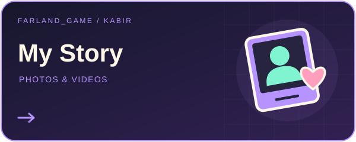
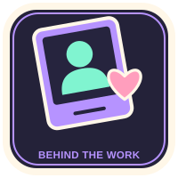
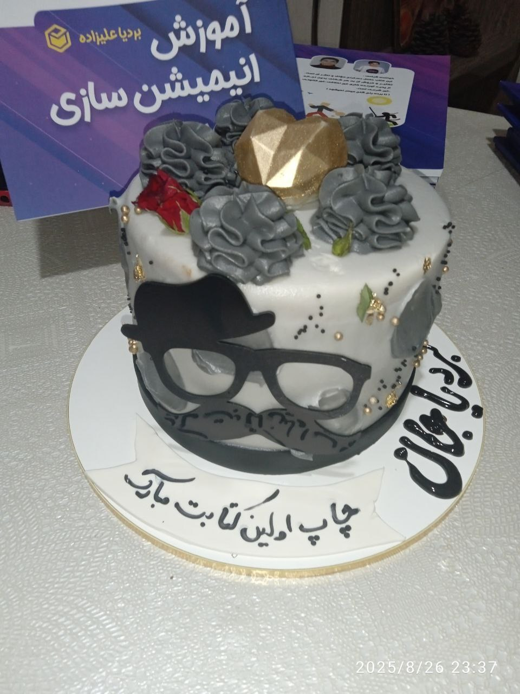
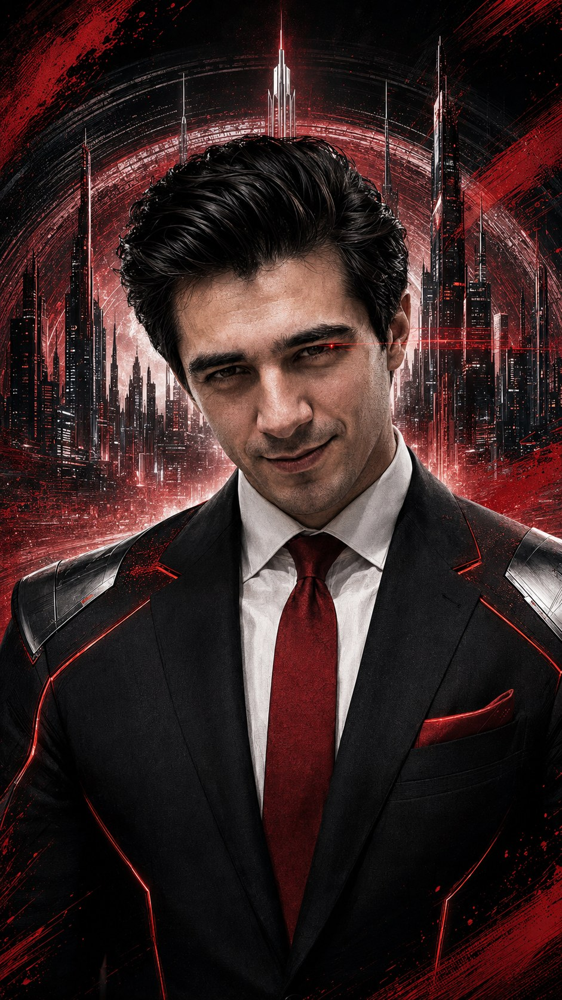

# Kişisel arşivim — Farland_game’in ardındaki Kabir 📸🎬

<!-- PROJECT_VISUAL_HEADER -->

[← Farland_game / Portfolio](https://github.com/FarlandGame#portfolio-directory)
<!-- PROJECT_VISUAL_HEADER_END -->

**Bardiya Alizadeh · Kabir · Farland_game**

[English](https://github.com/FarlandGame/Personal-Portfolio/blob/main/README.md) · [日本語](https://github.com/FarlandGame/Personal-Portfolio/blob/main/docs/README.ja.md) · [فارسی](https://github.com/FarlandGame/Personal-Portfolio/blob/main/docs/README.fa.md) · [Deutsch](https://github.com/FarlandGame/Personal-Portfolio/blob/main/docs/README.de.md) · [Français](https://github.com/FarlandGame/Personal-Portfolio/blob/main/docs/README.fr.md) · [Español](https://github.com/FarlandGame/Personal-Portfolio/blob/main/docs/README.es.md) · [Português (Brasil)](https://github.com/FarlandGame/Personal-Portfolio/blob/main/docs/README.pt-BR.md) · [Italiano](https://github.com/FarlandGame/Personal-Portfolio/blob/main/docs/README.it.md) · [Nederlands](https://github.com/FarlandGame/Personal-Portfolio/blob/main/docs/README.nl.md) · [Polski](https://github.com/FarlandGame/Personal-Portfolio/blob/main/docs/README.pl.md) · [Українська](https://github.com/FarlandGame/Personal-Portfolio/blob/main/docs/README.uk.md) · [Türkçe](https://github.com/FarlandGame/Personal-Portfolio/blob/main/docs/README.tr.md) · [Русский](https://github.com/FarlandGame/Personal-Portfolio/blob/main/docs/README.ru.md) · [简体中文](https://github.com/FarlandGame/Personal-Portfolio/blob/main/docs/README.zh-CN.md) · [繁體中文](https://github.com/FarlandGame/Personal-Portfolio/blob/main/docs/README.zh-TW.md) · [한국어](https://github.com/FarlandGame/Personal-Portfolio/blob/main/docs/README.ko.md) · [हिन्दी](https://github.com/FarlandGame/Personal-Portfolio/blob/main/docs/README.hi.md) · [Bahasa Indonesia](https://github.com/FarlandGame/Personal-Portfolio/blob/main/docs/README.id.md)

Ben Bardiya Alizadeh; Kabir adıyla da tanınıyorum ve Farland_game adıyla sanat üretiyorum. Burada kişisel Masaüstü arşivimden 136 görsel ve 12 video paylaşıyorum: çocukluk ve aile anıları, arkadaşlarla geçen anlar, kitabımın tanıtımı ve gördüğü takdirle ilgili fotoğraflar, portreler ve yaratıcı düzenlemeler. Yapımı devam eden Minecraft hikâye sunucum THE APEX için hazırladığım görseller ve 11,67 saniyelik bir animasyon da burada. Yaratıcı dünyamın daha kişisel bir yanını sizinle paylaşmak güzel.

[▶ Fotoğraflar ve görsel çalışmalar + Videolar ve düzenlemeler](https://farlandgame.github.io/Personal-Portfolio/) · [136 görselin tamamı](https://github.com/FarlandGame/Personal-Portfolio/blob/main/gallery/tr/all.md) · [GitHub portfolyosu](https://github.com/FarlandGame)

> Görev günlüğüm artık sonunda kontrolcüyü tutan kişiyi de içeriyor.

     

İçerikler katalog sırasındadır; bu sıra doğrulanmış bir kronoloji değildir.

Stilize ve birleştirilmiş portreler ile mizahi fantastik sahneler yaratıcı çalışmalardır; belgelenmiş yaşam dönüm noktaları veya statüm hakkında gerçek anlamda iddialar değildir. Ayrı Roblox klasöründeki 11 video, bayt düzeyinde aynı dosyalarla zaten herkese açıktır; mevcut koleksiyona bağlantı veriyor ve bunları yeni yayın olarak saymıyorum.

**Viewing copies: images resized to at most 2048 px with the full frame retained; complete-duration videos recompressed to fit within 1920×1080. Original desktop files remain unchanged.**

Images personal-008, personal-042, personal-088 and personal-103 are exceptions: phone-screen margins or unrelated surrounding page content were cropped at the creator’s request; the retained photograph pixels were not retouched.

- [Kişisel anılar ve aile anıları](https://farlandgame.github.io/Personal-Portfolio/#category-memories) · 84 📸 · 5 🎬
- [Portre düzenlemeleri](https://farlandgame.github.io/Personal-Portfolio/#category-portraits) · 35 📸 · 5 🎬
- [Kitap anıları](https://farlandgame.github.io/Personal-Portfolio/#category-book) · 10 📸 · 1 🎬
- [THE APEX](https://farlandgame.github.io/Personal-Portfolio/#category-apex) · 7 📸 · 1 🎬

[Roblox · 11](https://github.com/FarlandGame/Animation-Portfolio/blob/main/collections/en/roblox.md) · [Catalogue](https://github.com/FarlandGame/Personal-Portfolio/blob/main/catalogue.json) · [Stories](https://github.com/FarlandGame/Personal-Portfolio/blob/main/stories/README.md)

**İş iletişimi:** [farland.game158@gmail.com](mailto:farland.game158@gmail.com)
