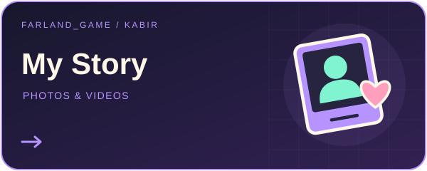

# Мій особистий архів — Кабір за Farland_game 📸🎬

<!-- PROJECT_VISUAL_HEADER -->

[← Farland_game / Portfolio](https://github.com/FarlandGame#portfolio-directory)
<!-- PROJECT_VISUAL_HEADER_END -->

**Bardiya Alizadeh · Kabir · Farland_game**

[English](https://github.com/FarlandGame/Personal-Portfolio/blob/main/README.md) · [日本語](https://github.com/FarlandGame/Personal-Portfolio/blob/main/docs/README.ja.md) · [فارسی](https://github.com/FarlandGame/Personal-Portfolio/blob/main/docs/README.fa.md) · [Deutsch](https://github.com/FarlandGame/Personal-Portfolio/blob/main/docs/README.de.md) · [Français](https://github.com/FarlandGame/Personal-Portfolio/blob/main/docs/README.fr.md) · [Español](https://github.com/FarlandGame/Personal-Portfolio/blob/main/docs/README.es.md) · [Português (Brasil)](https://github.com/FarlandGame/Personal-Portfolio/blob/main/docs/README.pt-BR.md) · [Italiano](https://github.com/FarlandGame/Personal-Portfolio/blob/main/docs/README.it.md) · [Nederlands](https://github.com/FarlandGame/Personal-Portfolio/blob/main/docs/README.nl.md) · [Polski](https://github.com/FarlandGame/Personal-Portfolio/blob/main/docs/README.pl.md) · [Українська](https://github.com/FarlandGame/Personal-Portfolio/blob/main/docs/README.uk.md) · [Türkçe](https://github.com/FarlandGame/Personal-Portfolio/blob/main/docs/README.tr.md) · [Русский](https://github.com/FarlandGame/Personal-Portfolio/blob/main/docs/README.ru.md) · [简体中文](https://github.com/FarlandGame/Personal-Portfolio/blob/main/docs/README.zh-CN.md) · [繁體中文](https://github.com/FarlandGame/Personal-Portfolio/blob/main/docs/README.zh-TW.md) · [한국어](https://github.com/FarlandGame/Personal-Portfolio/blob/main/docs/README.ko.md) · [हिन्दी](https://github.com/FarlandGame/Personal-Portfolio/blob/main/docs/README.hi.md) · [Bahasa Indonesia](https://github.com/FarlandGame/Personal-Portfolio/blob/main/docs/README.id.md)

Я Бардія Алізаде, також відомий як Кабір, і створюю мистецькі роботи під ім’ям Farland_game. Тут я ділюся 136 зображеннями та 12 відео зі свого особистого архіву на Робочому столі: спогадами про дитинство й родину, моментами з друзями, фотографіями, пов’язаними з промоцією та визнанням моєї книги, портретами й творчими обробками. Тут також є зображення для THE APEX, мого сюжетного сервера Minecraft, який ще розробляється, та анімація тривалістю 11,67 секунди. Радий показати вам цю більш особисту частину моєї творчості.

[▶ Фотографії та візуальні роботи + Відео та монтажі](https://farlandgame.github.io/Personal-Portfolio/) · [Усі 136 зображень](https://github.com/FarlandGame/Personal-Portfolio/blob/main/gallery/uk/all.md) · [Портфоліо на GitHub](https://github.com/FarlandGame)

> Мій журнал завдань нарешті містить і людину, яка тримає контролер.

     

Матеріали подано в порядку каталогу, а не за підтвердженою хронологією.

Стилізовані й складені портрети та гумористичні фантазійні сцени — це творчі роботи, а не документальні віхи життя чи буквальні твердження про мій статус. Одинадцять відео з окремої папки Roblox уже опубліковано у файлах, ідентичних байт у байт; я посилаюся на наявну колекцію й не рахую їх як нові публікації.

**Viewing copies: images resized to at most 2048 px with the full frame retained; complete-duration videos recompressed to fit within 1920×1080. Original desktop files remain unchanged.**

Images personal-008, personal-042, personal-088 and personal-103 are exceptions: phone-screen margins or unrelated surrounding page content were cropped at the creator’s request; the retained photograph pixels were not retouched.

- [Особисті та родинні спогади](https://farlandgame.github.io/Personal-Portfolio/#category-memories) · 84 📸 · 5 🎬
- [Оброблені портрети](https://farlandgame.github.io/Personal-Portfolio/#category-portraits) · 35 📸 · 5 🎬
- [Спогади про книгу](https://farlandgame.github.io/Personal-Portfolio/#category-book) · 10 📸 · 1 🎬
- [THE APEX](https://farlandgame.github.io/Personal-Portfolio/#category-apex) · 7 📸 · 1 🎬

[Roblox · 11](https://github.com/FarlandGame/Animation-Portfolio/blob/main/collections/en/roblox.md) · [Catalogue](https://github.com/FarlandGame/Personal-Portfolio/blob/main/catalogue.json) · [Stories](https://github.com/FarlandGame/Personal-Portfolio/blob/main/stories/README.md)

**Робочий контакт:** [farland.game158@gmail.com](mailto:farland.game158@gmail.com)
