# All 138 images 📸

[GitHub portfolio](https://github.com/FarlandGame) · [My Story — Kabir behind Farland_game](https://github.com/FarlandGame/Personal-Portfolio/blob/main/README.md) · [▶ Photos & artwork + Videos & edits](https://farlandgame.github.io/Personal-Portfolio/)

Catalogue order is not confirmed chronological order. Exact dates, ages and the identities of people are recorded only when supplied by the creator.

**Viewing copies: images resized to at most 2048 px with the full frame retained; complete-duration videos recompressed to fit within 1920×1080. Original desktop files remain unchanged.**

Image personal-088 is an exception: its phone-screen borders were cropped away at the creator’s request; the photograph itself is preserved without retouching.

## personal-001 · Portrait edits

[View / download](https://raw.githubusercontent.com/FarlandGame/Personal-Portfolio/main/images/personal-001.jpg)

This image belongs to a cinematic self-portrait project I made with Photoshop and AI. My reference was a scene from Better Call Saul and Saul Goodman, a character I admire and see as a role model. I wanted to make my own film, but I did not have a suitable camera or the budget to shoot it. Instead, I worked with several AI video tools and spent about two weeks bringing the film together. These four images represent scenes from that project.

## personal-002 · Portrait edits

<a href="https://raw.githubusercontent.com/FarlandGame/Personal-Portfolio/main/images/personal-002.jpg">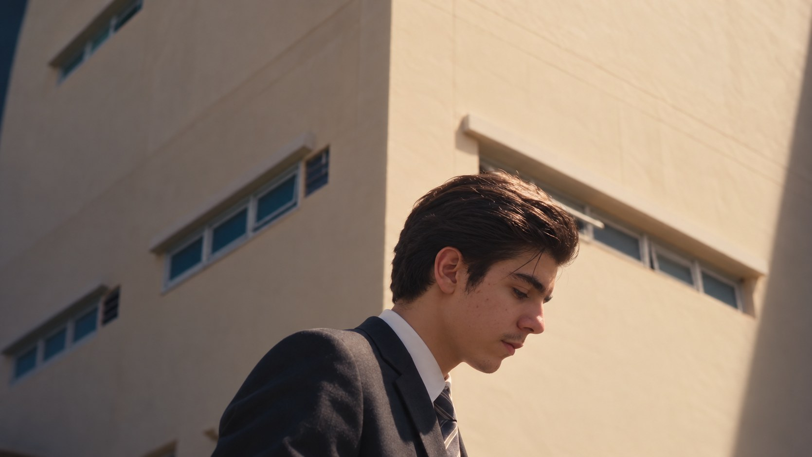</a>

[View / download](https://raw.githubusercontent.com/FarlandGame/Personal-Portfolio/main/images/personal-002.jpg)

This image belongs to a cinematic self-portrait project I made with Photoshop and AI. My reference was a scene from Better Call Saul and Saul Goodman, a character I admire and see as a role model. I wanted to make my own film, but I did not have a suitable camera or the budget to shoot it. Instead, I worked with several AI video tools and spent about two weeks bringing the film together. These four images represent scenes from that project.

## personal-003 · Portrait edits

<a href="https://raw.githubusercontent.com/FarlandGame/Personal-Portfolio/main/images/personal-003.jpg">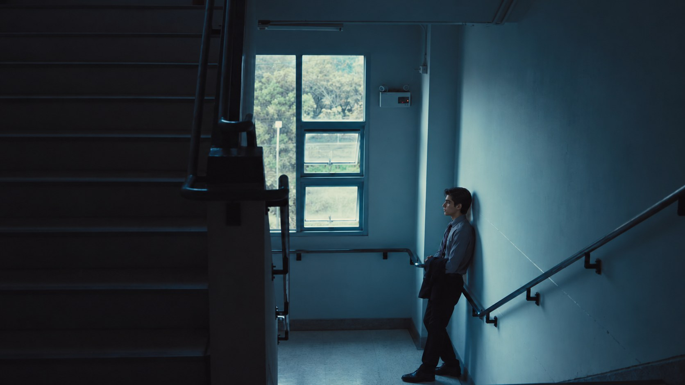</a>

[View / download](https://raw.githubusercontent.com/FarlandGame/Personal-Portfolio/main/images/personal-003.jpg)

This image belongs to a cinematic self-portrait project I made with Photoshop and AI. My reference was a scene from Better Call Saul and Saul Goodman, a character I admire and see as a role model. I wanted to make my own film, but I did not have a suitable camera or the budget to shoot it. Instead, I worked with several AI video tools and spent about two weeks bringing the film together. These four images represent scenes from that project.

## personal-004 · Portrait edits

<a href="https://raw.githubusercontent.com/FarlandGame/Personal-Portfolio/main/images/personal-004.jpg">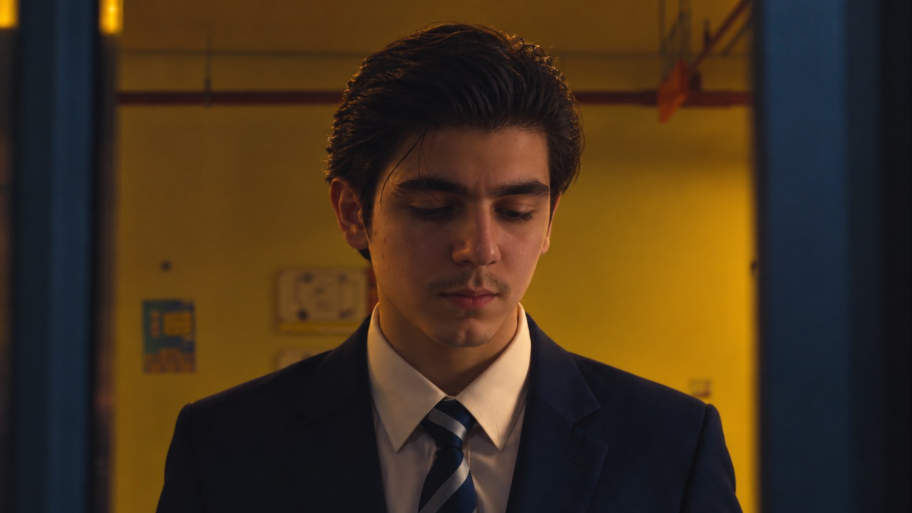</a>

[View / download](https://raw.githubusercontent.com/FarlandGame/Personal-Portfolio/main/images/personal-004.jpg)

This image belongs to a cinematic self-portrait project I made with Photoshop and AI. My reference was a scene from Better Call Saul and Saul Goodman, a character I admire and see as a role model. I wanted to make my own film, but I did not have a suitable camera or the budget to shoot it. Instead, I worked with several AI video tools and spent about two weeks bringing the film together. These four images represent scenes from that project.

## personal-005 · THE APEX

[View / download](https://raw.githubusercontent.com/FarlandGame/Personal-Portfolio/main/images/personal-005.jpg)

This is Farland_game, my artistic character and a central figure in my own gaming, animation and THE APEX creative world. I made this image in Photoshop. The masked face and the F mark belong to that character’s visual identity.

## personal-006 · Personal & family memories

<a href="https://raw.githubusercontent.com/FarlandGame/Personal-Portfolio/main/images/personal-006.jpg">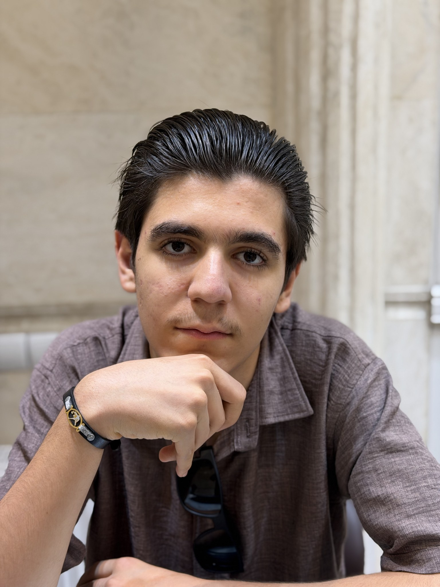</a>

[View / download](https://raw.githubusercontent.com/FarlandGame/Personal-Portfolio/main/images/personal-006.jpg)

This photograph was taken at Ahmadian Jewellery using Amir Ahmadian’s iPhone 16. Amir is Davoud Ahmadian’s son; the two Ahmadian brothers are Davoud and Reza. My twin brother and I spend time working and learning at the jewellery shop without pay, and we have learned how to sell gold jewellery. At the time I used to brush all my hair back, and this is the only photograph I have of that hairstyle. By my recollection, we started in Dey of my tenth-grade school year and have been doing this for about two years.

## personal-007 · Portrait edits

<a href="https://raw.githubusercontent.com/FarlandGame/Personal-Portfolio/main/images/personal-007.jpg">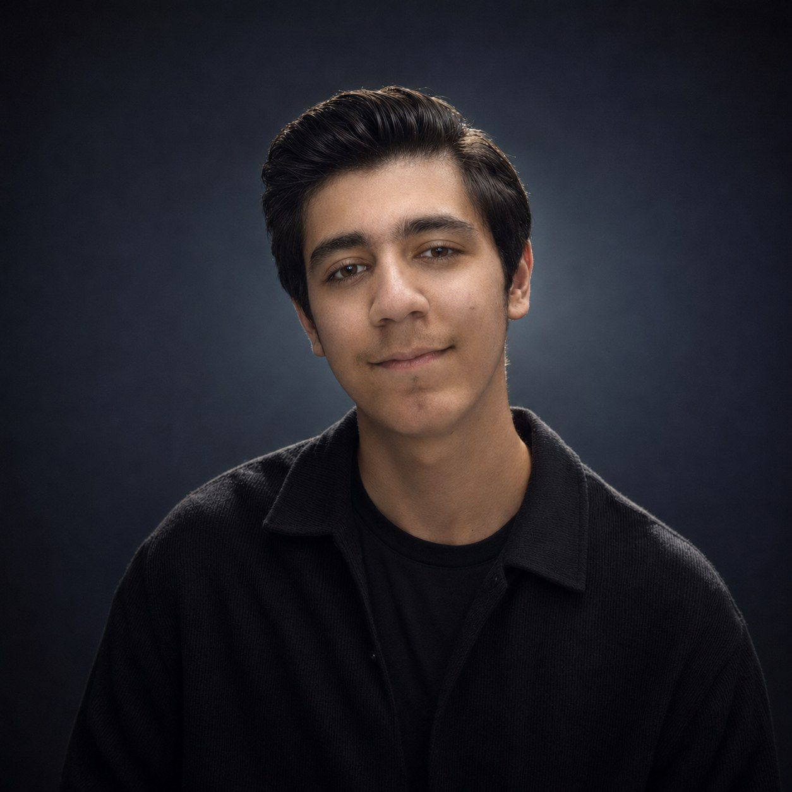</a>

[View / download](https://raw.githubusercontent.com/FarlandGame/Personal-Portfolio/main/images/personal-007.jpg)

I made this portrait for my Instagram profile using AI and Photoshop. I also edited it myself in Photoshop. In the end I did not like the result because I felt it did not look enough like me. It remains here as one of my portrait experiments.

## personal-008 · Personal & family memories

[View / download](https://raw.githubusercontent.com/FarlandGame/Personal-Portfolio/main/images/personal-008.jpg)

This is a real studio photograph. Although it may look AI-made, it was taken in a photography studio. I do not own a suit, even though I would love to have one; the studio had a suit available for the photograph.

## personal-009 · Portrait edits

<a href="https://raw.githubusercontent.com/FarlandGame/Personal-Portfolio/main/images/personal-009.jpg">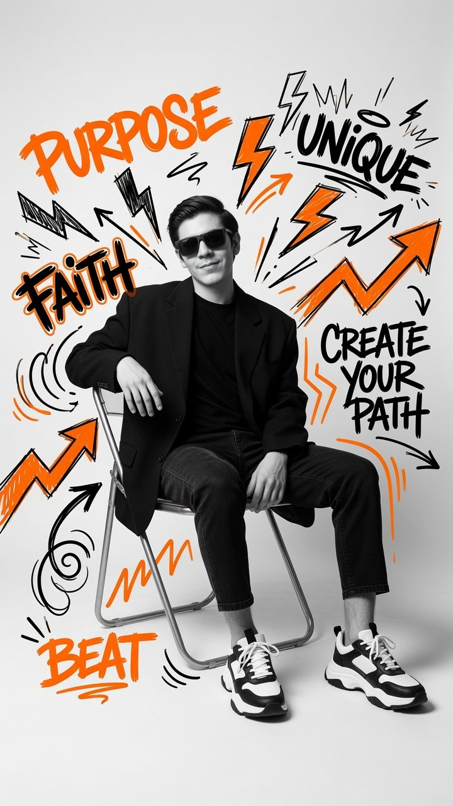</a>

[View / download](https://raw.githubusercontent.com/FarlandGame/Personal-Portfolio/main/images/personal-009.jpg)

I made this image for my Farland work-email profile using Photoshop, several editing apps and AI. I also worked on it myself in Photoshop. I do not especially enjoy relying on AI for pictures of myself; at the time I did not have a good camera. With a better camera, I would love to make more of my own photographs and videos. When I shared this story, this was still the profile image for my work address: farland.game158@gmail.com.

## personal-010 · Personal & family memories

<a href="https://raw.githubusercontent.com/FarlandGame/Personal-Portfolio/main/images/personal-010.jpg">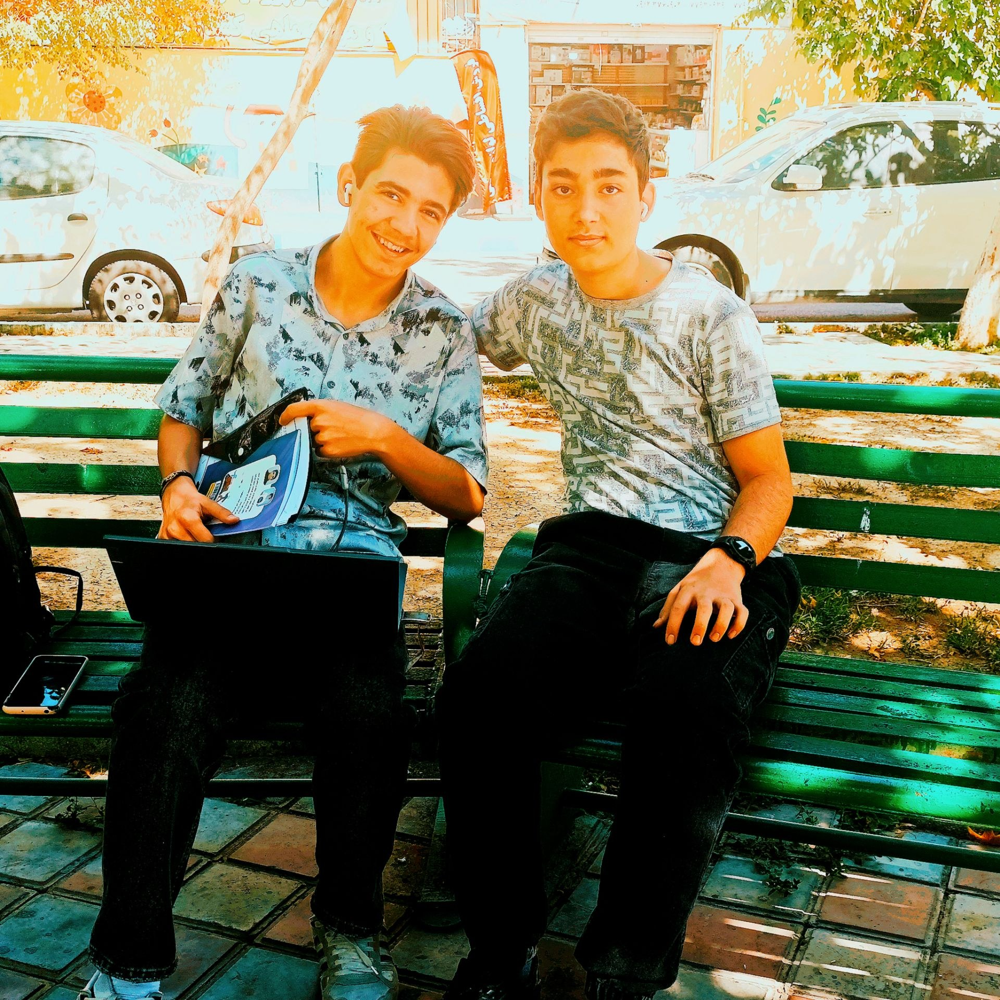</a>

[View / download](https://raw.githubusercontent.com/FarlandGame/Personal-Portfolio/main/images/personal-010.jpg)

These park-bench photographs mark an important moment in my friendship and collaboration with Ali Dehghannejad, known as Alivexor. Ali is from Tehran, and today I consider him my best friend and collaborator. I was in tenth grade, around fifteen or sixteen, and Ali was around fifteen and one school year below me.

For THE APEX, our Minecraft story-server project, my mother, who is a lawyer, helped prepare a collaboration agreement. I travelled to Tehran so Ali and his father could sign it; we were teenagers and involved our families in the process. My uncle Siamak Nournezhad accompanied me. He was also taking my grandmother to see a doctor, and I joined the trip.

That day I met Ali’s father and his two younger brothers. We sat in a park and had banana milk. I had dressed up, and my uncle had styled my hair. These are more than just photographs on a bench to me: they are memories of an important friend and the work we wanted to build together.

## personal-011 · Personal & family memories

<a href="https://raw.githubusercontent.com/FarlandGame/Personal-Portfolio/main/images/personal-011.jpg">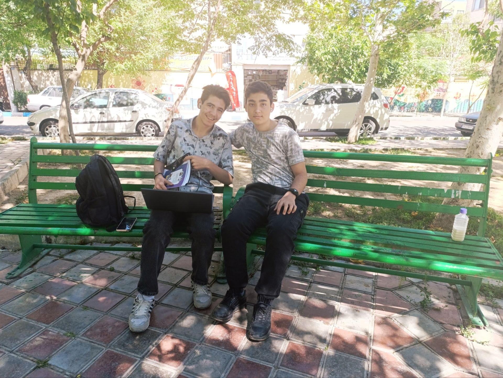</a>

[View / download](https://raw.githubusercontent.com/FarlandGame/Personal-Portfolio/main/images/personal-011.jpg)

These park-bench photographs mark an important moment in my friendship and collaboration with Ali Dehghannejad, known as Alivexor. Ali is from Tehran, and today I consider him my best friend and collaborator. I was in tenth grade, around fifteen or sixteen, and Ali was around fifteen and one school year below me.

For THE APEX, our Minecraft story-server project, my mother, who is a lawyer, helped prepare a collaboration agreement. I travelled to Tehran so Ali and his father could sign it; we were teenagers and involved our families in the process. My uncle Siamak Nournezhad accompanied me. He was also taking my grandmother to see a doctor, and I joined the trip.

That day I met Ali’s father and his two younger brothers. We sat in a park and had banana milk. I had dressed up, and my uncle had styled my hair. These are more than just photographs on a bench to me: they are memories of an important friend and the work we wanted to build together.

## personal-012 · Personal & family memories

<a href="https://raw.githubusercontent.com/FarlandGame/Personal-Portfolio/main/images/personal-012.jpg">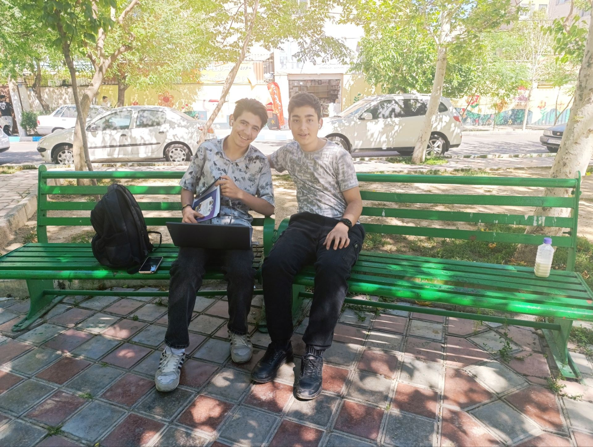</a>

[View / download](https://raw.githubusercontent.com/FarlandGame/Personal-Portfolio/main/images/personal-012.jpg)

These park-bench photographs mark an important moment in my friendship and collaboration with Ali Dehghannejad, known as Alivexor. Ali is from Tehran, and today I consider him my best friend and collaborator. I was in tenth grade, around fifteen or sixteen, and Ali was around fifteen and one school year below me.

For THE APEX, our Minecraft story-server project, my mother, who is a lawyer, helped prepare a collaboration agreement. I travelled to Tehran so Ali and his father could sign it; we were teenagers and involved our families in the process. My uncle Siamak Nournezhad accompanied me. He was also taking my grandmother to see a doctor, and I joined the trip.

That day I met Ali’s father and his two younger brothers. We sat in a park and had banana milk. I had dressed up, and my uncle had styled my hair. These are more than just photographs on a bench to me: they are memories of an important friend and the work we wanted to build together.

## personal-013 · Personal & family memories

<a href="https://raw.githubusercontent.com/FarlandGame/Personal-Portfolio/main/images/personal-013.jpg">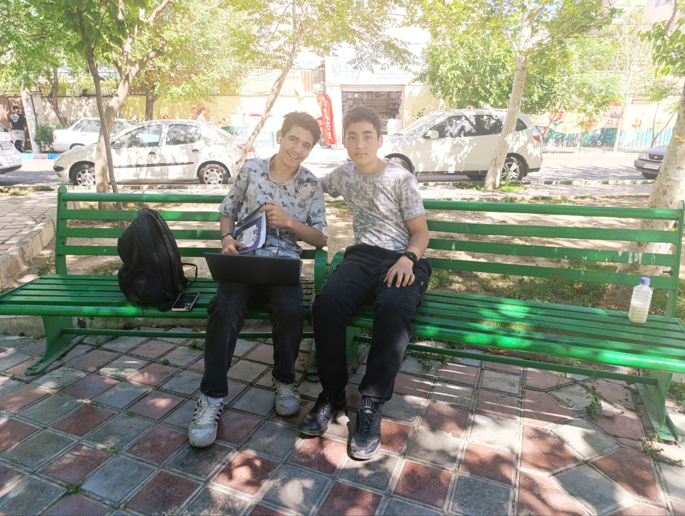</a>

[View / download](https://raw.githubusercontent.com/FarlandGame/Personal-Portfolio/main/images/personal-013.jpg)

These park-bench photographs mark an important moment in my friendship and collaboration with Ali Dehghannejad, known as Alivexor. Ali is from Tehran, and today I consider him my best friend and collaborator. I was in tenth grade, around fifteen or sixteen, and Ali was around fifteen and one school year below me.

For THE APEX, our Minecraft story-server project, my mother, who is a lawyer, helped prepare a collaboration agreement. I travelled to Tehran so Ali and his father could sign it; we were teenagers and involved our families in the process. My uncle Siamak Nournezhad accompanied me. He was also taking my grandmother to see a doctor, and I joined the trip.

That day I met Ali’s father and his two younger brothers. We sat in a park and had banana milk. I had dressed up, and my uncle had styled my hair. These are more than just photographs on a bench to me: they are memories of an important friend and the work we wanted to build together.

## personal-014 · Personal & family memories

<a href="https://raw.githubusercontent.com/FarlandGame/Personal-Portfolio/main/images/personal-014.jpg">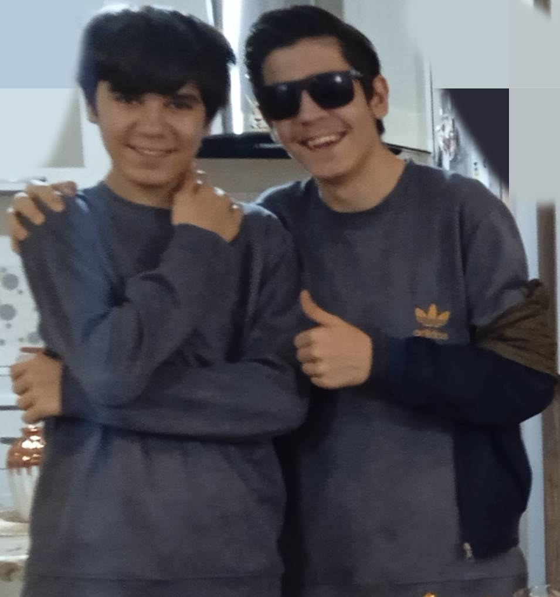</a>

[View / download](https://raw.githubusercontent.com/FarlandGame/Personal-Portfolio/main/images/personal-014.jpg)

This photograph was taken at home at the turn of the year, on the first day of Nowruz 1405 in the Iranian calendar. My maternal uncle Sajjad came over and took these pictures of us. I am the one wearing sunglasses; the person beside me without glasses is my twin brother Armiya.

## personal-015 · Personal & family memories

<a href="https://raw.githubusercontent.com/FarlandGame/Personal-Portfolio/main/images/personal-015.jpg">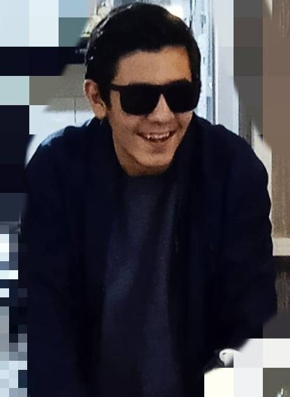</a>

[View / download](https://raw.githubusercontent.com/FarlandGame/Personal-Portfolio/main/images/personal-015.jpg)

My maternal uncle Sajjad took this photograph at our home at the turn of the year, on the first day of Nowruz 1405 in the Iranian calendar. I am wearing sunglasses. It belongs to the same New Year visit as photograph personal-014.

## personal-016 · Personal & family memories

<a href="https://raw.githubusercontent.com/FarlandGame/Personal-Portfolio/main/images/personal-016.jpg">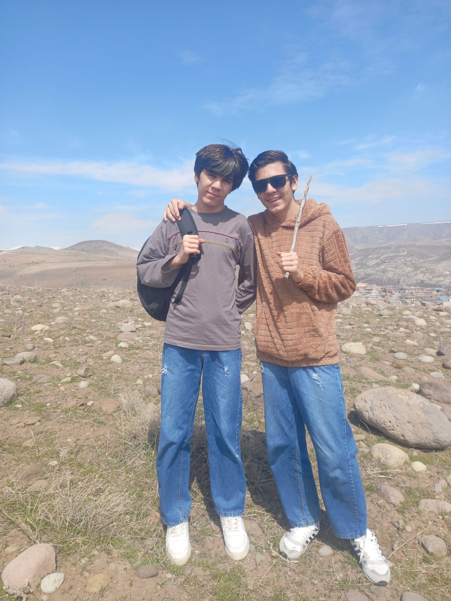</a>

[View / download](https://raw.githubusercontent.com/FarlandGame/Personal-Portfolio/main/images/personal-016.jpg)

This photograph is from Sizdah Bedar, the thirteenth day of Nowruz 1405 in the Iranian calendar. We went to the dam near Maragheh with my father and his extended family: my two aunts, uncle and his wife, grandmother, my father’s maternal uncle Masoud and his family, cousins and other relatives.

My father, my twin brother and I went up the mountainside, and my father took this photograph of us. Once again, I am the one wearing sunglasses; the other person is my brother Armiya.

## personal-017 · Personal & family memories

<a href="https://raw.githubusercontent.com/FarlandGame/Personal-Portfolio/main/images/personal-017.jpg">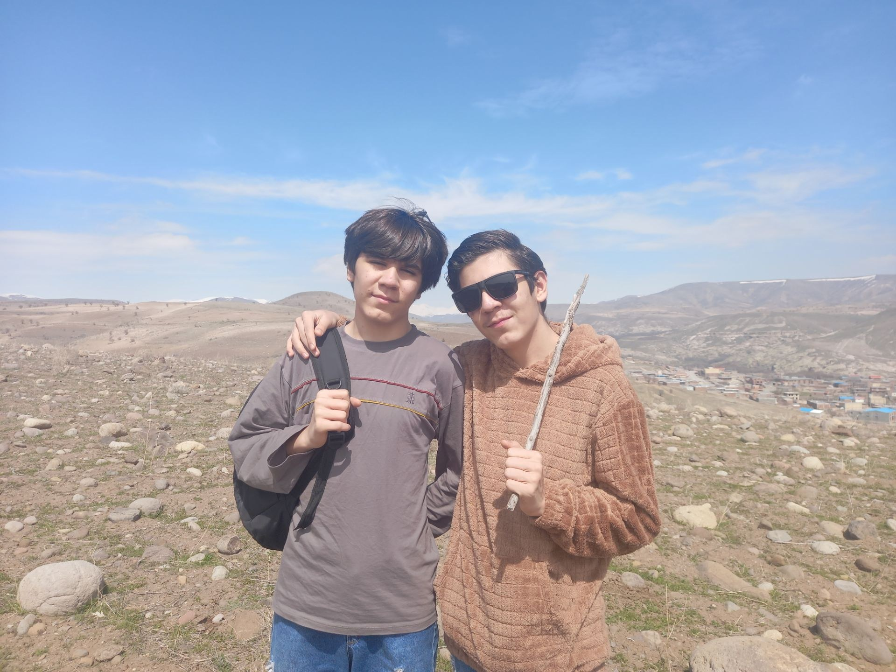</a>

[View / download](https://raw.githubusercontent.com/FarlandGame/Personal-Portfolio/main/images/personal-017.jpg)

This photograph is from Sizdah Bedar, the thirteenth day of Nowruz 1405 in the Iranian calendar. We went to the dam near Maragheh with my father and his extended family: my two aunts, uncle and his wife, grandmother, my father’s maternal uncle Masoud and his family, cousins and other relatives.

My father, my twin brother and I went up the mountainside, and my father took this photograph of us. Once again, I am the one wearing sunglasses; the other person is my brother Armiya.

## personal-018 · Personal & family memories

<a href="https://raw.githubusercontent.com/FarlandGame/Personal-Portfolio/main/images/personal-018.jpg">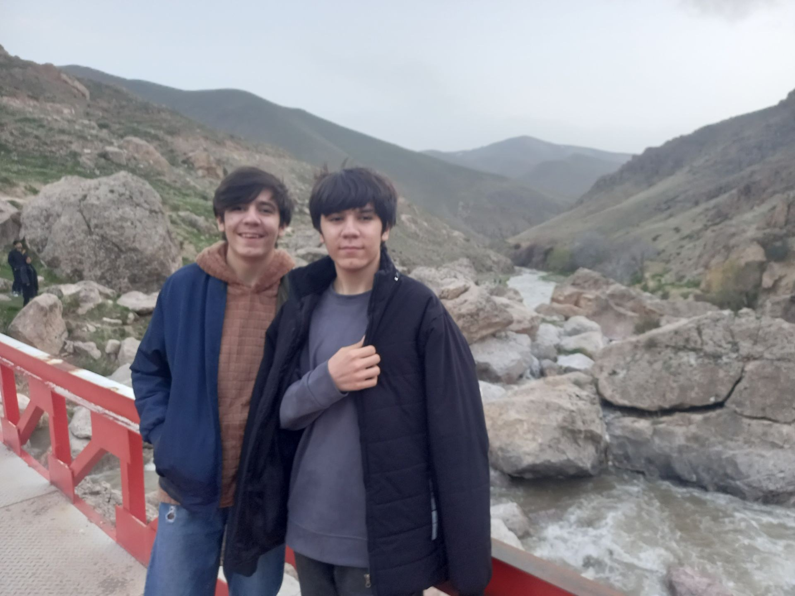</a>

[View / download](https://raw.githubusercontent.com/FarlandGame/Personal-Portfolio/main/images/personal-018.jpg)

These photographs were taken about two weeks after Sizdah Bedar in Nowruz 1405. We went to a high mountain with my father, and he took these pictures on a bridge during that outing.

## personal-019 · Personal & family memories

<a href="https://raw.githubusercontent.com/FarlandGame/Personal-Portfolio/main/images/personal-019.jpg">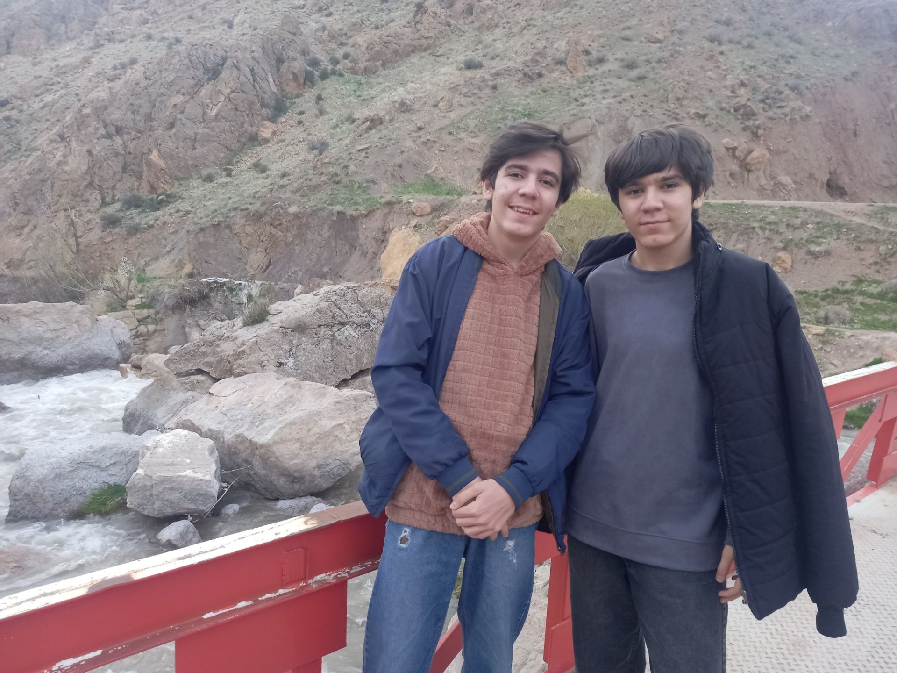</a>

[View / download](https://raw.githubusercontent.com/FarlandGame/Personal-Portfolio/main/images/personal-019.jpg)

These photographs were taken about two weeks after Sizdah Bedar in Nowruz 1405. We went to a high mountain with my father, and he took these pictures on a bridge during that outing.

## personal-020 · Portrait edits

<a href="https://raw.githubusercontent.com/FarlandGame/Personal-Portfolio/main/images/personal-020.jpg">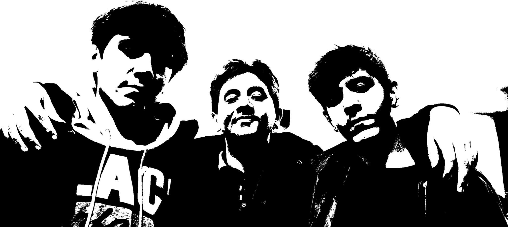</a>

[View / download](https://raw.githubusercontent.com/FarlandGame/Personal-Portfolio/main/images/personal-020.jpg)

This image belongs to a series from a rainy day at school. I think it was early Shahrivar, though I am not sure of the exact date. I had brought my earbuds and was listening to music in the schoolyard during the storm, imagining myself as a powerful character. I came back into class with wet hair.

My friend Ashkan Mohammad Alipour took photographs on his phone of my brother, Amir Hossein Sadegh and me. Ashkan is also my editor and helps with After Effects work and Blender animations. At the time I called Amir Hossein “SenpaiXD”; he often changes his artistic name because he dislikes repeating the same thing. Ashkan and our friend Sadra Shahi are not in this series. I later edited some of these images myself into a darker black-and-white style.

The day became much harder immediately after the photographs. As I remember it, the school administrator, Mr Azizi, took my phone and earbuds and kept them until the following day. I was deeply upset and cried. These pictures hold both the excitement of that moment with my friends and a difficult memory from later that day.

## personal-021 · Portrait edits

<a href="https://raw.githubusercontent.com/FarlandGame/Personal-Portfolio/main/images/personal-021.jpg">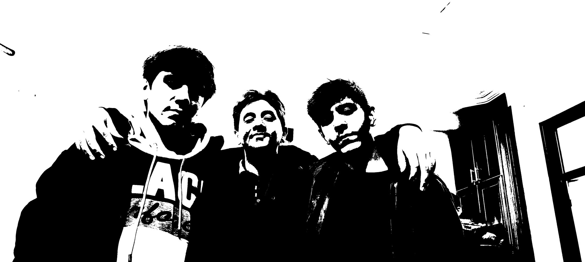</a>

[View / download](https://raw.githubusercontent.com/FarlandGame/Personal-Portfolio/main/images/personal-021.jpg)

This image belongs to a series from a rainy day at school. I think it was early Shahrivar, though I am not sure of the exact date. I had brought my earbuds and was listening to music in the schoolyard during the storm, imagining myself as a powerful character. I came back into class with wet hair.

My friend Ashkan Mohammad Alipour took photographs on his phone of my brother, Amir Hossein Sadegh and me. Ashkan is also my editor and helps with After Effects work and Blender animations. At the time I called Amir Hossein “SenpaiXD”; he often changes his artistic name because he dislikes repeating the same thing. Ashkan and our friend Sadra Shahi are not in this series. I later edited some of these images myself into a darker black-and-white style.

The day became much harder immediately after the photographs. As I remember it, the school administrator, Mr Azizi, took my phone and earbuds and kept them until the following day. I was deeply upset and cried. These pictures hold both the excitement of that moment with my friends and a difficult memory from later that day.

## personal-022 · Personal & family memories

<a href="https://raw.githubusercontent.com/FarlandGame/Personal-Portfolio/main/images/personal-022.jpg">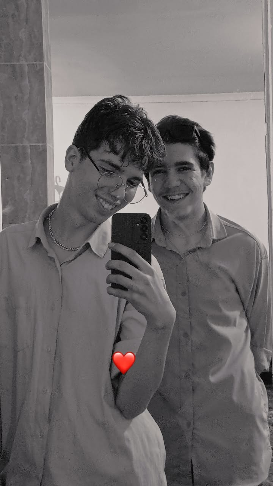</a>

[View / download](https://raw.githubusercontent.com/FarlandGame/Personal-Portfolio/main/images/personal-022.jpg)

These photographs are from my first visit to my friend Ali Heydari’s home. Ali is one school year ahead of me. I am the one wearing sunglasses and a cream-coloured outfit; Ali is wearing glasses. My twin brother Armiya did not come with us, so it was just the two of us playing games and talking. I had a wonderful time and hope we can do it again.

I remember the visit as roughly five to nine in the evening, though I am not certain of the times. I was struggling with a severe stomach upset that day and tried to manage it during the visit. After I got home, I took medicine, rested and felt better.

## personal-023 · Personal & family memories

<a href="https://raw.githubusercontent.com/FarlandGame/Personal-Portfolio/main/images/personal-023.jpg">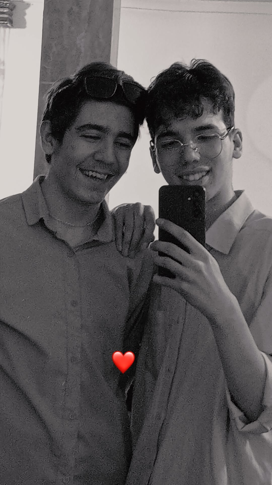</a>

[View / download](https://raw.githubusercontent.com/FarlandGame/Personal-Portfolio/main/images/personal-023.jpg)

These photographs are from my first visit to my friend Ali Heydari’s home. Ali is one school year ahead of me. I am the one wearing sunglasses and a cream-coloured outfit; Ali is wearing glasses. My twin brother Armiya did not come with us, so it was just the two of us playing games and talking. I had a wonderful time and hope we can do it again.

I remember the visit as roughly five to nine in the evening, though I am not certain of the times. I was struggling with a severe stomach upset that day and tried to manage it during the visit. After I got home, I took medicine, rested and felt better.

## personal-024 · Personal & family memories

<a href="https://raw.githubusercontent.com/FarlandGame/Personal-Portfolio/main/images/personal-024.jpg">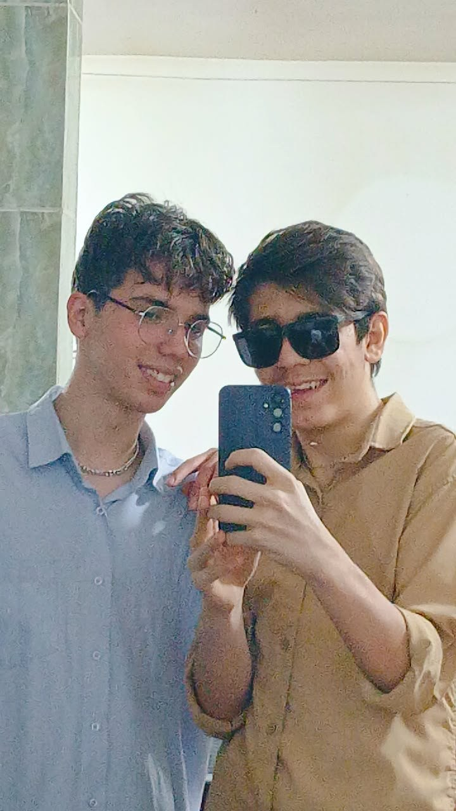</a>

[View / download](https://raw.githubusercontent.com/FarlandGame/Personal-Portfolio/main/images/personal-024.jpg)

These photographs are from my first visit to my friend Ali Heydari’s home. Ali is one school year ahead of me. I am the one wearing sunglasses and a cream-coloured outfit; Ali is wearing glasses. My twin brother Armiya did not come with us, so it was just the two of us playing games and talking. I had a wonderful time and hope we can do it again.

I remember the visit as roughly five to nine in the evening, though I am not certain of the times. I was struggling with a severe stomach upset that day and tried to manage it during the visit. After I got home, I took medicine, rested and felt better.

## personal-025 · Personal & family memories

[View / download](https://raw.githubusercontent.com/FarlandGame/Personal-Portfolio/main/images/personal-025.jpg)

This is me at about one year and a few months old, close to turning two. I liked wearing my father’s oversized shirt. Much later I photographed this printed album picture with my phone; that is why the supplied image is soft and has a bright reflection.

[AI-restored version · glare removed and clarity enhanced](https://raw.githubusercontent.com/FarlandGame/Personal-Portfolio/main/restorations/personal-025-ai-restored.png)

## personal-026 · Personal & family memories

<a href="https://raw.githubusercontent.com/FarlandGame/Personal-Portfolio/main/images/personal-026.jpg">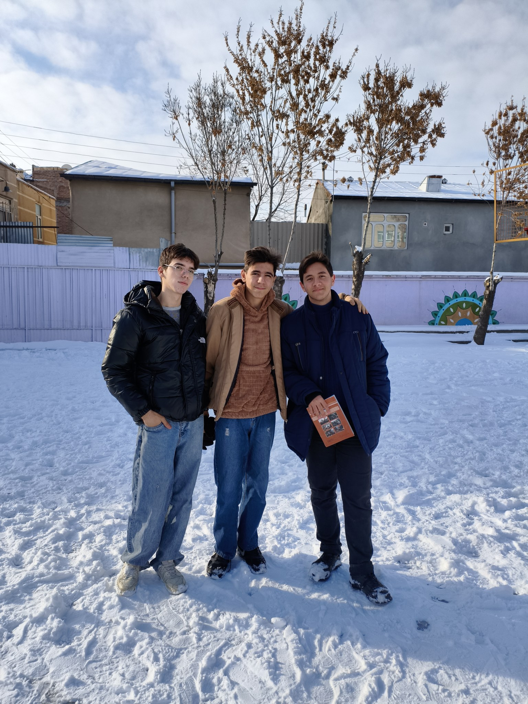</a>

[View / download](https://raw.githubusercontent.com/FarlandGame/Personal-Portfolio/main/images/personal-026.jpg)

This photograph is from Dey 1404 in the Iranian calendar, during our first-term school exams. It was a beautiful snowy day. I am in the middle; Amir Hossein Sadegh is on the right of the photograph, and Ali Heydari is on the left.

I had not styled my hair and was wearing a hat. When I took it off, my hair was a mess. My friends suggested taking photographs, and I agreed. Armiya and Ashkan took the pictures of us. I remember this as the day of our mathematics exam.

## personal-027 · Personal & family memories

<a href="https://raw.githubusercontent.com/FarlandGame/Personal-Portfolio/main/images/personal-027.jpg">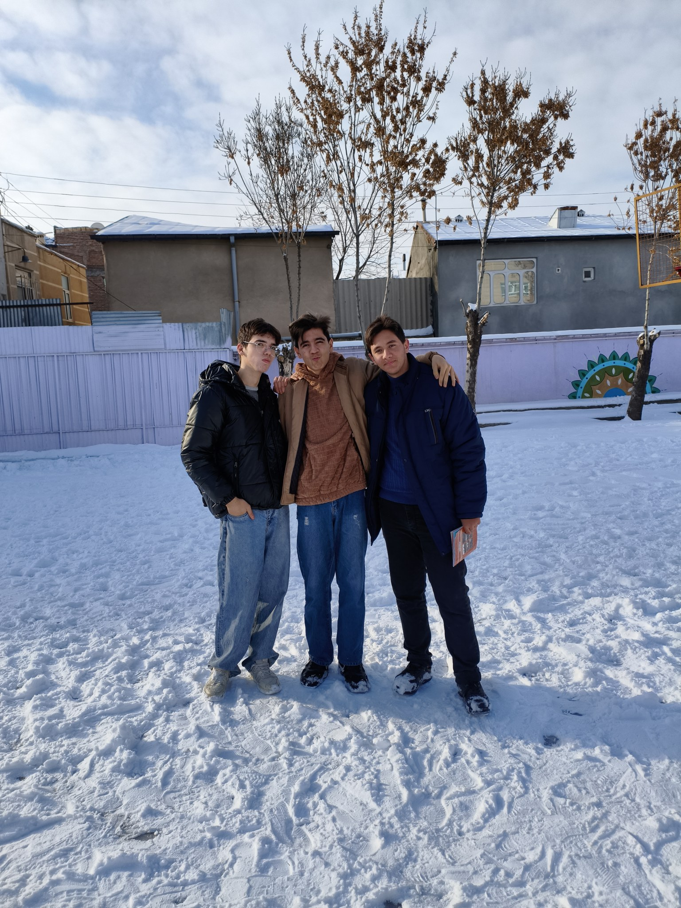</a>

[View / download](https://raw.githubusercontent.com/FarlandGame/Personal-Portfolio/main/images/personal-027.jpg)

This photograph is from Dey 1404 in the Iranian calendar, during our first-term school exams. It was a beautiful snowy day. I am in the middle; Amir Hossein Sadegh is on the right of the photograph, and Ali Heydari is on the left.

I had not styled my hair and was wearing a hat. When I took it off, my hair was a mess. My friends suggested taking photographs, and I agreed. Armiya and Ashkan took the pictures of us. I remember this as the day of our mathematics exam.

## personal-028 · Personal & family memories

<a href="https://raw.githubusercontent.com/FarlandGame/Personal-Portfolio/main/images/personal-028.jpg">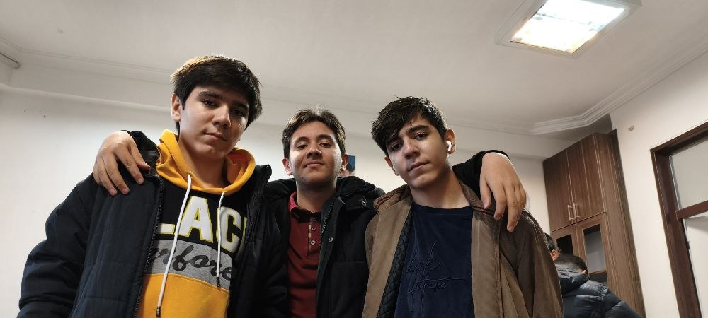</a>

[View / download](https://raw.githubusercontent.com/FarlandGame/Personal-Portfolio/main/images/personal-028.jpg)

This image belongs to a series from a rainy day at school. I think it was early Shahrivar, though I am not sure of the exact date. I had brought my earbuds and was listening to music in the schoolyard during the storm, imagining myself as a powerful character. I came back into class with wet hair.

My friend Ashkan Mohammad Alipour took photographs on his phone of my brother, Amir Hossein Sadegh and me. Ashkan is also my editor and helps with After Effects work and Blender animations. At the time I called Amir Hossein “SenpaiXD”; he often changes his artistic name because he dislikes repeating the same thing. Ashkan and our friend Sadra Shahi are not in this series. I later edited some of these images myself into a darker black-and-white style.

The day became much harder immediately after the photographs. As I remember it, the school administrator, Mr Azizi, took my phone and earbuds and kept them until the following day. I was deeply upset and cried. These pictures hold both the excitement of that moment with my friends and a difficult memory from later that day.

## personal-029 · Personal & family memories

<a href="https://raw.githubusercontent.com/FarlandGame/Personal-Portfolio/main/images/personal-029.jpg">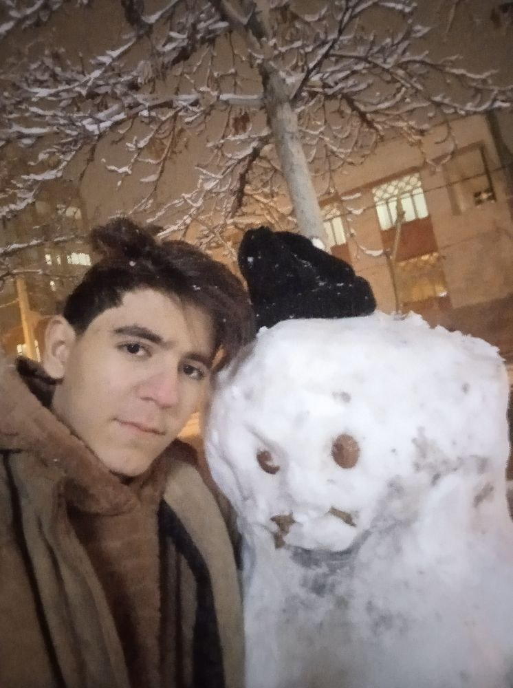</a>

[View / download](https://raw.githubusercontent.com/FarlandGame/Personal-Portfolio/main/images/personal-029.jpg)

These photographs are from the school-exam period in Dey 1404 in the Iranian calendar. I remember snow falling the day after the mathematics exam associated with photograph personal-027. That night I went outside our home and spent hours working hard to build this snowman, then took photographs of it.

As I remember it, two children from our neighbourhood damaged it the next day. I was upset to see the result of so many hours of effort disappear. These pictures are the memory I kept of the snowman I had worked so hard to make.

## personal-030 · Personal & family memories

<a href="https://raw.githubusercontent.com/FarlandGame/Personal-Portfolio/main/images/personal-030.jpg">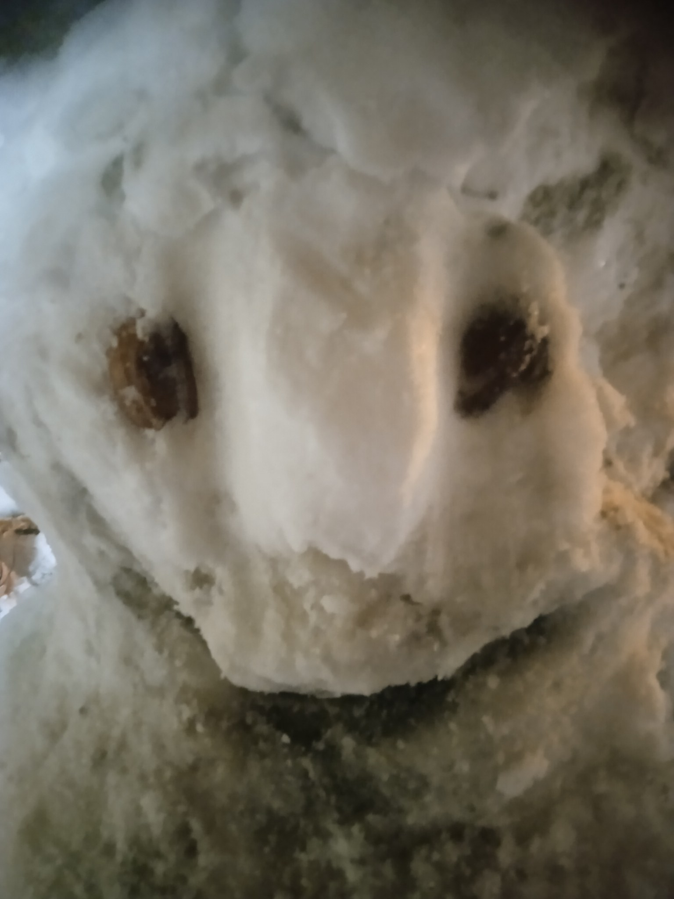</a>

[View / download](https://raw.githubusercontent.com/FarlandGame/Personal-Portfolio/main/images/personal-030.jpg)

These photographs are from the school-exam period in Dey 1404 in the Iranian calendar. I remember snow falling the day after the mathematics exam associated with photograph personal-027. That night I went outside our home and spent hours working hard to build this snowman, then took photographs of it.

As I remember it, two children from our neighbourhood damaged it the next day. I was upset to see the result of so many hours of effort disappear. These pictures are the memory I kept of the snowman I had worked so hard to make.

## personal-031 · Personal & family memories

<a href="https://raw.githubusercontent.com/FarlandGame/Personal-Portfolio/main/images/personal-031.jpg">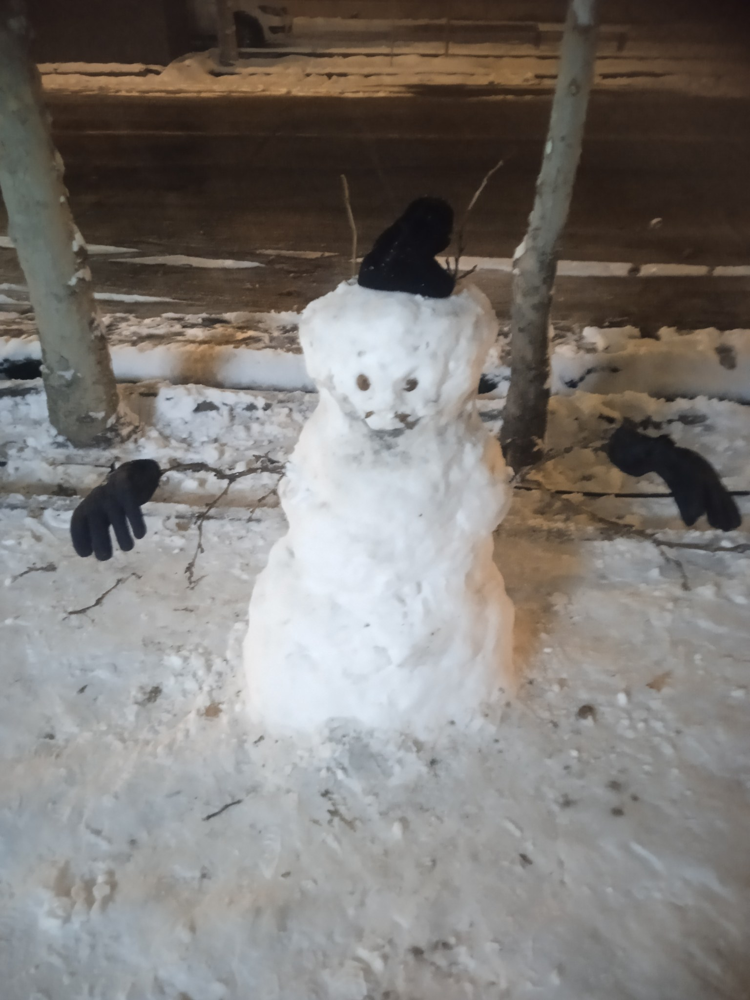</a>

[View / download](https://raw.githubusercontent.com/FarlandGame/Personal-Portfolio/main/images/personal-031.jpg)

These photographs are from the school-exam period in Dey 1404 in the Iranian calendar. I remember snow falling the day after the mathematics exam associated with photograph personal-027. That night I went outside our home and spent hours working hard to build this snowman, then took photographs of it.

As I remember it, two children from our neighbourhood damaged it the next day. I was upset to see the result of so many hours of effort disappear. These pictures are the memory I kept of the snowman I had worked so hard to make.

## personal-032 · Personal & family memories

<a href="https://raw.githubusercontent.com/FarlandGame/Personal-Portfolio/main/images/personal-032.jpg">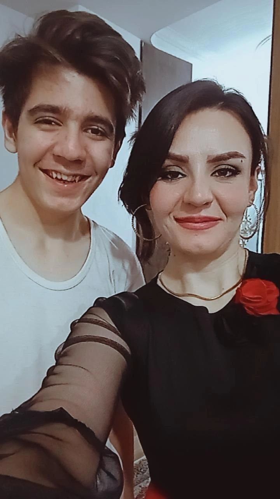</a>

[View / download](https://raw.githubusercontent.com/FarlandGame/Personal-Portfolio/main/images/personal-032.jpg)

This is a selfie with my mother at home. She said, “Come, let’s take a picture together.” She is wearing black with a red flower. A simple moment together at home.

## personal-033 · Book memories

<a href="https://raw.githubusercontent.com/FarlandGame/Personal-Portfolio/main/images/personal-033.jpg">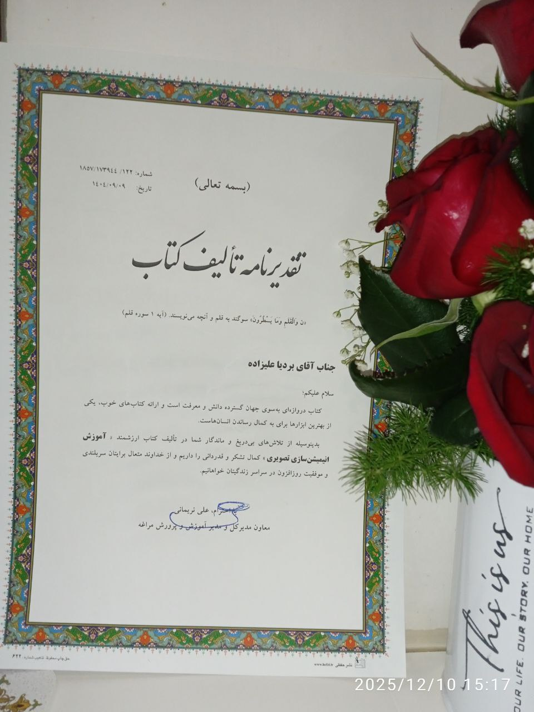</a>

[View / download](https://raw.githubusercontent.com/FarlandGame/Personal-Portfolio/main/images/personal-033.jpg)

These photographs show the book-authorship appreciation certificate and the flowers from a day that meant a great deal to me. I had given the education department a copy of my book months earlier. When the authors’ recognition event finally came, I was told I was the only fifteen-year-old in the group and that perhaps I should not attend among the adults. I felt that having a young author should have been a reason to welcome me, and I insisted on going.

We went from school to the education department. I remember feeling overlooked on arrival and having to explain that I was an author. After roughly an hour of names being called, mine was called last. By then, as I remember it, some people had left and others were looking at their phones. I felt that the moment had passed without the attention I had hoped for. This is my personal memory of the day, rather than a claim about anyone’s intentions.

I remember receiving 500,000 tomans with the certificate. My book was priced at 350,000 tomans, and I had already given them a copy as a gift. In my disappointment I compared those figures: 150,000 tomans above the price of the book I had donated. To me, the recognition felt small compared with the work and anticipation behind it.

The bouquet made me happy. My uncle Siamak, who was there, bought it for me. My mother and Akhtar Amir Sadeghi—whom I call “Aziz”—were also present. My father could not come. My mother took these photographs that night. Alongside the disappointment, I remember the warmth of my family and the flowers.

Date note: I recall the event as late Dey 1404, close to Bahman. The photographed certificate itself is dated 1404/09/09; its printed date and my recollection of the ceremony date are kept separate pending clarification.

## personal-034 · Book memories

<a href="https://raw.githubusercontent.com/FarlandGame/Personal-Portfolio/main/images/personal-034.jpg">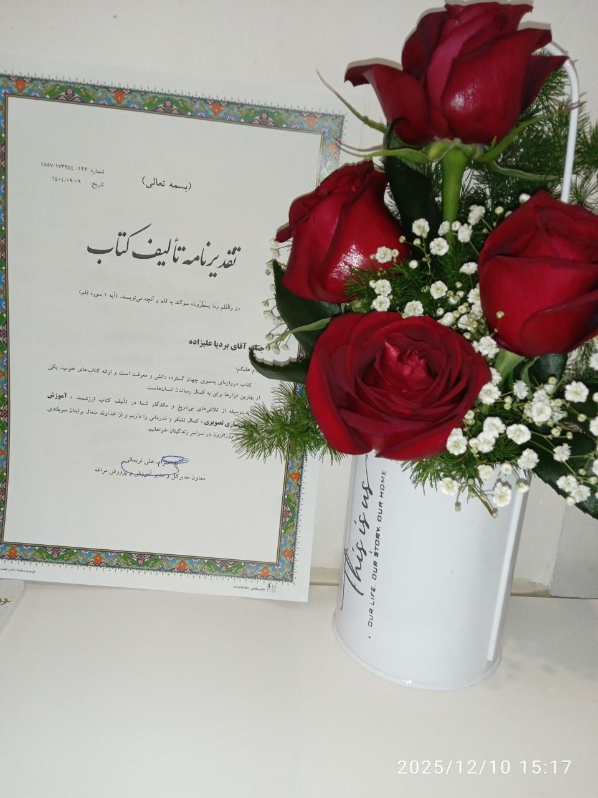</a>

[View / download](https://raw.githubusercontent.com/FarlandGame/Personal-Portfolio/main/images/personal-034.jpg)

These photographs show the book-authorship appreciation certificate and the flowers from a day that meant a great deal to me. I had given the education department a copy of my book months earlier. When the authors’ recognition event finally came, I was told I was the only fifteen-year-old in the group and that perhaps I should not attend among the adults. I felt that having a young author should have been a reason to welcome me, and I insisted on going.

We went from school to the education department. I remember feeling overlooked on arrival and having to explain that I was an author. After roughly an hour of names being called, mine was called last. By then, as I remember it, some people had left and others were looking at their phones. I felt that the moment had passed without the attention I had hoped for. This is my personal memory of the day, rather than a claim about anyone’s intentions.

I remember receiving 500,000 tomans with the certificate. My book was priced at 350,000 tomans, and I had already given them a copy as a gift. In my disappointment I compared those figures: 150,000 tomans above the price of the book I had donated. To me, the recognition felt small compared with the work and anticipation behind it.

The bouquet made me happy. My uncle Siamak, who was there, bought it for me. My mother and Akhtar Amir Sadeghi—whom I call “Aziz”—were also present. My father could not come. My mother took these photographs that night. Alongside the disappointment, I remember the warmth of my family and the flowers.

Date note: I recall the event as late Dey 1404, close to Bahman. The photographed certificate itself is dated 1404/09/09; its printed date and my recollection of the ceremony date are kept separate pending clarification.

## personal-035 · Personal & family memories

<a href="https://raw.githubusercontent.com/FarlandGame/Personal-Portfolio/main/images/personal-035.jpg">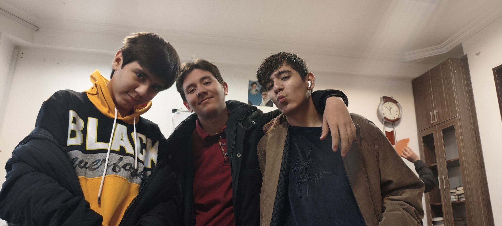</a>

[View / download](https://raw.githubusercontent.com/FarlandGame/Personal-Portfolio/main/images/personal-035.jpg)

This image belongs to a series from a rainy day at school. I think it was early Shahrivar, though I am not sure of the exact date. I had brought my earbuds and was listening to music in the schoolyard during the storm, imagining myself as a powerful character. I came back into class with wet hair.

My friend Ashkan Mohammad Alipour took photographs on his phone of my brother, Amir Hossein Sadegh and me. Ashkan is also my editor and helps with After Effects work and Blender animations. At the time I called Amir Hossein “SenpaiXD”; he often changes his artistic name because he dislikes repeating the same thing. Ashkan and our friend Sadra Shahi are not in this series. I later edited some of these images myself into a darker black-and-white style.

The day became much harder immediately after the photographs. As I remember it, the school administrator, Mr Azizi, took my phone and earbuds and kept them until the following day. I was deeply upset and cried. These pictures hold both the excitement of that moment with my friends and a difficult memory from later that day.

## personal-036 · Personal & family memories

<a href="https://raw.githubusercontent.com/FarlandGame/Personal-Portfolio/main/images/personal-036.jpg">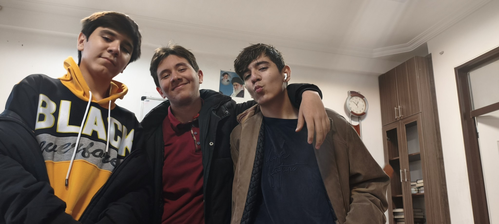</a>

[View / download](https://raw.githubusercontent.com/FarlandGame/Personal-Portfolio/main/images/personal-036.jpg)

This image belongs to a series from a rainy day at school. I think it was early Shahrivar, though I am not sure of the exact date. I had brought my earbuds and was listening to music in the schoolyard during the storm, imagining myself as a powerful character. I came back into class with wet hair.

My friend Ashkan Mohammad Alipour took photographs on his phone of my brother, Amir Hossein Sadegh and me. Ashkan is also my editor and helps with After Effects work and Blender animations. At the time I called Amir Hossein “SenpaiXD”; he often changes his artistic name because he dislikes repeating the same thing. Ashkan and our friend Sadra Shahi are not in this series. I later edited some of these images myself into a darker black-and-white style.

The day became much harder immediately after the photographs. As I remember it, the school administrator, Mr Azizi, took my phone and earbuds and kept them until the following day. I was deeply upset and cried. These pictures hold both the excitement of that moment with my friends and a difficult memory from later that day.

## personal-037 · Personal & family memories

<a href="https://raw.githubusercontent.com/FarlandGame/Personal-Portfolio/main/images/personal-037.jpg">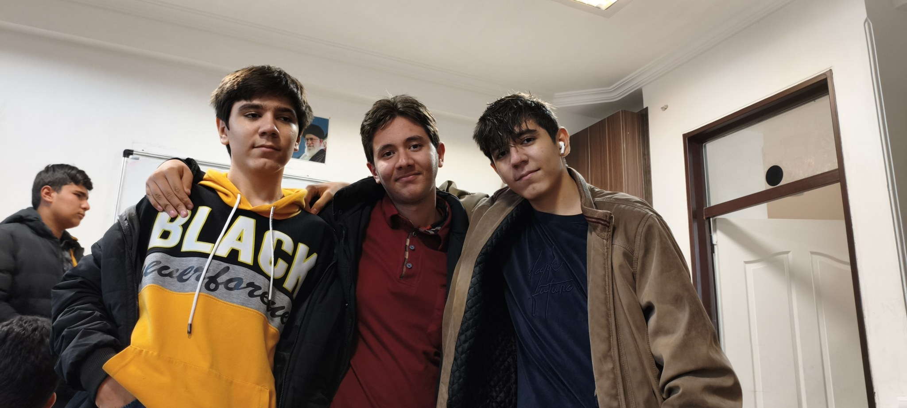</a>

[View / download](https://raw.githubusercontent.com/FarlandGame/Personal-Portfolio/main/images/personal-037.jpg)

This image belongs to a series from a rainy day at school. I think it was early Shahrivar, though I am not sure of the exact date. I had brought my earbuds and was listening to music in the schoolyard during the storm, imagining myself as a powerful character. I came back into class with wet hair.

My friend Ashkan Mohammad Alipour took photographs on his phone of my brother, Amir Hossein Sadegh and me. Ashkan is also my editor and helps with After Effects work and Blender animations. At the time I called Amir Hossein “SenpaiXD”; he often changes his artistic name because he dislikes repeating the same thing. Ashkan and our friend Sadra Shahi are not in this series. I later edited some of these images myself into a darker black-and-white style.

The day became much harder immediately after the photographs. As I remember it, the school administrator, Mr Azizi, took my phone and earbuds and kept them until the following day. I was deeply upset and cried. These pictures hold both the excitement of that moment with my friends and a difficult memory from later that day.

## personal-038 · Personal & family memories

<a href="https://raw.githubusercontent.com/FarlandGame/Personal-Portfolio/main/images/personal-038.jpg">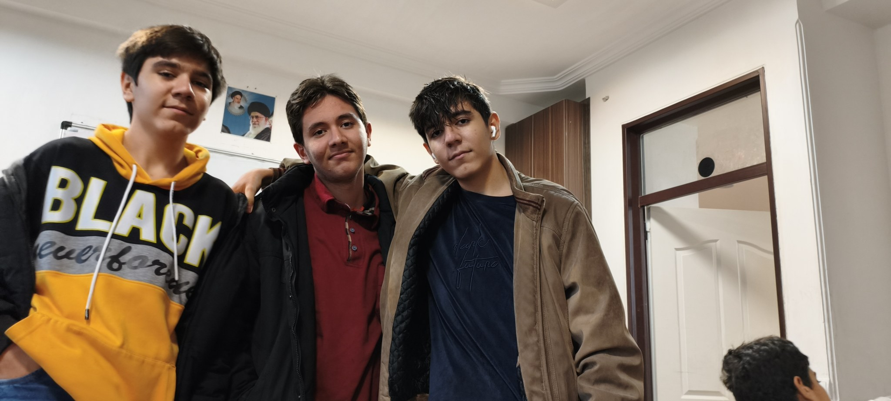</a>

[View / download](https://raw.githubusercontent.com/FarlandGame/Personal-Portfolio/main/images/personal-038.jpg)

This image belongs to a series from a rainy day at school. I think it was early Shahrivar, though I am not sure of the exact date. I had brought my earbuds and was listening to music in the schoolyard during the storm, imagining myself as a powerful character. I came back into class with wet hair.

My friend Ashkan Mohammad Alipour took photographs on his phone of my brother, Amir Hossein Sadegh and me. Ashkan is also my editor and helps with After Effects work and Blender animations. At the time I called Amir Hossein “SenpaiXD”; he often changes his artistic name because he dislikes repeating the same thing. Ashkan and our friend Sadra Shahi are not in this series. I later edited some of these images myself into a darker black-and-white style.

The day became much harder immediately after the photographs. As I remember it, the school administrator, Mr Azizi, took my phone and earbuds and kept them until the following day. I was deeply upset and cried. These pictures hold both the excitement of that moment with my friends and a difficult memory from later that day.

## personal-039 · Personal & family memories

<a href="https://raw.githubusercontent.com/FarlandGame/Personal-Portfolio/main/images/personal-039.jpg">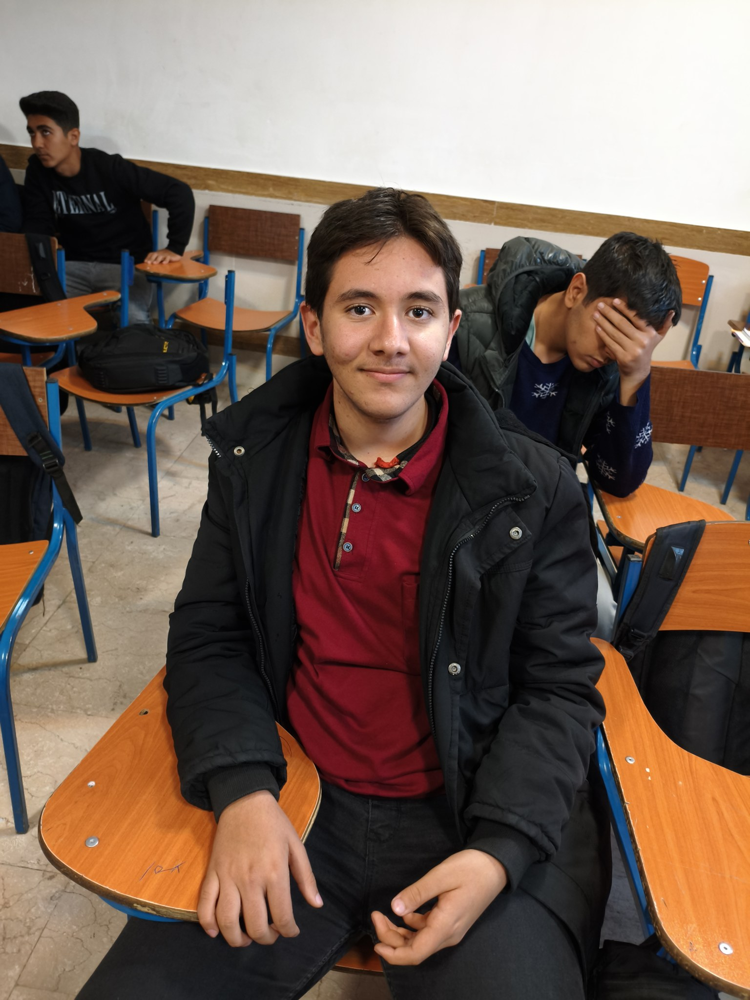</a>

[View / download](https://raw.githubusercontent.com/FarlandGame/Personal-Portfolio/main/images/personal-039.jpg)

This image belongs to a series from a rainy day at school. I think it was early Shahrivar, though I am not sure of the exact date. I had brought my earbuds and was listening to music in the schoolyard during the storm, imagining myself as a powerful character. I came back into class with wet hair.

My friend Ashkan Mohammad Alipour took photographs on his phone of my brother, Amir Hossein Sadegh and me. Ashkan is also my editor and helps with After Effects work and Blender animations. At the time I called Amir Hossein “SenpaiXD”; he often changes his artistic name because he dislikes repeating the same thing. Ashkan and our friend Sadra Shahi are not in this series. I later edited some of these images myself into a darker black-and-white style.

The day became much harder immediately after the photographs. As I remember it, the school administrator, Mr Azizi, took my phone and earbuds and kept them until the following day. I was deeply upset and cried. These pictures hold both the excitement of that moment with my friends and a difficult memory from later that day.

## personal-040 · Personal & family memories

<a href="https://raw.githubusercontent.com/FarlandGame/Personal-Portfolio/main/images/personal-040.jpg">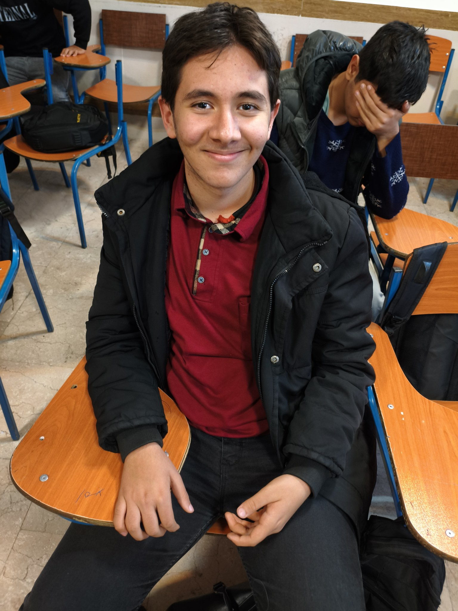</a>

[View / download](https://raw.githubusercontent.com/FarlandGame/Personal-Portfolio/main/images/personal-040.jpg)

This image belongs to a series from a rainy day at school. I think it was early Shahrivar, though I am not sure of the exact date. I had brought my earbuds and was listening to music in the schoolyard during the storm, imagining myself as a powerful character. I came back into class with wet hair.

My friend Ashkan Mohammad Alipour took photographs on his phone of my brother, Amir Hossein Sadegh and me. Ashkan is also my editor and helps with After Effects work and Blender animations. At the time I called Amir Hossein “SenpaiXD”; he often changes his artistic name because he dislikes repeating the same thing. Ashkan and our friend Sadra Shahi are not in this series. I later edited some of these images myself into a darker black-and-white style.

The day became much harder immediately after the photographs. As I remember it, the school administrator, Mr Azizi, took my phone and earbuds and kept them until the following day. I was deeply upset and cried. These pictures hold both the excitement of that moment with my friends and a difficult memory from later that day.

## personal-041 · Book memories

<a href="https://raw.githubusercontent.com/FarlandGame/Personal-Portfolio/main/images/personal-041.jpg">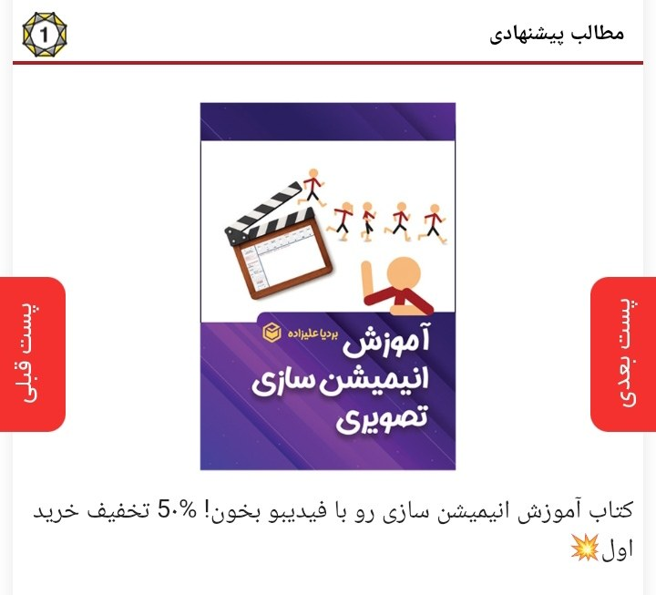</a>

[View / download](https://raw.githubusercontent.com/FarlandGame/Personal-Portfolio/main/images/personal-041.jpg)

I saved this screenshot when I was seeing my book appear on websites around its publication. I remember Digikala promoting the book online at that time, and wanted to keep a record of seeing it featured. The image shows the cover of Visual Animation Tutorial in a recommended-posts section, alongside an introduction and a five-percent first-purchase discount. It is a memory of the book becoming visible beyond my own pages; the offer shown belongs to that saved moment.

## personal-042 · Book memories

<a href="https://raw.githubusercontent.com/FarlandGame/Personal-Portfolio/main/images/personal-042.jpg">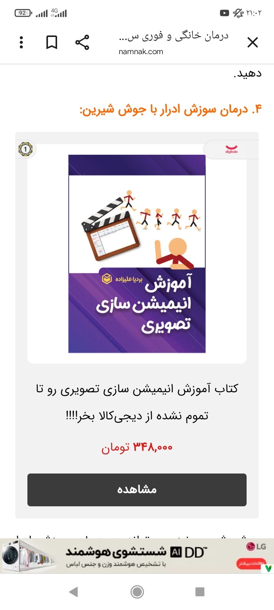</a>

[View / download](https://raw.githubusercontent.com/FarlandGame/Personal-Portfolio/main/images/personal-042.jpg)

This is another screenshot from the period when I was seeing my book featured online. It belongs to the same memory as photograph personal-041. I remember Digikala promoting the book around publication, and I saved these screenshots as a record of seeing it introduced on websites.

## personal-043 · Personal & family memories

<a href="https://raw.githubusercontent.com/FarlandGame/Personal-Portfolio/main/images/personal-043.jpg">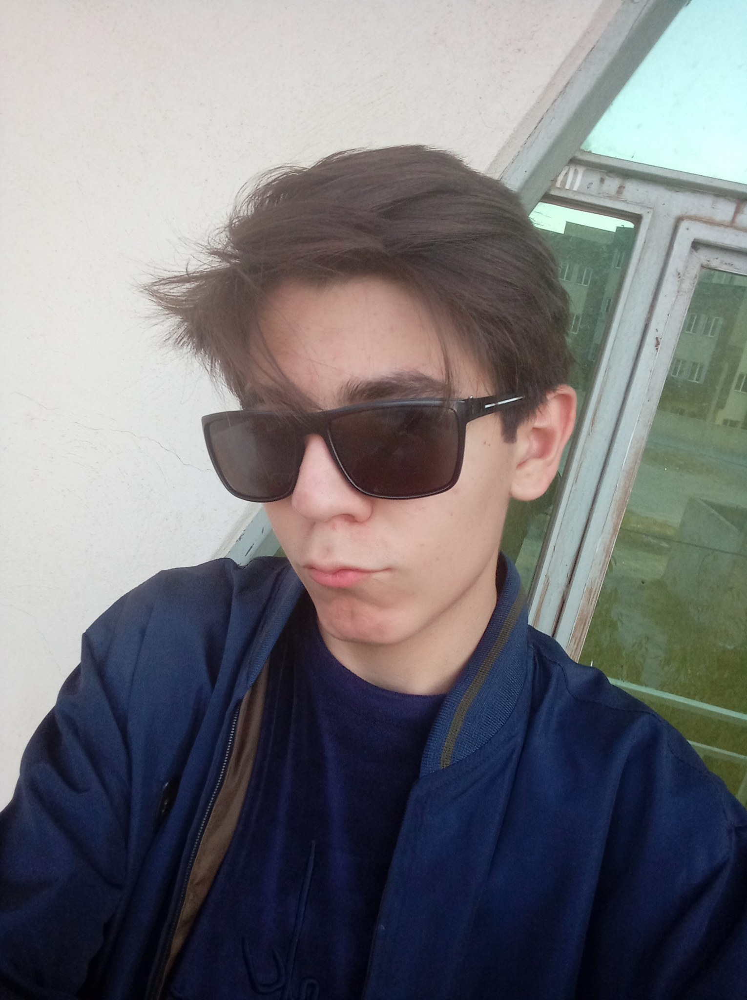</a>

[View / download](https://raw.githubusercontent.com/FarlandGame/Personal-Portfolio/main/images/personal-043.jpg)

I took these casual photographs on the balcony at Aziz’s home because my hairstyle caught my attention. I remember that I actually wanted to send them to someone, although I no longer remember who. A small everyday moment that stayed in my gallery.

## personal-044 · Personal & family memories

<a href="https://raw.githubusercontent.com/FarlandGame/Personal-Portfolio/main/images/personal-044.jpg">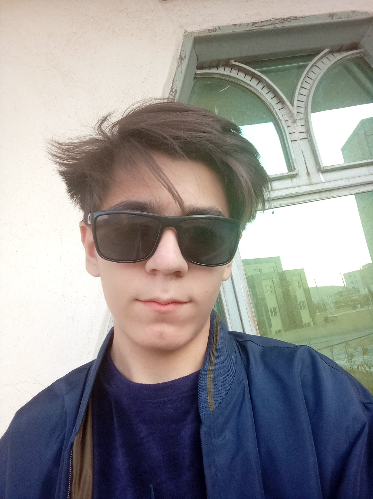</a>

[View / download](https://raw.githubusercontent.com/FarlandGame/Personal-Portfolio/main/images/personal-044.jpg)

I took these casual photographs on the balcony at Aziz’s home because my hairstyle caught my attention. I remember that I actually wanted to send them to someone, although I no longer remember who. A small everyday moment that stayed in my gallery.

## personal-045 · Personal & family memories

<a href="https://raw.githubusercontent.com/FarlandGame/Personal-Portfolio/main/images/personal-045.jpg">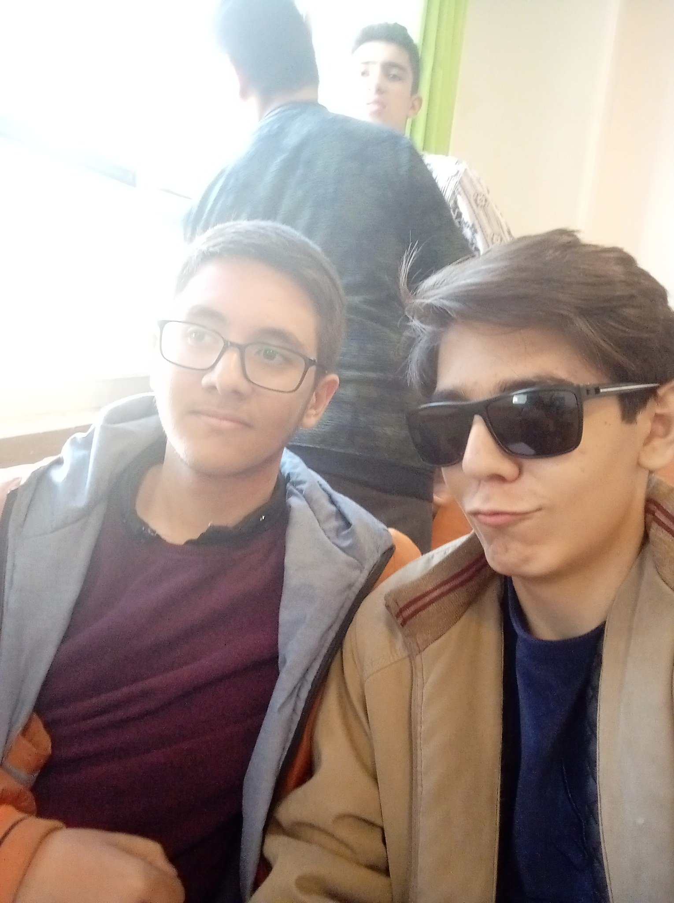</a>

[View / download](https://raw.githubusercontent.com/FarlandGame/Personal-Portfolio/main/images/personal-045.jpg)

This is a school photograph of Amir Hossein Sadegh and me from tenth grade. Amir suggested taking a photograph together as a keepsake, so I took one. The sunlight made his face less clear in the picture than we would have liked, but the photograph remains a memory of that moment together.

## personal-047 · Personal & family memories

<a href="https://raw.githubusercontent.com/FarlandGame/Personal-Portfolio/main/images/personal-047.jpg">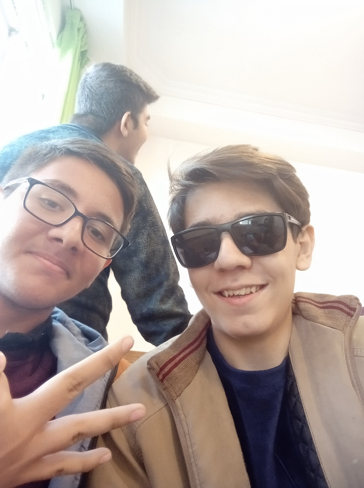</a>

[View / download](https://raw.githubusercontent.com/FarlandGame/Personal-Portfolio/main/images/personal-047.jpg)

This is a school photograph of Amir Hossein Sadegh and me from tenth grade. Amir suggested taking a photograph together as a keepsake, so I took one. The sunlight made his face less clear in the picture than we would have liked, but the photograph remains a memory of that moment together.

## personal-048 · Personal & family memories

<a href="https://raw.githubusercontent.com/FarlandGame/Personal-Portfolio/main/images/personal-048.jpg">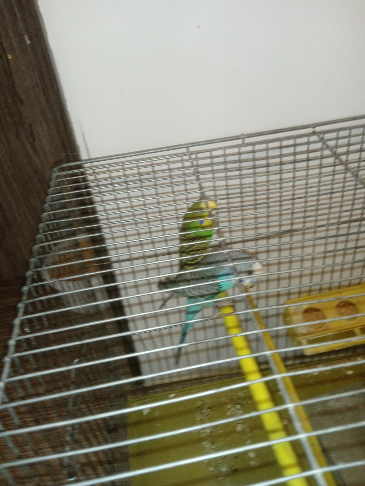</a>

[View / download](https://raw.githubusercontent.com/FarlandGame/Personal-Portfolio/main/images/personal-048.jpg)

Photograph personal-048 shows the parent budgies from the bird family we used to keep.

We had kept the blue budgie and a white one since about seventh grade, when I was around thirteen. They were together for roughly three years without laying eggs. The seller had described them as a pair, but I later suspected that both were male. I tried vitamins and different things, and eventually the white bird died.

Later, my father found a green budgie in the street. It seemed unwell, with an uneven beak and claws, so I took it to a vet. As I remember the conversation, the vet described it as a very old female in poor health with little prospect of recovery. We later exchanged it for a younger female. After she joined our blue bird, they bred and laid eggs. I remember about five chicks, with three hatching on one occasion and two on another; some eggs did not hatch. The chicks looked like their father.

Eventually the birds became very noisy, and we sold them. These are among the last photographs I kept of that little bird family.

There is an earlier childhood memory too. When my brother and I were about three or four, our aunt bought us two budgies, a golden one and a white one. A cat caught the golden bird at our grandmother’s home. We brought the white bird home and kept it for several years. I remember it later dying after eating a persimmon. These are my memories of what happened, not established veterinary explanations.

## personal-049 · Personal & family memories

<a href="https://raw.githubusercontent.com/FarlandGame/Personal-Portfolio/main/images/personal-049.jpg">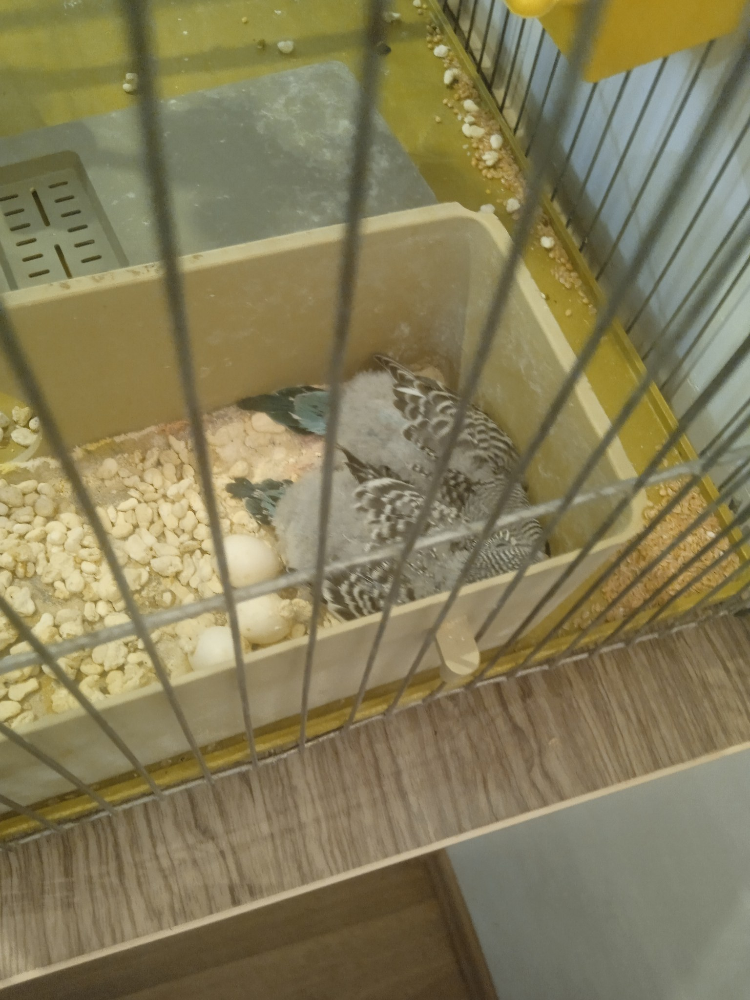</a>

[View / download](https://raw.githubusercontent.com/FarlandGame/Personal-Portfolio/main/images/personal-049.jpg)

Photograph personal-049 shows two of their chicks. I remember the chicks taking after their father’s colour.

We had kept the blue budgie and a white one since about seventh grade, when I was around thirteen. They were together for roughly three years without laying eggs. The seller had described them as a pair, but I later suspected that both were male. I tried vitamins and different things, and eventually the white bird died.

Later, my father found a green budgie in the street. It seemed unwell, with an uneven beak and claws, so I took it to a vet. As I remember the conversation, the vet described it as a very old female in poor health with little prospect of recovery. We later exchanged it for a younger female. After she joined our blue bird, they bred and laid eggs. I remember about five chicks, with three hatching on one occasion and two on another; some eggs did not hatch. The chicks looked like their father.

Eventually the birds became very noisy, and we sold them. These are among the last photographs I kept of that little bird family.

There is an earlier childhood memory too. When my brother and I were about three or four, our aunt bought us two budgies, a golden one and a white one. A cat caught the golden bird at our grandmother’s home. We brought the white bird home and kept it for several years. I remember it later dying after eating a persimmon. These are my memories of what happened, not established veterinary explanations.

## personal-050 · Personal & family memories

<a href="https://raw.githubusercontent.com/FarlandGame/Personal-Portfolio/main/images/personal-050.jpg">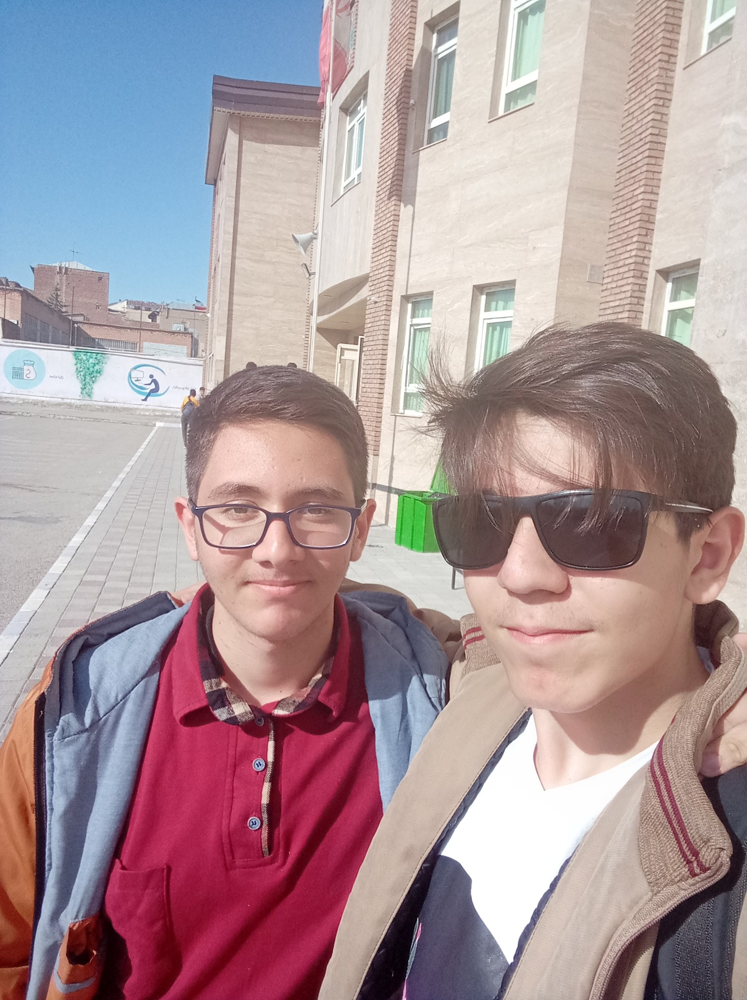</a>

[View / download](https://raw.githubusercontent.com/FarlandGame/Personal-Portfolio/main/images/personal-050.jpg)

These photographs were taken as we were leaving school in tenth grade. Amir Hossein Sadegh suggested taking a photograph together, so I took the pictures. The white shirt I am wearing carries my own channel and brand design: a cactus motif with purple LOVE lettering. I designed and had the shirt printed in ninth grade, at a cost I remember as about two million tomans.

## personal-051 · Personal & family memories

<a href="https://raw.githubusercontent.com/FarlandGame/Personal-Portfolio/main/images/personal-051.jpg">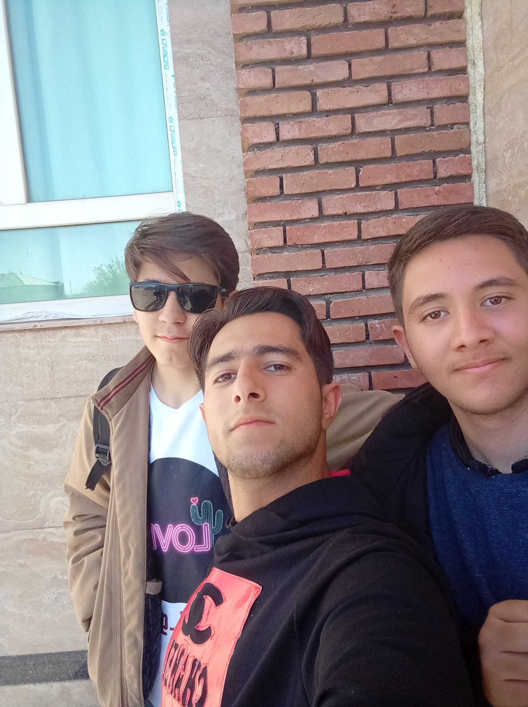</a>

[View / download](https://raw.githubusercontent.com/FarlandGame/Personal-Portfolio/main/images/personal-051.jpg)

These photographs were taken as we were leaving school in tenth grade. Amir Hossein Sadegh suggested taking a photograph together, so I took the pictures. The white shirt I am wearing carries my own channel and brand design: a cactus motif with purple LOVE lettering. I designed and had the shirt printed in ninth grade, at a cost I remember as about two million tomans.

In photograph personal-051, an eleventh-grade student saw us taking pictures and joined us in the middle. I think his name was Najaf, but I am not certain.

## personal-052 · Personal & family memories

<a href="https://raw.githubusercontent.com/FarlandGame/Personal-Portfolio/main/images/personal-052.jpg">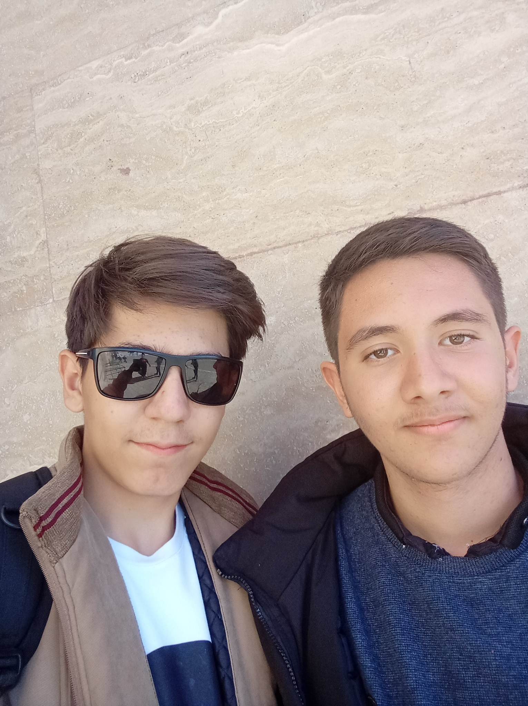</a>

[View / download](https://raw.githubusercontent.com/FarlandGame/Personal-Portfolio/main/images/personal-052.jpg)

These photographs were taken as we were leaving school in tenth grade. Amir Hossein Sadegh suggested taking a photograph together, so I took the pictures. The white shirt I am wearing carries my own channel and brand design: a cactus motif with purple LOVE lettering. I designed and had the shirt printed in ninth grade, at a cost I remember as about two million tomans.

## personal-053 · Book memories

<a href="https://raw.githubusercontent.com/FarlandGame/Personal-Portfolio/main/images/personal-053.jpg">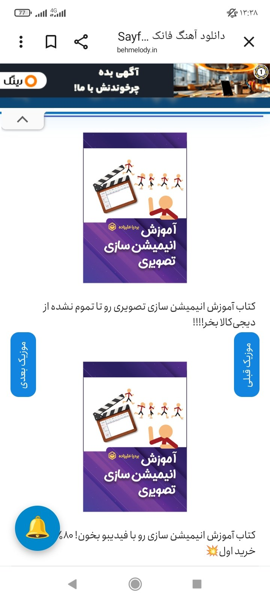</a>

[View / download](https://raw.githubusercontent.com/FarlandGame/Personal-Portfolio/main/images/personal-053.jpg)

This is another screenshot I saved of my book being promoted online. Like the earlier screenshots, I kept it as a memory of seeing the book introduced on websites.

## personal-054 · Personal & family memories

[View / download](https://raw.githubusercontent.com/FarlandGame/Personal-Portfolio/main/images/personal-054.jpg)

This is a casual photograph at school. I am wearing the same white shirt with my own cactus and purple LOVE brand design. Another student, Sina Vatan, also appears in the photograph.

## personal-055 · Book memories

<a href="https://raw.githubusercontent.com/FarlandGame/Personal-Portfolio/main/images/personal-055.jpg">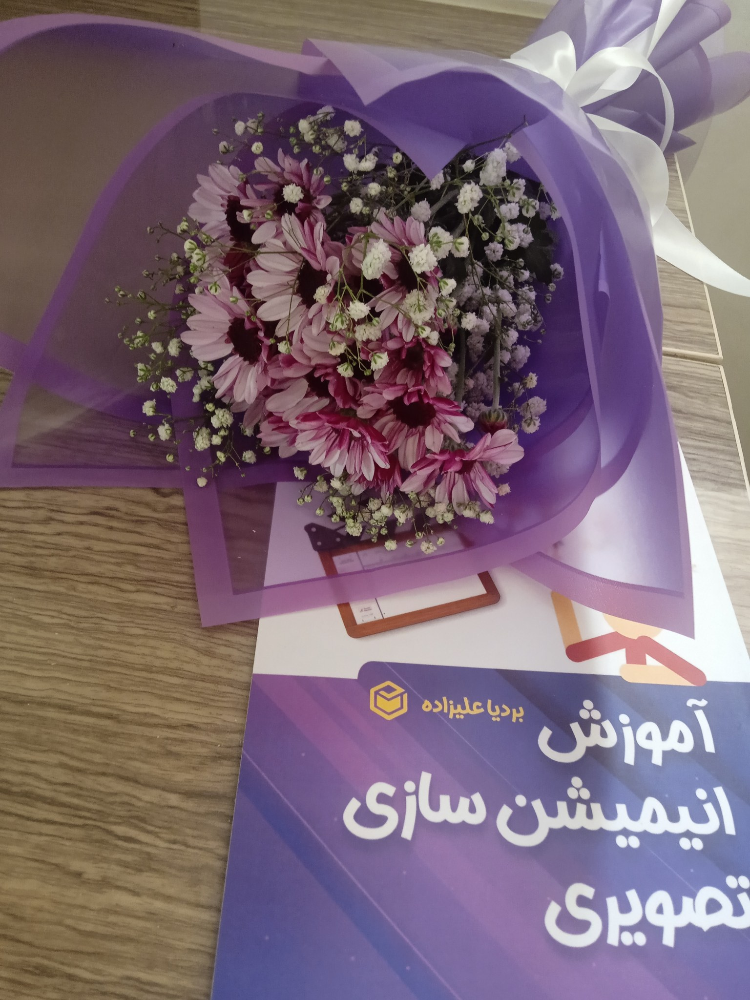</a>

[View / download](https://raw.githubusercontent.com/FarlandGame/Personal-Portfolio/main/images/personal-055.jpg)

The evening my first 50 printed copies arrived, my mother bought a cake and we celebrated together—my twin brother, my mother and me. We took photographs, shared the moment in our stories and ate the cake. It was a small family celebration for seeing my first book in print. These photographs were taken that same evening, and I shared them in my stories.

## personal-056 · Book memories

<a href="https://raw.githubusercontent.com/FarlandGame/Personal-Portfolio/main/images/personal-056.jpg">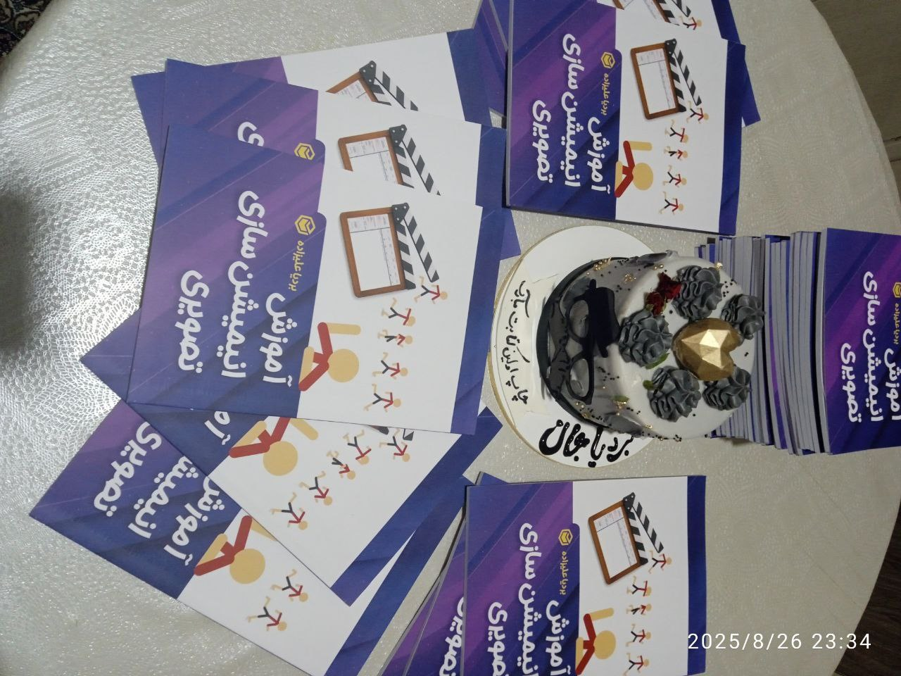</a>

[View / download](https://raw.githubusercontent.com/FarlandGame/Personal-Portfolio/main/images/personal-056.jpg)

The evening my first 50 printed copies arrived, my mother bought a cake and we celebrated together—my twin brother, my mother and me. We took photographs, shared the moment in our stories and ate the cake. It was a small family celebration for seeing my first book in print. These photographs were taken that same evening, and I shared them in my stories.

## personal-057 · Book memories

[View / download](https://raw.githubusercontent.com/FarlandGame/Personal-Portfolio/main/images/personal-057.jpg)

The evening my first 50 printed copies arrived, my mother bought a cake and we celebrated together—my twin brother, my mother and me. We took photographs, shared the moment in our stories and ate the cake. It was a small family celebration for seeing my first book in print.

## personal-058 · Book memories

[View / download](https://raw.githubusercontent.com/FarlandGame/Personal-Portfolio/main/images/personal-058.jpg)

The evening my first 50 printed copies arrived, my mother bought a cake and we celebrated together—my twin brother, my mother and me. We took photographs, shared the moment in our stories and ate the cake. It was a small family celebration for seeing my first book in print. These photographs were taken that same evening, and I shared them in my stories.

## personal-059 · Book memories

[View / download](https://raw.githubusercontent.com/FarlandGame/Personal-Portfolio/main/images/personal-059.jpg)

We also photographed the introduction page of my book that evening.

The evening my first 50 printed copies arrived, my mother bought a cake and we celebrated together—my twin brother, my mother and me. We took photographs, shared the moment in our stories and ate the cake. It was a small family celebration for seeing my first book in print.

## personal-060 · Personal & family memories

[View / download](https://raw.githubusercontent.com/FarlandGame/Personal-Portfolio/main/images/personal-060.jpg)

This photograph is from a book festival in Tehran in 1404 of the Iranian calendar. There was a Minecraft-themed promotional area for Classino, with a zombie character and Steve hats. Visitors could take a photograph with the zombie and share it in their stories to enter a prize draw. I did not win, but I kept this photograph and the Steve hats as memories of the visit.

## personal-061 · Personal & family memories

[View / download](https://raw.githubusercontent.com/FarlandGame/Personal-Portfolio/main/images/personal-061.jpg)

This is a childhood photograph of me, around one to two years old. I later photographed the album print with my phone. Reflected light and the quality of that phone photograph made the supplied image less clear, so I requested a separately labelled restoration while keeping the supplied version.

[AI-restored version · reflection reduced and clarity enhanced](https://raw.githubusercontent.com/FarlandGame/Personal-Portfolio/main/restorations/personal-061-ai-restored.png)

## personal-062 · Personal & family memories

[View / download](https://raw.githubusercontent.com/FarlandGame/Personal-Portfolio/main/images/personal-062.jpg)

I remember this as a ninth-grade photograph, from around 1402 or 1403 in the Iranian calendar; I am not certain of the year. My grey sports clothes remind me that it was a Monday, when we had physical education in the first lesson.

As we were leaving school, I realised I did not have a good photograph with my friend Ali Ata, whom I have known since seventh grade. I suggested taking one together. In my opinion, neither of us came out at our best—but our friendship is much better than the photograph! He is one of the best friends anyone could have.

## personal-063 · Personal & family memories

[View / download](https://raw.githubusercontent.com/FarlandGame/Personal-Portfolio/main/images/personal-063.jpg)

This is a keepsake from the same Monday physical-education day as photograph personal-062. I was in my sports clothes, and took this photograph with Elyar Nikpour, a friend from those school years. It preserves a moment of that friendship, even though we are not as close today.

## personal-064 · Personal & family memories

[View / download](https://raw.githubusercontent.com/FarlandGame/Personal-Portfolio/main/images/personal-064.jpg)

This photograph is from our visit to the annual book festival in Tehran. It belongs to the same outing as the Minecraft-themed Classino promotional area and the Steve hats in photograph personal-060. We were in Tehran and went to explore the festival together.

## personal-065 · Personal & family memories

[View / download](https://raw.githubusercontent.com/FarlandGame/Personal-Portfolio/main/images/personal-065.jpg)

My mother appears in this photograph from that book-festival visit in Tehran.

This photograph is from our visit to the annual book festival in Tehran. It belongs to the same outing as the Minecraft-themed Classino promotional area and the Steve hats in photograph personal-060. We were in Tehran and went to explore the festival together.

## personal-066 · Personal & family memories

[View / download](https://raw.githubusercontent.com/FarlandGame/Personal-Portfolio/main/images/personal-066.jpg)

My mother appears in this photograph from the trip for my fifteenth birthday, when I had completed fifteen years and was starting my sixteenth year of life. My mother and her side of the family took me to Tabriz to celebrate. I think the restaurant was called Berkeh, but I am not certain of the name. We had a wonderful time and went to an amusement park afterwards. It was a happy day with my family.

## personal-067 · Personal & family memories

[View / download](https://raw.githubusercontent.com/FarlandGame/Personal-Portfolio/main/images/personal-067.jpg)

These photographs are from the same birthday celebration in Tabriz as photograph personal-066. I had turned fifteen and was beginning my sixteenth year of life. We celebrated with my mother and her side of the family at a restaurant I remember as Berkeh. We had a wonderful time, and went to an amusement park afterwards. These are more memories from that happy family day.

## personal-068 · Personal & family memories

[View / download](https://raw.githubusercontent.com/FarlandGame/Personal-Portfolio/main/images/personal-068.jpg)

These photographs are from the same birthday celebration in Tabriz as photograph personal-066. I had turned fifteen and was beginning my sixteenth year of life. We celebrated with my mother and her side of the family at a restaurant I remember as Berkeh. We had a wonderful time, and went to an amusement park afterwards. These are more memories from that happy family day.

## personal-069 · Personal & family memories

[View / download](https://raw.githubusercontent.com/FarlandGame/Personal-Portfolio/main/images/personal-069.jpg)

These photographs are from the same birthday celebration in Tabriz as photograph personal-066. I had turned fifteen and was beginning my sixteenth year of life. We celebrated with my mother and her side of the family at a restaurant I remember as Berkeh. We had a wonderful time, and went to an amusement park afterwards. These are more memories from that happy family day.

## personal-070 · Personal & family memories

[View / download](https://raw.githubusercontent.com/FarlandGame/Personal-Portfolio/main/images/personal-070.jpg)

These photographs are from the same birthday celebration in Tabriz as photograph personal-066. I had turned fifteen and was beginning my sixteenth year of life. We celebrated with my mother and her side of the family at a restaurant I remember as Berkeh. We had a wonderful time, and went to an amusement park afterwards. These are more memories from that happy family day.

## personal-071 · Personal & family memories

[View / download](https://raw.githubusercontent.com/FarlandGame/Personal-Portfolio/main/images/personal-071.jpg)

These photographs are from the same birthday celebration in Tabriz as photograph personal-066. I had turned fifteen and was beginning my sixteenth year of life. We celebrated with my mother and her side of the family at a restaurant I remember as Berkeh. We had a wonderful time, and went to an amusement park afterwards. These are more memories from that happy family day.

## personal-072 · Personal & family memories

[View / download](https://raw.githubusercontent.com/FarlandGame/Personal-Portfolio/main/images/personal-072.jpg)

These photographs are from the same birthday celebration in Tabriz as photograph personal-066. I had turned fifteen and was beginning my sixteenth year of life. We celebrated with my mother and her side of the family at a restaurant I remember as Berkeh. We had a wonderful time, and went to an amusement park afterwards. These are more memories from that happy family day.

## personal-074 · Personal & family memories

[View / download](https://raw.githubusercontent.com/FarlandGame/Personal-Portfolio/main/images/personal-074.jpg)

I remember this as a photograph from Nowruz, either 1403 or 1404 in the Iranian calendar. I am not certain which year it was, so I am keeping that uncertainty with the photograph.

## personal-075 · Personal & family memories

[View / download](https://raw.githubusercontent.com/FarlandGame/Personal-Portfolio/main/images/personal-075.jpg)

I remember this as a photograph from Nowruz, either 1403 or 1404 in the Iranian calendar. I am not certain which year it was, so I am keeping that uncertainty with the photograph.

## personal-076 · Personal & family memories

[View / download](https://raw.githubusercontent.com/FarlandGame/Personal-Portfolio/main/images/personal-076.jpg)

These photographs are from the primary-school years of my twin brother Armiya and me. They are memories of our childhood together; no exact year has been assigned.

## personal-077 · Personal & family memories

[View / download](https://raw.githubusercontent.com/FarlandGame/Personal-Portfolio/main/images/personal-077.jpg)

This photograph is a memory of the ten-session public-speaking course that my twin brother and I took with Taha Bamshad during the summer, in Mordad and Shahrivar 1403 in the Iranian calendar.

Those summer months became a turning point in my life. Looking back, I felt much more confident, less shy and more comfortable speaking and expressing myself after the course. It changed how I behaved and how I saw myself.

## personal-078 · Personal & family memories

[View / download](https://raw.githubusercontent.com/FarlandGame/Personal-Portfolio/main/images/personal-078.jpg)

These photographs are from the primary-school years of my twin brother Armiya and me. They are memories of our childhood together; no exact year has been assigned.

## personal-079 · Personal & family memories

[View / download](https://raw.githubusercontent.com/FarlandGame/Personal-Portfolio/main/images/personal-079.jpg)

These are childhood photographs of my twin brother Armiya and me. They are another keepsake from our early years together; no exact age or year has been assigned.

## personal-080 · Personal & family memories

[View / download](https://raw.githubusercontent.com/FarlandGame/Personal-Portfolio/main/images/personal-080.jpg)

This photograph is a memory of my mother’s birthday. It belongs to the pictures we kept from that family occasion; no exact year has been assigned.

## personal-081 · Personal & family memories

[View / download](https://raw.githubusercontent.com/FarlandGame/Personal-Portfolio/main/images/personal-081.jpg)

This photograph is a memory of my mother’s birthday. It belongs to the pictures we kept from that family occasion; no exact year has been assigned.

## personal-082 · Portrait edits

[View / download](https://raw.githubusercontent.com/FarlandGame/Personal-Portfolio/main/images/personal-082.jpg)

My uncle Siamak took this photograph at his home in Tehran. I kept the picture and later added my own brand design to it. I like how it turned out; it is a family-taken photograph that also became part of my creative identity.

## personal-083 · Personal & family memories

[View / download](https://raw.githubusercontent.com/FarlandGame/Personal-Portfolio/main/images/personal-083.jpg)

This is another pose from the same photo session as photograph personal-082. My uncle Siamak took the picture at his home in Tehran. I kept it as another memory of that visit.

## personal-084 · Personal & family memories

[View / download](https://raw.githubusercontent.com/FarlandGame/Personal-Portfolio/main/images/personal-084.jpg)

The person wearing the Steve head in this photograph is my uncle Siamak. I had got the Minecraft Steve hat, and during the same visit he put it on. I took this photograph of him—a playful memory of that time at his home in Tehran.

## personal-085 · Personal & family memories

[View / download](https://raw.githubusercontent.com/FarlandGame/Personal-Portfolio/main/images/personal-085.jpg)

This is a real studio photograph featuring my own brand shirt. After designing the shirt with the logo of my brand and channel, I wore it for a photography-studio session. It is an older photograph, and it also appears in the Persian edition of my book.

## personal-086 · Portrait edits

[View / download](https://raw.githubusercontent.com/FarlandGame/Personal-Portfolio/main/images/personal-086.jpg)

This image shows the back of my shirt design. It belongs to the clothing design carrying my brand and channel identity; the front of the shirt appears later in the gallery.

## personal-087 · Portrait edits

[View / download](https://raw.githubusercontent.com/FarlandGame/Personal-Portfolio/main/images/personal-087.jpg)

This is the front view of the shirt design I mentioned with photograph personal-086. It carries the identity of my own brand and channel, and complements the back view shown earlier.

## personal-088 · Personal & family memories

[View / download](https://raw.githubusercontent.com/FarlandGame/Personal-Portfolio/main/images/personal-088.png)

This is an old childhood photograph of me. I do not remember exactly how old I was. The supplied file was a phone screenshot; at my request its top and bottom interface areas were cropped away so that only the photograph remains. The photo itself was not retouched.

## personal-089 · Personal & family memories

[View / download](https://raw.githubusercontent.com/FarlandGame/Personal-Portfolio/main/images/personal-089.jpg)

This photograph shows me working on ring-making. My twin brother Armiya and I once attended a course in making rings with silver, and this is one of the photographs from that hands-on learning experience.

## personal-090 · Personal & family memories

[View / download](https://raw.githubusercontent.com/FarlandGame/Personal-Portfolio/main/images/personal-090.jpg)

This is my maternal grandmother, whom I call “Aziz.” I kept this photograph as a family memory.

## personal-091 · Personal & family memories

[View / download](https://raw.githubusercontent.com/FarlandGame/Personal-Portfolio/main/images/personal-091.jpg)

This is another photograph of my maternal grandmother, whom I call Aziz. It was taken at the same time as photograph personal-090, but in this one she is wearing my sunglasses. A playful family keepsake.

## personal-092 · Personal & family memories

[View / download](https://raw.githubusercontent.com/FarlandGame/Personal-Portfolio/main/images/personal-092.jpg)

This photograph is from a family celebration after my swimming competition. I remember finishing first, as described in the swimming section of my portfolio. That evening my mother and father bought a cake and took this photograph of me with the certificate.

The photographed swimming documents are participation certificates and do not state a placing; the first-place result is my own recollection. This photograph preserves the family celebration of that moment.

## personal-093 · Personal & family memories

[View / download](https://raw.githubusercontent.com/FarlandGame/Personal-Portfolio/main/images/personal-093.jpg)

This is a selfie of me with Taha Bamshad during the public-speaking course my twin brother and I attended. It is a keepsake with the instructor from the summer 1403 course that helped me become more confident speaking and expressing myself.

## personal-094 · Personal & family memories

[View / download](https://raw.githubusercontent.com/FarlandGame/Personal-Portfolio/main/images/personal-094.jpg)

In this photograph my twin brother Armiya is taking a selfie with Taha Bamshad at the same public-speaking course. We both attended the summer 1403 course, and this is Armiya’s keepsake with our instructor.

## personal-095 · Personal & family memories

[View / download](https://raw.githubusercontent.com/FarlandGame/Personal-Portfolio/main/images/personal-095.jpg)

This is a photograph of my pet duck, which I was very fond of. I lost it when a cat caught it at my grandmother Aziz’s home. I kept this picture as a memory of a pet I loved.

## personal-096 · THE APEX

[View / download](https://raw.githubusercontent.com/FarlandGame/Personal-Portfolio/main/images/personal-096.jpg)

Ali, known as Alivexor, created this image in Blender during the early days of THE APEX. It belongs to the visual work from the beginning of our Minecraft story-server project. The artwork is credited to Ali; I share it here as part of the history of the project we were building together.

## personal-097 · THE APEX

[View / download](https://raw.githubusercontent.com/FarlandGame/Personal-Portfolio/main/images/personal-097.jpg)

Ali, known as Alivexor, created this image in Blender during the early days of THE APEX. It belongs to the visual work from the beginning of our Minecraft story-server project. The artwork is credited to Ali; I share it here as part of the history of the project we were building together.

## personal-098 · THE APEX

[View / download](https://raw.githubusercontent.com/FarlandGame/Personal-Portfolio/main/images/personal-098.jpg)

Ali, known as Alivexor, created this image in Blender during the early days of THE APEX. It belongs to the visual work from the beginning of our Minecraft story-server project. The artwork is credited to Ali; I share it here as part of the history of the project we were building together.

## personal-099 · THE APEX

[View / download](https://raw.githubusercontent.com/FarlandGame/Personal-Portfolio/main/images/personal-099.jpg)

Ali, known as Alivexor, created this image in Blender during the early days of THE APEX. It belongs to the visual work from the beginning of our Minecraft story-server project. The artwork is credited to Ali; I share it here as part of the history of the project we were building together.

## personal-100 · THE APEX

[View / download](https://raw.githubusercontent.com/FarlandGame/Personal-Portfolio/main/images/personal-100.jpg)

Ali, known as Alivexor, created this image in Blender during the early days of THE APEX. It belongs to the visual work from the beginning of our Minecraft story-server project. The artwork is credited to Ali; I share it here as part of the history of the project we were building together.

## personal-101 · THE APEX

[View / download](https://raw.githubusercontent.com/FarlandGame/Personal-Portfolio/main/images/personal-101.jpg)

I designed this welcome image near the beginning of THE APEX, with text for players to see when entering the server. It is a reminder of the visual ideas I was trying out at the start.

Ali Dehghannejad, known as Alivexor, and I chose the name THE APEX together. I love this project, and looking back at these early images brings back a lot of affection for its beginnings. I imagine a future in which the project is complete and we are making second and third versions. That is a hope for the future, not a record of releases already made.

## personal-102 · Personal & family memories

[View / download](https://raw.githubusercontent.com/FarlandGame/Personal-Portfolio/main/images/personal-102.jpg)

This photograph shows a handmade Rick-themed board I was making for fun. It was still a work in progress, and I liked how it was turning out. Some of the piece remains, and I intend to finish it.

## personal-103 · Personal & family memories

[View / download](https://raw.githubusercontent.com/FarlandGame/Personal-Portfolio/main/images/personal-103.jpg)

## personal-104 · Personal & family memories

[View / download](https://raw.githubusercontent.com/FarlandGame/Personal-Portfolio/main/images/personal-104.jpg)

## personal-105 · Portrait edits

[View / download](https://raw.githubusercontent.com/FarlandGame/Personal-Portfolio/main/images/personal-105.jpg)

## personal-106 · Portrait edits

[View / download](https://raw.githubusercontent.com/FarlandGame/Personal-Portfolio/main/images/personal-106.jpg)

## personal-107 · Portrait edits

[View / download](https://raw.githubusercontent.com/FarlandGame/Personal-Portfolio/main/images/personal-107.jpg)

## personal-108 · Portrait edits

[View / download](https://raw.githubusercontent.com/FarlandGame/Personal-Portfolio/main/images/personal-108.jpg)

## personal-109 · Portrait edits

[View / download](https://raw.githubusercontent.com/FarlandGame/Personal-Portfolio/main/images/personal-109.jpg)

## personal-110 · Portrait edits

[View / download](https://raw.githubusercontent.com/FarlandGame/Personal-Portfolio/main/images/personal-110.jpg)

## personal-111 · Portrait edits

[View / download](https://raw.githubusercontent.com/FarlandGame/Personal-Portfolio/main/images/personal-111.jpg)

## personal-112 · Portrait edits

[View / download](https://raw.githubusercontent.com/FarlandGame/Personal-Portfolio/main/images/personal-112.jpg)

## personal-113 · Portrait edits

[View / download](https://raw.githubusercontent.com/FarlandGame/Personal-Portfolio/main/images/personal-113.jpg)

## personal-114 · Portrait edits

[View / download](https://raw.githubusercontent.com/FarlandGame/Personal-Portfolio/main/images/personal-114.jpg)

## personal-115 · Portrait edits

[View / download](https://raw.githubusercontent.com/FarlandGame/Personal-Portfolio/main/images/personal-115.jpg)

## personal-116 · Portrait edits

[View / download](https://raw.githubusercontent.com/FarlandGame/Personal-Portfolio/main/images/personal-116.jpg)

## personal-117 · Portrait edits

[View / download](https://raw.githubusercontent.com/FarlandGame/Personal-Portfolio/main/images/personal-117.jpg)

## personal-118 · Portrait edits

[View / download](https://raw.githubusercontent.com/FarlandGame/Personal-Portfolio/main/images/personal-118.jpg)

## personal-119 · Portrait edits

[View / download](https://raw.githubusercontent.com/FarlandGame/Personal-Portfolio/main/images/personal-119.jpg)

## personal-120 · Portrait edits

[View / download](https://raw.githubusercontent.com/FarlandGame/Personal-Portfolio/main/images/personal-120.jpg)

## personal-121 · Portrait edits

[View / download](https://raw.githubusercontent.com/FarlandGame/Personal-Portfolio/main/images/personal-121.jpg)

## personal-122 · Portrait edits

[View / download](https://raw.githubusercontent.com/FarlandGame/Personal-Portfolio/main/images/personal-122.jpg)

## personal-123 · Personal & family memories

[View / download](https://raw.githubusercontent.com/FarlandGame/Personal-Portfolio/main/images/personal-123.jpg)

## personal-124 · Personal & family memories

[View / download](https://raw.githubusercontent.com/FarlandGame/Personal-Portfolio/main/images/personal-124.jpg)

## personal-125 · Personal & family memories

[View / download](https://raw.githubusercontent.com/FarlandGame/Personal-Portfolio/main/images/personal-125.jpg)

## personal-126 · Personal & family memories

[View / download](https://raw.githubusercontent.com/FarlandGame/Personal-Portfolio/main/images/personal-126.jpg)

## personal-127 · Personal & family memories

[View / download](https://raw.githubusercontent.com/FarlandGame/Personal-Portfolio/main/images/personal-127.jpg)

## personal-128 · Portrait edits

[View / download](https://raw.githubusercontent.com/FarlandGame/Personal-Portfolio/main/images/personal-128.jpg)

## personal-129 · Portrait edits

[View / download](https://raw.githubusercontent.com/FarlandGame/Personal-Portfolio/main/images/personal-129.jpg)

## personal-130 · Personal & family memories

[View / download](https://raw.githubusercontent.com/FarlandGame/Personal-Portfolio/main/images/personal-130.jpg)

## personal-131 · Personal & family memories

[View / download](https://raw.githubusercontent.com/FarlandGame/Personal-Portfolio/main/images/personal-131.jpg)

## personal-132 · Personal & family memories

[View / download](https://raw.githubusercontent.com/FarlandGame/Personal-Portfolio/main/images/personal-132.jpg)

## personal-133 · Portrait edits

[View / download](https://raw.githubusercontent.com/FarlandGame/Personal-Portfolio/main/images/personal-133.jpg)

## personal-134 · Portrait edits

[View / download](https://raw.githubusercontent.com/FarlandGame/Personal-Portfolio/main/images/personal-134.jpg)

## personal-135 · Portrait edits

[View / download](https://raw.githubusercontent.com/FarlandGame/Personal-Portfolio/main/images/personal-135.jpg)

## personal-136 · Portrait edits

[View / download](https://raw.githubusercontent.com/FarlandGame/Personal-Portfolio/main/images/personal-136.jpg)

## personal-137 · Portrait edits

[View / download](https://raw.githubusercontent.com/FarlandGame/Personal-Portfolio/main/images/personal-137.jpg)

## personal-138 · Personal & family memories

[View / download](https://raw.githubusercontent.com/FarlandGame/Personal-Portfolio/main/images/personal-138.jpg)

## personal-139 · Personal & family memories

[View / download](https://raw.githubusercontent.com/FarlandGame/Personal-Portfolio/main/images/personal-139.jpg)

## personal-140 · Portrait edits

[View / download](https://raw.githubusercontent.com/FarlandGame/Personal-Portfolio/main/images/personal-140.jpg)

