# هر ۱۳۴ عکس و تصویر 📸

[پروفایل گیت‌هاب](https://github.com/FarlandGame) · [داستان من؛ کبیر پشت نام Farland_game](https://github.com/FarlandGame/Personal-Portfolio/blob/main/docs/README.fa.md) · [▶ عکس‌ها و تصویرها + ویدئوها و ادیت‌ها](https://farlandgame.github.io/Personal-Portfolio/?lang=fa)

ترتیب فهرست، ترتیب زمانیِ تأییدشده نیست. تاریخ دقیق، سن و هویت افراد فقط با توضیح خود سازنده ثبت می‌شود.

**نسخه‌های نمایشی: عکس‌ها با حفظ تمام کادر تا ۲۰۴۸ پیکسل تغییر اندازه یافته‌اند؛ ویدئوها بدون کوتاه‌کردن، در کادر حداکثر ۱۹۲۰×۱۰۸۰ بازفشرده شده‌اند. فایل‌های اصلی دسکتاپ دست‌نخورده‌اند.**

عکس‌های ۰۰۸، ۰۴۲، ۰۸۸ و ۱۰۳ استثنا هستند: به درخواست سازنده، حاشیه‌های صفحهٔ گوشی یا مطالب نامربوطِ اطراف عکس برش خورده‌اند و پیکسل‌های داخل خود عکس‌ها بدون روتوش حفظ شده‌اند.

## personal-002 · ادیت‌های پرتره

[دیدن / دانلود](https://raw.githubusercontent.com/FarlandGame/Personal-Portfolio/main/images/personal-002.jpg)

این تصویر مربوط به صحنه‌ای از فیلمی است که با Photoshop و هوش مصنوعی برای خودم ساختم. مرجع و الهامم بخشی از سریال Better Call Saul و سال گودمن بود؛ شخصیتی که دوستش دارم و الگوی من است. می‌خواستم فیلم خودم را بسازم، اما دوربین مناسب و بودجهٔ فیلم‌برداری نداشتم. به‌جایش با چند ابزار هوش مصنوعیِ فیلم‌ساز کار کردم و حدود دو هفته برای ساختن آن وقت گذاشتم. این تصویرها مربوط به صحنه‌های همان پروژه‌اند.

## personal-003 · ادیت‌های پرتره

<a href="https://raw.githubusercontent.com/FarlandGame/Personal-Portfolio/main/images/personal-003.jpg">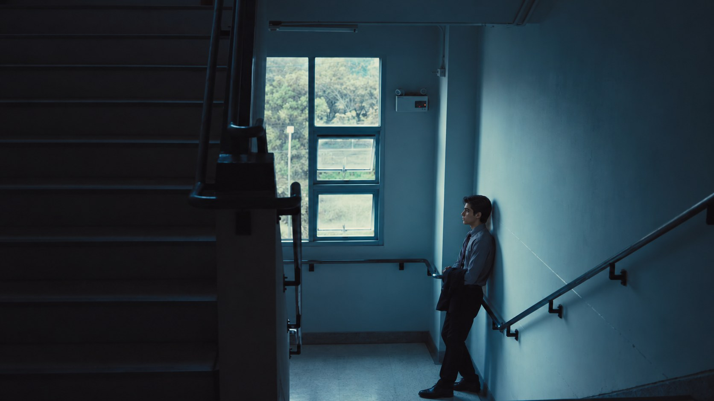</a>

[دیدن / دانلود](https://raw.githubusercontent.com/FarlandGame/Personal-Portfolio/main/images/personal-003.jpg)

این تصویر مربوط به صحنه‌ای از فیلمی است که با Photoshop و هوش مصنوعی برای خودم ساختم. مرجع و الهامم بخشی از سریال Better Call Saul و سال گودمن بود؛ شخصیتی که دوستش دارم و الگوی من است. می‌خواستم فیلم خودم را بسازم، اما دوربین مناسب و بودجهٔ فیلم‌برداری نداشتم. به‌جایش با چند ابزار هوش مصنوعیِ فیلم‌ساز کار کردم و حدود دو هفته برای ساختن آن وقت گذاشتم. این تصویرها مربوط به صحنه‌های همان پروژه‌اند.

## personal-004 · ادیت‌های پرتره

<a href="https://raw.githubusercontent.com/FarlandGame/Personal-Portfolio/main/images/personal-004.jpg">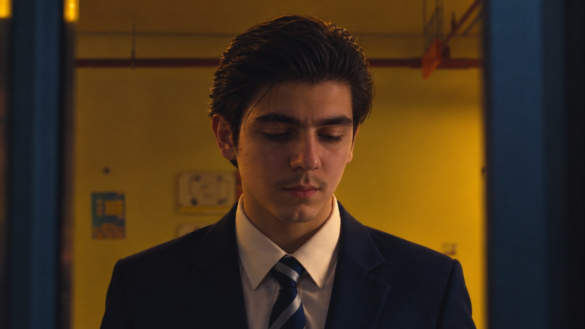</a>

[دیدن / دانلود](https://raw.githubusercontent.com/FarlandGame/Personal-Portfolio/main/images/personal-004.jpg)

این تصویر مربوط به صحنه‌ای از فیلمی است که با Photoshop و هوش مصنوعی برای خودم ساختم. مرجع و الهامم بخشی از سریال Better Call Saul و سال گودمن بود؛ شخصیتی که دوستش دارم و الگوی من است. می‌خواستم فیلم خودم را بسازم، اما دوربین مناسب و بودجهٔ فیلم‌برداری نداشتم. به‌جایش با چند ابزار هوش مصنوعیِ فیلم‌ساز کار کردم و حدود دو هفته برای ساختن آن وقت گذاشتم. این تصویرها مربوط به صحنه‌های همان پروژه‌اند.

## personal-005 · THE APEX

[دیدن / دانلود](https://raw.githubusercontent.com/FarlandGame/Personal-Portfolio/main/images/personal-005.jpg)

این Farland_game است؛ کاراکتر و شخصیت هنری من و یکی از شخصیت‌های مهم دنیای بازی، انیمیشن و THE APEX خودم. این تصویر را با Photoshop درست کردم. چهرهٔ نقاب‌دار و نشان F بخشی از هویت بصری این کاراکترند.

## personal-006 · خاطرات شخصی و خانوادگی

[دیدن / دانلود](https://raw.githubusercontent.com/FarlandGame/Personal-Portfolio/main/images/personal-006.jpg)

این عکس را در زرگری احمدیان با آیفون ۱۶ امیر احمدیان گرفتیم. امیر پسر آقای داوود احمدیان است؛ دو برادر احمدیان، داوود و رضا هستند. من و برادر دوقلویم در این زرگری کار می‌کنیم و پولی نمی‌گیریم، اما فروشندگی طلا را یاد گرفته‌ایم. آن موقع همهٔ موهایم را عقب می‌دادم و این تنها عکسی است که از آن مدل مو دارم. به یاد خودم، از دی‌ماه پایهٔ دهم شروع کردیم و الان حدود دو سال می‌شود که این کار و یادگیری را ادامه می‌دهیم.

## personal-007 · ادیت‌های پرتره

[دیدن / دانلود](https://raw.githubusercontent.com/FarlandGame/Personal-Portfolio/main/images/personal-007.jpg)

این پرتره را برای پروفایل اینستاگرامم با هوش مصنوعی و Photoshop ساختم؛ خودم هم در Photoshop روی آن کار کردم. در نهایت از نتیجه خوشم نیامد، چون به نظرم شبیه خودم نشده بود. اینجا به‌عنوان یکی از تجربه‌های ساخت پرتره نگهش داشته‌ام.

## personal-008 · خاطرات شخصی و خانوادگی

<a href="https://raw.githubusercontent.com/FarlandGame/Personal-Portfolio/main/images/personal-008.png">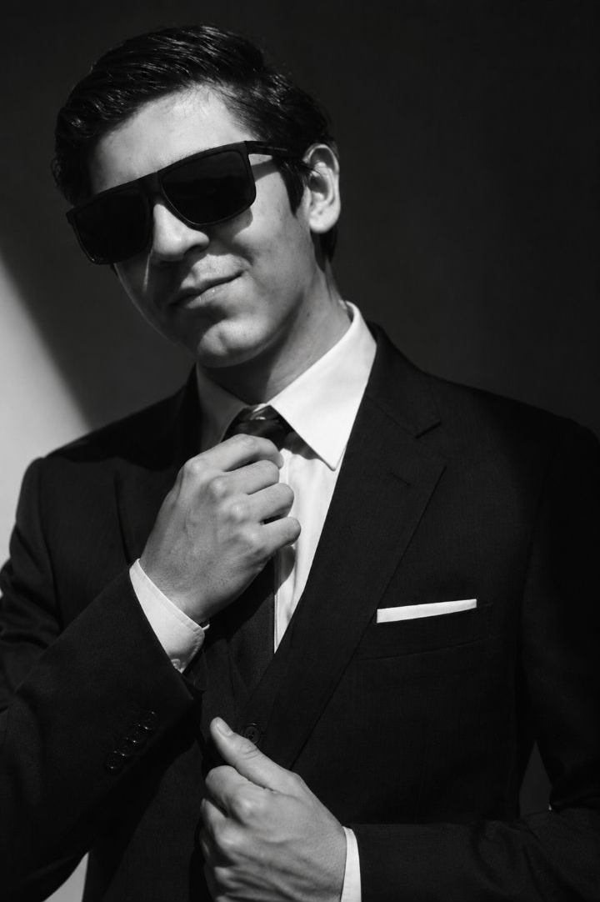</a>

[دیدن / دانلود](https://raw.githubusercontent.com/FarlandGame/Personal-Portfolio/main/images/personal-008.png)

این یک عکس واقعی است که در آتلیه گرفته شده. شاید شبیه تصویر ساخته‌شده با هوش مصنوعی به نظر برسد، اما عکاسی واقعی است. خودم کت‌وشلوار ندارم، هرچند خیلی دوست دارم داشته باشم؛ کت‌وشلوار را آتلیه برای عکس در اختیار داشت.

## personal-009 · ادیت‌های پرتره

[دیدن / دانلود](https://raw.githubusercontent.com/FarlandGame/Personal-Portfolio/main/images/personal-009.jpg)

این تصویر را برای پروفایل ایمیل کاری Farland با Photoshop، چند برنامهٔ ادیت و چند ابزار هوش مصنوعی ساختم و خودم هم در Photoshop روی آن کار کردم. خیلی دوست ندارم برای عکس‌های خودم به هوش مصنوعی تکیه کنم، اما آن موقع دوربین خوبی نداشتم. اگر دوربین باکیفیت داشته باشم، دوست دارم عکس‌ها و فیلم‌های خودم را با آن بسازم. وقتی این خاطره را تعریف کردم، این تصویر هنوز روی ایمیل کاری‌ام بود: farland.game158@gmail.com.

## personal-010 · خاطرات شخصی و خانوادگی

[دیدن / دانلود](https://raw.githubusercontent.com/FarlandGame/Personal-Portfolio/main/images/personal-010.jpg)

این عکس‌های نیمکت پارک، خاطره‌ای مهم از دوستی و همکاری من با علی دهقان‌نژاد، با نام هنری Alivexor هستند. علی تهرانی است و امروز او را بهترین دوست و همکارم می‌دانم. آن موقع پایهٔ دهم بودم و حدود پانزده یا شانزده سال داشتم؛ علی هم حدود پانزده سال داشت و یک پایهٔ تحصیلی پایین‌تر از من بود.

برای همکاری روی THE APEX، پروژهٔ سرور داستانی ماینکرافت ما، با کمک مادرم که وکیل است یک قرارداد آماده کردیم. به تهران رفتم تا علی و پدرش آن را امضا کنند؛ هر دو نوجوان بودیم و خانواده‌هایمان هم در این کار همراه بودند. دایی‌ام، سیامک نورنژاد، همراهم بود. او برای بردن مادربزرگم پیش پزشک هم به تهران می‌رفت و من با آن‌ها همراه شدم.

آن روز پدر علی و دو برادر کوچک‌ترش را دیدم. وسط پارک نشستیم و شیرموز خوردیم. خوش‌تیپ کرده بودم و دایی‌ام موهایم را حالت داده بود. برای من این‌ها فقط چند عکس روی نیمکت نیستند؛ یادگاریِ یک دوستی مهم و کارهایی هستند که می‌خواستیم با هم بسازیم.

## personal-011 · خاطرات شخصی و خانوادگی

<a href="https://raw.githubusercontent.com/FarlandGame/Personal-Portfolio/main/images/personal-011.jpg">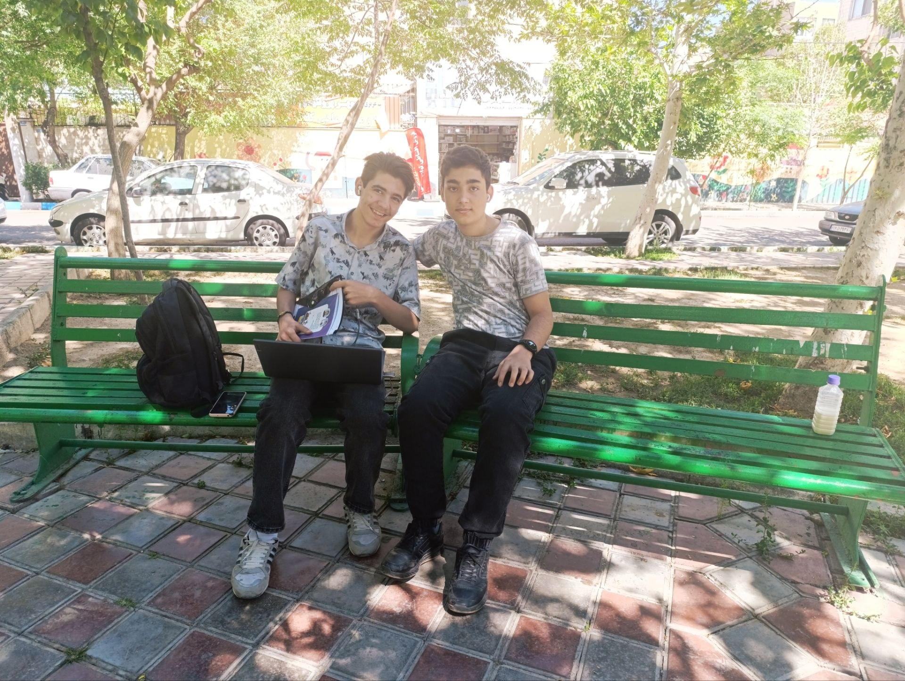</a>

[دیدن / دانلود](https://raw.githubusercontent.com/FarlandGame/Personal-Portfolio/main/images/personal-011.jpg)

این عکس‌های نیمکت پارک، خاطره‌ای مهم از دوستی و همکاری من با علی دهقان‌نژاد، با نام هنری Alivexor هستند. علی تهرانی است و امروز او را بهترین دوست و همکارم می‌دانم. آن موقع پایهٔ دهم بودم و حدود پانزده یا شانزده سال داشتم؛ علی هم حدود پانزده سال داشت و یک پایهٔ تحصیلی پایین‌تر از من بود.

برای همکاری روی THE APEX، پروژهٔ سرور داستانی ماینکرافت ما، با کمک مادرم که وکیل است یک قرارداد آماده کردیم. به تهران رفتم تا علی و پدرش آن را امضا کنند؛ هر دو نوجوان بودیم و خانواده‌هایمان هم در این کار همراه بودند. دایی‌ام، سیامک نورنژاد، همراهم بود. او برای بردن مادربزرگم پیش پزشک هم به تهران می‌رفت و من با آن‌ها همراه شدم.

آن روز پدر علی و دو برادر کوچک‌ترش را دیدم. وسط پارک نشستیم و شیرموز خوردیم. خوش‌تیپ کرده بودم و دایی‌ام موهایم را حالت داده بود. برای من این‌ها فقط چند عکس روی نیمکت نیستند؛ یادگاریِ یک دوستی مهم و کارهایی هستند که می‌خواستیم با هم بسازیم.

## personal-012 · خاطرات شخصی و خانوادگی

<a href="https://raw.githubusercontent.com/FarlandGame/Personal-Portfolio/main/images/personal-012.jpg">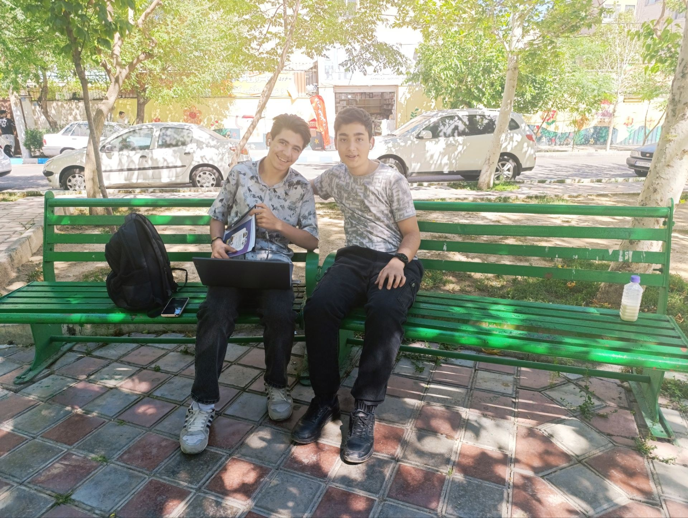</a>

[دیدن / دانلود](https://raw.githubusercontent.com/FarlandGame/Personal-Portfolio/main/images/personal-012.jpg)

این عکس‌های نیمکت پارک، خاطره‌ای مهم از دوستی و همکاری من با علی دهقان‌نژاد، با نام هنری Alivexor هستند. علی تهرانی است و امروز او را بهترین دوست و همکارم می‌دانم. آن موقع پایهٔ دهم بودم و حدود پانزده یا شانزده سال داشتم؛ علی هم حدود پانزده سال داشت و یک پایهٔ تحصیلی پایین‌تر از من بود.

برای همکاری روی THE APEX، پروژهٔ سرور داستانی ماینکرافت ما، با کمک مادرم که وکیل است یک قرارداد آماده کردیم. به تهران رفتم تا علی و پدرش آن را امضا کنند؛ هر دو نوجوان بودیم و خانواده‌هایمان هم در این کار همراه بودند. دایی‌ام، سیامک نورنژاد، همراهم بود. او برای بردن مادربزرگم پیش پزشک هم به تهران می‌رفت و من با آن‌ها همراه شدم.

آن روز پدر علی و دو برادر کوچک‌ترش را دیدم. وسط پارک نشستیم و شیرموز خوردیم. خوش‌تیپ کرده بودم و دایی‌ام موهایم را حالت داده بود. برای من این‌ها فقط چند عکس روی نیمکت نیستند؛ یادگاریِ یک دوستی مهم و کارهایی هستند که می‌خواستیم با هم بسازیم.

## personal-013 · خاطرات شخصی و خانوادگی

<a href="https://raw.githubusercontent.com/FarlandGame/Personal-Portfolio/main/images/personal-013.jpg">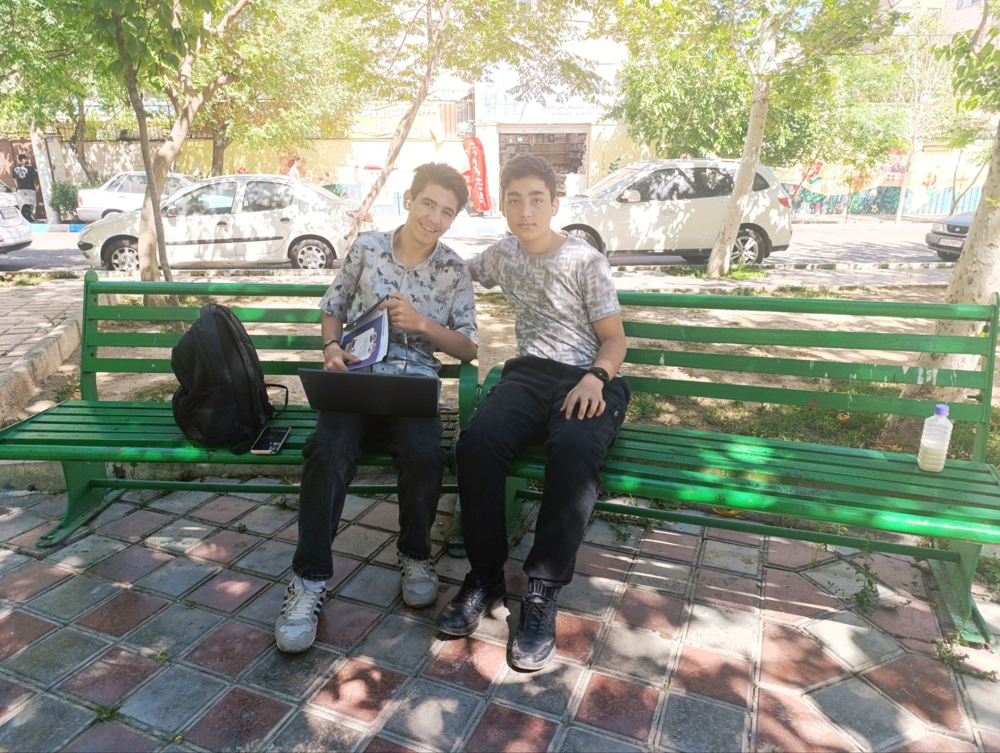</a>

[دیدن / دانلود](https://raw.githubusercontent.com/FarlandGame/Personal-Portfolio/main/images/personal-013.jpg)

این عکس‌های نیمکت پارک، خاطره‌ای مهم از دوستی و همکاری من با علی دهقان‌نژاد، با نام هنری Alivexor هستند. علی تهرانی است و امروز او را بهترین دوست و همکارم می‌دانم. آن موقع پایهٔ دهم بودم و حدود پانزده یا شانزده سال داشتم؛ علی هم حدود پانزده سال داشت و یک پایهٔ تحصیلی پایین‌تر از من بود.

برای همکاری روی THE APEX، پروژهٔ سرور داستانی ماینکرافت ما، با کمک مادرم که وکیل است یک قرارداد آماده کردیم. به تهران رفتم تا علی و پدرش آن را امضا کنند؛ هر دو نوجوان بودیم و خانواده‌هایمان هم در این کار همراه بودند. دایی‌ام، سیامک نورنژاد، همراهم بود. او برای بردن مادربزرگم پیش پزشک هم به تهران می‌رفت و من با آن‌ها همراه شدم.

آن روز پدر علی و دو برادر کوچک‌ترش را دیدم. وسط پارک نشستیم و شیرموز خوردیم. خوش‌تیپ کرده بودم و دایی‌ام موهایم را حالت داده بود. برای من این‌ها فقط چند عکس روی نیمکت نیستند؛ یادگاریِ یک دوستی مهم و کارهایی هستند که می‌خواستیم با هم بسازیم.

## personal-014 · خاطرات شخصی و خانوادگی

[دیدن / دانلود](https://raw.githubusercontent.com/FarlandGame/Personal-Portfolio/main/images/personal-014.jpg)

این عکس در خانه، درست موقع تحویل سال و روز اول عید ۱۴۰۵ گرفته شد. دایی سجادم به خانه‌مان آمد و این عکس‌ها را از ما گرفت. من کسی هستم که عینک آفتابی دارد؛ آن کسی که کنارم عینک نزده، برادر دوقلویم ارمیاست.

## personal-015 · خاطرات شخصی و خانوادگی

[دیدن / دانلود](https://raw.githubusercontent.com/FarlandGame/Personal-Portfolio/main/images/personal-015.jpg)

این عکس را دایی سجادم در خانه‌مان، موقع تحویل سال و روز اول عید ۱۴۰۵ از من گرفت. اینجا هم خودم هستم که عینک آفتابی زده‌ام. این عکس مربوط به همان دیدار نوروزیِ عکس ۰۱۴ است.

## personal-016 · خاطرات شخصی و خانوادگی

<a href="https://raw.githubusercontent.com/FarlandGame/Personal-Portfolio/main/images/personal-016.jpg">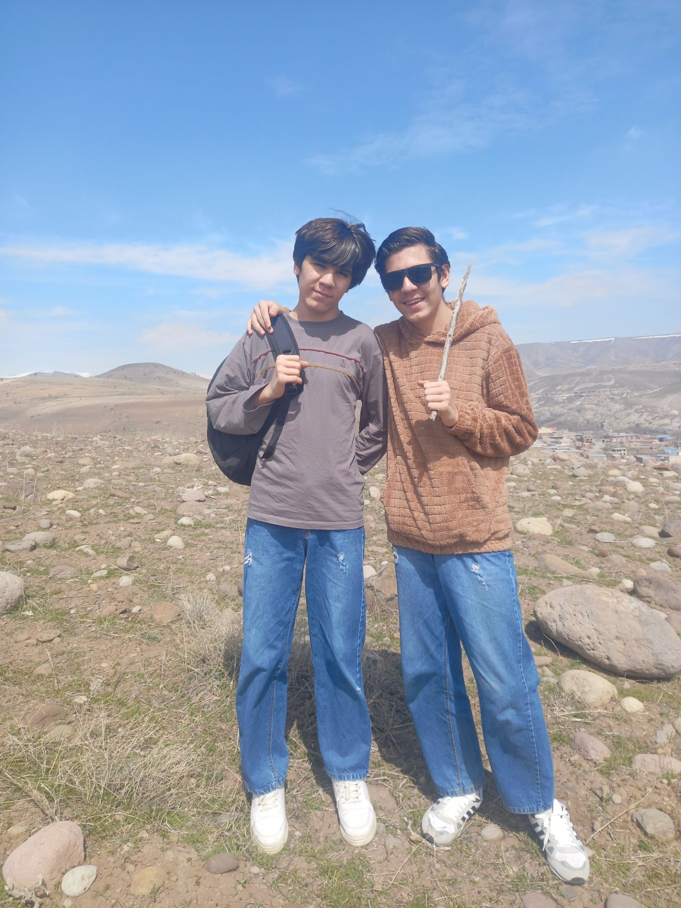</a>

[دیدن / دانلود](https://raw.githubusercontent.com/FarlandGame/Personal-Portfolio/main/images/personal-016.jpg)

این عکس مربوط به سیزده‌بدر عید ۱۴۰۵ است. با پدرم و خانوادهٔ پدری‌ام به سد مراغه رفته بودیم؛ دو عمه‌ام، عمو و زن‌عمویم، مادربزرگم، داییِ پدرم مسعود و خانواده‌اش، پسرعمه‌ها و بقیهٔ فامیل هم بودند.

با پدرم و برادر دوقلویم بالای کوه رفتیم و پدرم این عکس را از ما گرفت. اینجا هم کسی که عینک آفتابی دارد منم و نفر دیگر، برادرم ارمیاست.

## personal-017 · خاطرات شخصی و خانوادگی

[دیدن / دانلود](https://raw.githubusercontent.com/FarlandGame/Personal-Portfolio/main/images/personal-017.jpg)

این عکس مربوط به سیزده‌بدر عید ۱۴۰۵ است. با پدرم و خانوادهٔ پدری‌ام به سد مراغه رفته بودیم؛ دو عمه‌ام، عمو و زن‌عمویم، مادربزرگم، داییِ پدرم مسعود و خانواده‌اش، پسرعمه‌ها و بقیهٔ فامیل هم بودند.

با پدرم و برادر دوقلویم بالای کوه رفتیم و پدرم این عکس را از ما گرفت. اینجا هم کسی که عینک آفتابی دارد منم و نفر دیگر، برادرم ارمیاست.

## personal-018 · خاطرات شخصی و خانوادگی

[دیدن / دانلود](https://raw.githubusercontent.com/FarlandGame/Personal-Portfolio/main/images/personal-018.jpg)

این عکس‌ها حدود دو هفته بعد از سیزده‌بدر عید ۱۴۰۵ گرفته شدند. با پدرم به یک کوه بلند رفتیم و او در آن گردش، روی پل این عکس‌ها را از ما گرفت.

## personal-019 · خاطرات شخصی و خانوادگی

<a href="https://raw.githubusercontent.com/FarlandGame/Personal-Portfolio/main/images/personal-019.jpg">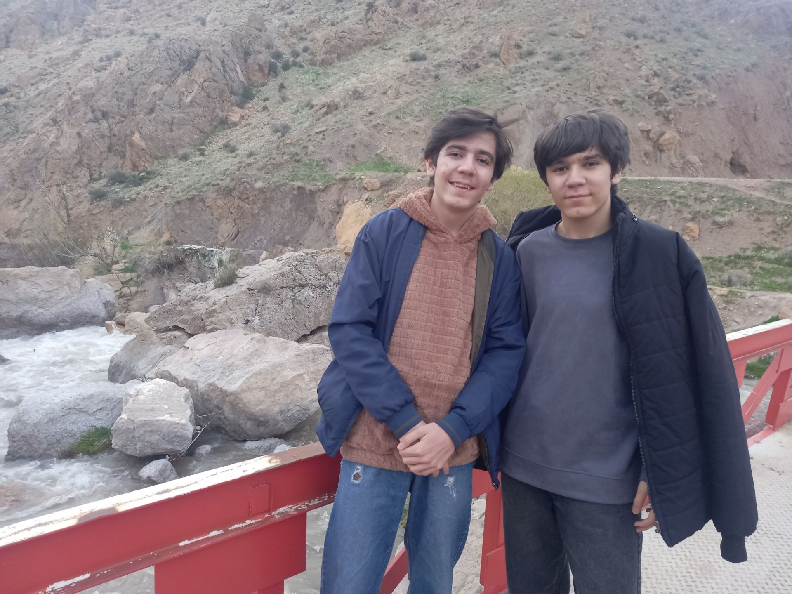</a>

[دیدن / دانلود](https://raw.githubusercontent.com/FarlandGame/Personal-Portfolio/main/images/personal-019.jpg)

این عکس‌ها حدود دو هفته بعد از سیزده‌بدر عید ۱۴۰۵ گرفته شدند. با پدرم به یک کوه بلند رفتیم و او در آن گردش، روی پل این عکس‌ها را از ما گرفت.

## personal-020 · ادیت‌های پرتره

<a href="https://raw.githubusercontent.com/FarlandGame/Personal-Portfolio/main/images/personal-020.jpg">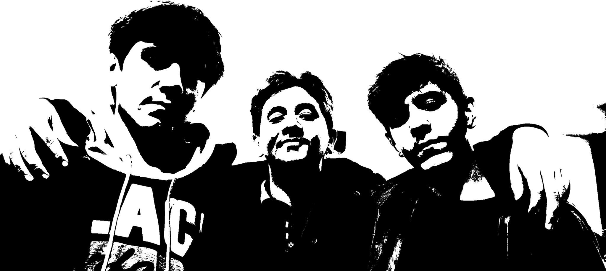</a>

[دیدن / دانلود](https://raw.githubusercontent.com/FarlandGame/Personal-Portfolio/main/images/personal-020.jpg)

این تصویر مربوط به مجموعه‌ای از عکس‌های یک روز بارانی در مدرسه است. فکر می‌کنم اوایل شهریور بود، اما تاریخ دقیقش را مطمئن نیستم. ایرپادم را به مدرسه برده بودم و در حیاط، میان طوفان، آهنگ گوش می‌دادم و خودم را شخصیتی قدرتمند تصور می‌کردم. وقتی به کلاس برگشتم، موهایم خیس بود.

دوستم اشکان محمدعلی‌پور با گوشی خودش از من، برادرم و امیرحسین صادق عکس گرفت. اشکان ادیتور من هم هست و در کارهای After Effects و انیمیشن‌های Blender کمکم می‌کند. آن موقع امیرحسین را SenpaiXD صدا می‌کردم؛ او نام هنری‌اش را زیاد تغییر می‌دهد، چون چیز تکراری دوست ندارد. اشکان و دوستمان صدرا شاهی در این مجموعهٔ عکس حضور ندارند. بعداً خودم بعضی از عکس‌ها را با ادیت، سیاه‌وسفید و دارک‌تر کردم.

بلافاصله بعد از عکس‌ها، روز سختی شد. به یادم، ناظم مدرسه، آقای عزیزی، گوشی و ایرپادم را گرفت و تا روز بعد نگه داشت. خیلی ناراحت شدم و گریه کردم. این عکس‌ها برای من هم هیجان آن لحظه کنار دوستانم را دارند و هم خاطرهٔ تلخِ بعد از آن را.

## personal-021 · ادیت‌های پرتره

<a href="https://raw.githubusercontent.com/FarlandGame/Personal-Portfolio/main/images/personal-021.jpg">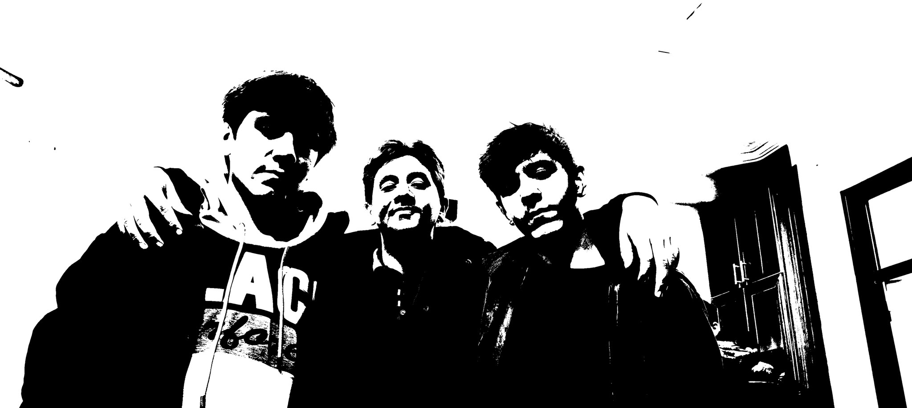</a>

[دیدن / دانلود](https://raw.githubusercontent.com/FarlandGame/Personal-Portfolio/main/images/personal-021.jpg)

این تصویر مربوط به مجموعه‌ای از عکس‌های یک روز بارانی در مدرسه است. فکر می‌کنم اوایل شهریور بود، اما تاریخ دقیقش را مطمئن نیستم. ایرپادم را به مدرسه برده بودم و در حیاط، میان طوفان، آهنگ گوش می‌دادم و خودم را شخصیتی قدرتمند تصور می‌کردم. وقتی به کلاس برگشتم، موهایم خیس بود.

دوستم اشکان محمدعلی‌پور با گوشی خودش از من، برادرم و امیرحسین صادق عکس گرفت. اشکان ادیتور من هم هست و در کارهای After Effects و انیمیشن‌های Blender کمکم می‌کند. آن موقع امیرحسین را SenpaiXD صدا می‌کردم؛ او نام هنری‌اش را زیاد تغییر می‌دهد، چون چیز تکراری دوست ندارد. اشکان و دوستمان صدرا شاهی در این مجموعهٔ عکس حضور ندارند. بعداً خودم بعضی از عکس‌ها را با ادیت، سیاه‌وسفید و دارک‌تر کردم.

بلافاصله بعد از عکس‌ها، روز سختی شد. به یادم، ناظم مدرسه، آقای عزیزی، گوشی و ایرپادم را گرفت و تا روز بعد نگه داشت. خیلی ناراحت شدم و گریه کردم. این عکس‌ها برای من هم هیجان آن لحظه کنار دوستانم را دارند و هم خاطرهٔ تلخِ بعد از آن را.

## personal-022 · خاطرات شخصی و خانوادگی

[دیدن / دانلود](https://raw.githubusercontent.com/FarlandGame/Personal-Portfolio/main/images/personal-022.jpg)

این عکس‌ها مربوط به اولین باری هستند که به خانهٔ دوستم علی حیدری رفتم. علی یک پایهٔ تحصیلی از من بالاتر است. من کسی هستم که عینک آفتابی و لباس کرمی دارد و علی عینک معمولی زده است. ارمیا نیامده بود؛ دونفری کلی بازی کردیم، حرف زدیم و خیلی خوش گذشت. امیدوارم باز هم تکرار شود.

فکر می‌کنم مهمانی حدود پنج عصر تا نه شب بود، اما از ساعت‌ها مطمئن نیستم. آن روز دل‌درد و ناراحتی گوارشی شدیدی داشتم و سعی کردم در مهمانی تحملش کنم. وقتی به خانه برگشتم، دارو خوردم، استراحت کردم و بهتر شدم.

## personal-023 · خاطرات شخصی و خانوادگی

<a href="https://raw.githubusercontent.com/FarlandGame/Personal-Portfolio/main/images/personal-023.jpg">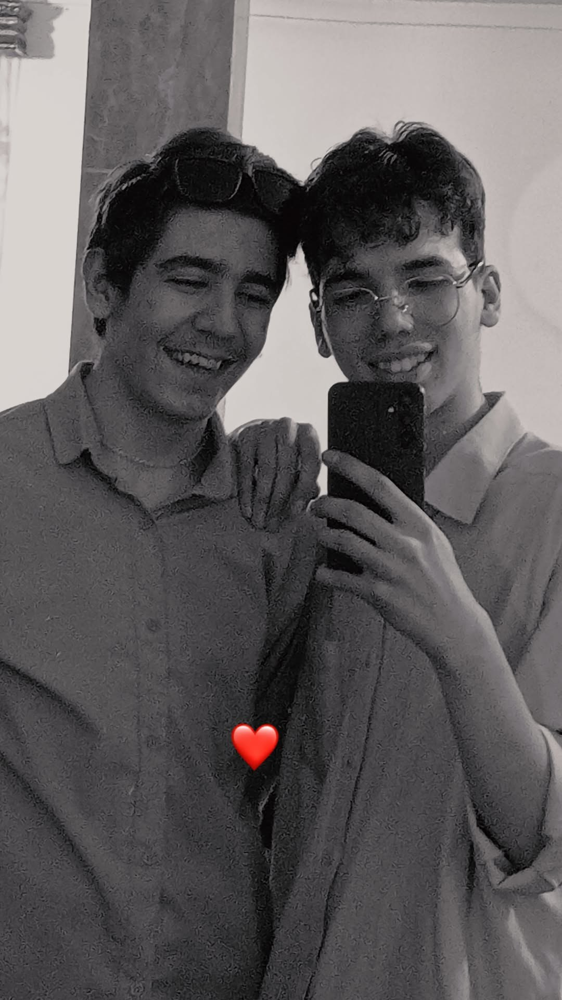</a>

[دیدن / دانلود](https://raw.githubusercontent.com/FarlandGame/Personal-Portfolio/main/images/personal-023.jpg)

این عکس‌ها مربوط به اولین باری هستند که به خانهٔ دوستم علی حیدری رفتم. علی یک پایهٔ تحصیلی از من بالاتر است. من کسی هستم که عینک آفتابی و لباس کرمی دارد و علی عینک معمولی زده است. ارمیا نیامده بود؛ دونفری کلی بازی کردیم، حرف زدیم و خیلی خوش گذشت. امیدوارم باز هم تکرار شود.

فکر می‌کنم مهمانی حدود پنج عصر تا نه شب بود، اما از ساعت‌ها مطمئن نیستم. آن روز دل‌درد و ناراحتی گوارشی شدیدی داشتم و سعی کردم در مهمانی تحملش کنم. وقتی به خانه برگشتم، دارو خوردم، استراحت کردم و بهتر شدم.

## personal-024 · خاطرات شخصی و خانوادگی

<a href="https://raw.githubusercontent.com/FarlandGame/Personal-Portfolio/main/images/personal-024.jpg">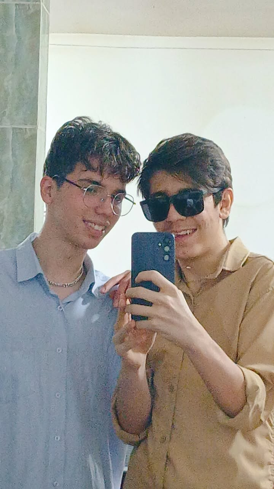</a>

[دیدن / دانلود](https://raw.githubusercontent.com/FarlandGame/Personal-Portfolio/main/images/personal-024.jpg)

این عکس‌ها مربوط به اولین باری هستند که به خانهٔ دوستم علی حیدری رفتم. علی یک پایهٔ تحصیلی از من بالاتر است. من کسی هستم که عینک آفتابی و لباس کرمی دارد و علی عینک معمولی زده است. ارمیا نیامده بود؛ دونفری کلی بازی کردیم، حرف زدیم و خیلی خوش گذشت. امیدوارم باز هم تکرار شود.

فکر می‌کنم مهمانی حدود پنج عصر تا نه شب بود، اما از ساعت‌ها مطمئن نیستم. آن روز دل‌درد و ناراحتی گوارشی شدیدی داشتم و سعی کردم در مهمانی تحملش کنم. وقتی به خانه برگشتم، دارو خوردم، استراحت کردم و بهتر شدم.

## personal-025 · خاطرات شخصی و خانوادگی

[دیدن / دانلود](https://raw.githubusercontent.com/FarlandGame/Personal-Portfolio/main/images/personal-025.jpg)

این خودم هستم؛ یک سال و چند ماهم بود و به دوسالگی نزدیک می‌شدم. آن پیراهن بزرگ، پیراهن پدرم است؛ آن موقع دوست داشتم آن را بپوشم. بعدها با گوشی از عکس داخل آلبوم عکس گرفتم؛ برای همین نسخهٔ ارسالی کمی تار است و بازتاب نور دارد.

[نسخهٔ ترمیم‌شده با هوش مصنوعی؛ حذف بازتاب نور و بهبود وضوح](https://raw.githubusercontent.com/FarlandGame/Personal-Portfolio/main/restorations/personal-025-ai-restored.png)

## personal-026 · خاطرات شخصی و خانوادگی

<a href="https://raw.githubusercontent.com/FarlandGame/Personal-Portfolio/main/images/personal-026.jpg">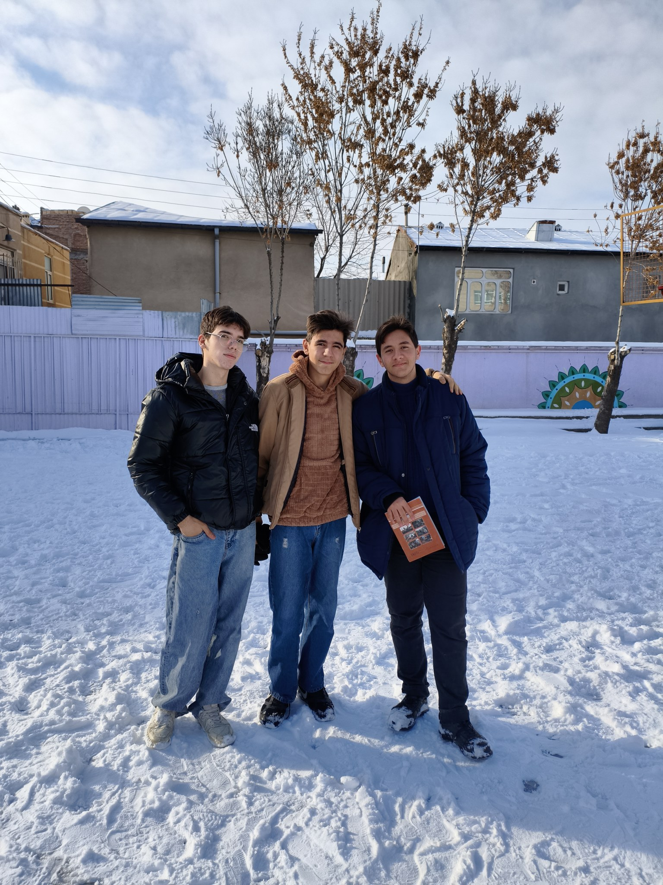</a>

[دیدن / دانلود](https://raw.githubusercontent.com/FarlandGame/Personal-Portfolio/main/images/personal-026.jpg)

این عکس مربوط به دی‌ماه ۱۴۰۴، زمان امتحانات ترم اول مدرسه، است. روز برفی و قشنگی بود. من وسط عکس هستم؛ سمت راستِ عکس امیرحسین صادق است و سمت چپ علی حیدری.

آن روز موهایم را حالت نداده بودم و کلاه گذاشته بودم. کلاه را که برداشتم، موهایم به‌هم ریخته بود. بچه‌ها پیشنهاد دادند عکس بگیریم و من هم قبول کردم. ارمیا و اشکان این عکس‌ها را از ما گرفتند. به یادم، این عکس مربوط به روز امتحان ریاضی‌مان است.

## personal-027 · خاطرات شخصی و خانوادگی

[دیدن / دانلود](https://raw.githubusercontent.com/FarlandGame/Personal-Portfolio/main/images/personal-027.jpg)

این عکس مربوط به دی‌ماه ۱۴۰۴، زمان امتحانات ترم اول مدرسه، است. روز برفی و قشنگی بود. من وسط عکس هستم؛ سمت راستِ عکس امیرحسین صادق است و سمت چپ علی حیدری.

آن روز موهایم را حالت نداده بودم و کلاه گذاشته بودم. کلاه را که برداشتم، موهایم به‌هم ریخته بود. بچه‌ها پیشنهاد دادند عکس بگیریم و من هم قبول کردم. ارمیا و اشکان این عکس‌ها را از ما گرفتند. به یادم، این عکس مربوط به روز امتحان ریاضی‌مان است.

## personal-028 · خاطرات شخصی و خانوادگی

<a href="https://raw.githubusercontent.com/FarlandGame/Personal-Portfolio/main/images/personal-028.jpg">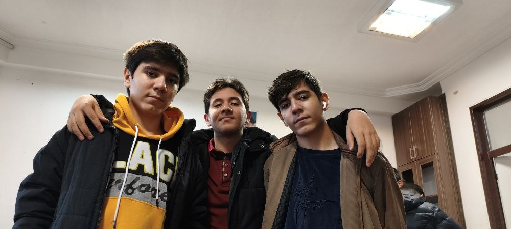</a>

[دیدن / دانلود](https://raw.githubusercontent.com/FarlandGame/Personal-Portfolio/main/images/personal-028.jpg)

این تصویر مربوط به مجموعه‌ای از عکس‌های یک روز بارانی در مدرسه است. فکر می‌کنم اوایل شهریور بود، اما تاریخ دقیقش را مطمئن نیستم. ایرپادم را به مدرسه برده بودم و در حیاط، میان طوفان، آهنگ گوش می‌دادم و خودم را شخصیتی قدرتمند تصور می‌کردم. وقتی به کلاس برگشتم، موهایم خیس بود.

دوستم اشکان محمدعلی‌پور با گوشی خودش از من، برادرم و امیرحسین صادق عکس گرفت. اشکان ادیتور من هم هست و در کارهای After Effects و انیمیشن‌های Blender کمکم می‌کند. آن موقع امیرحسین را SenpaiXD صدا می‌کردم؛ او نام هنری‌اش را زیاد تغییر می‌دهد، چون چیز تکراری دوست ندارد. اشکان و دوستمان صدرا شاهی در این مجموعهٔ عکس حضور ندارند. بعداً خودم بعضی از عکس‌ها را با ادیت، سیاه‌وسفید و دارک‌تر کردم.

بلافاصله بعد از عکس‌ها، روز سختی شد. به یادم، ناظم مدرسه، آقای عزیزی، گوشی و ایرپادم را گرفت و تا روز بعد نگه داشت. خیلی ناراحت شدم و گریه کردم. این عکس‌ها برای من هم هیجان آن لحظه کنار دوستانم را دارند و هم خاطرهٔ تلخِ بعد از آن را.

## personal-029 · خاطرات شخصی و خانوادگی

<a href="https://raw.githubusercontent.com/FarlandGame/Personal-Portfolio/main/images/personal-029.jpg">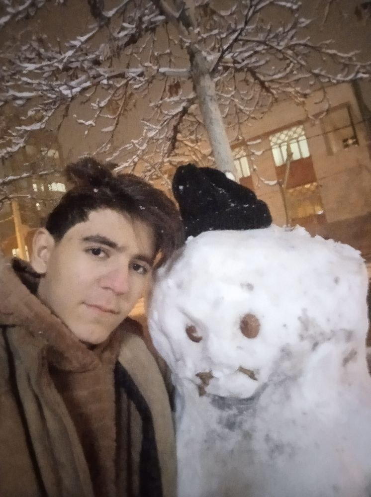</a>

[دیدن / دانلود](https://raw.githubusercontent.com/FarlandGame/Personal-Portfolio/main/images/personal-029.jpg)

این عکس‌ها مربوط به روزهای امتحانات مدرسه در دی‌ماه ۱۴۰۴ هستند. به یادم، فردای امتحان ریاضی ــ همان امتحان مربوط به عکس ۰۲۷ ــ برف بارید. آن شب جلوی خانه‌مان رفتم و با کلی زحمت و چند ساعت کار این آدم‌برفی را ساختم و از آن عکس گرفتم.

به یادم، روز بعد دو نفر از بچه‌های همسایه خرابش کردند. ناراحت شدم که نتیجهٔ آن همه ساعت زحمت از بین رفت. این عکس‌ها یادگاریِ همان آدم‌برفی هستند که برای ساختنش خیلی تلاش کرده بودم.

## personal-030 · خاطرات شخصی و خانوادگی

<a href="https://raw.githubusercontent.com/FarlandGame/Personal-Portfolio/main/images/personal-030.jpg">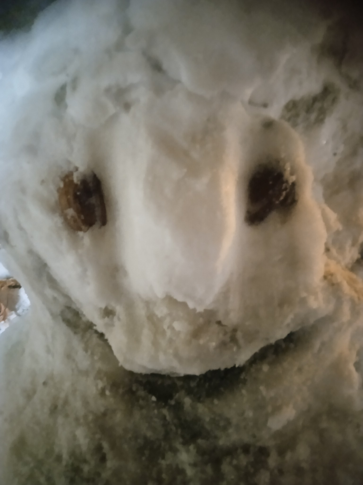</a>

[دیدن / دانلود](https://raw.githubusercontent.com/FarlandGame/Personal-Portfolio/main/images/personal-030.jpg)

این عکس‌ها مربوط به روزهای امتحانات مدرسه در دی‌ماه ۱۴۰۴ هستند. به یادم، فردای امتحان ریاضی ــ همان امتحان مربوط به عکس ۰۲۷ ــ برف بارید. آن شب جلوی خانه‌مان رفتم و با کلی زحمت و چند ساعت کار این آدم‌برفی را ساختم و از آن عکس گرفتم.

به یادم، روز بعد دو نفر از بچه‌های همسایه خرابش کردند. ناراحت شدم که نتیجهٔ آن همه ساعت زحمت از بین رفت. این عکس‌ها یادگاریِ همان آدم‌برفی هستند که برای ساختنش خیلی تلاش کرده بودم.

## personal-031 · خاطرات شخصی و خانوادگی

<a href="https://raw.githubusercontent.com/FarlandGame/Personal-Portfolio/main/images/personal-031.jpg">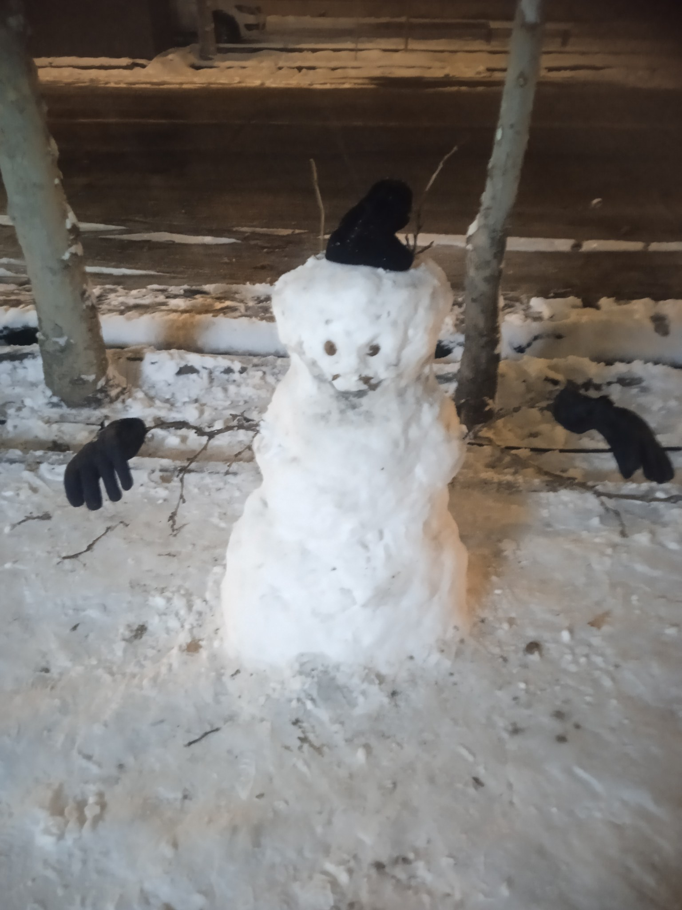</a>

[دیدن / دانلود](https://raw.githubusercontent.com/FarlandGame/Personal-Portfolio/main/images/personal-031.jpg)

این عکس‌ها مربوط به روزهای امتحانات مدرسه در دی‌ماه ۱۴۰۴ هستند. به یادم، فردای امتحان ریاضی ــ همان امتحان مربوط به عکس ۰۲۷ ــ برف بارید. آن شب جلوی خانه‌مان رفتم و با کلی زحمت و چند ساعت کار این آدم‌برفی را ساختم و از آن عکس گرفتم.

به یادم، روز بعد دو نفر از بچه‌های همسایه خرابش کردند. ناراحت شدم که نتیجهٔ آن همه ساعت زحمت از بین رفت. این عکس‌ها یادگاریِ همان آدم‌برفی هستند که برای ساختنش خیلی تلاش کرده بودم.

## personal-032 · خاطرات شخصی و خانوادگی

[دیدن / دانلود](https://raw.githubusercontent.com/FarlandGame/Personal-Portfolio/main/images/personal-032.jpg)

این سلفی من و مادرم در خانه است. مادرم گفت: «بیا با هم عکس بگیریم.» لباسش سیاه است و یک گل قرمز دارد؛ یک لحظهٔ سادهٔ دونفره در خانه.

## personal-033 · خاطرات کتاب

[دیدن / دانلود](https://raw.githubusercontent.com/FarlandGame/Personal-Portfolio/main/images/personal-033.jpg)

این عکس‌ها، تقدیرنامهٔ تألیف کتاب و گل‌های روزی را نشان می‌دهند که برایم خیلی مهم بود. چند ماه پیش از آن، یک نسخه از کتابم را به آموزش‌وپرورش هدیه داده بودم. وقتی بالاخره مراسم تقدیر از نویسندگان رسید، به من گفته بودند تنها پانزده‌سالهٔ آن جمع هستم و شاید بهتر باشد میان بزرگ‌ترها نباشم. برای من، وجود یک نویسندهٔ نوجوان باید دلیل استقبال می‌بود؛ اصرار کردم که من هم می‌آیم.

از مدرسه به آموزش‌وپرورش رفتیم. یادم هست هنگام ورود احساس می‌کردم نادیده گرفته می‌شوم و باید توضیح بدهم که نویسنده‌ام. حدود یک ساعت نام‌ها را خواندند و اسم من آخر از همه خوانده شد. به یادم، آن موقع بعضی‌ها رفته بودند و بعضی‌ها سرشان در گوشی بود. احساس می‌کردم آن لحظه بدون توجهی که انتظار داشتم گذشت. این روایت، خاطره و احساس شخصی من از آن روز است؛ نه قضاوت دربارهٔ نیت دیگران.

به یادم، همراه تقدیرنامه پانصد هزار تومان دریافت کردم. قیمت کتابم سیصد و پنجاه هزار تومان بود و قبلاً یک نسخه را هدیه داده بودم. از شدت ناراحتی، این دو عدد را در ذهنم مقایسه می‌کردم: صد و پنجاه هزار تومان بیشتر از قیمت کتابی که اهدا کرده بودم. برای من، این تقدیر در مقایسه با آن همه تلاش و انتظار، کم‌رنگ به نظر می‌رسید.

اما دسته‌گل خوشحالم کرد. دایی سیامکم که آنجا حضور داشت، آن را برایم خرید. مادرم و «عزیز»، اختر امیرصادقی، هم بودند. پدرم نتوانست بیاید. آن شب مادرم این عکس‌ها را گرفت. کنار دلخوری آن روز، گرمای حضور خانواده و گل‌ها هم در خاطرم مانده است.

یادداشت تاریخ: زمان مراسم را اواخر دی‌ماه ۱۴۰۴، نزدیک بهمن، به یاد دارم. تاریخ چاپ‌شده روی خودِ لوح ۱۴۰۴/۰۹/۰۹ است؛ تا روشن‌شدن موضوع، تاریخ روی سند و خاطرهٔ من از روز مراسم جدا ثبت شده‌اند.

## personal-034 · خاطرات کتاب

<a href="https://raw.githubusercontent.com/FarlandGame/Personal-Portfolio/main/images/personal-034.jpg">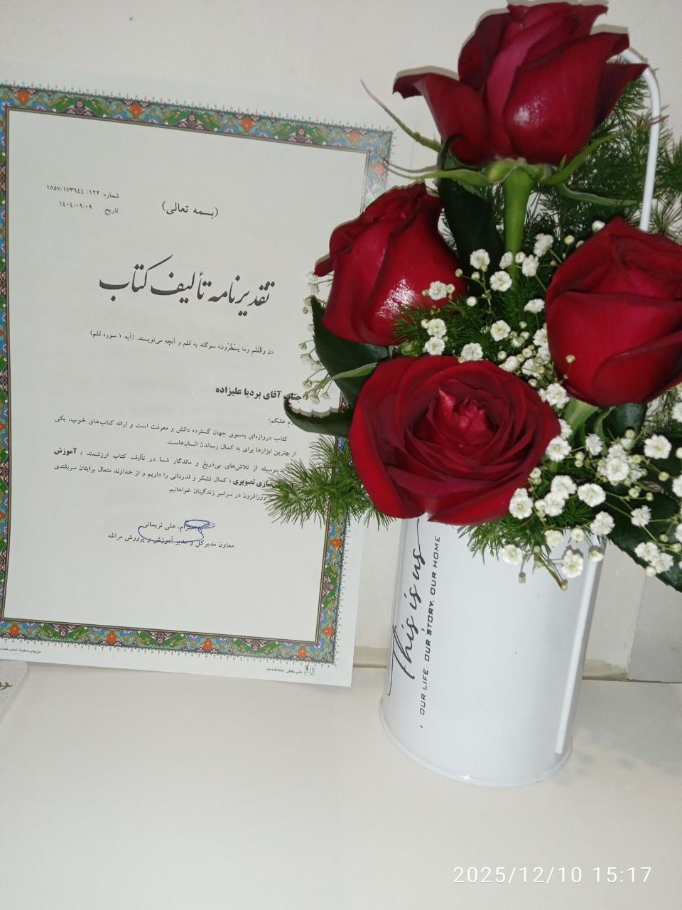</a>

[دیدن / دانلود](https://raw.githubusercontent.com/FarlandGame/Personal-Portfolio/main/images/personal-034.jpg)

این عکس‌ها، تقدیرنامهٔ تألیف کتاب و گل‌های روزی را نشان می‌دهند که برایم خیلی مهم بود. چند ماه پیش از آن، یک نسخه از کتابم را به آموزش‌وپرورش هدیه داده بودم. وقتی بالاخره مراسم تقدیر از نویسندگان رسید، به من گفته بودند تنها پانزده‌سالهٔ آن جمع هستم و شاید بهتر باشد میان بزرگ‌ترها نباشم. برای من، وجود یک نویسندهٔ نوجوان باید دلیل استقبال می‌بود؛ اصرار کردم که من هم می‌آیم.

از مدرسه به آموزش‌وپرورش رفتیم. یادم هست هنگام ورود احساس می‌کردم نادیده گرفته می‌شوم و باید توضیح بدهم که نویسنده‌ام. حدود یک ساعت نام‌ها را خواندند و اسم من آخر از همه خوانده شد. به یادم، آن موقع بعضی‌ها رفته بودند و بعضی‌ها سرشان در گوشی بود. احساس می‌کردم آن لحظه بدون توجهی که انتظار داشتم گذشت. این روایت، خاطره و احساس شخصی من از آن روز است؛ نه قضاوت دربارهٔ نیت دیگران.

به یادم، همراه تقدیرنامه پانصد هزار تومان دریافت کردم. قیمت کتابم سیصد و پنجاه هزار تومان بود و قبلاً یک نسخه را هدیه داده بودم. از شدت ناراحتی، این دو عدد را در ذهنم مقایسه می‌کردم: صد و پنجاه هزار تومان بیشتر از قیمت کتابی که اهدا کرده بودم. برای من، این تقدیر در مقایسه با آن همه تلاش و انتظار، کم‌رنگ به نظر می‌رسید.

اما دسته‌گل خوشحالم کرد. دایی سیامکم که آنجا حضور داشت، آن را برایم خرید. مادرم و «عزیز»، اختر امیرصادقی، هم بودند. پدرم نتوانست بیاید. آن شب مادرم این عکس‌ها را گرفت. کنار دلخوری آن روز، گرمای حضور خانواده و گل‌ها هم در خاطرم مانده است.

یادداشت تاریخ: زمان مراسم را اواخر دی‌ماه ۱۴۰۴، نزدیک بهمن، به یاد دارم. تاریخ چاپ‌شده روی خودِ لوح ۱۴۰۴/۰۹/۰۹ است؛ تا روشن‌شدن موضوع، تاریخ روی سند و خاطرهٔ من از روز مراسم جدا ثبت شده‌اند.

## personal-035 · خاطرات شخصی و خانوادگی

<a href="https://raw.githubusercontent.com/FarlandGame/Personal-Portfolio/main/images/personal-035.jpg">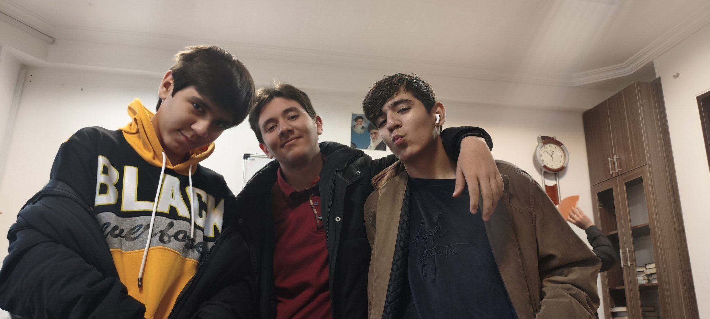</a>

[دیدن / دانلود](https://raw.githubusercontent.com/FarlandGame/Personal-Portfolio/main/images/personal-035.jpg)

این تصویر مربوط به مجموعه‌ای از عکس‌های یک روز بارانی در مدرسه است. فکر می‌کنم اوایل شهریور بود، اما تاریخ دقیقش را مطمئن نیستم. ایرپادم را به مدرسه برده بودم و در حیاط، میان طوفان، آهنگ گوش می‌دادم و خودم را شخصیتی قدرتمند تصور می‌کردم. وقتی به کلاس برگشتم، موهایم خیس بود.

دوستم اشکان محمدعلی‌پور با گوشی خودش از من، برادرم و امیرحسین صادق عکس گرفت. اشکان ادیتور من هم هست و در کارهای After Effects و انیمیشن‌های Blender کمکم می‌کند. آن موقع امیرحسین را SenpaiXD صدا می‌کردم؛ او نام هنری‌اش را زیاد تغییر می‌دهد، چون چیز تکراری دوست ندارد. اشکان و دوستمان صدرا شاهی در این مجموعهٔ عکس حضور ندارند. بعداً خودم بعضی از عکس‌ها را با ادیت، سیاه‌وسفید و دارک‌تر کردم.

بلافاصله بعد از عکس‌ها، روز سختی شد. به یادم، ناظم مدرسه، آقای عزیزی، گوشی و ایرپادم را گرفت و تا روز بعد نگه داشت. خیلی ناراحت شدم و گریه کردم. این عکس‌ها برای من هم هیجان آن لحظه کنار دوستانم را دارند و هم خاطرهٔ تلخِ بعد از آن را.

## personal-036 · خاطرات شخصی و خانوادگی

<a href="https://raw.githubusercontent.com/FarlandGame/Personal-Portfolio/main/images/personal-036.jpg">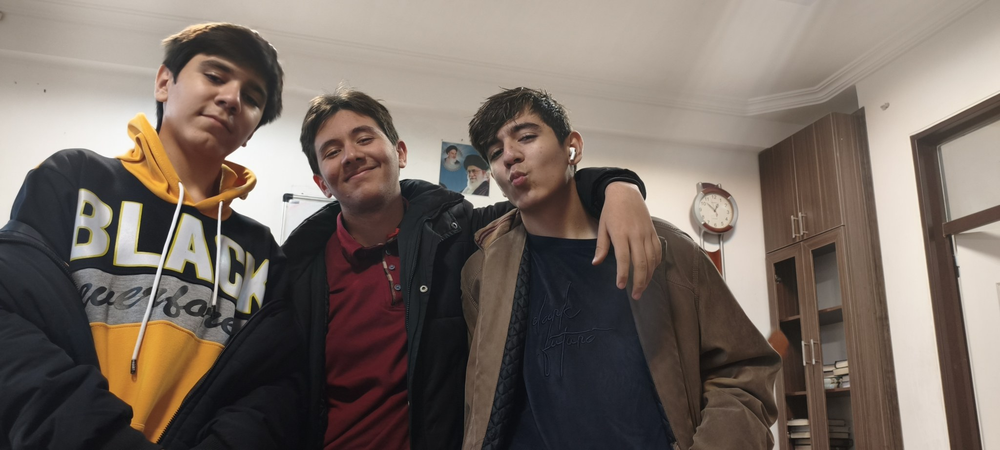</a>

[دیدن / دانلود](https://raw.githubusercontent.com/FarlandGame/Personal-Portfolio/main/images/personal-036.jpg)

این تصویر مربوط به مجموعه‌ای از عکس‌های یک روز بارانی در مدرسه است. فکر می‌کنم اوایل شهریور بود، اما تاریخ دقیقش را مطمئن نیستم. ایرپادم را به مدرسه برده بودم و در حیاط، میان طوفان، آهنگ گوش می‌دادم و خودم را شخصیتی قدرتمند تصور می‌کردم. وقتی به کلاس برگشتم، موهایم خیس بود.

دوستم اشکان محمدعلی‌پور با گوشی خودش از من، برادرم و امیرحسین صادق عکس گرفت. اشکان ادیتور من هم هست و در کارهای After Effects و انیمیشن‌های Blender کمکم می‌کند. آن موقع امیرحسین را SenpaiXD صدا می‌کردم؛ او نام هنری‌اش را زیاد تغییر می‌دهد، چون چیز تکراری دوست ندارد. اشکان و دوستمان صدرا شاهی در این مجموعهٔ عکس حضور ندارند. بعداً خودم بعضی از عکس‌ها را با ادیت، سیاه‌وسفید و دارک‌تر کردم.

بلافاصله بعد از عکس‌ها، روز سختی شد. به یادم، ناظم مدرسه، آقای عزیزی، گوشی و ایرپادم را گرفت و تا روز بعد نگه داشت. خیلی ناراحت شدم و گریه کردم. این عکس‌ها برای من هم هیجان آن لحظه کنار دوستانم را دارند و هم خاطرهٔ تلخِ بعد از آن را.

## personal-037 · خاطرات شخصی و خانوادگی

<a href="https://raw.githubusercontent.com/FarlandGame/Personal-Portfolio/main/images/personal-037.jpg">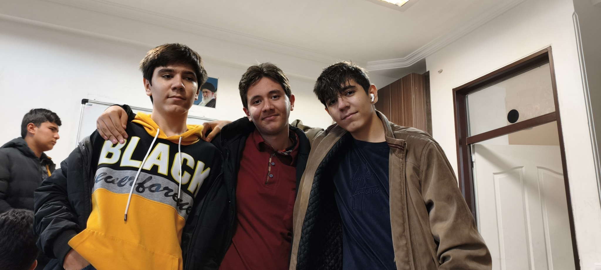</a>

[دیدن / دانلود](https://raw.githubusercontent.com/FarlandGame/Personal-Portfolio/main/images/personal-037.jpg)

این تصویر مربوط به مجموعه‌ای از عکس‌های یک روز بارانی در مدرسه است. فکر می‌کنم اوایل شهریور بود، اما تاریخ دقیقش را مطمئن نیستم. ایرپادم را به مدرسه برده بودم و در حیاط، میان طوفان، آهنگ گوش می‌دادم و خودم را شخصیتی قدرتمند تصور می‌کردم. وقتی به کلاس برگشتم، موهایم خیس بود.

دوستم اشکان محمدعلی‌پور با گوشی خودش از من، برادرم و امیرحسین صادق عکس گرفت. اشکان ادیتور من هم هست و در کارهای After Effects و انیمیشن‌های Blender کمکم می‌کند. آن موقع امیرحسین را SenpaiXD صدا می‌کردم؛ او نام هنری‌اش را زیاد تغییر می‌دهد، چون چیز تکراری دوست ندارد. اشکان و دوستمان صدرا شاهی در این مجموعهٔ عکس حضور ندارند. بعداً خودم بعضی از عکس‌ها را با ادیت، سیاه‌وسفید و دارک‌تر کردم.

بلافاصله بعد از عکس‌ها، روز سختی شد. به یادم، ناظم مدرسه، آقای عزیزی، گوشی و ایرپادم را گرفت و تا روز بعد نگه داشت. خیلی ناراحت شدم و گریه کردم. این عکس‌ها برای من هم هیجان آن لحظه کنار دوستانم را دارند و هم خاطرهٔ تلخِ بعد از آن را.

## personal-038 · خاطرات شخصی و خانوادگی

<a href="https://raw.githubusercontent.com/FarlandGame/Personal-Portfolio/main/images/personal-038.jpg">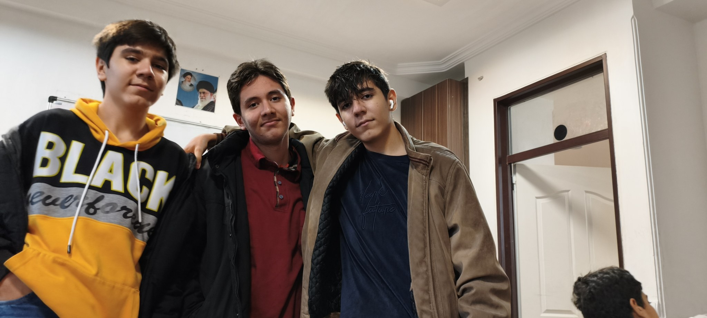</a>

[دیدن / دانلود](https://raw.githubusercontent.com/FarlandGame/Personal-Portfolio/main/images/personal-038.jpg)

این تصویر مربوط به مجموعه‌ای از عکس‌های یک روز بارانی در مدرسه است. فکر می‌کنم اوایل شهریور بود، اما تاریخ دقیقش را مطمئن نیستم. ایرپادم را به مدرسه برده بودم و در حیاط، میان طوفان، آهنگ گوش می‌دادم و خودم را شخصیتی قدرتمند تصور می‌کردم. وقتی به کلاس برگشتم، موهایم خیس بود.

دوستم اشکان محمدعلی‌پور با گوشی خودش از من، برادرم و امیرحسین صادق عکس گرفت. اشکان ادیتور من هم هست و در کارهای After Effects و انیمیشن‌های Blender کمکم می‌کند. آن موقع امیرحسین را SenpaiXD صدا می‌کردم؛ او نام هنری‌اش را زیاد تغییر می‌دهد، چون چیز تکراری دوست ندارد. اشکان و دوستمان صدرا شاهی در این مجموعهٔ عکس حضور ندارند. بعداً خودم بعضی از عکس‌ها را با ادیت، سیاه‌وسفید و دارک‌تر کردم.

بلافاصله بعد از عکس‌ها، روز سختی شد. به یادم، ناظم مدرسه، آقای عزیزی، گوشی و ایرپادم را گرفت و تا روز بعد نگه داشت. خیلی ناراحت شدم و گریه کردم. این عکس‌ها برای من هم هیجان آن لحظه کنار دوستانم را دارند و هم خاطرهٔ تلخِ بعد از آن را.

## personal-039 · خاطرات شخصی و خانوادگی

<a href="https://raw.githubusercontent.com/FarlandGame/Personal-Portfolio/main/images/personal-039.jpg">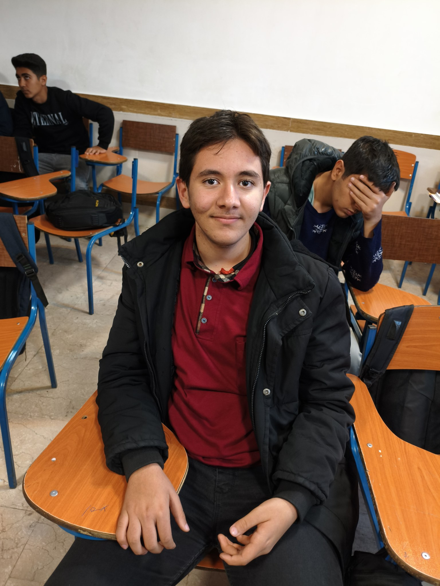</a>

[دیدن / دانلود](https://raw.githubusercontent.com/FarlandGame/Personal-Portfolio/main/images/personal-039.jpg)

این تصویر مربوط به مجموعه‌ای از عکس‌های یک روز بارانی در مدرسه است. فکر می‌کنم اوایل شهریور بود، اما تاریخ دقیقش را مطمئن نیستم. ایرپادم را به مدرسه برده بودم و در حیاط، میان طوفان، آهنگ گوش می‌دادم و خودم را شخصیتی قدرتمند تصور می‌کردم. وقتی به کلاس برگشتم، موهایم خیس بود.

دوستم اشکان محمدعلی‌پور با گوشی خودش از من، برادرم و امیرحسین صادق عکس گرفت. اشکان ادیتور من هم هست و در کارهای After Effects و انیمیشن‌های Blender کمکم می‌کند. آن موقع امیرحسین را SenpaiXD صدا می‌کردم؛ او نام هنری‌اش را زیاد تغییر می‌دهد، چون چیز تکراری دوست ندارد. اشکان و دوستمان صدرا شاهی در این مجموعهٔ عکس حضور ندارند. بعداً خودم بعضی از عکس‌ها را با ادیت، سیاه‌وسفید و دارک‌تر کردم.

بلافاصله بعد از عکس‌ها، روز سختی شد. به یادم، ناظم مدرسه، آقای عزیزی، گوشی و ایرپادم را گرفت و تا روز بعد نگه داشت. خیلی ناراحت شدم و گریه کردم. این عکس‌ها برای من هم هیجان آن لحظه کنار دوستانم را دارند و هم خاطرهٔ تلخِ بعد از آن را.

## personal-040 · خاطرات شخصی و خانوادگی

<a href="https://raw.githubusercontent.com/FarlandGame/Personal-Portfolio/main/images/personal-040.jpg">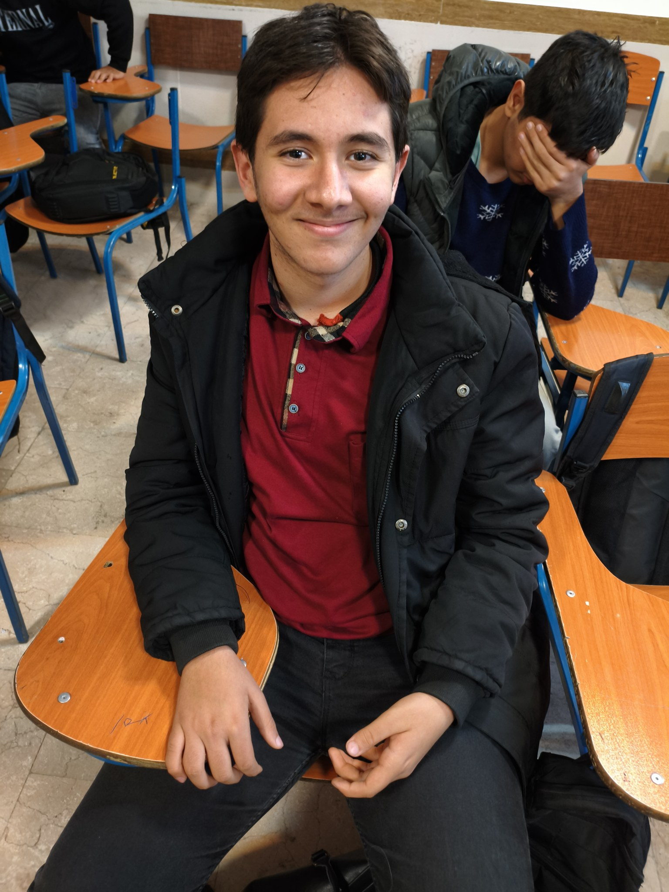</a>

[دیدن / دانلود](https://raw.githubusercontent.com/FarlandGame/Personal-Portfolio/main/images/personal-040.jpg)

این تصویر مربوط به مجموعه‌ای از عکس‌های یک روز بارانی در مدرسه است. فکر می‌کنم اوایل شهریور بود، اما تاریخ دقیقش را مطمئن نیستم. ایرپادم را به مدرسه برده بودم و در حیاط، میان طوفان، آهنگ گوش می‌دادم و خودم را شخصیتی قدرتمند تصور می‌کردم. وقتی به کلاس برگشتم، موهایم خیس بود.

دوستم اشکان محمدعلی‌پور با گوشی خودش از من، برادرم و امیرحسین صادق عکس گرفت. اشکان ادیتور من هم هست و در کارهای After Effects و انیمیشن‌های Blender کمکم می‌کند. آن موقع امیرحسین را SenpaiXD صدا می‌کردم؛ او نام هنری‌اش را زیاد تغییر می‌دهد، چون چیز تکراری دوست ندارد. اشکان و دوستمان صدرا شاهی در این مجموعهٔ عکس حضور ندارند. بعداً خودم بعضی از عکس‌ها را با ادیت، سیاه‌وسفید و دارک‌تر کردم.

بلافاصله بعد از عکس‌ها، روز سختی شد. به یادم، ناظم مدرسه، آقای عزیزی، گوشی و ایرپادم را گرفت و تا روز بعد نگه داشت. خیلی ناراحت شدم و گریه کردم. این عکس‌ها برای من هم هیجان آن لحظه کنار دوستانم را دارند و هم خاطرهٔ تلخِ بعد از آن را.

## personal-041 · خاطرات کتاب

[دیدن / دانلود](https://raw.githubusercontent.com/FarlandGame/Personal-Portfolio/main/images/personal-041.jpg)

این یکی از اسکرین‌شات‌هایی است که هنگام چاپ کتابم، وقتی آن را در سایت‌ها می‌دیدم، نگه داشتم. به یادم، دیجی‌کالا آن موقع کتابم را در وب معرفی و تبلیغ می‌کرد و می‌خواستم یادگاری‌ای از دیده‌شدنش داشته باشم. در خود این تصویر، جلد «آموزش انیمیشن‌سازی تصویری» در بخش «مطالب پیشنهادی» کنار معرفی کتاب و تخفیف پنج‌درصدی خرید اول دیده می‌شود. برای من، این خاطرهٔ دیده‌شدن کتاب بیرون از صفحه‌های خودم است؛ پیشنهاد تخفیف هم مربوط به همان تصویر ذخیره‌شده است.

## personal-042 · خاطرات کتاب

<a href="https://raw.githubusercontent.com/FarlandGame/Personal-Portfolio/main/images/personal-042.png">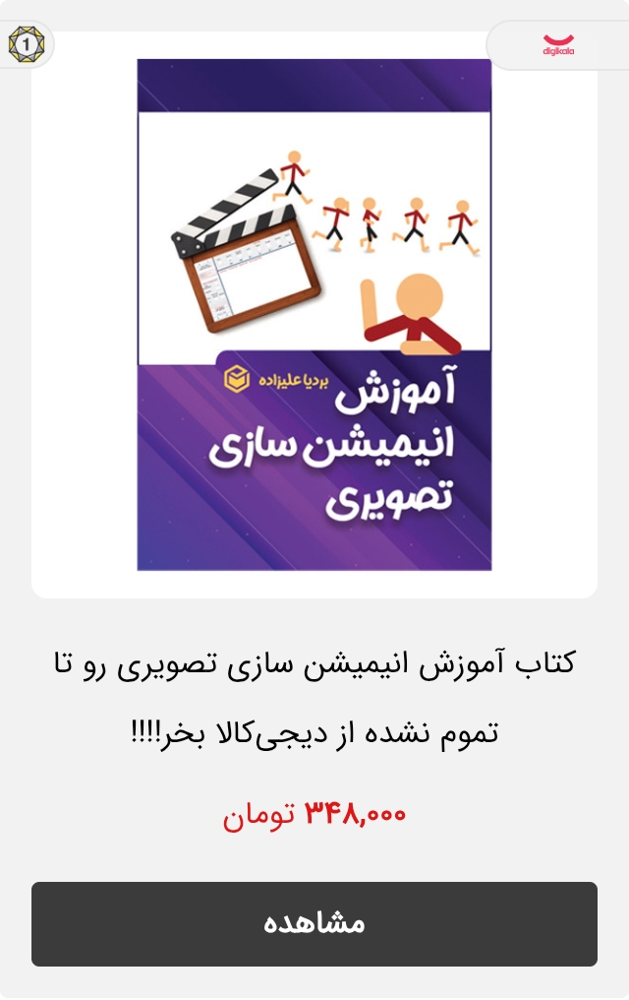</a>

[دیدن / دانلود](https://raw.githubusercontent.com/FarlandGame/Personal-Portfolio/main/images/personal-042.png)

این هم اسکرین‌شات دیگری از زمانی است که کتابم را در وب و میان معرفی‌ها و تبلیغات می‌دیدم؛ مربوط به همان خاطرهٔ عکس ۰۴۱ است. به یادم، دیجی‌کالا هنگام انتشار کتاب آن را معرفی و تبلیغ می‌کرد و من این تصویرها را به‌عنوان یادگاریِ دیده‌شدن کتاب در سایت‌ها نگه داشتم.

## personal-043 · خاطرات شخصی و خانوادگی

[دیدن / دانلود](https://raw.githubusercontent.com/FarlandGame/Personal-Portfolio/main/images/personal-043.jpg)

این دو عکس ساده را روی بالکن خانهٔ عزیز گرفتم، چون مدل موهایم برایم جالب شده بود. یادم هست در واقع می‌خواستم آن‌ها را برای کسی بفرستم، اما دیگر یادم نیست برای چه کسی. یک لحظهٔ معمولی که در گالری‌ام باقی مانده است.

## personal-044 · خاطرات شخصی و خانوادگی

[دیدن / دانلود](https://raw.githubusercontent.com/FarlandGame/Personal-Portfolio/main/images/personal-044.jpg)

این دو عکس ساده را روی بالکن خانهٔ عزیز گرفتم، چون مدل موهایم برایم جالب شده بود. یادم هست در واقع می‌خواستم آن‌ها را برای کسی بفرستم، اما دیگر یادم نیست برای چه کسی. یک لحظهٔ معمولی که در گالری‌ام باقی مانده است.

## personal-045 · خاطرات شخصی و خانوادگی

[دیدن / دانلود](https://raw.githubusercontent.com/FarlandGame/Personal-Portfolio/main/images/personal-045.jpg)

این عکس یادگاریِ من و امیرحسین صادق در مدرسه و مربوط به پایهٔ دهم است. امیرحسین پیشنهاد داد با هم یک عکس یادگاری بگیریم و من هم گرفتم. نور آفتاب باعث شد صورت او در عکس آن‌طور که می‌خواستیم واضح نیفتد، اما عکس یادگاریِ همان لحظهٔ دونفره باقی مانده است.

## personal-047 · خاطرات شخصی و خانوادگی

<a href="https://raw.githubusercontent.com/FarlandGame/Personal-Portfolio/main/images/personal-047.jpg">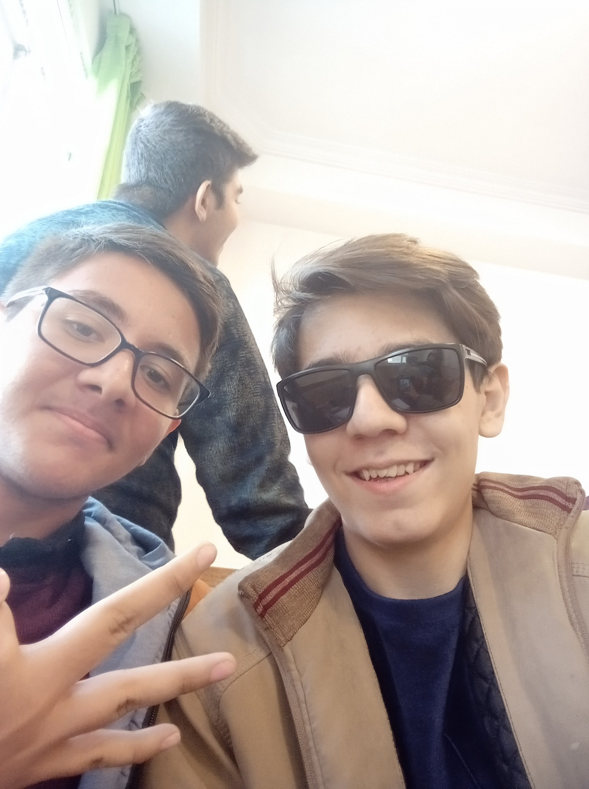</a>

[دیدن / دانلود](https://raw.githubusercontent.com/FarlandGame/Personal-Portfolio/main/images/personal-047.jpg)

این عکس یادگاریِ من و امیرحسین صادق در مدرسه و مربوط به پایهٔ دهم است. امیرحسین پیشنهاد داد با هم یک عکس یادگاری بگیریم و من هم گرفتم. نور آفتاب باعث شد صورت او در عکس آن‌طور که می‌خواستیم واضح نیفتد، اما عکس یادگاریِ همان لحظهٔ دونفره باقی مانده است.

## personal-048 · خاطرات شخصی و خانوادگی

<a href="https://raw.githubusercontent.com/FarlandGame/Personal-Portfolio/main/images/personal-048.jpg">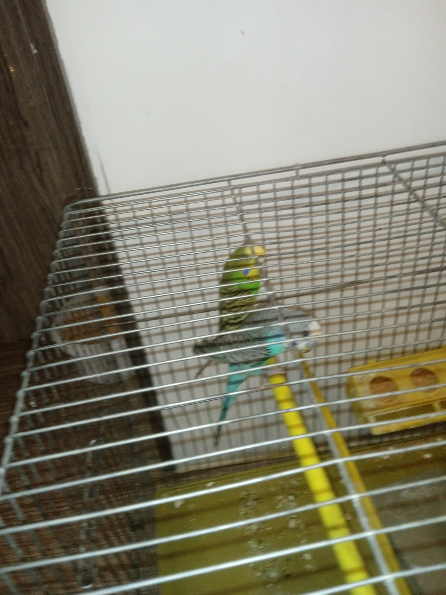</a>

[دیدن / دانلود](https://raw.githubusercontent.com/FarlandGame/Personal-Portfolio/main/images/personal-048.jpg)

عکس ۰۴۸، مرغ‌عشق‌های والدِ خانوادهٔ پرنده‌هایی را نشان می‌دهد که نگه می‌داشتیم.

از حدود پایهٔ هفتم و سیزده‌سالگی، این مرغ‌عشق آبی و یک مرغ‌عشق سفید داشتیم. حدود سه سال کنار هم بودند، اما تخم نمی‌گذاشتند. فروشنده گفته بود جفت‌اند، ولی بعداً به نظرم رسید شاید هر دو نر بودند. ویتامین و کارهای مختلف را امتحان کردم و در نهایت پرندهٔ سفید مرد.

بعدتر پدرم در خیابان یک مرغ‌عشق سبز پیدا کرد. حالش خوب به نظر نمی‌رسید و منقار و ناخن‌هایش کج بود؛ برای همین آن را پیش دامپزشک بردم. به یادم، دامپزشک گفت ماده‌ای بسیار پیر و بیمار است و امید چندانی به درمانش نیست. بعداً آن را با یک مادهٔ جوان‌تر عوض کردیم. وقتی مادهٔ جدید کنار پرندهٔ آبی آمد، جفت‌گیری کردند و تخم گذاشتند. حدود پنج جوجه به یاد دارم؛ یک بار سه جوجه و بار دیگر دو جوجه، و بعضی تخم‌ها هم باز نمی‌شدند. جوجه‌ها شبیه پدرشان می‌شدند.

سرانجام پرنده‌ها خیلی پرسروصدا شدند و آن‌ها را فروختیم. این‌ها از آخرین عکس‌هایی هستند که از آن خانوادهٔ کوچک پرنده نگه داشتم.

یک خاطرهٔ قدیمی‌تر هم داریم: وقتی من و برادرم حدود سه یا چهار سال داشتیم، خاله‌مان دو مرغ‌عشق طلایی و سفید برایمان خرید. پرندهٔ طلایی را گربه‌ای در خانهٔ مادربزرگ گرفت. سفید را به خانهٔ خودمان آوردیم و چند سال نگه داشتیم؛ به یادم، بعدها پس از خوردن خرمالو مرد. این‌ها خاطرات من از اتفاق‌ها هستند، نه علت‌های دامپزشکیِ تأییدشده.

## personal-049 · خاطرات شخصی و خانوادگی

[دیدن / دانلود](https://raw.githubusercontent.com/FarlandGame/Personal-Portfolio/main/images/personal-049.jpg)

عکس ۰۴۹، دو جوجهٔ آن‌ها را نشان می‌دهد. به یادم، جوجه‌ها همرنگ پدرشان می‌شدند.

از حدود پایهٔ هفتم و سیزده‌سالگی، این مرغ‌عشق آبی و یک مرغ‌عشق سفید داشتیم. حدود سه سال کنار هم بودند، اما تخم نمی‌گذاشتند. فروشنده گفته بود جفت‌اند، ولی بعداً به نظرم رسید شاید هر دو نر بودند. ویتامین و کارهای مختلف را امتحان کردم و در نهایت پرندهٔ سفید مرد.

بعدتر پدرم در خیابان یک مرغ‌عشق سبز پیدا کرد. حالش خوب به نظر نمی‌رسید و منقار و ناخن‌هایش کج بود؛ برای همین آن را پیش دامپزشک بردم. به یادم، دامپزشک گفت ماده‌ای بسیار پیر و بیمار است و امید چندانی به درمانش نیست. بعداً آن را با یک مادهٔ جوان‌تر عوض کردیم. وقتی مادهٔ جدید کنار پرندهٔ آبی آمد، جفت‌گیری کردند و تخم گذاشتند. حدود پنج جوجه به یاد دارم؛ یک بار سه جوجه و بار دیگر دو جوجه، و بعضی تخم‌ها هم باز نمی‌شدند. جوجه‌ها شبیه پدرشان می‌شدند.

سرانجام پرنده‌ها خیلی پرسروصدا شدند و آن‌ها را فروختیم. این‌ها از آخرین عکس‌هایی هستند که از آن خانوادهٔ کوچک پرنده نگه داشتم.

یک خاطرهٔ قدیمی‌تر هم داریم: وقتی من و برادرم حدود سه یا چهار سال داشتیم، خاله‌مان دو مرغ‌عشق طلایی و سفید برایمان خرید. پرندهٔ طلایی را گربه‌ای در خانهٔ مادربزرگ گرفت. سفید را به خانهٔ خودمان آوردیم و چند سال نگه داشتیم؛ به یادم، بعدها پس از خوردن خرمالو مرد. این‌ها خاطرات من از اتفاق‌ها هستند، نه علت‌های دامپزشکیِ تأییدشده.

## personal-050 · خاطرات شخصی و خانوادگی

<a href="https://raw.githubusercontent.com/FarlandGame/Personal-Portfolio/main/images/personal-050.jpg">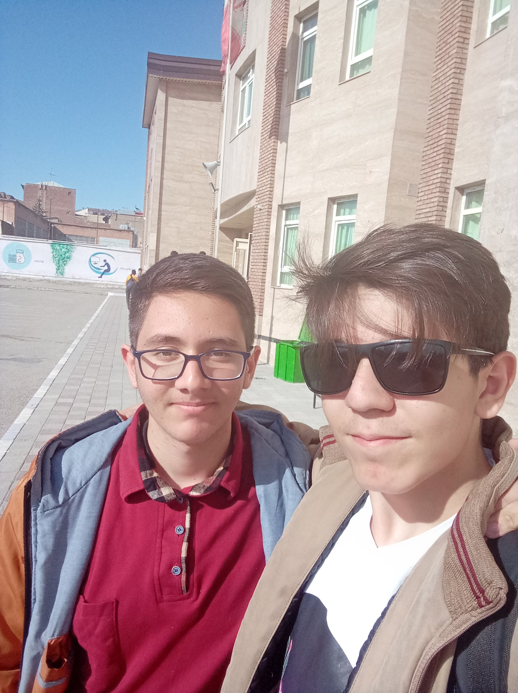</a>

[دیدن / دانلود](https://raw.githubusercontent.com/FarlandGame/Personal-Portfolio/main/images/personal-050.jpg)

این عکس‌ها را هنگام بیرون‌آمدن از مدرسه در پایهٔ دهم گرفتیم. امیرحسین صادق گفت با هم عکس بگیریم و من هم گرفتم. پیراهن سفیدم طرح کانال و برند خودم را دارد: کاکتوس و نوشتهٔ بنفش LOVE. این پیراهن را در پایهٔ نهم طراحی و چاپ کردم و هزینه‌اش، به یادم، حدود دو میلیون تومان بود.

## personal-051 · خاطرات شخصی و خانوادگی

[دیدن / دانلود](https://raw.githubusercontent.com/FarlandGame/Personal-Portfolio/main/images/personal-051.jpg)

این عکس‌ها را هنگام بیرون‌آمدن از مدرسه در پایهٔ دهم گرفتیم. امیرحسین صادق گفت با هم عکس بگیریم و من هم گرفتم. پیراهن سفیدم طرح کانال و برند خودم را دارد: کاکتوس و نوشتهٔ بنفش LOVE. این پیراهن را در پایهٔ نهم طراحی و چاپ کردم و هزینه‌اش، به یادم، حدود دو میلیون تومان بود.

در عکس ۰۵۱، یکی از دانش‌آموزان پایهٔ یازدهم دید که عکس می‌گیریم و آمد وسط ما ایستاد تا با هم عکس بگیریم. فکر می‌کنم اسمش نجف بود، اما مطمئن نیستم.

## personal-052 · خاطرات شخصی و خانوادگی

[دیدن / دانلود](https://raw.githubusercontent.com/FarlandGame/Personal-Portfolio/main/images/personal-052.jpg)

این عکس‌ها را هنگام بیرون‌آمدن از مدرسه در پایهٔ دهم گرفتیم. امیرحسین صادق گفت با هم عکس بگیریم و من هم گرفتم. پیراهن سفیدم طرح کانال و برند خودم را دارد: کاکتوس و نوشتهٔ بنفش LOVE. این پیراهن را در پایهٔ نهم طراحی و چاپ کردم و هزینه‌اش، به یادم، حدود دو میلیون تومان بود.

## personal-053 · خاطرات کتاب

[دیدن / دانلود](https://raw.githubusercontent.com/FarlandGame/Personal-Portfolio/main/images/personal-053.jpg)

این هم اسکرین‌شات دیگری از معرفی و تبلیغ کتابم در اینترنت است. مثل تصویرهای قبلی، آن را به‌عنوان یادگاریِ دیده‌شدن کتاب در سایت‌ها نگه داشتم.

## personal-054 · خاطرات شخصی و خانوادگی

[دیدن / دانلود](https://raw.githubusercontent.com/FarlandGame/Personal-Portfolio/main/images/personal-054.jpg)

این یک عکس معمولی در مدرسه است. همان پیراهن سفید با طرح کاکتوس و LOVE بنفشِ برند خودم را پوشیده‌ام. یکی از دانش‌آموزان به نام سینا وطن هم در این عکس دیده می‌شود.

## personal-055 · خاطرات کتاب

<a href="https://raw.githubusercontent.com/FarlandGame/Personal-Portfolio/main/images/personal-055.jpg">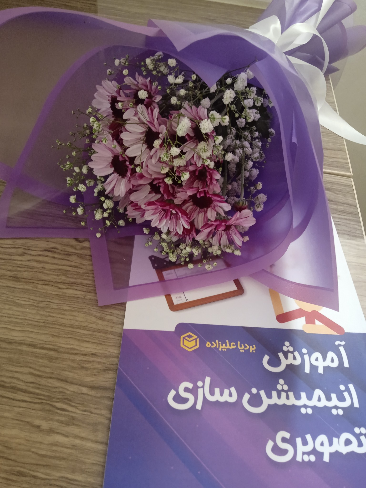</a>

[دیدن / دانلود](https://raw.githubusercontent.com/FarlandGame/Personal-Portfolio/main/images/personal-055.jpg)

شبی که اولین ۵۰ جلد از چاپ اول کتابم به دستم رسید، مادرم کیک گرفت و من، برادر دوقلویم و مادرم با هم جشن گرفتیم. عکس گرفتیم، لحظه را استوری کردیم و کیک را خوردیم؛ یک جشن خانوادگی برای دیدن اولین کتابم در نسخهٔ چاپی. این عکس‌ها هم همان شب گرفته شدند و آن‌ها را استوری کردم.

## personal-056 · خاطرات کتاب

[دیدن / دانلود](https://raw.githubusercontent.com/FarlandGame/Personal-Portfolio/main/images/personal-056.jpg)

شبی که اولین ۵۰ جلد از چاپ اول کتابم به دستم رسید، مادرم کیک گرفت و من، برادر دوقلویم و مادرم با هم جشن گرفتیم. عکس گرفتیم، لحظه را استوری کردیم و کیک را خوردیم؛ یک جشن خانوادگی برای دیدن اولین کتابم در نسخهٔ چاپی. این عکس‌ها هم همان شب گرفته شدند و آن‌ها را استوری کردم.

## personal-057 · خاطرات کتاب

[دیدن / دانلود](https://raw.githubusercontent.com/FarlandGame/Personal-Portfolio/main/images/personal-057.jpg)

شبی که اولین ۵۰ جلد از چاپ اول کتابم به دستم رسید، مادرم کیک گرفت و من، برادر دوقلویم و مادرم با هم جشن گرفتیم. عکس گرفتیم، لحظه را استوری کردیم و کیک را خوردیم؛ یک جشن خانوادگی برای دیدن اولین کتابم در نسخهٔ چاپی.

## personal-058 · خاطرات کتاب

<a href="https://raw.githubusercontent.com/FarlandGame/Personal-Portfolio/main/images/personal-058.jpg">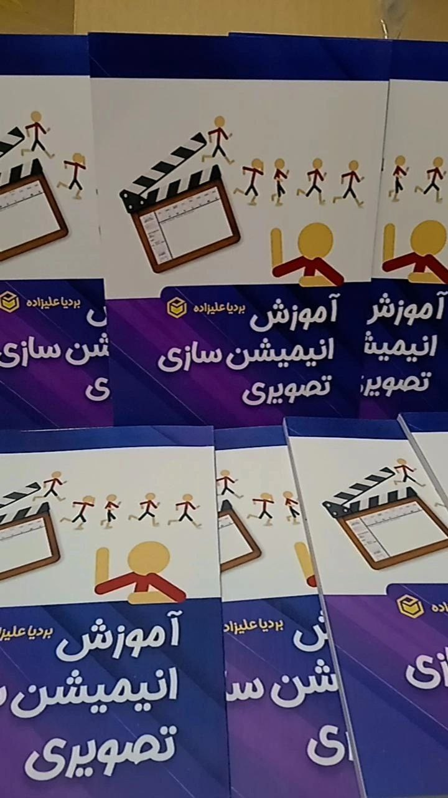</a>

[دیدن / دانلود](https://raw.githubusercontent.com/FarlandGame/Personal-Portfolio/main/images/personal-058.jpg)

شبی که اولین ۵۰ جلد از چاپ اول کتابم به دستم رسید، مادرم کیک گرفت و من، برادر دوقلویم و مادرم با هم جشن گرفتیم. عکس گرفتیم، لحظه را استوری کردیم و کیک را خوردیم؛ یک جشن خانوادگی برای دیدن اولین کتابم در نسخهٔ چاپی. این عکس‌ها هم همان شب گرفته شدند و آن‌ها را استوری کردم.

## personal-059 · خاطرات کتاب

[دیدن / دانلود](https://raw.githubusercontent.com/FarlandGame/Personal-Portfolio/main/images/personal-059.jpg)

آن شب از صفحهٔ مقدمهٔ کتابم هم عکس گرفتیم.

شبی که اولین ۵۰ جلد از چاپ اول کتابم به دستم رسید، مادرم کیک گرفت و من، برادر دوقلویم و مادرم با هم جشن گرفتیم. عکس گرفتیم، لحظه را استوری کردیم و کیک را خوردیم؛ یک جشن خانوادگی برای دیدن اولین کتابم در نسخهٔ چاپی.

## personal-060 · خاطرات شخصی و خانوادگی

[دیدن / دانلود](https://raw.githubusercontent.com/FarlandGame/Personal-Portfolio/main/images/personal-060.jpg)

این عکس مربوط به جشنوارهٔ کتابی در تهران در سال ۱۴۰۴ است. برای تبلیغات کلاسینو یک فضای ماینکرفتی ساخته بودند، با کاراکتر زامبی و کلاه‌های استیو. اگر با زامبی عکس می‌گرفتی و استوری می‌کردی، وارد قرعه‌کشی می‌شدی. برنده نشدم، اما این عکس و کلاه‌های استیو را به‌عنوان یادگاریِ آن بازدید نگه داشتم.

## personal-061 · خاطرات شخصی و خانوادگی

[دیدن / دانلود](https://raw.githubusercontent.com/FarlandGame/Personal-Portfolio/main/images/personal-061.jpg)

این عکس کودکیِ خودم است؛ حدود یک تا دو سال داشتم. بعدها با گوشی از عکس داخل آلبوم عکس گرفتم. بازتاب نور و کیفیت عکس گوشی باعث شد نسخهٔ ارسالی وضوح خوبی نداشته باشد؛ برای همین خواستم یک نسخهٔ ترمیم‌شدهٔ جدا داشته باشم و نسخهٔ ارسالی هم حفظ شود.

[نسخهٔ ترمیم‌شده با هوش مصنوعی؛ کاهش بازتاب نور و بهبود وضوح](https://raw.githubusercontent.com/FarlandGame/Personal-Portfolio/main/restorations/personal-061-ai-restored.png)

## personal-062 · خاطرات شخصی و خانوادگی

[دیدن / دانلود](https://raw.githubusercontent.com/FarlandGame/Personal-Portfolio/main/images/personal-062.jpg)

این عکس را از پایهٔ نهم و حدود سال ۱۴۰۲ یا ۱۴۰۳ به یاد دارم؛ از سال دقیقش مطمئن نیستم. لباس ورزشی طوسی‌ام یادم می‌آورد که دوشنبه بود و زنگ اول ورزش داشتیم.

موقع بیرون‌آمدن از مدرسه به دوستم علی عطا، که از هفتم تا حالا با او دوستم، گفتم عکس درست‌وحسابی با هم نداریم و پیشنهاد دادم عکس بگیریم. به نظر خودم، هیچ‌کداممان خیلی خوب نیفتادیم؛ ولی دوستی‌مان خیلی بهتر از کیفیت این عکس است! او از بهترین دوست‌هایی است که هرکسی می‌تواند داشته باشد.

## personal-063 · خاطرات شخصی و خانوادگی

[دیدن / دانلود](https://raw.githubusercontent.com/FarlandGame/Personal-Portfolio/main/images/personal-063.jpg)

این عکس یادگاری مربوط به همان دوشنبهٔ ورزشِ عکس ۰۶۲ است. لباس ورزشی پوشیده بودم و این عکس را با الیار نیک‌پور، از دوستان آن دورهٔ مدرسه، گرفتم. یادگاریِ آن روزهای دوستی است، هرچند امروز مثل آن موقع نزدیک نیستیم.

## personal-064 · خاطرات شخصی و خانوادگی

[دیدن / دانلود](https://raw.githubusercontent.com/FarlandGame/Personal-Portfolio/main/images/personal-064.jpg)

این عکس مربوط به بازدیدمان از جشنوارهٔ سالانهٔ کتاب در تهران است. همان گردش و همان روزی بود که فضای تبلیغاتیِ ماینکرفتیِ کلاسینو و کلاه‌های استیو را دیدیم؛ خاطره‌ای که برای عکس ۰۶۰ گفته‌ام. آن روز تهران بودیم و با هم به جشنواره رفتیم.

## personal-065 · خاطرات شخصی و خانوادگی

[دیدن / دانلود](https://raw.githubusercontent.com/FarlandGame/Personal-Portfolio/main/images/personal-065.jpg)

در این عکس از همان بازدید جشنوارهٔ کتاب تهران، مادرم دیده می‌شود.

این عکس مربوط به بازدیدمان از جشنوارهٔ سالانهٔ کتاب در تهران است. همان گردش و همان روزی بود که فضای تبلیغاتیِ ماینکرفتیِ کلاسینو و کلاه‌های استیو را دیدیم؛ خاطره‌ای که برای عکس ۰۶۰ گفته‌ام. آن روز تهران بودیم و با هم به جشنواره رفتیم.

## personal-066 · خاطرات شخصی و خانوادگی

[دیدن / دانلود](https://raw.githubusercontent.com/FarlandGame/Personal-Portfolio/main/images/personal-066.jpg)

این عکس مادرم مربوط به سفرِ تولد پانزده‌سالگی من است؛ پانزده سال را تمام کرده بودم و وارد شانزدهمین سال زندگی‌ام می‌شدم. با مادرم و خانوادهٔ مادری‌ام به تبریز رفتیم و جشن گرفتیم. فکر می‌کنم اسم رستوران «برکه» بود، اما از نامش مطمئن نیستم. خیلی خوش گذشت و بعد هم به شهربازی رفتیم؛ روز خوب و شادی کنار خانواده بود.

## personal-067 · خاطرات شخصی و خانوادگی

<a href="https://raw.githubusercontent.com/FarlandGame/Personal-Portfolio/main/images/personal-067.jpg">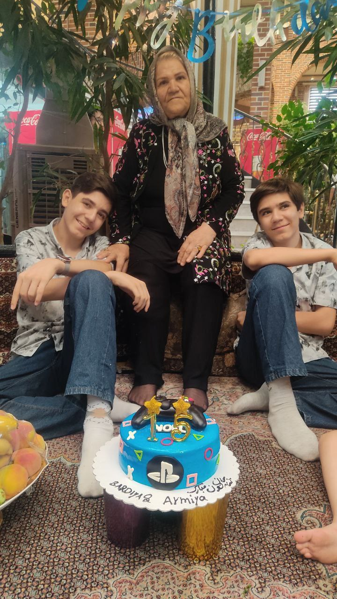</a>

[دیدن / دانلود](https://raw.githubusercontent.com/FarlandGame/Personal-Portfolio/main/images/personal-067.jpg)

این عکس‌ها مربوط به همان جشن تولد در تبریز هستند که خاطره‌اش را برای عکس ۰۶۶ گفتم. پانزده سال را تمام کرده بودم و وارد شانزدهمین سال زندگی‌ام می‌شدم. با مادرم و خانوادهٔ مادری‌ام در رستورانی که نامش را «برکه» به یاد دارم جشن گرفتیم. خیلی خوش گذشت و بعد هم به شهربازی رفتیم. این‌ها یادگاری‌های بیشتری از همان روز خوب خانوادگی هستند.

## personal-068 · خاطرات شخصی و خانوادگی

<a href="https://raw.githubusercontent.com/FarlandGame/Personal-Portfolio/main/images/personal-068.jpg">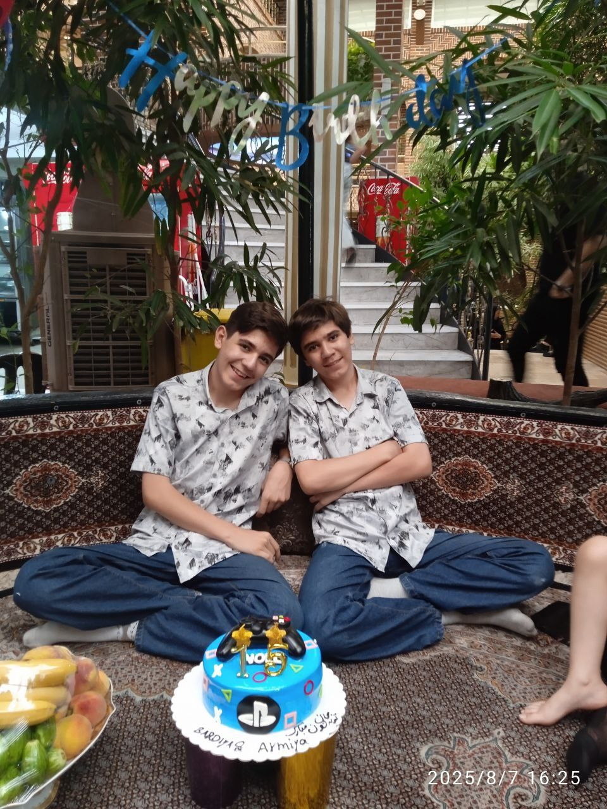</a>

[دیدن / دانلود](https://raw.githubusercontent.com/FarlandGame/Personal-Portfolio/main/images/personal-068.jpg)

این عکس‌ها مربوط به همان جشن تولد در تبریز هستند که خاطره‌اش را برای عکس ۰۶۶ گفتم. پانزده سال را تمام کرده بودم و وارد شانزدهمین سال زندگی‌ام می‌شدم. با مادرم و خانوادهٔ مادری‌ام در رستورانی که نامش را «برکه» به یاد دارم جشن گرفتیم. خیلی خوش گذشت و بعد هم به شهربازی رفتیم. این‌ها یادگاری‌های بیشتری از همان روز خوب خانوادگی هستند.

## personal-069 · خاطرات شخصی و خانوادگی

<a href="https://raw.githubusercontent.com/FarlandGame/Personal-Portfolio/main/images/personal-069.jpg">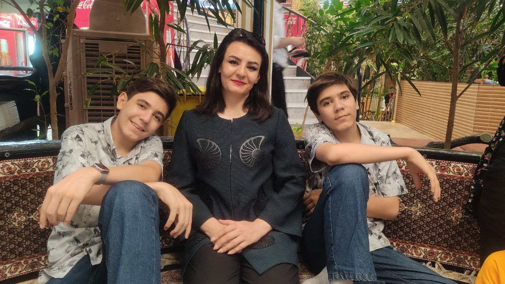</a>

[دیدن / دانلود](https://raw.githubusercontent.com/FarlandGame/Personal-Portfolio/main/images/personal-069.jpg)

این عکس‌ها مربوط به همان جشن تولد در تبریز هستند که خاطره‌اش را برای عکس ۰۶۶ گفتم. پانزده سال را تمام کرده بودم و وارد شانزدهمین سال زندگی‌ام می‌شدم. با مادرم و خانوادهٔ مادری‌ام در رستورانی که نامش را «برکه» به یاد دارم جشن گرفتیم. خیلی خوش گذشت و بعد هم به شهربازی رفتیم. این‌ها یادگاری‌های بیشتری از همان روز خوب خانوادگی هستند.

## personal-070 · خاطرات شخصی و خانوادگی

<a href="https://raw.githubusercontent.com/FarlandGame/Personal-Portfolio/main/images/personal-070.jpg">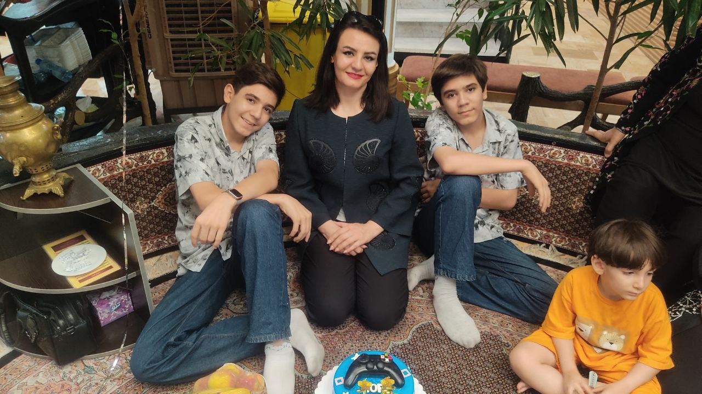</a>

[دیدن / دانلود](https://raw.githubusercontent.com/FarlandGame/Personal-Portfolio/main/images/personal-070.jpg)

این عکس‌ها مربوط به همان جشن تولد در تبریز هستند که خاطره‌اش را برای عکس ۰۶۶ گفتم. پانزده سال را تمام کرده بودم و وارد شانزدهمین سال زندگی‌ام می‌شدم. با مادرم و خانوادهٔ مادری‌ام در رستورانی که نامش را «برکه» به یاد دارم جشن گرفتیم. خیلی خوش گذشت و بعد هم به شهربازی رفتیم. این‌ها یادگاری‌های بیشتری از همان روز خوب خانوادگی هستند.

## personal-071 · خاطرات شخصی و خانوادگی

<a href="https://raw.githubusercontent.com/FarlandGame/Personal-Portfolio/main/images/personal-071.jpg">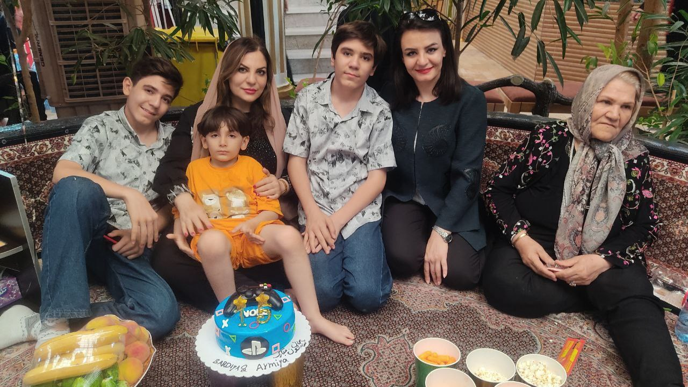</a>

[دیدن / دانلود](https://raw.githubusercontent.com/FarlandGame/Personal-Portfolio/main/images/personal-071.jpg)

این عکس‌ها مربوط به همان جشن تولد در تبریز هستند که خاطره‌اش را برای عکس ۰۶۶ گفتم. پانزده سال را تمام کرده بودم و وارد شانزدهمین سال زندگی‌ام می‌شدم. با مادرم و خانوادهٔ مادری‌ام در رستورانی که نامش را «برکه» به یاد دارم جشن گرفتیم. خیلی خوش گذشت و بعد هم به شهربازی رفتیم. این‌ها یادگاری‌های بیشتری از همان روز خوب خانوادگی هستند.

## personal-072 · خاطرات شخصی و خانوادگی

[دیدن / دانلود](https://raw.githubusercontent.com/FarlandGame/Personal-Portfolio/main/images/personal-072.jpg)

این عکس‌ها مربوط به همان جشن تولد در تبریز هستند که خاطره‌اش را برای عکس ۰۶۶ گفتم. پانزده سال را تمام کرده بودم و وارد شانزدهمین سال زندگی‌ام می‌شدم. با مادرم و خانوادهٔ مادری‌ام در رستورانی که نامش را «برکه» به یاد دارم جشن گرفتیم. خیلی خوش گذشت و بعد هم به شهربازی رفتیم. این‌ها یادگاری‌های بیشتری از همان روز خوب خانوادگی هستند.

## personal-074 · خاطرات شخصی و خانوادگی

[دیدن / دانلود](https://raw.githubusercontent.com/FarlandGame/Personal-Portfolio/main/images/personal-074.jpg)

این عکس را از عید نوروز، در سال ۱۴۰۳ یا ۱۴۰۴، به یاد دارم. مطمئن نیستم کدام سال بوده؛ برای همین تاریخش را همان‌طور نامطمئن نگه می‌دارم.

## personal-075 · خاطرات شخصی و خانوادگی

[دیدن / دانلود](https://raw.githubusercontent.com/FarlandGame/Personal-Portfolio/main/images/personal-075.jpg)

این عکس را از عید نوروز، در سال ۱۴۰۳ یا ۱۴۰۴، به یاد دارم. مطمئن نیستم کدام سال بوده؛ برای همین تاریخش را همان‌طور نامطمئن نگه می‌دارم.

## personal-076 · خاطرات شخصی و خانوادگی

[دیدن / دانلود](https://raw.githubusercontent.com/FarlandGame/Personal-Portfolio/main/images/personal-076.jpg)

این عکس‌ها مربوط به دوران دبستان من و برادر دوقلویم ارمیا هستند؛ یادگاری‌هایی از کودکیِ مشترکمان. سال دقیقشان را مشخص نکرده‌ام.

## personal-077 · خاطرات شخصی و خانوادگی

[دیدن / دانلود](https://raw.githubusercontent.com/FarlandGame/Personal-Portfolio/main/images/personal-077.jpg)

این عکس یادگاریِ دورهٔ ده‌جلسه‌ای فن بیان طاها بامشاد است که من و برادر دوقلویم در تابستان ۱۴۰۳، در ماه‌های مرداد و شهریور، گذراندیم.

آن ماه‌های تابستان برایم نقطهٔ عطف شدند. به تجربهٔ خودم، بعد از دوره اعتمادبه‌نفسم خیلی بیشتر شد، خجالتم کمتر شد و صحبت‌کردن و بیان خودم برایم راحت‌تر شد. رفتارم و نگاهم به خودم تغییر کرد.

## personal-078 · خاطرات شخصی و خانوادگی

[دیدن / دانلود](https://raw.githubusercontent.com/FarlandGame/Personal-Portfolio/main/images/personal-078.jpg)

این عکس‌ها مربوط به دوران دبستان من و برادر دوقلویم ارمیا هستند؛ یادگاری‌هایی از کودکیِ مشترکمان. سال دقیقشان را مشخص نکرده‌ام.

## personal-079 · خاطرات شخصی و خانوادگی

<a href="https://raw.githubusercontent.com/FarlandGame/Personal-Portfolio/main/images/personal-079.jpg">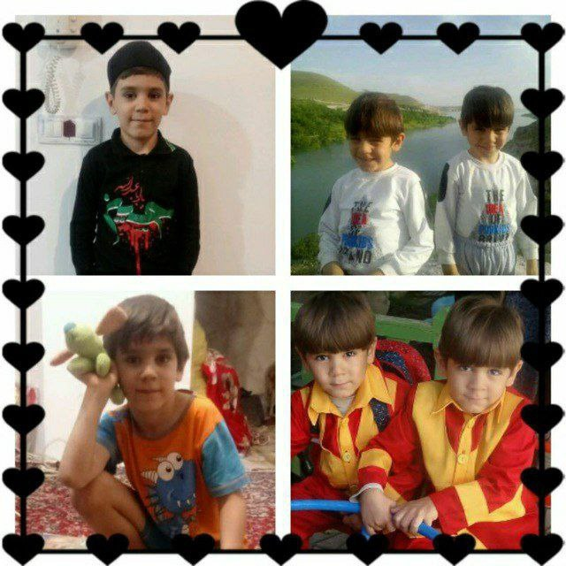</a>

[دیدن / دانلود](https://raw.githubusercontent.com/FarlandGame/Personal-Portfolio/main/images/personal-079.jpg)

این‌ها هم عکس‌های کودکی من و برادر دوقلویم ارمیا هستند؛ یادگاری‌های دیگری از سال‌های کودکیِ مشترکمان. سن و سال دقیقشان را مشخص نکرده‌ام.

## personal-080 · خاطرات شخصی و خانوادگی

[دیدن / دانلود](https://raw.githubusercontent.com/FarlandGame/Personal-Portfolio/main/images/personal-080.jpg)

این عکس یادگاریِ روز تولد مادرم است؛ از عکس‌هایی که از آن مناسبت خانوادگی نگه داشته‌ایم. سال دقیقش را مشخص نکرده‌ام.

## personal-081 · خاطرات شخصی و خانوادگی

[دیدن / دانلود](https://raw.githubusercontent.com/FarlandGame/Personal-Portfolio/main/images/personal-081.jpg)

این عکس یادگاریِ روز تولد مادرم است؛ از عکس‌هایی که از آن مناسبت خانوادگی نگه داشته‌ایم. سال دقیقش را مشخص نکرده‌ام.

## personal-082 · ادیت‌های پرتره

[دیدن / دانلود](https://raw.githubusercontent.com/FarlandGame/Personal-Portfolio/main/images/personal-082.jpg)

این عکس را دایی سیامکم در خانه‌اش در تهران از من گرفت. عکس را نگه داشتم و بعداً طرح برند خودم را به آن اضافه کردم. از نتیجه‌اش خوشم می‌آید؛ عکسی خانوادگی که بخشی از هویت خلاقانه‌ام هم شد.

## personal-083 · خاطرات شخصی و خانوادگی

[دیدن / دانلود](https://raw.githubusercontent.com/FarlandGame/Personal-Portfolio/main/images/personal-083.jpg)

این هم یک عکس دیگر با ژستی متفاوت از همان موقعیت عکس ۰۸۲ است. دایی سیامکم در خانه‌اش در تهران از من عکس گرفت و آن را به‌عنوان یادگاری دیگری از آن دیدار نگه داشتم.

## personal-084 · خاطرات شخصی و خانوادگی

[دیدن / دانلود](https://raw.githubusercontent.com/FarlandGame/Personal-Portfolio/main/images/personal-084.jpg)

کسی که در این عکس کلاه استیو را سرش کرده، دایی سیامکم است. کلاه ماینکرفتیِ استیو را گرفته بودم و او در همان دیدار آن را سرش گذاشت. من هم این عکس را از او گرفتم؛ یک یادگاری بامزه از آن روز در خانه‌اش در تهران.

## personal-085 · خاطرات شخصی و خانوادگی

[دیدن / دانلود](https://raw.githubusercontent.com/FarlandGame/Personal-Portfolio/main/images/personal-085.jpg)

این عکس واقعیِ آتلیه، مربوط به پیراهن برند خودم است. بعد از اینکه لباس دلخواهم را با لوگوی برند و کانالم طراحی کردم، با آن در آتلیه عکس گرفتم. عکس قدیمی است و در نسخهٔ فارسی کتابم هم آمده است.

## personal-086 · ادیت‌های پرتره

[دیدن / دانلود](https://raw.githubusercontent.com/FarlandGame/Personal-Portfolio/main/images/personal-086.jpg)

این تصویر نمای پشتِ طرح بلوزم است؛ بخشی از طراحی لباسی که هویت برند و کانالم را دارد. نمای جلوی پیراهن در عکس‌های بعدیِ گالری دیده می‌شود.

## personal-087 · ادیت‌های پرتره

[دیدن / دانلود](https://raw.githubusercontent.com/FarlandGame/Personal-Portfolio/main/images/personal-087.jpg)

این همان نمای جلوی طرح لباسم است که برای عکس ۰۸۶ گفته بودم. طرح مربوط به برند و کانال خودم است و در کنار نمای پشت، طراحی لباس را نشان می‌دهد.

## personal-088 · خاطرات شخصی و خانوادگی

[دیدن / دانلود](https://raw.githubusercontent.com/FarlandGame/Personal-Portfolio/main/images/personal-088.png)

این عکس قدیمیِ کودکی خودم است و دقیق یادم نیست چند سال داشتم. فایل ارسالی یک اسکرین‌شات گوشی بود؛ به درخواست من، بخش‌های رابط گوشی در بالا و پایین حذف شدند تا فقط خود عکس باقی بماند. روی خود عکس روتوشی انجام نشده است.

## personal-089 · خاطرات شخصی و خانوادگی

[دیدن / دانلود](https://raw.githubusercontent.com/FarlandGame/Personal-Portfolio/main/images/personal-089.jpg)

در این عکس مشغول کار روی انگشترسازی هستم. مدتی همراه برادر دوقلویم ارمیا در یک کلاس ساخت انگشتر با نقره شرکت کردیم و این یکی از عکس‌های همان تجربهٔ عملیِ یادگیری است.

## personal-090 · خاطرات شخصی و خانوادگی

[دیدن / دانلود](https://raw.githubusercontent.com/FarlandGame/Personal-Portfolio/main/images/personal-090.jpg)

این مادربزرگ مادری من است؛ مادرِ مادرم که او را «عزیز» صدا می‌کنم. این عکس را به‌عنوان یادگاری خانوادگی نگه داشته‌ام.

## personal-091 · خاطرات شخصی و خانوادگی

[دیدن / دانلود](https://raw.githubusercontent.com/FarlandGame/Personal-Portfolio/main/images/personal-091.jpg)

این هم عکس دیگری از مادربزرگ مادری‌ام، عزیز، در همان روز و همان زمانِ عکس ۰۹۰ است. این بار عینک آفتابی خودم را زده؛ یک یادگاری بامزهٔ خانوادگی.

## personal-092 · خاطرات شخصی و خانوادگی

[دیدن / دانلود](https://raw.githubusercontent.com/FarlandGame/Personal-Portfolio/main/images/personal-092.jpg)

این عکس مربوط به جشن خانوادگیِ بعد از مسابقهٔ شنای من است. به یادم، نفر اول شدم؛ همان خاطره‌ای که در بخش شنای رزومه‌ام گفته‌ام. آن شب پدر و مادرم کیک گرفتند و این عکس را با گواهی از من گرفتند.

گواهی‌های شنایی که تصویرشان منتشر شده، گواهی شرکت هستند و رتبه‌ای روی آن‌ها نوشته نشده؛ نفر اول شدن، خاطرهٔ شخصی من از مسابقه است. این عکس یادگاریِ جشن خانوادگی همان موفقیت است.

## personal-093 · خاطرات شخصی و خانوادگی

[دیدن / دانلود](https://raw.githubusercontent.com/FarlandGame/Personal-Portfolio/main/images/personal-093.jpg)

این سلفی من با آقای طاها بامشاد، در دورهٔ فن بیانی است که من و برادر دوقلویم گذراندیم. یادگاری‌ای کنار مدرس دورهٔ تابستان ۱۴۰۳؛ دوره‌ای که کمکم کرد با اعتمادبه‌نفس بیشتری صحبت کنم و خودم را بیان کنم.

## personal-094 · خاطرات شخصی و خانوادگی

[دیدن / دانلود](https://raw.githubusercontent.com/FarlandGame/Personal-Portfolio/main/images/personal-094.jpg)

در این عکس، برادر دوقلویم ارمیا در حال گرفتن سلفی با آقای طاها بامشاد در همان کلاس فن بیان است. هر دو دورهٔ تابستان ۱۴۰۳ را گذراندیم و این یادگاریِ ارمیا با مدرس‌مان است.

## personal-096 · THE APEX

[دیدن / دانلود](https://raw.githubusercontent.com/FarlandGame/Personal-Portfolio/main/images/personal-096.jpg)

این تصویر را علی، با نام هنری Alivexor، در اوایل شروع پروژهٔ THE APEX با Blender ساخته است. از کارهای تصویریِ آغاز پروژهٔ سرور داستانی ماینکرافت ماست. سازندهٔ این اثر علی است و من آن را به‌عنوان بخشی از تاریخچهٔ پروژه‌ای که با هم می‌ساختیم، اینجا گذاشته‌ام.

## personal-097 · THE APEX

<a href="https://raw.githubusercontent.com/FarlandGame/Personal-Portfolio/main/images/personal-097.jpg">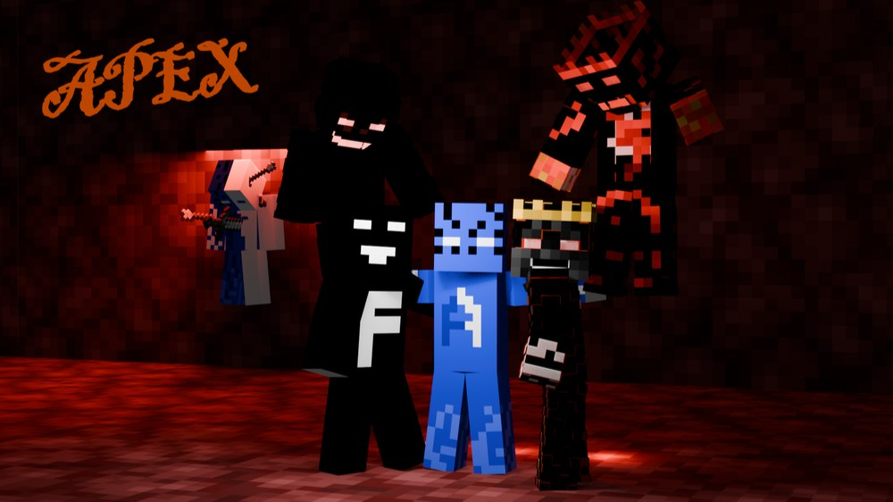</a>

[دیدن / دانلود](https://raw.githubusercontent.com/FarlandGame/Personal-Portfolio/main/images/personal-097.jpg)

این تصویر را علی، با نام هنری Alivexor، در اوایل شروع پروژهٔ THE APEX با Blender ساخته است. از کارهای تصویریِ آغاز پروژهٔ سرور داستانی ماینکرافت ماست. سازندهٔ این اثر علی است و من آن را به‌عنوان بخشی از تاریخچهٔ پروژه‌ای که با هم می‌ساختیم، اینجا گذاشته‌ام.

## personal-098 · THE APEX

[دیدن / دانلود](https://raw.githubusercontent.com/FarlandGame/Personal-Portfolio/main/images/personal-098.jpg)

این تصویر را علی، با نام هنری Alivexor، در اوایل شروع پروژهٔ THE APEX با Blender ساخته است. از کارهای تصویریِ آغاز پروژهٔ سرور داستانی ماینکرافت ماست. سازندهٔ این اثر علی است و من آن را به‌عنوان بخشی از تاریخچهٔ پروژه‌ای که با هم می‌ساختیم، اینجا گذاشته‌ام.

## personal-099 · THE APEX

<a href="https://raw.githubusercontent.com/FarlandGame/Personal-Portfolio/main/images/personal-099.jpg">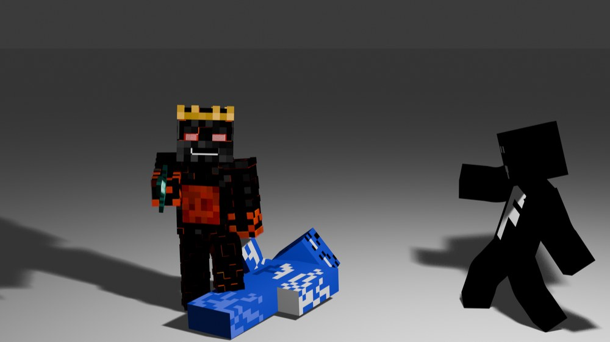</a>

[دیدن / دانلود](https://raw.githubusercontent.com/FarlandGame/Personal-Portfolio/main/images/personal-099.jpg)

این تصویر را علی، با نام هنری Alivexor، در اوایل شروع پروژهٔ THE APEX با Blender ساخته است. از کارهای تصویریِ آغاز پروژهٔ سرور داستانی ماینکرافت ماست. سازندهٔ این اثر علی است و من آن را به‌عنوان بخشی از تاریخچهٔ پروژه‌ای که با هم می‌ساختیم، اینجا گذاشته‌ام.

## personal-100 · THE APEX

<a href="https://raw.githubusercontent.com/FarlandGame/Personal-Portfolio/main/images/personal-100.jpg">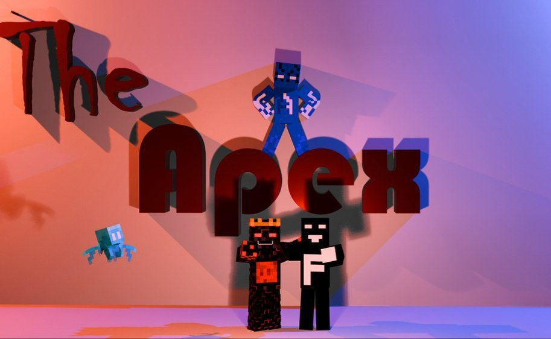</a>

[دیدن / دانلود](https://raw.githubusercontent.com/FarlandGame/Personal-Portfolio/main/images/personal-100.jpg)

این تصویر را علی، با نام هنری Alivexor، در اوایل شروع پروژهٔ THE APEX با Blender ساخته است. از کارهای تصویریِ آغاز پروژهٔ سرور داستانی ماینکرافت ماست. سازندهٔ این اثر علی است و من آن را به‌عنوان بخشی از تاریخچهٔ پروژه‌ای که با هم می‌ساختیم، اینجا گذاشته‌ام.

## personal-101 · THE APEX

[دیدن / دانلود](https://raw.githubusercontent.com/FarlandGame/Personal-Portfolio/main/images/personal-101.jpg)

این تصویرِ خوشامدگویی را اوایل شروع THE APEX طراحی کردم؛ قرار بود بازیکن هنگام ورود به سرور، این تصویر و نوشته‌هایش را ببیند. یادگاریِ ایده‌های بصری‌ای است که آن اوایل امتحان می‌کردم.

نام THE APEX را من و علی دهقان‌نژاد، با نام هنری Alivexor، با هم انتخاب کردیم. این پروژه را خیلی دوست دارم و دیدن این عکس‌های قدیمی، خاطرهٔ شروعش را زنده می‌کند. آینده‌ای را تصور می‌کنم که پروژه کامل شده و سراغ نسخه‌های دوم و سوم رفته‌ایم؛ این آرزوی آینده‌ام است، نه گزارش نسخه‌هایی که همین حالا منتشر شده‌اند.

## personal-102 · خاطرات شخصی و خانوادگی

[دیدن / دانلود](https://raw.githubusercontent.com/FarlandGame/Personal-Portfolio/main/images/personal-102.jpg)

این عکس مربوط به تابلوی دست‌ساز ریک است که برای سرگرمی مشغول ساختنش بودم. کار هنوز نیمه‌تمام بود و تا همان‌جا از نتیجه‌اش خوشم می‌آمد. بخشی از آن هنوز باقی مانده و قصد دارم کاملش کنم.

## personal-103 · خاطرات شخصی و خانوادگی

<a href="https://raw.githubusercontent.com/FarlandGame/Personal-Portfolio/main/images/personal-103.png">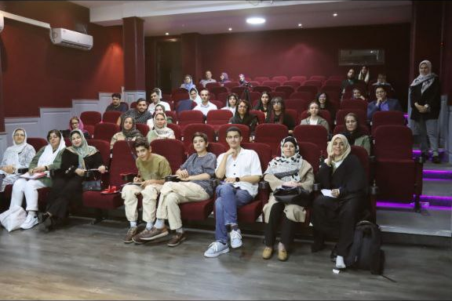</a>

[دیدن / دانلود](https://raw.githubusercontent.com/FarlandGame/Personal-Portfolio/main/images/personal-103.png)

این عکس گروهی مربوط به کلاس فن بیان طاها بامشاد است که من و برادر دوقلویم در تابستان ۱۴۰۳ گذراندیم. فایل ارسالی اسکرین‌شات گوشی بود و خواستم حاشیه‌های بالا و پایین حذف شوند. خود عکس با همان کیفیت و وضوح اصلی در کادر برش‌خورده حفظ شده است.

## personal-104 · خاطرات شخصی و خانوادگی

[دیدن / دانلود](https://raw.githubusercontent.com/FarlandGame/Personal-Portfolio/main/images/personal-104.jpg)

این عکس کودکی من و برادر دوقلویم ارمیا در مراسم عقد خاله هاله، در سال ۱۳۹۹ است.

## personal-105 · ادیت‌های پرتره

[دیدن / دانلود](https://raw.githubusercontent.com/FarlandGame/Personal-Portfolio/main/images/personal-105.jpg)

برای ساخت این قاب، چند عکس از خودم را کنار هم گذاشتم. آن موقع عکس‌ها را خیلی خوب می‌دانستم و می‌خواستم در یک ترکیب‌بندی کنار هم نگهشان دارم.

## personal-106 · ادیت‌های پرتره

[دیدن / دانلود](https://raw.githubusercontent.com/FarlandGame/Personal-Portfolio/main/images/personal-106.jpg)

این تصویر من و علی دهقان‌نژاد، با نام هنری Alivexor، است و آن را با هم درست کردیم. نتیجه‌اش را خیلی دوست دارم؛ کاری مشترک با دوست و همکار عزیزم.

## personal-107 · ادیت‌های پرتره

<a href="https://raw.githubusercontent.com/FarlandGame/Personal-Portfolio/main/images/personal-107.jpg">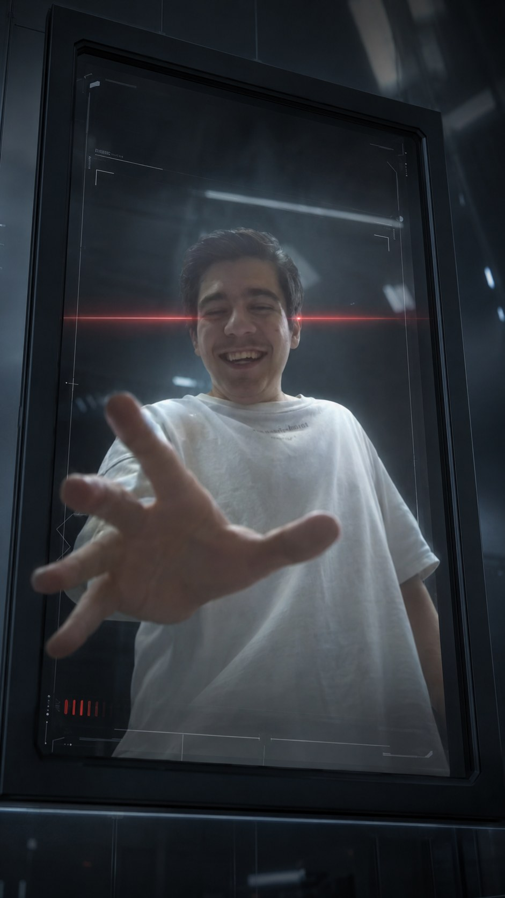</a>

[دیدن / دانلود](https://raw.githubusercontent.com/FarlandGame/Personal-Portfolio/main/images/personal-107.jpg)

این تصویرها را خودم با Photoshop و هوش مصنوعی برای دوستم اشکان محمدعلی‌پور درست کردم تا در یک ادیت ویدئویی از من استفاده کند. بخشی از آماده‌کردن مواد تصویری برای آن ادیت بودند. حالا که نگاهشان می‌کنم، حس می‌کنم دیگر آن‌قدرها شبیه من نیستند.

## personal-108 · ادیت‌های پرتره

[دیدن / دانلود](https://raw.githubusercontent.com/FarlandGame/Personal-Portfolio/main/images/personal-108.jpg)

این تصویرها را خودم با Photoshop و هوش مصنوعی برای دوستم اشکان محمدعلی‌پور درست کردم تا در یک ادیت ویدئویی از من استفاده کند. بخشی از آماده‌کردن مواد تصویری برای آن ادیت بودند. حالا که نگاهشان می‌کنم، حس می‌کنم دیگر آن‌قدرها شبیه من نیستند.

## personal-109 · ادیت‌های پرتره

<a href="https://raw.githubusercontent.com/FarlandGame/Personal-Portfolio/main/images/personal-109.jpg">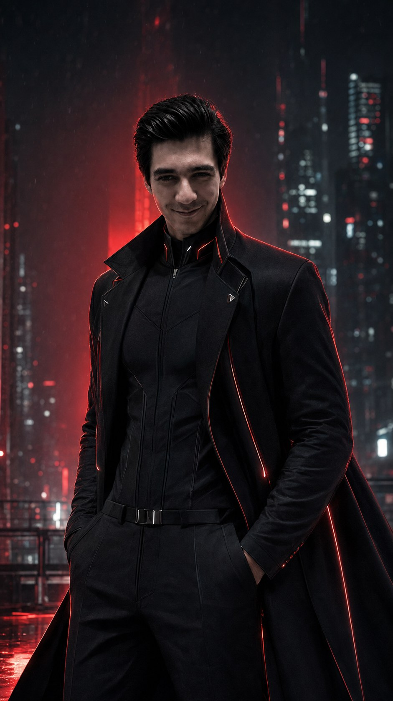</a>

[دیدن / دانلود](https://raw.githubusercontent.com/FarlandGame/Personal-Portfolio/main/images/personal-109.jpg)

این تصویرها را خودم با Photoshop و هوش مصنوعی برای دوستم اشکان محمدعلی‌پور درست کردم تا در یک ادیت ویدئویی از من استفاده کند. بخشی از آماده‌کردن مواد تصویری برای آن ادیت بودند. حالا که نگاهشان می‌کنم، حس می‌کنم دیگر آن‌قدرها شبیه من نیستند.

## personal-110 · ادیت‌های پرتره

[دیدن / دانلود](https://raw.githubusercontent.com/FarlandGame/Personal-Portfolio/main/images/personal-110.jpg)

این تصویرها را خودم با Photoshop و هوش مصنوعی برای دوستم اشکان محمدعلی‌پور درست کردم تا در یک ادیت ویدئویی از من استفاده کند. بخشی از آماده‌کردن مواد تصویری برای آن ادیت بودند. حالا که نگاهشان می‌کنم، حس می‌کنم دیگر آن‌قدرها شبیه من نیستند.

در میان این تصویرها، ۱۱۰ را بیشتر دوست دارم، چون حس‌وحال کمیک دارد.

## personal-111 · ادیت‌های پرتره

[دیدن / دانلود](https://raw.githubusercontent.com/FarlandGame/Personal-Portfolio/main/images/personal-111.jpg)

این تصویر خودم را با هوش مصنوعی و Photoshop برای پروژهٔ ویدئویی الهام‌گرفته از Better Call Saul ساختم. مربوط به همان پروژهٔ خلاقانهٔ عکس‌های ۰۰۲ تا ۰۰۴ و فیلم personal-video-12 است.

## personal-112 · ادیت‌های پرتره

[دیدن / دانلود](https://raw.githubusercontent.com/FarlandGame/Personal-Portfolio/main/images/personal-112.jpg)

این تصویر ترکیبیِ خودم کنار تصویری از فردوسی را با هوش مصنوعی و Photoshop برای ارائهٔ کلاسی دربارهٔ او ساختم. فردوسی را خیلی دوست دارم و او هم یکی از الگوهای من است.

من به‌جای سلام می‌گویم «درود» و به‌جای خداحافظی می‌گویم «بدرود»؛ شیوهٔ موردعلاقه‌ام برای آغاز و پایان گفت‌وگو. این تصویر، علاقه‌ام به ادبیات فارسی را با یک کار بصری برای ارائه‌ام پیوند می‌دهد.

## personal-113 · ادیت‌های پرتره

<a href="https://raw.githubusercontent.com/FarlandGame/Personal-Portfolio/main/images/personal-113.jpg">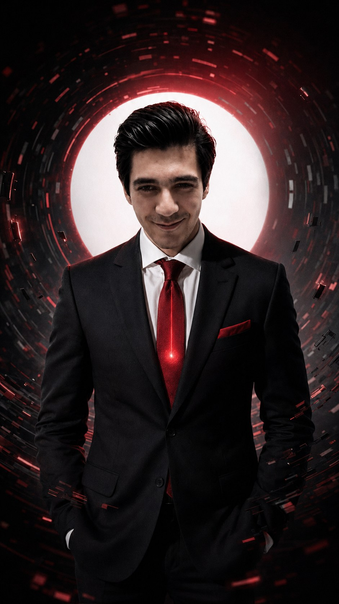</a>

[دیدن / دانلود](https://raw.githubusercontent.com/FarlandGame/Personal-Portfolio/main/images/personal-113.jpg)

این تصویرها را خودم با Photoshop و هوش مصنوعی برای دوستم اشکان محمدعلی‌پور درست کردم تا در یک ادیت ویدئویی از من استفاده کند. بخشی از آماده‌کردن مواد تصویری برای آن ادیت بودند. حالا که نگاهشان می‌کنم، حس می‌کنم دیگر آن‌قدرها شبیه من نیستند.

## personal-114 · ادیت‌های پرتره

<a href="https://raw.githubusercontent.com/FarlandGame/Personal-Portfolio/main/images/personal-114.jpg">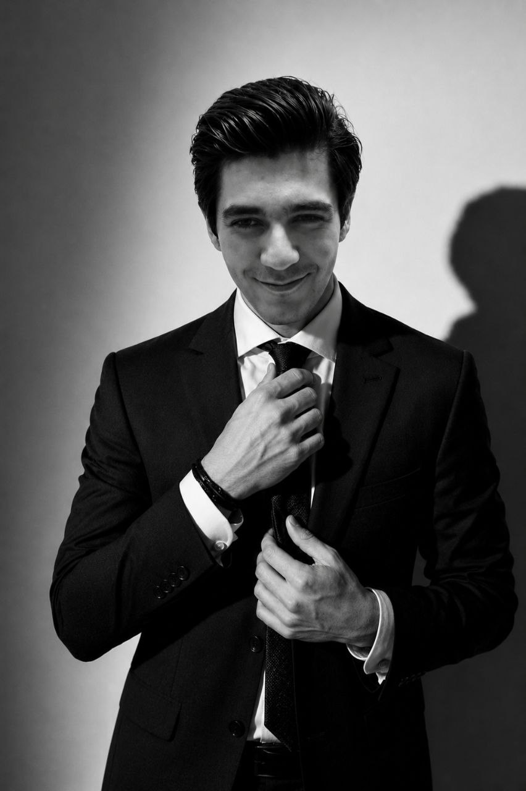</a>

[دیدن / دانلود](https://raw.githubusercontent.com/FarlandGame/Personal-Portfolio/main/images/personal-114.jpg)

این تصویرها را خودم با Photoshop و هوش مصنوعی برای دوستم اشکان محمدعلی‌پور درست کردم تا در یک ادیت ویدئویی از من استفاده کند. بخشی از آماده‌کردن مواد تصویری برای آن ادیت بودند. حالا که نگاهشان می‌کنم، حس می‌کنم دیگر آن‌قدرها شبیه من نیستند.

## personal-115 · ادیت‌های پرتره

<a href="https://raw.githubusercontent.com/FarlandGame/Personal-Portfolio/main/images/personal-115.jpg">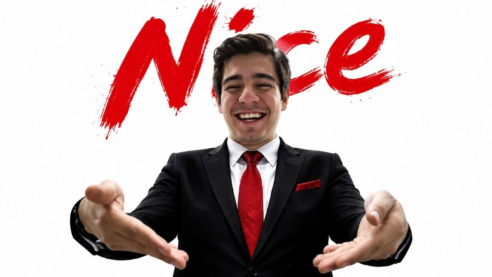</a>

[دیدن / دانلود](https://raw.githubusercontent.com/FarlandGame/Personal-Portfolio/main/images/personal-115.jpg)

این تصویرها از نخستین تجربه‌های من در تصویرسازی با کمک هوش مصنوعی هستند. آن موقع با Photoshop کار می‌کردم و می‌خواستم برای یک آلبوم اینستاگرام از خودم و برادر دوقلویم ارمیا تصویر بسازم. دوربین خوبی نداشتم، برای همین از عکس‌های خودمان و نسخهٔ پولی ChatGPT برای ساخت، ادیت و بازطراحی تصویرها استفاده کردم و بعد منتشرشان کردم. هنوز هم نتیجهٔ این تجربه‌های اولیه را دوست دارم.

## personal-116 · ادیت‌های پرتره

[دیدن / دانلود](https://raw.githubusercontent.com/FarlandGame/Personal-Portfolio/main/images/personal-116.jpg)

این تصویرها از نخستین تجربه‌های من در تصویرسازی با کمک هوش مصنوعی هستند. آن موقع با Photoshop کار می‌کردم و می‌خواستم برای یک آلبوم اینستاگرام از خودم و برادر دوقلویم ارمیا تصویر بسازم. دوربین خوبی نداشتم، برای همین از عکس‌های خودمان و نسخهٔ پولی ChatGPT برای ساخت، ادیت و بازطراحی تصویرها استفاده کردم و بعد منتشرشان کردم. هنوز هم نتیجهٔ این تجربه‌های اولیه را دوست دارم.

## personal-117 · ادیت‌های پرتره

[دیدن / دانلود](https://raw.githubusercontent.com/FarlandGame/Personal-Portfolio/main/images/personal-117.jpg)

این تصویرها از نخستین تجربه‌های من در تصویرسازی با کمک هوش مصنوعی هستند. آن موقع با Photoshop کار می‌کردم و می‌خواستم برای یک آلبوم اینستاگرام از خودم و برادر دوقلویم ارمیا تصویر بسازم. دوربین خوبی نداشتم، برای همین از عکس‌های خودمان و نسخهٔ پولی ChatGPT برای ساخت، ادیت و بازطراحی تصویرها استفاده کردم و بعد منتشرشان کردم. هنوز هم نتیجهٔ این تجربه‌های اولیه را دوست دارم.

## personal-118 · ادیت‌های پرتره

<a href="https://raw.githubusercontent.com/FarlandGame/Personal-Portfolio/main/images/personal-118.jpg">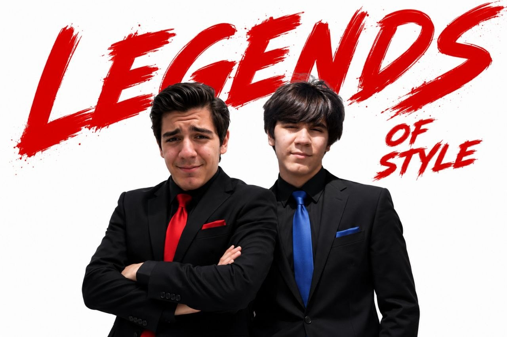</a>

[دیدن / دانلود](https://raw.githubusercontent.com/FarlandGame/Personal-Portfolio/main/images/personal-118.jpg)

این تصویرها از نخستین تجربه‌های من در تصویرسازی با کمک هوش مصنوعی هستند. آن موقع با Photoshop کار می‌کردم و می‌خواستم برای یک آلبوم اینستاگرام از خودم و برادر دوقلویم ارمیا تصویر بسازم. دوربین خوبی نداشتم، برای همین از عکس‌های خودمان و نسخهٔ پولی ChatGPT برای ساخت، ادیت و بازطراحی تصویرها استفاده کردم و بعد منتشرشان کردم. هنوز هم نتیجهٔ این تجربه‌های اولیه را دوست دارم.

در تصویر ۱۱۸، ارمیا همان شخصیتی است که جزئیات آبی دارد.

## personal-119 · ادیت‌های پرتره

<a href="https://raw.githubusercontent.com/FarlandGame/Personal-Portfolio/main/images/personal-119.jpg">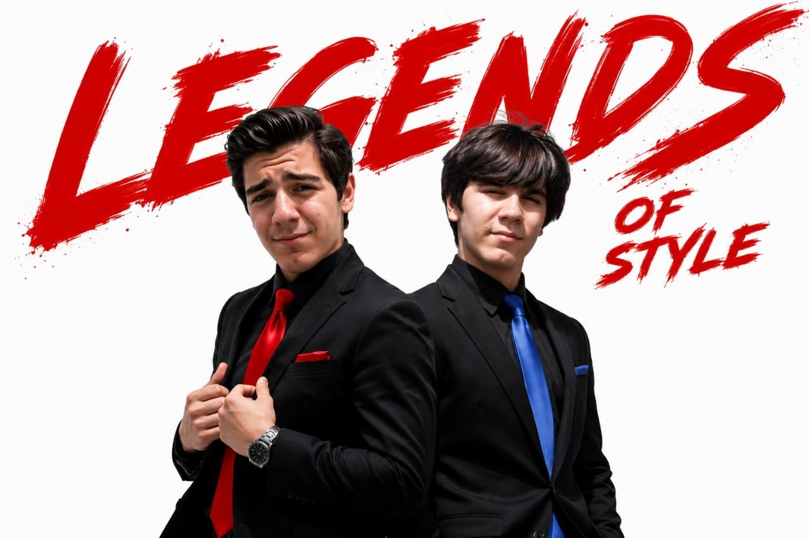</a>

[دیدن / دانلود](https://raw.githubusercontent.com/FarlandGame/Personal-Portfolio/main/images/personal-119.jpg)

این تصویرها از نخستین تجربه‌های من در تصویرسازی با کمک هوش مصنوعی هستند. آن موقع با Photoshop کار می‌کردم و می‌خواستم برای یک آلبوم اینستاگرام از خودم و برادر دوقلویم ارمیا تصویر بسازم. دوربین خوبی نداشتم، برای همین از عکس‌های خودمان و نسخهٔ پولی ChatGPT برای ساخت، ادیت و بازطراحی تصویرها استفاده کردم و بعد منتشرشان کردم. هنوز هم نتیجهٔ این تجربه‌های اولیه را دوست دارم.

## personal-120 · ادیت‌های پرتره

<a href="https://raw.githubusercontent.com/FarlandGame/Personal-Portfolio/main/images/personal-120.jpg">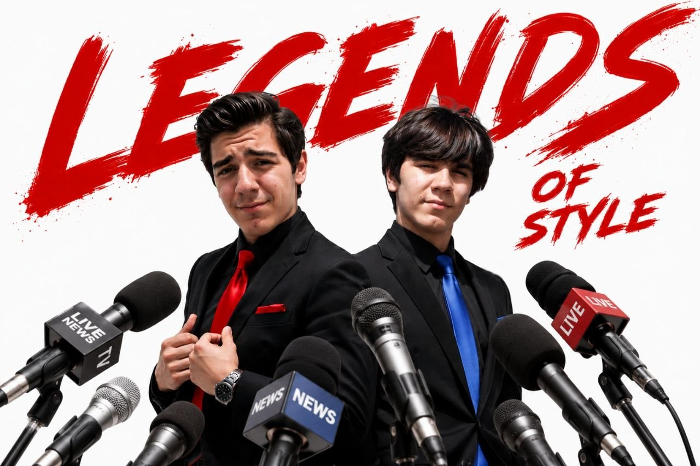</a>

[دیدن / دانلود](https://raw.githubusercontent.com/FarlandGame/Personal-Portfolio/main/images/personal-120.jpg)

این تصویرها از نخستین تجربه‌های من در تصویرسازی با کمک هوش مصنوعی هستند. آن موقع با Photoshop کار می‌کردم و می‌خواستم برای یک آلبوم اینستاگرام از خودم و برادر دوقلویم ارمیا تصویر بسازم. دوربین خوبی نداشتم، برای همین از عکس‌های خودمان و نسخهٔ پولی ChatGPT برای ساخت، ادیت و بازطراحی تصویرها استفاده کردم و بعد منتشرشان کردم. هنوز هم نتیجهٔ این تجربه‌های اولیه را دوست دارم.

## personal-121 · ادیت‌های پرتره

[دیدن / دانلود](https://raw.githubusercontent.com/FarlandGame/Personal-Portfolio/main/images/personal-121.jpg)

این تصویرها از نخستین تجربه‌های من در تصویرسازی با کمک هوش مصنوعی هستند. آن موقع با Photoshop کار می‌کردم و می‌خواستم برای یک آلبوم اینستاگرام از خودم و برادر دوقلویم ارمیا تصویر بسازم. دوربین خوبی نداشتم، برای همین از عکس‌های خودمان و نسخهٔ پولی ChatGPT برای ساخت، ادیت و بازطراحی تصویرها استفاده کردم و بعد منتشرشان کردم. هنوز هم نتیجهٔ این تجربه‌های اولیه را دوست دارم.

## personal-122 · ادیت‌های پرتره

[دیدن / دانلود](https://raw.githubusercontent.com/FarlandGame/Personal-Portfolio/main/images/personal-122.jpg)

این تصویر خودم را با Photoshop و هوش مصنوعی ساختم تا دوستم اشکان محمدعلی‌پور در ادیت ویدئویی از من استفاده کند. از همان مجموعهٔ مواد تصویریِ خلاقانه برای ادیت‌های اوست.

## personal-123 · خاطرات شخصی و خانوادگی

[دیدن / دانلود](https://raw.githubusercontent.com/FarlandGame/Personal-Portfolio/main/images/personal-123.jpg)

این عکس کودکیِ خودم است؛ حدود یک تا دو سال داشتم. بعدها با گوشی از عکس داخل آلبوم عکس گرفتم. بازتاب نور و کیفیت عکس گوشی باعث شد نسخهٔ ارسالی وضوح خوبی نداشته باشد؛ برای همین خواستم یک نسخهٔ ترمیم‌شدهٔ جدا داشته باشم و نسخهٔ ارسالی هم حفظ شود.

## personal-124 · خاطرات شخصی و خانوادگی

[دیدن / دانلود](https://raw.githubusercontent.com/FarlandGame/Personal-Portfolio/main/images/personal-124.jpg)

این هم عکسی از کودکیِ خودم است که میان عکس‌های قدیمی خانواده نگه داشته‌ام.

## personal-125 · خاطرات شخصی و خانوادگی

[دیدن / دانلود](https://raw.githubusercontent.com/FarlandGame/Personal-Portfolio/main/images/personal-125.jpg)

این هم عکسی از کودکیِ خودم است که میان عکس‌های قدیمی خانواده نگه داشته‌ام.

## personal-126 · خاطرات شخصی و خانوادگی

[دیدن / دانلود](https://raw.githubusercontent.com/FarlandGame/Personal-Portfolio/main/images/personal-126.jpg)

در این عکس کودکی، من و برادر دوقلویم ارمیا کنار کامپیوتر هستیم. از عکس‌های قدیمی خانوادگی است که نگه داشته‌ام.

## personal-127 · خاطرات شخصی و خانوادگی

[دیدن / دانلود](https://raw.githubusercontent.com/FarlandGame/Personal-Portfolio/main/images/personal-127.jpg)

این‌ها هم عکس‌های کودکی من و برادر دوقلویم ارمیا هستند؛ یادگاری‌های دیگری از سال‌های کودکیِ مشترکمان. سن و سال دقیقشان را مشخص نکرده‌ام.

## personal-129 · ادیت‌های پرتره

[دیدن / دانلود](https://raw.githubusercontent.com/FarlandGame/Personal-Portfolio/main/images/personal-129.jpg)

این نسخهٔ ادیت‌شدهٔ عکس کودکی‌ام، یعنی عکس ۱۲۳، است. با یک بازطراحی خلاقانه به تصویر کت‌وشلوار اضافه کردم؛ این لباس در ادیت به عکس اضافه شده است.

## personal-130 · خاطرات شخصی و خانوادگی

[دیدن / دانلود](https://raw.githubusercontent.com/FarlandGame/Personal-Portfolio/main/images/personal-130.jpg)

این تصویر را مدتی پیش برای پروفایلم طراحی کرده بودم. نتیجه‌اش را دوست دارم و آن را میان کارهای تصویری شخصی‌ام نگه داشته‌ام.

## personal-132 · خاطرات شخصی و خانوادگی

[دیدن / دانلود](https://raw.githubusercontent.com/FarlandGame/Personal-Portfolio/main/images/personal-132.jpg)

این پرترهٔ موردعلاقه‌ام از خودم است و از تصویر پایه در جاهای زیادی برای پروفایلم استفاده کرده‌ام. در میان نسخه‌هایش، این نسخهٔ کت‌وشلواری با کراوات قرمز را از همه بیشتر دوست دارم. این انتخاب و سلیقهٔ خودم است و هر دو نسخه کنار هم نگه داشته شده‌اند.

### نسخهٔ موردعلاقه‌ام؛ کت‌وشلوار با کراوات قرمز

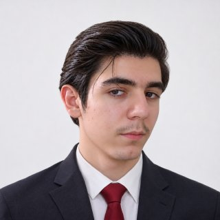

## personal-133 · ادیت‌های پرتره

[دیدن / دانلود](https://raw.githubusercontent.com/FarlandGame/Personal-Portfolio/main/images/personal-133.jpg)

این یکی از عکس‌های کودکی خودم است که با هوش مصنوعی به آن کت‌وشلوار اضافه کردم؛ بازطراحیِ یک عکس قدیمی با لباس رسمی که در ادیت به تصویر اضافه شده است.

## personal-134 · خاطرات شخصی و خانوادگی

[دیدن / دانلود](https://raw.githubusercontent.com/FarlandGame/Personal-Portfolio/main/images/personal-134.jpg)

این پرترهٔ آتلیه‌ایِ برادر دوقلویم ارمیاست. او به آتلیه رفت و این تصویر را تهیه کرد؛ حال‌وهوای جسور و شیکش را دوست دارم.

## personal-135 · ادیت‌های پرتره

[دیدن / دانلود](https://raw.githubusercontent.com/FarlandGame/Personal-Portfolio/main/images/personal-135.jpg)

این تصویر را با هوش مصنوعی برای ادیت ویدئوییِ دوستم و ادیتورم، اشکان محمدعلی‌پور، از خودم ساختم. این هم یکی از تصویرهای خلاقانه‌ای بود که برای آن ادیت آماده کردم؛ صحنه‌اش را به‌عنوان یک اتفاق واقعی معرفی نمی‌کنم. 🎬

## personal-136 · ادیت‌های پرتره

[دیدن / دانلود](https://raw.githubusercontent.com/FarlandGame/Personal-Portfolio/main/images/personal-136.jpg)

این هم تصویر دیگری از خودم است که با هوش مصنوعی برای ادیت ویدئوی اشکان محمدعلی‌پور ساختم. این عکس‌ها بخشی از تصویرهایی بودند که آماده کردم تا در ادیت از آن‌ها استفاده کند؛ یک قاب دیگر برای ادیت! 🎬

## personal-137 · ادیت‌های پرتره

[دیدن / دانلود](https://raw.githubusercontent.com/FarlandGame/Personal-Portfolio/main/images/personal-137.jpg)

این پرتره از یک عکس واقعی شروع شد: دقیقاً با همین ژست نشستم و عکس پایه را گرفتم. بعد در Blender روی کیفیتش کار کردم، در Photoshop ادیتش کردم و با هوش مصنوعی لباس و محیط را تغییر دادم. از نتیجه‌اش خیلی خوشم می‌آید؛ ژست از عکس خودم آمده، ولی ظاهر نهایی حاصل کار با چند ابزار است. 😎🎨

## personal-138 · خاطرات شخصی و خانوادگی

[دیدن / دانلود](https://raw.githubusercontent.com/FarlandGame/Personal-Portfolio/main/images/personal-138.jpg)

این عکس هم مربوط به همان اولین دیدار در خانهٔ دوستم علی حیدری است که داستانش را کنار عکس‌های ۰۲۲ تا ۰۲۴ گفتم. یادم هست تابستان دهم بود و این عکس را با لپ‌تاپم گرفتم. با اینکه آن روز دل‌پیچه داشتم، با هم خیلی خوش گذراندیم. همان خاطرهٔ آشنا، با یک عکس دیگر! 📷

## personal-139 · خاطرات شخصی و خانوادگی

[دیدن / دانلود](https://raw.githubusercontent.com/FarlandGame/Personal-Portfolio/main/images/personal-139.jpg)

یک عکس معمولی با لپ‌تاپ، داخل ماشین و در مسیر برگشت از تهران. برای دیدار با دوستم و همکارم علی دهقان‌نژاد، با نام هنری Alivexor، و امضای قرارداد همکاری THE APEX به تهران رفته بودم؛ همان سفری که داستانش را کنار عکس‌های ۰۱۰ تا ۰۱۳ گفتم. بعد از آن دیدار مهم، یک عکس رندوم هم سهم آرشیو خاطره‌ها شد! 🚗📷

## personal-140 · ادیت‌های پرتره

[دیدن / دانلود](https://raw.githubusercontent.com/FarlandGame/Personal-Portfolio/main/images/personal-140.jpg)

این هم یکی دیگر از تصویرهای خودم است که با هوش مصنوعی برای ادیت ویدئوی دوستم و ادیتورم، اشکان محمدعلی‌پور، ساختم. مثل عکس‌های دیگر این مجموعه، یک تصویر خلاقانه برای استفاده در ادیت بود؛ آخرین قاب این بخش از آرشیو! 🎬

