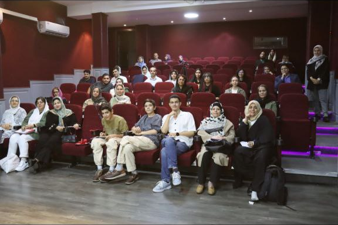
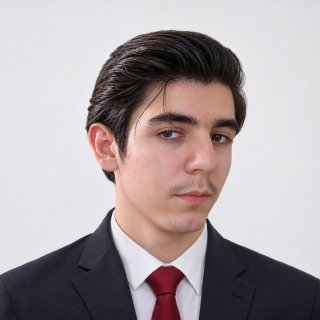

# 画像138点すべて 📸

[GitHubポートフォリオ](https://github.com/FarlandGame) · [私の物語 — Farland_gameの素顔、Kabir](https://github.com/FarlandGame/Personal-Portfolio/blob/main/docs/README.ja.md) · [▶ 写真と画像作品 + 動画と編集作品](https://farlandgame.github.io/Personal-Portfolio/?lang=ja)

カタログの順番は、確認済みの時系列ではありません。正確な日付、年齢、人物については、制作者から説明があった場合に記録します。

**閲覧用コピー：画像は全体の構図を保ち長辺最大2048pxに縮小、動画は全編を保ち1920×1080以内に再圧縮しています。デスクトップの元ファイルは変更していません。**

personal-088とpersonal-103は例外です。作者の希望で画面の余白を切り取り、写真自体の画素はレタッチせず残しています。

## personal-001 · ポートレート編集

[表示・ダウンロード](https://raw.githubusercontent.com/FarlandGame/Personal-Portfolio/main/images/personal-001.jpg)

この画像は、PhotoshopとAIを使って制作した、自分を主題にした映像作品の一場面です。参考にしたのはドラマ『ベター・コール・ソウル』のある場面と、私が憧れ、手本にしているソウル・グッドマンという人物でした。自分の映像を作りたかったのですが、撮影に使えるカメラも予算もありませんでした。そこで複数のAI動画ツールを使い、およそ2週間かけて作品を作りました。この4枚は、その作品の場面に関する画像です。

## personal-002 · ポートレート編集

[表示・ダウンロード](https://raw.githubusercontent.com/FarlandGame/Personal-Portfolio/main/images/personal-002.jpg)

この画像は、PhotoshopとAIを使って制作した、自分を主題にした映像作品の一場面です。参考にしたのはドラマ『ベター・コール・ソウル』のある場面と、私が憧れ、手本にしているソウル・グッドマンという人物でした。自分の映像を作りたかったのですが、撮影に使えるカメラも予算もありませんでした。そこで複数のAI動画ツールを使い、およそ2週間かけて作品を作りました。この4枚は、その作品の場面に関する画像です。

## personal-003 · ポートレート編集

[表示・ダウンロード](https://raw.githubusercontent.com/FarlandGame/Personal-Portfolio/main/images/personal-003.jpg)

この画像は、PhotoshopとAIを使って制作した、自分を主題にした映像作品の一場面です。参考にしたのはドラマ『ベター・コール・ソウル』のある場面と、私が憧れ、手本にしているソウル・グッドマンという人物でした。自分の映像を作りたかったのですが、撮影に使えるカメラも予算もありませんでした。そこで複数のAI動画ツールを使い、およそ2週間かけて作品を作りました。この4枚は、その作品の場面に関する画像です。

## personal-004 · ポートレート編集

[表示・ダウンロード](https://raw.githubusercontent.com/FarlandGame/Personal-Portfolio/main/images/personal-004.jpg)

この画像は、PhotoshopとAIを使って制作した、自分を主題にした映像作品の一場面です。参考にしたのはドラマ『ベター・コール・ソウル』のある場面と、私が憧れ、手本にしているソウル・グッドマンという人物でした。自分の映像を作りたかったのですが、撮影に使えるカメラも予算もありませんでした。そこで複数のAI動画ツールを使い、およそ2週間かけて作品を作りました。この4枚は、その作品の場面に関する画像です。

## personal-005 · THE APEX

[表示・ダウンロード](https://raw.githubusercontent.com/FarlandGame/Personal-Portfolio/main/images/personal-005.jpg)

これは私のアーティストとしてのキャラクター、Farland_gameです。私自身が作るゲーム、アニメーション、THE APEXの世界で中心となるキャラクターの1人です。この画像はPhotoshopで制作しました。仮面の顔とFのマークが、このキャラクターのビジュアルを形づくっています。

## personal-006 · 個人と家族の思い出

[表示・ダウンロード](https://raw.githubusercontent.com/FarlandGame/Personal-Portfolio/main/images/personal-006.jpg)

この写真は、Ahmadianの宝飾店でAmir AhmadianさんのiPhone 16を使って撮りました。AmirさんはDavoud Ahmadianさんの息子さんで、Ahmadian兄弟はDavoudさんとRezaさんです。双子の弟と私は、この店で報酬をもらわずに働きながら学び、金のジュエリーの販売を身につけました。当時は髪を全部後ろへ流していて、その髪型で残っている写真はこれ1枚だけです。 私の記憶では、学校の10年生だった年のデイ月に始め、これまで約2年間続けています。

## personal-007 · ポートレート編集

[表示・ダウンロード](https://raw.githubusercontent.com/FarlandGame/Personal-Portfolio/main/images/personal-007.jpg)

Instagramのプロフィール用に、AIとPhotoshopを使って作ったポートレートです。自分でもPhotoshopで編集しました。ただ、仕上がりが自分にあまり似ていないと感じ、最終的には気に入りませんでした。ポートレート制作の試みの1つとして残しています。

## personal-008 · 個人と家族の思い出

[表示・ダウンロード](https://raw.githubusercontent.com/FarlandGame/Personal-Portfolio/main/images/personal-008.jpg)

これは写真スタジオで撮影した、本物の写真です。AIで作った画像のように見えるかもしれませんが、実際にスタジオで撮りました。スーツを持ちたいと思っているものの、自分のスーツはまだありません。撮影にはスタジオにあったスーツを使いました。

## personal-009 · ポートレート編集

[表示・ダウンロード](https://raw.githubusercontent.com/FarlandGame/Personal-Portfolio/main/images/personal-009.jpg)

この画像は、Farlandの仕事用メールのプロフィールに使うため、Photoshop、複数の編集アプリ、AIを使って制作しました。自分でもPhotoshopで編集しています。自分の写真をAIに頼って作ることが特に好きなわけではありませんが、当時は良いカメラがありませんでした。良いカメラがあれば、自分の写真や映像をもっと撮りたいと思っています。この思い出を話した時点では、仕事用アドレスfarland.game158@gmail.comのプロフィール画像として使っていました。

## personal-010 · 個人と家族の思い出

[表示・ダウンロード](https://raw.githubusercontent.com/FarlandGame/Personal-Portfolio/main/images/personal-010.jpg)

公園のベンチで撮ったこれらの写真は、Alivexorという活動名で知られるAli Dehghannejadとの友情と共同制作における、大切な思い出です。Aliはテヘラン出身で、今では私の親友であり、一緒に活動する仲間です。当時、私は学校の10年生で15〜16歳くらい、Aliは15歳くらいで、学年は私より1つ下でした。

MinecraftのストーリーサーバープロジェクトTHE APEXで協力するため、弁護士である母に手伝ってもらい、協力に関する契約を用意しました。Aliとお父さんに署名してもらうため、私はテヘランへ向かいました。私たちはまだ10代で、家族にも関わってもらっていました。叔父のSiamak Nournezhadが同行しました。叔父は祖母を医師のところへ連れていくためにもテヘランへ行く予定で、私もその旅に加わりました。

その日、Aliのお父さんと2人の弟さんにも会いました。公園に座ってバナナミルクを飲み、私はおしゃれをして、髪も叔父に整えてもらっていました。私にとって、これは単なるベンチでの写真ではなく、大切な友人と、一緒に作りたいと思ったものの思い出です。

## personal-011 · 個人と家族の思い出

[表示・ダウンロード](https://raw.githubusercontent.com/FarlandGame/Personal-Portfolio/main/images/personal-011.jpg)

公園のベンチで撮ったこれらの写真は、Alivexorという活動名で知られるAli Dehghannejadとの友情と共同制作における、大切な思い出です。Aliはテヘラン出身で、今では私の親友であり、一緒に活動する仲間です。当時、私は学校の10年生で15〜16歳くらい、Aliは15歳くらいで、学年は私より1つ下でした。

MinecraftのストーリーサーバープロジェクトTHE APEXで協力するため、弁護士である母に手伝ってもらい、協力に関する契約を用意しました。Aliとお父さんに署名してもらうため、私はテヘランへ向かいました。私たちはまだ10代で、家族にも関わってもらっていました。叔父のSiamak Nournezhadが同行しました。叔父は祖母を医師のところへ連れていくためにもテヘランへ行く予定で、私もその旅に加わりました。

その日、Aliのお父さんと2人の弟さんにも会いました。公園に座ってバナナミルクを飲み、私はおしゃれをして、髪も叔父に整えてもらっていました。私にとって、これは単なるベンチでの写真ではなく、大切な友人と、一緒に作りたいと思ったものの思い出です。

## personal-012 · 個人と家族の思い出

[表示・ダウンロード](https://raw.githubusercontent.com/FarlandGame/Personal-Portfolio/main/images/personal-012.jpg)

公園のベンチで撮ったこれらの写真は、Alivexorという活動名で知られるAli Dehghannejadとの友情と共同制作における、大切な思い出です。Aliはテヘラン出身で、今では私の親友であり、一緒に活動する仲間です。当時、私は学校の10年生で15〜16歳くらい、Aliは15歳くらいで、学年は私より1つ下でした。

MinecraftのストーリーサーバープロジェクトTHE APEXで協力するため、弁護士である母に手伝ってもらい、協力に関する契約を用意しました。Aliとお父さんに署名してもらうため、私はテヘランへ向かいました。私たちはまだ10代で、家族にも関わってもらっていました。叔父のSiamak Nournezhadが同行しました。叔父は祖母を医師のところへ連れていくためにもテヘランへ行く予定で、私もその旅に加わりました。

その日、Aliのお父さんと2人の弟さんにも会いました。公園に座ってバナナミルクを飲み、私はおしゃれをして、髪も叔父に整えてもらっていました。私にとって、これは単なるベンチでの写真ではなく、大切な友人と、一緒に作りたいと思ったものの思い出です。

## personal-013 · 個人と家族の思い出

[表示・ダウンロード](https://raw.githubusercontent.com/FarlandGame/Personal-Portfolio/main/images/personal-013.jpg)

公園のベンチで撮ったこれらの写真は、Alivexorという活動名で知られるAli Dehghannejadとの友情と共同制作における、大切な思い出です。Aliはテヘラン出身で、今では私の親友であり、一緒に活動する仲間です。当時、私は学校の10年生で15〜16歳くらい、Aliは15歳くらいで、学年は私より1つ下でした。

MinecraftのストーリーサーバープロジェクトTHE APEXで協力するため、弁護士である母に手伝ってもらい、協力に関する契約を用意しました。Aliとお父さんに署名してもらうため、私はテヘランへ向かいました。私たちはまだ10代で、家族にも関わってもらっていました。叔父のSiamak Nournezhadが同行しました。叔父は祖母を医師のところへ連れていくためにもテヘランへ行く予定で、私もその旅に加わりました。

その日、Aliのお父さんと2人の弟さんにも会いました。公園に座ってバナナミルクを飲み、私はおしゃれをして、髪も叔父に整えてもらっていました。私にとって、これは単なるベンチでの写真ではなく、大切な友人と、一緒に作りたいと思ったものの思い出です。

## personal-014 · 個人と家族の思い出

[表示・ダウンロード](https://raw.githubusercontent.com/FarlandGame/Personal-Portfolio/main/images/personal-014.jpg)

この写真は、イラン暦1405年のノウルーズ初日、年が明ける頃に家で撮りました。母方の叔父Sajjadが家に来て、私たちの写真を撮ってくれました。サングラスをかけているのが私で、隣の眼鏡をかけていない人は双子の弟Armiyaです。

## personal-015 · 個人と家族の思い出

[表示・ダウンロード](https://raw.githubusercontent.com/FarlandGame/Personal-Portfolio/main/images/personal-015.jpg)

母方の叔父Sajjadが、イラン暦1405年のノウルーズ初日、年が明ける頃に私たちの家で撮ってくれた写真です。サングラスをかけているのは私です。写真personal-014と同じ、年始の訪問のときの1枚です。

## personal-016 · 個人と家族の思い出

[表示・ダウンロード](https://raw.githubusercontent.com/FarlandGame/Personal-Portfolio/main/images/personal-016.jpg)

この写真は、イラン暦1405年のノウルーズ13日目、シーズダ・ベダルの日のものです。父と父方の親戚と一緒に、Maragheh近くのダムへ出かけました。父方の2人の叔母、叔父とその妻、祖母、父の母方の叔父Masoudとその家族、いとこたちや、ほかの親戚も一緒でした。

父と双子の弟と私で山の斜面を上がり、父が私たちを撮ってくれました。ここでもサングラスをかけているのが私で、もう1人は弟のArmiyaです。

## personal-017 · 個人と家族の思い出

[表示・ダウンロード](https://raw.githubusercontent.com/FarlandGame/Personal-Portfolio/main/images/personal-017.jpg)

この写真は、イラン暦1405年のノウルーズ13日目、シーズダ・ベダルの日のものです。父と父方の親戚と一緒に、Maragheh近くのダムへ出かけました。父方の2人の叔母、叔父とその妻、祖母、父の母方の叔父Masoudとその家族、いとこたちや、ほかの親戚も一緒でした。

父と双子の弟と私で山の斜面を上がり、父が私たちを撮ってくれました。ここでもサングラスをかけているのが私で、もう1人は弟のArmiyaです。

## personal-018 · 個人と家族の思い出

[表示・ダウンロード](https://raw.githubusercontent.com/FarlandGame/Personal-Portfolio/main/images/personal-018.jpg)

これらの写真は、イラン暦1405年のシーズダ・ベダルから約2週間後に撮りました。父と高い山へ出かけ、そのとき橋の上で父が写真を撮ってくれました。

## personal-019 · 個人と家族の思い出

[表示・ダウンロード](https://raw.githubusercontent.com/FarlandGame/Personal-Portfolio/main/images/personal-019.jpg)

これらの写真は、イラン暦1405年のシーズダ・ベダルから約2週間後に撮りました。父と高い山へ出かけ、そのとき橋の上で父が写真を撮ってくれました。

## personal-020 · ポートレート編集

[表示・ダウンロード](https://raw.githubusercontent.com/FarlandGame/Personal-Portfolio/main/images/personal-020.jpg)

この画像は、学校で過ごした雨の日の写真シリーズの1枚です。確かシャフリーヴァル月の初め頃でしたが、正確な日付には自信がありません。イヤホンを学校に持っていき、嵐の校庭で音楽を聴きながら、自分を力強いキャラクターとして想像していました。教室に戻ったとき、髪はぬれていました。

友人のAshkan Mohammad Alipourが、自分のスマートフォンで私と双子の弟、Amir Hossein Sadeghの写真を撮ってくれました。Ashkanは私の編集も担当し、After Effectsの作業やBlenderのアニメーションでも手伝ってくれています。当時、私はAmir HosseinをSenpaiXDと呼んでいました。同じものを繰り返すのが好きではなく、活動名をよく変える友人です。Ashkanと友人のSadra Shahiは、この写真シリーズには写っていません。その後、私は一部の写真を自分で、より暗いモノクロのスタイルに編集しました。

写真を撮った直後、その日はつらいものになりました。私の記憶では、学校の生活指導担当のAzizi先生が私のスマートフォンとイヤホンを預かり、翌日まで返してくれませんでした。私はとても悲しくなり、泣きました。この写真には、友人たちと過ごした瞬間の高揚感と、その後のつらい思い出の両方が残っています。

## personal-021 · ポートレート編集

[表示・ダウンロード](https://raw.githubusercontent.com/FarlandGame/Personal-Portfolio/main/images/personal-021.jpg)

この画像は、学校で過ごした雨の日の写真シリーズの1枚です。確かシャフリーヴァル月の初め頃でしたが、正確な日付には自信がありません。イヤホンを学校に持っていき、嵐の校庭で音楽を聴きながら、自分を力強いキャラクターとして想像していました。教室に戻ったとき、髪はぬれていました。

友人のAshkan Mohammad Alipourが、自分のスマートフォンで私と双子の弟、Amir Hossein Sadeghの写真を撮ってくれました。Ashkanは私の編集も担当し、After Effectsの作業やBlenderのアニメーションでも手伝ってくれています。当時、私はAmir HosseinをSenpaiXDと呼んでいました。同じものを繰り返すのが好きではなく、活動名をよく変える友人です。Ashkanと友人のSadra Shahiは、この写真シリーズには写っていません。その後、私は一部の写真を自分で、より暗いモノクロのスタイルに編集しました。

写真を撮った直後、その日はつらいものになりました。私の記憶では、学校の生活指導担当のAzizi先生が私のスマートフォンとイヤホンを預かり、翌日まで返してくれませんでした。私はとても悲しくなり、泣きました。この写真には、友人たちと過ごした瞬間の高揚感と、その後のつらい思い出の両方が残っています。

## personal-022 · 個人と家族の思い出

[表示・ダウンロード](https://raw.githubusercontent.com/FarlandGame/Personal-Portfolio/main/images/personal-022.jpg)

これらの写真は、友人Ali Heydariの家に初めて遊びに行ったときのものです。Aliは私より学年が1つ上です。サングラスとクリーム色の服を着ているのが私で、普通の眼鏡をかけているのがAliです。双子の弟Armiyaは来なかったので、2人でたくさんゲームをして、おしゃべりしました。とても楽しく、また遊びに行けたらと思っています。

確か夕方5時から夜9時頃までだったと思いますが、時間ははっきり覚えていません。その日はひどくお腹の調子が悪く、遊んでいる間は何とか我慢していました。帰宅してから薬を飲んで休み、よくなりました。

## personal-023 · 個人と家族の思い出

[表示・ダウンロード](https://raw.githubusercontent.com/FarlandGame/Personal-Portfolio/main/images/personal-023.jpg)

これらの写真は、友人Ali Heydariの家に初めて遊びに行ったときのものです。Aliは私より学年が1つ上です。サングラスとクリーム色の服を着ているのが私で、普通の眼鏡をかけているのがAliです。双子の弟Armiyaは来なかったので、2人でたくさんゲームをして、おしゃべりしました。とても楽しく、また遊びに行けたらと思っています。

確か夕方5時から夜9時頃までだったと思いますが、時間ははっきり覚えていません。その日はひどくお腹の調子が悪く、遊んでいる間は何とか我慢していました。帰宅してから薬を飲んで休み、よくなりました。

## personal-024 · 個人と家族の思い出

[表示・ダウンロード](https://raw.githubusercontent.com/FarlandGame/Personal-Portfolio/main/images/personal-024.jpg)

これらの写真は、友人Ali Heydariの家に初めて遊びに行ったときのものです。Aliは私より学年が1つ上です。サングラスとクリーム色の服を着ているのが私で、普通の眼鏡をかけているのがAliです。双子の弟Armiyaは来なかったので、2人でたくさんゲームをして、おしゃべりしました。とても楽しく、また遊びに行けたらと思っています。

確か夕方5時から夜9時頃までだったと思いますが、時間ははっきり覚えていません。その日はひどくお腹の調子が悪く、遊んでいる間は何とか我慢していました。帰宅してから薬を飲んで休み、よくなりました。

## personal-025 · 個人と家族の思い出

[表示・ダウンロード](https://raw.githubusercontent.com/FarlandGame/Personal-Portfolio/main/images/personal-025.jpg)

これは1歳を過ぎ、もうすぐ2歳になる頃の私です。父の大きなシャツを着るのが好きでした。ずっと後になって、アルバムにあったこのプリント写真をスマートフォンで撮りました。そのため、提供した画像は少しぼやけ、光の反射が写っています。

[AI修復版：光の反射を除去し、見やすさを改善](https://raw.githubusercontent.com/FarlandGame/Personal-Portfolio/main/restorations/personal-025-ai-restored.png)

## personal-026 · 個人と家族の思い出

[表示・ダウンロード](https://raw.githubusercontent.com/FarlandGame/Personal-Portfolio/main/images/personal-026.jpg)

この写真は、イラン暦1404年のデイ月、学校の前期試験の時期に撮りました。雪が降ったきれいな日でした。中央が私で、写真の右側がAmir Hossein Sadegh、左側がAli Heydariです。

その日は髪を整えず、帽子をかぶっていました。帽子を取ると髪がぐしゃぐしゃになっていましたが、友人たちが写真を撮ろうと言ってくれたので、私も賛成しました。ArmiyaとAshkanが私たちの写真を撮ってくれました。 私の記憶では、数学の試験の日に撮った写真です。

## personal-027 · 個人と家族の思い出

[表示・ダウンロード](https://raw.githubusercontent.com/FarlandGame/Personal-Portfolio/main/images/personal-027.jpg)

この写真は、イラン暦1404年のデイ月、学校の前期試験の時期に撮りました。雪が降ったきれいな日でした。中央が私で、写真の右側がAmir Hossein Sadegh、左側がAli Heydariです。

その日は髪を整えず、帽子をかぶっていました。帽子を取ると髪がぐしゃぐしゃになっていましたが、友人たちが写真を撮ろうと言ってくれたので、私も賛成しました。ArmiyaとAshkanが私たちの写真を撮ってくれました。 私の記憶では、数学の試験の日に撮った写真です。

## personal-028 · 個人と家族の思い出

[表示・ダウンロード](https://raw.githubusercontent.com/FarlandGame/Personal-Portfolio/main/images/personal-028.jpg)

この画像は、学校で過ごした雨の日の写真シリーズの1枚です。確かシャフリーヴァル月の初め頃でしたが、正確な日付には自信がありません。イヤホンを学校に持っていき、嵐の校庭で音楽を聴きながら、自分を力強いキャラクターとして想像していました。教室に戻ったとき、髪はぬれていました。

友人のAshkan Mohammad Alipourが、自分のスマートフォンで私と双子の弟、Amir Hossein Sadeghの写真を撮ってくれました。Ashkanは私の編集も担当し、After Effectsの作業やBlenderのアニメーションでも手伝ってくれています。当時、私はAmir HosseinをSenpaiXDと呼んでいました。同じものを繰り返すのが好きではなく、活動名をよく変える友人です。Ashkanと友人のSadra Shahiは、この写真シリーズには写っていません。その後、私は一部の写真を自分で、より暗いモノクロのスタイルに編集しました。

写真を撮った直後、その日はつらいものになりました。私の記憶では、学校の生活指導担当のAzizi先生が私のスマートフォンとイヤホンを預かり、翌日まで返してくれませんでした。私はとても悲しくなり、泣きました。この写真には、友人たちと過ごした瞬間の高揚感と、その後のつらい思い出の両方が残っています。

## personal-029 · 個人と家族の思い出

[表示・ダウンロード](https://raw.githubusercontent.com/FarlandGame/Personal-Portfolio/main/images/personal-029.jpg)

これらの写真は、イラン暦1404年のデイ月、学校の試験の時期のものです。写真personal-027に関係する数学の試験の翌日に雪が降ったと覚えています。その夜、家の前へ出て、何時間もかけて一生懸命この雪だるまを作り、写真を撮りました。

私の記憶では、翌日、近所の子ども2人が雪だるまを壊してしまいました。何時間もの努力が消えてしまい、悲しかったです。この写真は、苦労して作った雪だるまの思い出として残っています。

## personal-030 · 個人と家族の思い出

[表示・ダウンロード](https://raw.githubusercontent.com/FarlandGame/Personal-Portfolio/main/images/personal-030.jpg)

これらの写真は、イラン暦1404年のデイ月、学校の試験の時期のものです。写真personal-027に関係する数学の試験の翌日に雪が降ったと覚えています。その夜、家の前へ出て、何時間もかけて一生懸命この雪だるまを作り、写真を撮りました。

私の記憶では、翌日、近所の子ども2人が雪だるまを壊してしまいました。何時間もの努力が消えてしまい、悲しかったです。この写真は、苦労して作った雪だるまの思い出として残っています。

## personal-031 · 個人と家族の思い出

[表示・ダウンロード](https://raw.githubusercontent.com/FarlandGame/Personal-Portfolio/main/images/personal-031.jpg)

これらの写真は、イラン暦1404年のデイ月、学校の試験の時期のものです。写真personal-027に関係する数学の試験の翌日に雪が降ったと覚えています。その夜、家の前へ出て、何時間もかけて一生懸命この雪だるまを作り、写真を撮りました。

私の記憶では、翌日、近所の子ども2人が雪だるまを壊してしまいました。何時間もの努力が消えてしまい、悲しかったです。この写真は、苦労して作った雪だるまの思い出として残っています。

## personal-032 · 個人と家族の思い出

[表示・ダウンロード](https://raw.githubusercontent.com/FarlandGame/Personal-Portfolio/main/images/personal-032.jpg)

これは家で母と撮った自撮り写真です。母が「一緒に写真を撮ろう」と言ってくれました。母は黒い服を着ていて、赤い花が写っています。家で過ごした、何気ない2人のひとときです。

## personal-033 · 本の思い出

[表示・ダウンロード](https://raw.githubusercontent.com/FarlandGame/Personal-Portfolio/main/images/personal-033.jpg)

これらの写真は、著書に対する感謝状と、その日に贈られた花です。私にとって、とても大きな意味のある日でした。数か月前に教育当局へ自分の本を1冊寄贈していました。ようやく著者を表彰する会が開かれることになったとき、その集まりで15歳なのは私だけで、大人たちの中に参加しないほうがよいのではと言われていました。若い著者がいることを歓迎してほしいと思い、私も行くと伝えました。

学校から教育当局へ向かいました。到着したときは相手にされていないように感じ、自分も著者だと説明したことを覚えています。名前が呼ばれ続けて約1時間後、私の名前は最後に呼ばれました。私の記憶では、その頃には帰った人やスマートフォンを見ている人もいました。期待していたほど注目されず、その瞬間が過ぎてしまったと感じました。これはその日の私自身の記憶と気持ちであり、誰かの意図を断定するものではありません。

感謝状とともに50万トマンを受け取ったと覚えています。本の価格は35万トマンで、すでに1冊を寄贈していました。落胆した私は、頭の中でその差を比べていました。寄贈した本の価格より15万トマン多いだけだ、と感じたのです。自分が注いだ努力や待ち続けた時間に比べ、十分に認めてもらえなかったように思いました。

でも、花束はうれしかったです。その場にいた叔父Siamakが買ってくれました。母と、私が「Aziz」と呼ぶAkhtar Amir Sadeghiも一緒でした。父は来られませんでした。その夜、母がこれらの写真を撮ってくれました。落胆とともに、家族や花の温かさも覚えています。

日付について：会はイラン暦1404年のデイ月末、バフマン月に近い頃だったと覚えています。一方、写真の感謝状に印刷されている日付は1404/09/09です。確認が取れるまでは、書面の日付と私が記憶する開催時期を区別して記録しています。

## personal-034 · 本の思い出

[表示・ダウンロード](https://raw.githubusercontent.com/FarlandGame/Personal-Portfolio/main/images/personal-034.jpg)

これらの写真は、著書に対する感謝状と、その日に贈られた花です。私にとって、とても大きな意味のある日でした。数か月前に教育当局へ自分の本を1冊寄贈していました。ようやく著者を表彰する会が開かれることになったとき、その集まりで15歳なのは私だけで、大人たちの中に参加しないほうがよいのではと言われていました。若い著者がいることを歓迎してほしいと思い、私も行くと伝えました。

学校から教育当局へ向かいました。到着したときは相手にされていないように感じ、自分も著者だと説明したことを覚えています。名前が呼ばれ続けて約1時間後、私の名前は最後に呼ばれました。私の記憶では、その頃には帰った人やスマートフォンを見ている人もいました。期待していたほど注目されず、その瞬間が過ぎてしまったと感じました。これはその日の私自身の記憶と気持ちであり、誰かの意図を断定するものではありません。

感謝状とともに50万トマンを受け取ったと覚えています。本の価格は35万トマンで、すでに1冊を寄贈していました。落胆した私は、頭の中でその差を比べていました。寄贈した本の価格より15万トマン多いだけだ、と感じたのです。自分が注いだ努力や待ち続けた時間に比べ、十分に認めてもらえなかったように思いました。

でも、花束はうれしかったです。その場にいた叔父Siamakが買ってくれました。母と、私が「Aziz」と呼ぶAkhtar Amir Sadeghiも一緒でした。父は来られませんでした。その夜、母がこれらの写真を撮ってくれました。落胆とともに、家族や花の温かさも覚えています。

日付について：会はイラン暦1404年のデイ月末、バフマン月に近い頃だったと覚えています。一方、写真の感謝状に印刷されている日付は1404/09/09です。確認が取れるまでは、書面の日付と私が記憶する開催時期を区別して記録しています。

## personal-035 · 個人と家族の思い出

[表示・ダウンロード](https://raw.githubusercontent.com/FarlandGame/Personal-Portfolio/main/images/personal-035.jpg)

この画像は、学校で過ごした雨の日の写真シリーズの1枚です。確かシャフリーヴァル月の初め頃でしたが、正確な日付には自信がありません。イヤホンを学校に持っていき、嵐の校庭で音楽を聴きながら、自分を力強いキャラクターとして想像していました。教室に戻ったとき、髪はぬれていました。

友人のAshkan Mohammad Alipourが、自分のスマートフォンで私と双子の弟、Amir Hossein Sadeghの写真を撮ってくれました。Ashkanは私の編集も担当し、After Effectsの作業やBlenderのアニメーションでも手伝ってくれています。当時、私はAmir HosseinをSenpaiXDと呼んでいました。同じものを繰り返すのが好きではなく、活動名をよく変える友人です。Ashkanと友人のSadra Shahiは、この写真シリーズには写っていません。その後、私は一部の写真を自分で、より暗いモノクロのスタイルに編集しました。

写真を撮った直後、その日はつらいものになりました。私の記憶では、学校の生活指導担当のAzizi先生が私のスマートフォンとイヤホンを預かり、翌日まで返してくれませんでした。私はとても悲しくなり、泣きました。この写真には、友人たちと過ごした瞬間の高揚感と、その後のつらい思い出の両方が残っています。

## personal-036 · 個人と家族の思い出

[表示・ダウンロード](https://raw.githubusercontent.com/FarlandGame/Personal-Portfolio/main/images/personal-036.jpg)

この画像は、学校で過ごした雨の日の写真シリーズの1枚です。確かシャフリーヴァル月の初め頃でしたが、正確な日付には自信がありません。イヤホンを学校に持っていき、嵐の校庭で音楽を聴きながら、自分を力強いキャラクターとして想像していました。教室に戻ったとき、髪はぬれていました。

友人のAshkan Mohammad Alipourが、自分のスマートフォンで私と双子の弟、Amir Hossein Sadeghの写真を撮ってくれました。Ashkanは私の編集も担当し、After Effectsの作業やBlenderのアニメーションでも手伝ってくれています。当時、私はAmir HosseinをSenpaiXDと呼んでいました。同じものを繰り返すのが好きではなく、活動名をよく変える友人です。Ashkanと友人のSadra Shahiは、この写真シリーズには写っていません。その後、私は一部の写真を自分で、より暗いモノクロのスタイルに編集しました。

写真を撮った直後、その日はつらいものになりました。私の記憶では、学校の生活指導担当のAzizi先生が私のスマートフォンとイヤホンを預かり、翌日まで返してくれませんでした。私はとても悲しくなり、泣きました。この写真には、友人たちと過ごした瞬間の高揚感と、その後のつらい思い出の両方が残っています。

## personal-037 · 個人と家族の思い出

[表示・ダウンロード](https://raw.githubusercontent.com/FarlandGame/Personal-Portfolio/main/images/personal-037.jpg)

この画像は、学校で過ごした雨の日の写真シリーズの1枚です。確かシャフリーヴァル月の初め頃でしたが、正確な日付には自信がありません。イヤホンを学校に持っていき、嵐の校庭で音楽を聴きながら、自分を力強いキャラクターとして想像していました。教室に戻ったとき、髪はぬれていました。

友人のAshkan Mohammad Alipourが、自分のスマートフォンで私と双子の弟、Amir Hossein Sadeghの写真を撮ってくれました。Ashkanは私の編集も担当し、After Effectsの作業やBlenderのアニメーションでも手伝ってくれています。当時、私はAmir HosseinをSenpaiXDと呼んでいました。同じものを繰り返すのが好きではなく、活動名をよく変える友人です。Ashkanと友人のSadra Shahiは、この写真シリーズには写っていません。その後、私は一部の写真を自分で、より暗いモノクロのスタイルに編集しました。

写真を撮った直後、その日はつらいものになりました。私の記憶では、学校の生活指導担当のAzizi先生が私のスマートフォンとイヤホンを預かり、翌日まで返してくれませんでした。私はとても悲しくなり、泣きました。この写真には、友人たちと過ごした瞬間の高揚感と、その後のつらい思い出の両方が残っています。

## personal-038 · 個人と家族の思い出

[表示・ダウンロード](https://raw.githubusercontent.com/FarlandGame/Personal-Portfolio/main/images/personal-038.jpg)

この画像は、学校で過ごした雨の日の写真シリーズの1枚です。確かシャフリーヴァル月の初め頃でしたが、正確な日付には自信がありません。イヤホンを学校に持っていき、嵐の校庭で音楽を聴きながら、自分を力強いキャラクターとして想像していました。教室に戻ったとき、髪はぬれていました。

友人のAshkan Mohammad Alipourが、自分のスマートフォンで私と双子の弟、Amir Hossein Sadeghの写真を撮ってくれました。Ashkanは私の編集も担当し、After Effectsの作業やBlenderのアニメーションでも手伝ってくれています。当時、私はAmir HosseinをSenpaiXDと呼んでいました。同じものを繰り返すのが好きではなく、活動名をよく変える友人です。Ashkanと友人のSadra Shahiは、この写真シリーズには写っていません。その後、私は一部の写真を自分で、より暗いモノクロのスタイルに編集しました。

写真を撮った直後、その日はつらいものになりました。私の記憶では、学校の生活指導担当のAzizi先生が私のスマートフォンとイヤホンを預かり、翌日まで返してくれませんでした。私はとても悲しくなり、泣きました。この写真には、友人たちと過ごした瞬間の高揚感と、その後のつらい思い出の両方が残っています。

## personal-039 · 個人と家族の思い出

[表示・ダウンロード](https://raw.githubusercontent.com/FarlandGame/Personal-Portfolio/main/images/personal-039.jpg)

この画像は、学校で過ごした雨の日の写真シリーズの1枚です。確かシャフリーヴァル月の初め頃でしたが、正確な日付には自信がありません。イヤホンを学校に持っていき、嵐の校庭で音楽を聴きながら、自分を力強いキャラクターとして想像していました。教室に戻ったとき、髪はぬれていました。

友人のAshkan Mohammad Alipourが、自分のスマートフォンで私と双子の弟、Amir Hossein Sadeghの写真を撮ってくれました。Ashkanは私の編集も担当し、After Effectsの作業やBlenderのアニメーションでも手伝ってくれています。当時、私はAmir HosseinをSenpaiXDと呼んでいました。同じものを繰り返すのが好きではなく、活動名をよく変える友人です。Ashkanと友人のSadra Shahiは、この写真シリーズには写っていません。その後、私は一部の写真を自分で、より暗いモノクロのスタイルに編集しました。

写真を撮った直後、その日はつらいものになりました。私の記憶では、学校の生活指導担当のAzizi先生が私のスマートフォンとイヤホンを預かり、翌日まで返してくれませんでした。私はとても悲しくなり、泣きました。この写真には、友人たちと過ごした瞬間の高揚感と、その後のつらい思い出の両方が残っています。

## personal-040 · 個人と家族の思い出

[表示・ダウンロード](https://raw.githubusercontent.com/FarlandGame/Personal-Portfolio/main/images/personal-040.jpg)

この画像は、学校で過ごした雨の日の写真シリーズの1枚です。確かシャフリーヴァル月の初め頃でしたが、正確な日付には自信がありません。イヤホンを学校に持っていき、嵐の校庭で音楽を聴きながら、自分を力強いキャラクターとして想像していました。教室に戻ったとき、髪はぬれていました。

友人のAshkan Mohammad Alipourが、自分のスマートフォンで私と双子の弟、Amir Hossein Sadeghの写真を撮ってくれました。Ashkanは私の編集も担当し、After Effectsの作業やBlenderのアニメーションでも手伝ってくれています。当時、私はAmir HosseinをSenpaiXDと呼んでいました。同じものを繰り返すのが好きではなく、活動名をよく変える友人です。Ashkanと友人のSadra Shahiは、この写真シリーズには写っていません。その後、私は一部の写真を自分で、より暗いモノクロのスタイルに編集しました。

写真を撮った直後、その日はつらいものになりました。私の記憶では、学校の生活指導担当のAzizi先生が私のスマートフォンとイヤホンを預かり、翌日まで返してくれませんでした。私はとても悲しくなり、泣きました。この写真には、友人たちと過ごした瞬間の高揚感と、その後のつらい思い出の両方が残っています。

## personal-041 · 本の思い出

[表示・ダウンロード](https://raw.githubusercontent.com/FarlandGame/Personal-Portfolio/main/images/personal-041.jpg)

本が出版された頃、ウェブサイトに自分の本が載っているのを見かけ、このスクリーンショットを保存しました。当時Digikalaがオンラインで本を紹介・宣伝していたと覚えていて、掲載された記録を残したかったのです。画像には、おすすめ記事の欄に『Visual Animation Tutorial』の表紙が載り、本の紹介と初回購入5％割引の案内が見えます。自分のページ以外でも本を見かけるようになった思い出です。表示されている割引は、保存した当時の案内です。

## personal-042 · 本の思い出

[表示・ダウンロード](https://raw.githubusercontent.com/FarlandGame/Personal-Portfolio/main/images/personal-042.jpg)

自分の本がウェブ上で紹介されているのを見かけた頃の、もう1枚のスクリーンショットです。写真personal-041と同じ思い出に関係しています。出版の頃、Digikalaが本を紹介・宣伝していたと覚えていて、ウェブサイトに載った記録として保存していました。

## personal-043 · 個人と家族の思い出

[表示・ダウンロード](https://raw.githubusercontent.com/FarlandGame/Personal-Portfolio/main/images/personal-043.jpg)

髪型が気になって、Azizの家のバルコニーで撮った何気ない写真です。実は誰かに送ろうと思っていたことは覚えていますが、誰に送るつもりだったのかは、もう思い出せません。ギャラリーに残った、日常の小さなひとときです。

## personal-044 · 個人と家族の思い出

[表示・ダウンロード](https://raw.githubusercontent.com/FarlandGame/Personal-Portfolio/main/images/personal-044.jpg)

髪型が気になって、Azizの家のバルコニーで撮った何気ない写真です。実は誰かに送ろうと思っていたことは覚えていますが、誰に送るつもりだったのかは、もう思い出せません。ギャラリーに残った、日常の小さなひとときです。

## personal-045 · 個人と家族の思い出

[表示・ダウンロード](https://raw.githubusercontent.com/FarlandGame/Personal-Portfolio/main/images/personal-045.jpg)

10年生の頃、学校でAmir Hossein Sadeghと一緒に撮った写真です。Amirが記念に写真を撮ろうと提案してくれたので、私が撮りました。日差しのために彼の顔が思うほどはっきり写りませんでしたが、一緒に過ごした瞬間の思い出として残っています。

## personal-047 · 個人と家族の思い出

[表示・ダウンロード](https://raw.githubusercontent.com/FarlandGame/Personal-Portfolio/main/images/personal-047.jpg)

10年生の頃、学校でAmir Hossein Sadeghと一緒に撮った写真です。Amirが記念に写真を撮ろうと提案してくれたので、私が撮りました。日差しのために彼の顔が思うほどはっきり写りませんでしたが、一緒に過ごした瞬間の思い出として残っています。

## personal-048 · 個人と家族の思い出

[表示・ダウンロード](https://raw.githubusercontent.com/FarlandGame/Personal-Portfolio/main/images/personal-048.jpg)

写真personal-048に写っているのは、私たちが飼っていた鳥の家族の親鳥です。

7年生で13歳くらいの頃から、青いセキセイインコと白い1羽を飼っていました。約3年間一緒にいましたが、卵は産みませんでした。店ではペアだと言われたものの、後になって私は両方ともオスだったのかもしれないと思いました。ビタミンなどいろいろ試しましたが、やがて白い鳥は死んでしまいました。

その後、父が道で緑色のセキセイインコを見つけました。具合が悪そうで、くちばしや爪も曲がっていたため、獣医に連れていきました。私の記憶では、とても年を取った病気のメスで、回復は難しいという説明でした。その後、若いメスと交換しました。青い鳥と一緒になると繁殖して卵を産みました。あるときは3羽、別のときは2羽、合わせて5羽ほどのひなが生まれたと覚えています。かえらない卵もあり、ひなは父鳥に似ていました。

やがて鳥たちの声がとても大きくなり、手放しました。これらは、その小さな鳥の家族を写した最後の写真の一部です。

さらに昔の思い出もあります。弟と私が3〜4歳くらいの頃、叔母が金色と白のセキセイインコを買ってくれました。金色の鳥は祖母の家で猫に捕まり、白い鳥は私たちの家へ連れて帰って何年か飼いました。私の記憶では、その後、柿を食べた後に死んでしまいました。これらは私自身の記憶であり、獣医学的に確認された死因の説明ではありません。

## personal-049 · 個人と家族の思い出

[表示・ダウンロード](https://raw.githubusercontent.com/FarlandGame/Personal-Portfolio/main/images/personal-049.jpg)

写真personal-049に写っているのは、親鳥から生まれたひな2羽です。父鳥と同じような色になったと覚えています。

7年生で13歳くらいの頃から、青いセキセイインコと白い1羽を飼っていました。約3年間一緒にいましたが、卵は産みませんでした。店ではペアだと言われたものの、後になって私は両方ともオスだったのかもしれないと思いました。ビタミンなどいろいろ試しましたが、やがて白い鳥は死んでしまいました。

その後、父が道で緑色のセキセイインコを見つけました。具合が悪そうで、くちばしや爪も曲がっていたため、獣医に連れていきました。私の記憶では、とても年を取った病気のメスで、回復は難しいという説明でした。その後、若いメスと交換しました。青い鳥と一緒になると繁殖して卵を産みました。あるときは3羽、別のときは2羽、合わせて5羽ほどのひなが生まれたと覚えています。かえらない卵もあり、ひなは父鳥に似ていました。

やがて鳥たちの声がとても大きくなり、手放しました。これらは、その小さな鳥の家族を写した最後の写真の一部です。

さらに昔の思い出もあります。弟と私が3〜4歳くらいの頃、叔母が金色と白のセキセイインコを買ってくれました。金色の鳥は祖母の家で猫に捕まり、白い鳥は私たちの家へ連れて帰って何年か飼いました。私の記憶では、その後、柿を食べた後に死んでしまいました。これらは私自身の記憶であり、獣医学的に確認された死因の説明ではありません。

## personal-050 · 個人と家族の思い出

[表示・ダウンロード](https://raw.githubusercontent.com/FarlandGame/Personal-Portfolio/main/images/personal-050.jpg)

これらの写真は、10年生の頃、学校から帰るときに撮りました。Amir Hossein Sadeghが一緒に写真を撮ろうと提案してくれたので、私が撮りました。私の白いシャツには、自分のチャンネルとブランドのデザインであるサボテンと紫色のLOVEの文字が入っています。9年生のときにデザインしてプリントしてもらい、費用は約200万トマンだったと覚えています。

## personal-051 · 個人と家族の思い出

[表示・ダウンロード](https://raw.githubusercontent.com/FarlandGame/Personal-Portfolio/main/images/personal-051.jpg)

これらの写真は、10年生の頃、学校から帰るときに撮りました。Amir Hossein Sadeghが一緒に写真を撮ろうと提案してくれたので、私が撮りました。私の白いシャツには、自分のチャンネルとブランドのデザインであるサボテンと紫色のLOVEの文字が入っています。9年生のときにデザインしてプリントしてもらい、費用は約200万トマンだったと覚えています。

写真personal-051では、写真を撮っている私たちを見かけた11年生の生徒が、中央に入って一緒に写ってくれました。名前はNajafだったと思いますが、はっきりとは覚えていません。

## personal-052 · 個人と家族の思い出

[表示・ダウンロード](https://raw.githubusercontent.com/FarlandGame/Personal-Portfolio/main/images/personal-052.jpg)

これらの写真は、10年生の頃、学校から帰るときに撮りました。Amir Hossein Sadeghが一緒に写真を撮ろうと提案してくれたので、私が撮りました。私の白いシャツには、自分のチャンネルとブランドのデザインであるサボテンと紫色のLOVEの文字が入っています。9年生のときにデザインしてプリントしてもらい、費用は約200万トマンだったと覚えています。

## personal-053 · 本の思い出

[表示・ダウンロード](https://raw.githubusercontent.com/FarlandGame/Personal-Portfolio/main/images/personal-053.jpg)

これも、自分の本がインターネットで紹介・宣伝されているところを保存したスクリーンショットです。前の画像と同じように、ウェブサイトで本を見かけた思い出として残しています。

## personal-054 · 個人と家族の思い出

[表示・ダウンロード](https://raw.githubusercontent.com/FarlandGame/Personal-Portfolio/main/images/personal-054.jpg)

学校で撮った何気ない写真です。自分のブランドのサボテンと紫色のLOVEのデザインが入った、あの白いシャツを着ています。生徒のSina Vatanも写真に写っています。

## personal-055 · 本の思い出

[表示・ダウンロード](https://raw.githubusercontent.com/FarlandGame/Personal-Portfolio/main/images/personal-055.jpg)

初版の本50冊が手元に届いた夜、母がケーキを買ってくれました。双子の弟と母と私の3人でお祝いし、写真を撮ってストーリーに載せ、ケーキを食べました。自分の初めての本が印刷された形になったことを喜ぶ、小さな家族のお祝いでした。 これらの写真も同じ夜に撮り、ストーリーに載せました。

## personal-056 · 本の思い出

[表示・ダウンロード](https://raw.githubusercontent.com/FarlandGame/Personal-Portfolio/main/images/personal-056.jpg)

初版の本50冊が手元に届いた夜、母がケーキを買ってくれました。双子の弟と母と私の3人でお祝いし、写真を撮ってストーリーに載せ、ケーキを食べました。自分の初めての本が印刷された形になったことを喜ぶ、小さな家族のお祝いでした。 これらの写真も同じ夜に撮り、ストーリーに載せました。

## personal-057 · 本の思い出

[表示・ダウンロード](https://raw.githubusercontent.com/FarlandGame/Personal-Portfolio/main/images/personal-057.jpg)

初版の本50冊が手元に届いた夜、母がケーキを買ってくれました。双子の弟と母と私の3人でお祝いし、写真を撮ってストーリーに載せ、ケーキを食べました。自分の初めての本が印刷された形になったことを喜ぶ、小さな家族のお祝いでした。

## personal-058 · 本の思い出

[表示・ダウンロード](https://raw.githubusercontent.com/FarlandGame/Personal-Portfolio/main/images/personal-058.jpg)

初版の本50冊が手元に届いた夜、母がケーキを買ってくれました。双子の弟と母と私の3人でお祝いし、写真を撮ってストーリーに載せ、ケーキを食べました。自分の初めての本が印刷された形になったことを喜ぶ、小さな家族のお祝いでした。 これらの写真も同じ夜に撮り、ストーリーに載せました。

## personal-059 · 本の思い出

[表示・ダウンロード](https://raw.githubusercontent.com/FarlandGame/Personal-Portfolio/main/images/personal-059.jpg)

その夜、本の序文のページも写真に撮りました。

初版の本50冊が手元に届いた夜、母がケーキを買ってくれました。双子の弟と母と私の3人でお祝いし、写真を撮ってストーリーに載せ、ケーキを食べました。自分の初めての本が印刷された形になったことを喜ぶ、小さな家族のお祝いでした。

## personal-060 · 個人と家族の思い出

[表示・ダウンロード](https://raw.githubusercontent.com/FarlandGame/Personal-Portfolio/main/images/personal-060.jpg)

これはイラン暦1404年にテヘランの本のフェスティバルで撮った写真です。Classinoの宣伝用にMinecraftをテーマにした場所があり、ゾンビのキャラクターやSteveの帽子が用意されていました。ゾンビと写真を撮り、ストーリーに投稿すると抽選に参加できました。当たりませんでしたが、この写真とSteveの帽子が訪問の思い出になりました。

## personal-061 · 個人と家族の思い出

[表示・ダウンロード](https://raw.githubusercontent.com/FarlandGame/Personal-Portfolio/main/images/personal-061.jpg)

これは1〜2歳くらいの私の写真です。後になって、アルバムのプリント写真をスマートフォンで撮りました。光の反射やその撮影の画質で見えにくくなっていたため、提供した画像を残したまま、修復版を別に作ってもらうことにしました。

[AI修復版：光の反射を抑え、見やすさを改善](https://raw.githubusercontent.com/FarlandGame/Personal-Portfolio/main/restorations/personal-061-ai-restored.png)

## personal-062 · 個人と家族の思い出

[表示・ダウンロード](https://raw.githubusercontent.com/FarlandGame/Personal-Portfolio/main/images/personal-062.jpg)

9年生の頃、イラン暦1402年か1403年あたりの写真だったと覚えていますが、正確な年には自信がありません。灰色の運動着を見ると、1時間目に体育があった月曜日だったことを思い出します。

学校から帰るとき、7年生からずっと友人のAli Ataと、まともな写真をまだ撮っていないと気づき、一緒に撮ろうと声をかけました。私としては2人ともあまりうまく写らなかったと思いますが、友情はこの写真の出来よりずっとすてきです！誰にとっても最高の友人になれる人です。

## personal-063 · 個人と家族の思い出

[表示・ダウンロード](https://raw.githubusercontent.com/FarlandGame/Personal-Portfolio/main/images/personal-063.jpg)

これは写真personal-062と同じ、月曜日の体育の日の思い出です。運動着を着て、当時の学校の友人Elyar Nikpourと一緒に撮りました。今は当時ほど親しくありませんが、あの頃の友情のひとときを残した写真です。

## personal-064 · 個人と家族の思い出

[表示・ダウンロード](https://raw.githubusercontent.com/FarlandGame/Personal-Portfolio/main/images/personal-064.jpg)

これは、テヘランで毎年開かれる本のフェスティバルを訪れたときの写真です。写真personal-060にあるClassinoのMinecraft風の宣伝エリアやSteveの帽子と同じ日の思い出です。テヘランに滞在していたので、一緒にフェスティバルへ出かけました。

## personal-065 · 個人と家族の思い出

[表示・ダウンロード](https://raw.githubusercontent.com/FarlandGame/Personal-Portfolio/main/images/personal-065.jpg)

同じテヘランの本のフェスティバルへの訪問で撮った、母の写真です。

これは、テヘランで毎年開かれる本のフェスティバルを訪れたときの写真です。写真personal-060にあるClassinoのMinecraft風の宣伝エリアやSteveの帽子と同じ日の思い出です。テヘランに滞在していたので、一緒にフェスティバルへ出かけました。

## personal-066 · 個人と家族の思い出

[表示・ダウンロード](https://raw.githubusercontent.com/FarlandGame/Personal-Portfolio/main/images/personal-066.jpg)

この母の写真は、私の15歳の誕生日を祝う旅行のときのものです。15年を終えて、人生の16年目に入るところでした。母と母方の家族と一緒にタブリーズへ出かけ、お祝いしました。レストランはBerkehという名前だったと思いますが、確かではありません。とても楽しく、その後は遊園地にも行きました。家族と過ごした、幸せな1日でした。

## personal-067 · 個人と家族の思い出

[表示・ダウンロード](https://raw.githubusercontent.com/FarlandGame/Personal-Portfolio/main/images/personal-067.jpg)

これらの写真は、写真personal-066と同じ、タブリーズでの誕生日のお祝いのものです。15歳になり、人生の16年目を迎えるところでした。母と母方の家族と一緒に、Berkehという名前だったと覚えているレストランでお祝いしました。とても楽しく、その後は遊園地にも行きました。同じ幸せな家族の1日を残した写真です。

## personal-068 · 個人と家族の思い出

[表示・ダウンロード](https://raw.githubusercontent.com/FarlandGame/Personal-Portfolio/main/images/personal-068.jpg)

これらの写真は、写真personal-066と同じ、タブリーズでの誕生日のお祝いのものです。15歳になり、人生の16年目を迎えるところでした。母と母方の家族と一緒に、Berkehという名前だったと覚えているレストランでお祝いしました。とても楽しく、その後は遊園地にも行きました。同じ幸せな家族の1日を残した写真です。

## personal-069 · 個人と家族の思い出

[表示・ダウンロード](https://raw.githubusercontent.com/FarlandGame/Personal-Portfolio/main/images/personal-069.jpg)

これらの写真は、写真personal-066と同じ、タブリーズでの誕生日のお祝いのものです。15歳になり、人生の16年目を迎えるところでした。母と母方の家族と一緒に、Berkehという名前だったと覚えているレストランでお祝いしました。とても楽しく、その後は遊園地にも行きました。同じ幸せな家族の1日を残した写真です。

## personal-070 · 個人と家族の思い出

[表示・ダウンロード](https://raw.githubusercontent.com/FarlandGame/Personal-Portfolio/main/images/personal-070.jpg)

これらの写真は、写真personal-066と同じ、タブリーズでの誕生日のお祝いのものです。15歳になり、人生の16年目を迎えるところでした。母と母方の家族と一緒に、Berkehという名前だったと覚えているレストランでお祝いしました。とても楽しく、その後は遊園地にも行きました。同じ幸せな家族の1日を残した写真です。

## personal-071 · 個人と家族の思い出

[表示・ダウンロード](https://raw.githubusercontent.com/FarlandGame/Personal-Portfolio/main/images/personal-071.jpg)

これらの写真は、写真personal-066と同じ、タブリーズでの誕生日のお祝いのものです。15歳になり、人生の16年目を迎えるところでした。母と母方の家族と一緒に、Berkehという名前だったと覚えているレストランでお祝いしました。とても楽しく、その後は遊園地にも行きました。同じ幸せな家族の1日を残した写真です。

## personal-072 · 個人と家族の思い出

[表示・ダウンロード](https://raw.githubusercontent.com/FarlandGame/Personal-Portfolio/main/images/personal-072.jpg)

これらの写真は、写真personal-066と同じ、タブリーズでの誕生日のお祝いのものです。15歳になり、人生の16年目を迎えるところでした。母と母方の家族と一緒に、Berkehという名前だったと覚えているレストランでお祝いしました。とても楽しく、その後は遊園地にも行きました。同じ幸せな家族の1日を残した写真です。

## personal-074 · 個人と家族の思い出

[表示・ダウンロード](https://raw.githubusercontent.com/FarlandGame/Personal-Portfolio/main/images/personal-074.jpg)

これはイラン暦1403年か1404年のノウルーズの写真だったと覚えています。どちらの年かははっきり思い出せないので、その不確かさも写真と一緒に残しています。

## personal-075 · 個人と家族の思い出

[表示・ダウンロード](https://raw.githubusercontent.com/FarlandGame/Personal-Portfolio/main/images/personal-075.jpg)

これはイラン暦1403年か1404年のノウルーズの写真だったと覚えています。どちらの年かははっきり思い出せないので、その不確かさも写真と一緒に残しています。

## personal-076 · 個人と家族の思い出

[表示・ダウンロード](https://raw.githubusercontent.com/FarlandGame/Personal-Portfolio/main/images/personal-076.jpg)

これらの写真は、双子の弟Armiyaと私が小学生だった頃のものです。一緒に過ごした子ども時代の思い出で、正確な年はまだ記録していません。

## personal-077 · 個人と家族の思い出

[表示・ダウンロード](https://raw.githubusercontent.com/FarlandGame/Personal-Portfolio/main/images/personal-077.jpg)

これは、双子の弟と私がTaha Bamshadのもとで受けた、全10回のスピーチ講座の思い出です。イラン暦1403年の夏、モルダード月とシャフリーヴァル月に通いました。

その夏の数か月は、私の人生の転機になりました。振り返ると、講座の後は自信がとても増し、恥ずかしさが減って、自分の考えを話したり表現したりすることが楽になりました。振る舞いや自分自身の見方が変わったと感じています。

## personal-078 · 個人と家族の思い出

[表示・ダウンロード](https://raw.githubusercontent.com/FarlandGame/Personal-Portfolio/main/images/personal-078.jpg)

これらの写真は、双子の弟Armiyaと私が小学生だった頃のものです。一緒に過ごした子ども時代の思い出で、正確な年はまだ記録していません。

## personal-079 · 個人と家族の思い出

[表示・ダウンロード](https://raw.githubusercontent.com/FarlandGame/Personal-Portfolio/main/images/personal-079.jpg)

これも、双子の弟Armiyaと私の子どもの頃の写真です。一緒に過ごした幼い日々の思い出で、正確な年齢や年はまだ記録していません。

## personal-080 · 個人と家族の思い出

[表示・ダウンロード](https://raw.githubusercontent.com/FarlandGame/Personal-Portfolio/main/images/personal-080.jpg)

これは母の誕生日の思い出の写真です。その家族の記念日から残している写真の1枚で、正確な年はまだ記録していません。

## personal-081 · 個人と家族の思い出

[表示・ダウンロード](https://raw.githubusercontent.com/FarlandGame/Personal-Portfolio/main/images/personal-081.jpg)

これは母の誕生日の思い出の写真です。その家族の記念日から残している写真の1枚で、正確な年はまだ記録していません。

## personal-082 · ポートレート編集

[表示・ダウンロード](https://raw.githubusercontent.com/FarlandGame/Personal-Portfolio/main/images/personal-082.jpg)

叔父Siamakが、テヘランの自宅で私を撮ってくれた写真です。写真を残しておき、後から自分のブランドのデザインを加えました。仕上がりが気に入っています。家族に撮ってもらった1枚が、自分の創作上のアイデンティティの一部にもなりました。

## personal-083 · 個人と家族の思い出

[表示・ダウンロード](https://raw.githubusercontent.com/FarlandGame/Personal-Portfolio/main/images/personal-083.jpg)

これは写真personal-082と同じときに、別のポーズで撮った1枚です。叔父Siamakがテヘランの自宅で私を撮ってくれました。その訪問のもう1つの思い出として残しています。

## personal-084 · 個人と家族の思い出

[表示・ダウンロード](https://raw.githubusercontent.com/FarlandGame/Personal-Portfolio/main/images/personal-084.jpg)

この写真でSteveの頭の帽子をかぶっているのは、叔父Siamakです。私が手に入れたMinecraftのSteveの帽子を、同じ訪問のときに叔父がかぶり、私が撮りました。テヘランの叔父の家での、楽しい思い出の1枚です。

## personal-085 · 個人と家族の思い出

[表示・ダウンロード](https://raw.githubusercontent.com/FarlandGame/Personal-Portfolio/main/images/personal-085.jpg)

これは、自分のブランドのシャツを着て写真スタジオで撮った、本物の写真です。ブランドとチャンネルのロゴを入れたシャツをデザインし、それを着てスタジオで撮影しました。以前の写真で、私の本のペルシャ語版にも載っています。

## personal-086 · ポートレート編集

[表示・ダウンロード](https://raw.githubusercontent.com/FarlandGame/Personal-Portfolio/main/images/personal-086.jpg)

この画像は、私がデザインしたシャツの背面です。ブランドとチャンネルのアイデンティティを込めた服のデザインの一部で、前面はギャラリーの後の画像に登場します。

## personal-087 · ポートレート編集

[表示・ダウンロード](https://raw.githubusercontent.com/FarlandGame/Personal-Portfolio/main/images/personal-087.jpg)

これは、写真personal-086で触れたシャツのデザインの前面です。自分のブランドとチャンネルのデザインで、前に載せた背面と対になる画像です。

## personal-088 · 個人と家族の思い出

[表示・ダウンロード](https://raw.githubusercontent.com/FarlandGame/Personal-Portfolio/main/images/personal-088.png)

これは私の昔の子ども時代の写真です。何歳の頃かは、はっきり覚えていません。提供したファイルはスマートフォンのスクリーンショットだったため、私の希望で上下の画面表示部分を切り取り、写真だけを残しました。写真自体のレタッチはしていません。

## personal-089 · 個人と家族の思い出

[表示・ダウンロード](https://raw.githubusercontent.com/FarlandGame/Personal-Portfolio/main/images/personal-089.jpg)

この写真は、指輪作りに取り組んでいる私です。双子の弟Armiyaと一緒に銀の指輪を作る講座へ通ったことがあり、その実習で学んでいたときの1枚です。

## personal-090 · 個人と家族の思い出

[表示・ダウンロード](https://raw.githubusercontent.com/FarlandGame/Personal-Portfolio/main/images/personal-090.jpg)

これは母方の祖母、つまり母の母で、私が「Aziz」と呼んでいる人です。家族の思い出として残している写真です。

## personal-091 · 個人と家族の思い出

[表示・ダウンロード](https://raw.githubusercontent.com/FarlandGame/Personal-Portfolio/main/images/personal-091.jpg)

これは、私がAzizと呼ぶ母方の祖母の、もう1枚の写真です。写真personal-090と同じときに撮りましたが、こちらでは私のサングラスをかけています。楽しい家族の思い出です。

## personal-092 · 個人と家族の思い出

[表示・ダウンロード](https://raw.githubusercontent.com/FarlandGame/Personal-Portfolio/main/images/personal-092.jpg)

これは、水泳の大会の後、家族でお祝いしたときの写真です。ポートフォリオの水泳の欄でも話しているように、私は1位になったと覚えています。その夜、母と父がケーキを買い、証書を持った私を撮ってくれました。

公開している水泳の書類は参加証書で、順位は記載されていません。1位という結果は私自身の記憶です。この写真は、その瞬間を家族で祝った思い出を残しています。

## personal-093 · 個人と家族の思い出

[表示・ダウンロード](https://raw.githubusercontent.com/FarlandGame/Personal-Portfolio/main/images/personal-093.jpg)

これは、双子の弟と一緒に通ったスピーチ講座で、講師のTaha Bamshadと撮った私の自撮り写真です。話したり自分を表現したりする自信をつけてくれた、イラン暦1403年の夏の講座の思い出です。

## personal-094 · 個人と家族の思い出

[表示・ダウンロード](https://raw.githubusercontent.com/FarlandGame/Personal-Portfolio/main/images/personal-094.jpg)

この写真では、双子の弟Armiyaが同じスピーチ講座でTaha Bamshadと自撮りをしています。2人ともイラン暦1403年の夏の講座に通い、これはArmiyaと講師の思い出の1枚です。

## personal-095 · 個人と家族の思い出

[表示・ダウンロード](https://raw.githubusercontent.com/FarlandGame/Personal-Portfolio/main/images/personal-095.jpg)

これは、私がとてもかわいがっていたペットのアヒルの写真です。祖母Azizの家で猫に捕まり、亡くなってしまいました。大好きだったペットの思い出として、この写真を残しています。

## personal-096 · THE APEX

[表示・ダウンロード](https://raw.githubusercontent.com/FarlandGame/Personal-Portfolio/main/images/personal-096.jpg)

この画像は、Alivexorとして活動するAliが、THE APEXを始めた頃にBlenderで制作したものです。私たちのMinecraftストーリーサーバープロジェクトの初期のビジュアル作品にあたります。制作者はAliで、一緒に作っていたプロジェクトの歴史の一部として、ここに載せています。

## personal-097 · THE APEX

[表示・ダウンロード](https://raw.githubusercontent.com/FarlandGame/Personal-Portfolio/main/images/personal-097.jpg)

この画像は、Alivexorとして活動するAliが、THE APEXを始めた頃にBlenderで制作したものです。私たちのMinecraftストーリーサーバープロジェクトの初期のビジュアル作品にあたります。制作者はAliで、一緒に作っていたプロジェクトの歴史の一部として、ここに載せています。

## personal-098 · THE APEX

[表示・ダウンロード](https://raw.githubusercontent.com/FarlandGame/Personal-Portfolio/main/images/personal-098.jpg)

この画像は、Alivexorとして活動するAliが、THE APEXを始めた頃にBlenderで制作したものです。私たちのMinecraftストーリーサーバープロジェクトの初期のビジュアル作品にあたります。制作者はAliで、一緒に作っていたプロジェクトの歴史の一部として、ここに載せています。

## personal-099 · THE APEX

[表示・ダウンロード](https://raw.githubusercontent.com/FarlandGame/Personal-Portfolio/main/images/personal-099.jpg)

この画像は、Alivexorとして活動するAliが、THE APEXを始めた頃にBlenderで制作したものです。私たちのMinecraftストーリーサーバープロジェクトの初期のビジュアル作品にあたります。制作者はAliで、一緒に作っていたプロジェクトの歴史の一部として、ここに載せています。

## personal-100 · THE APEX

[表示・ダウンロード](https://raw.githubusercontent.com/FarlandGame/Personal-Portfolio/main/images/personal-100.jpg)

この画像は、Alivexorとして活動するAliが、THE APEXを始めた頃にBlenderで制作したものです。私たちのMinecraftストーリーサーバープロジェクトの初期のビジュアル作品にあたります。制作者はAliで、一緒に作っていたプロジェクトの歴史の一部として、ここに載せています。

## personal-101 · THE APEX

[表示・ダウンロード](https://raw.githubusercontent.com/FarlandGame/Personal-Portfolio/main/images/personal-101.jpg)

これはTHE APEXを始めた頃に私がデザインした、サーバーへの参加時にプレイヤーに見せるための文字入りウェルカム画像です。初期に試していたビジュアルのアイデアを思い出させてくれます。

THE APEXという名前は、Alivexorとして活動するAli Dehghannejadと私で一緒に選びました。このプロジェクトが大好きで、初期の画像を見返すと、始めた頃への愛着がよみがえります。いつか完成し、第2、第3のバージョンを作っている未来を想像しています。これは将来への願いで、すでに公開済みのバージョンを示すものではありません。

## personal-102 · 個人と家族の思い出

[表示・ダウンロード](https://raw.githubusercontent.com/FarlandGame/Personal-Portfolio/main/images/personal-102.jpg)

これは、楽しみで作っていたRickを題材にした手作りボードの写真です。まだ制作途中でしたが、その時点までの仕上がりが気に入っていました。作品の一部は今も残っていて、完成させたいと思っています。

## personal-103 · 個人と家族の思い出

[表示・ダウンロード](https://raw.githubusercontent.com/FarlandGame/Personal-Portfolio/main/images/personal-103.png)

これは、双子の弟と一緒にイラン暦1403年の夏に通った、Taha Bamshadのスピーチ講座の集合写真です。提供したファイルはスマートフォンのスクリーンショットだったため、上下の余白を取り除くようお願いしました。切り取った範囲の写真は、元の画質と解像度のまま残しています。

## personal-104 · 個人と家族の思い出

[表示・ダウンロード](https://raw.githubusercontent.com/FarlandGame/Personal-Portfolio/main/images/personal-104.jpg)

これは、イラン暦1399年の叔母Halehの結婚の儀式で撮った、双子の弟Armiyaと私の子ども時代の写真です。

## personal-105 · ポートレート編集

[表示・ダウンロード](https://raw.githubusercontent.com/FarlandGame/Personal-Portfolio/main/images/personal-105.jpg)

自分の写真を何枚か1つのフレームにまとめて、このコラージュを作りました。当時は特に良い写真だと思っていて、1つにまとめて残したかったのです。

## personal-106 · ポートレート編集

[表示・ダウンロード](https://raw.githubusercontent.com/FarlandGame/Personal-Portfolio/main/images/personal-106.jpg)

これは、Alivexorとして活動するAli Dehghannejadと私を描いた画像です。2人で一緒に作り、仕上がりがとても気に入っています。親しい友人であり、制作仲間でもある彼との共同作品です。

## personal-107 · ポートレート編集

[表示・ダウンロード](https://raw.githubusercontent.com/FarlandGame/Personal-Portfolio/main/images/personal-107.jpg)

これらの画像は、友人Ashkan Mohammad Alipourが私の動画編集に使えるよう、私自身がPhotoshopとAIで作りました。その編集のために用意したビジュアル素材の一部です。今見返すと、以前ほど自分に似ていないと感じています。

## personal-108 · ポートレート編集

[表示・ダウンロード](https://raw.githubusercontent.com/FarlandGame/Personal-Portfolio/main/images/personal-108.jpg)

これらの画像は、友人Ashkan Mohammad Alipourが私の動画編集に使えるよう、私自身がPhotoshopとAIで作りました。その編集のために用意したビジュアル素材の一部です。今見返すと、以前ほど自分に似ていないと感じています。

## personal-109 · ポートレート編集

[表示・ダウンロード](https://raw.githubusercontent.com/FarlandGame/Personal-Portfolio/main/images/personal-109.jpg)

これらの画像は、友人Ashkan Mohammad Alipourが私の動画編集に使えるよう、私自身がPhotoshopとAIで作りました。その編集のために用意したビジュアル素材の一部です。今見返すと、以前ほど自分に似ていないと感じています。

## personal-110 · ポートレート編集

[表示・ダウンロード](https://raw.githubusercontent.com/FarlandGame/Personal-Portfolio/main/images/personal-110.jpg)

これらの画像は、友人Ashkan Mohammad Alipourが私の動画編集に使えるよう、私自身がPhotoshopとAIで作りました。その編集のために用意したビジュアル素材の一部です。今見返すと、以前ほど自分に似ていないと感じています。

この中では、コミックのような雰囲気のpersonal-110が特に気に入っています。

## personal-111 · ポートレート編集

[表示・ダウンロード](https://raw.githubusercontent.com/FarlandGame/Personal-Portfolio/main/images/personal-111.jpg)

これは、『ベター・コール・ソウル』に着想を得た映像作品のために、AIとPhotoshopを使って作った自分の画像です。画像personal-001〜004、映像personal-video-12と同じ制作プロジェクトのものです。

## personal-112 · ポートレート編集

[表示・ダウンロード](https://raw.githubusercontent.com/FarlandGame/Personal-Portfolio/main/images/personal-112.jpg)

これは、授業での発表のために、AIとPhotoshopを使って作った、私とフェルドウスィーの姿を組み合わせた画像です。フェルドウスィーが大好きで、私の手本となる人物の1人でもあります。

私は挨拶に「Dorood」、別れ際には「Bedrood」と言います。私が好んで使う、こんにちはとさようならの言い方です。この画像は、ペルシャ文学への関心と、発表のためのビジュアル制作を結びつけたものです。

## personal-113 · ポートレート編集

[表示・ダウンロード](https://raw.githubusercontent.com/FarlandGame/Personal-Portfolio/main/images/personal-113.jpg)

これらの画像は、友人Ashkan Mohammad Alipourが私の動画編集に使えるよう、私自身がPhotoshopとAIで作りました。その編集のために用意したビジュアル素材の一部です。今見返すと、以前ほど自分に似ていないと感じています。

## personal-114 · ポートレート編集

[表示・ダウンロード](https://raw.githubusercontent.com/FarlandGame/Personal-Portfolio/main/images/personal-114.jpg)

これらの画像は、友人Ashkan Mohammad Alipourが私の動画編集に使えるよう、私自身がPhotoshopとAIで作りました。その編集のために用意したビジュアル素材の一部です。今見返すと、以前ほど自分に似ていないと感じています。

## personal-115 · ポートレート編集

[表示・ダウンロード](https://raw.githubusercontent.com/FarlandGame/Personal-Portfolio/main/images/personal-115.jpg)

これらの画像は、AIを活用した画像制作を始めた頃の作品です。当時すでにPhotoshopを使っていて、双子の弟Armiyaと私のInstagramアルバムを作りたいと思っていました。良いカメラがなかったため、私たちの既存の写真と有料版のChatGPTを使い、画像を作成・編集・再デザインしてから公開しました。今でも、この初期の試みの仕上がりが気に入っています。

## personal-116 · ポートレート編集

[表示・ダウンロード](https://raw.githubusercontent.com/FarlandGame/Personal-Portfolio/main/images/personal-116.jpg)

これらの画像は、AIを活用した画像制作を始めた頃の作品です。当時すでにPhotoshopを使っていて、双子の弟Armiyaと私のInstagramアルバムを作りたいと思っていました。良いカメラがなかったため、私たちの既存の写真と有料版のChatGPTを使い、画像を作成・編集・再デザインしてから公開しました。今でも、この初期の試みの仕上がりが気に入っています。

## personal-117 · ポートレート編集

[表示・ダウンロード](https://raw.githubusercontent.com/FarlandGame/Personal-Portfolio/main/images/personal-117.jpg)

これらの画像は、AIを活用した画像制作を始めた頃の作品です。当時すでにPhotoshopを使っていて、双子の弟Armiyaと私のInstagramアルバムを作りたいと思っていました。良いカメラがなかったため、私たちの既存の写真と有料版のChatGPTを使い、画像を作成・編集・再デザインしてから公開しました。今でも、この初期の試みの仕上がりが気に入っています。

## personal-118 · ポートレート編集

[表示・ダウンロード](https://raw.githubusercontent.com/FarlandGame/Personal-Portfolio/main/images/personal-118.jpg)

これらの画像は、AIを活用した画像制作を始めた頃の作品です。当時すでにPhotoshopを使っていて、双子の弟Armiyaと私のInstagramアルバムを作りたいと思っていました。良いカメラがなかったため、私たちの既存の写真と有料版のChatGPTを使い、画像を作成・編集・再デザインしてから公開しました。今でも、この初期の試みの仕上がりが気に入っています。

画像personal-118で青い部分があるキャラクターがArmiyaです。

## personal-119 · ポートレート編集

[表示・ダウンロード](https://raw.githubusercontent.com/FarlandGame/Personal-Portfolio/main/images/personal-119.jpg)

これらの画像は、AIを活用した画像制作を始めた頃の作品です。当時すでにPhotoshopを使っていて、双子の弟Armiyaと私のInstagramアルバムを作りたいと思っていました。良いカメラがなかったため、私たちの既存の写真と有料版のChatGPTを使い、画像を作成・編集・再デザインしてから公開しました。今でも、この初期の試みの仕上がりが気に入っています。

## personal-120 · ポートレート編集

[表示・ダウンロード](https://raw.githubusercontent.com/FarlandGame/Personal-Portfolio/main/images/personal-120.jpg)

これらの画像は、AIを活用した画像制作を始めた頃の作品です。当時すでにPhotoshopを使っていて、双子の弟Armiyaと私のInstagramアルバムを作りたいと思っていました。良いカメラがなかったため、私たちの既存の写真と有料版のChatGPTを使い、画像を作成・編集・再デザインしてから公開しました。今でも、この初期の試みの仕上がりが気に入っています。

## personal-121 · ポートレート編集

[表示・ダウンロード](https://raw.githubusercontent.com/FarlandGame/Personal-Portfolio/main/images/personal-121.jpg)

これらの画像は、AIを活用した画像制作を始めた頃の作品です。当時すでにPhotoshopを使っていて、双子の弟Armiyaと私のInstagramアルバムを作りたいと思っていました。良いカメラがなかったため、私たちの既存の写真と有料版のChatGPTを使い、画像を作成・編集・再デザインしてから公開しました。今でも、この初期の試みの仕上がりが気に入っています。

## personal-122 · ポートレート編集

[表示・ダウンロード](https://raw.githubusercontent.com/FarlandGame/Personal-Portfolio/main/images/personal-122.jpg)

これは、友人Ashkan Mohammad Alipourが私の動画編集に使うビジュアル素材として、PhotoshopとAIで作った自分の画像です。彼の編集用に用意した創作素材のグループにあたります。

## personal-123 · 個人と家族の思い出

[表示・ダウンロード](https://raw.githubusercontent.com/FarlandGame/Personal-Portfolio/main/images/personal-123.jpg)

これは1〜2歳くらいの私の写真です。後になって、アルバムのプリント写真をスマートフォンで撮りました。光の反射やその撮影の画質で見えにくくなっていたため、提供した画像を残したまま、修復版を別に作ってもらうことにしました。

## personal-124 · 個人と家族の思い出

[表示・ダウンロード](https://raw.githubusercontent.com/FarlandGame/Personal-Portfolio/main/images/personal-124.jpg)

これも、家族の昔の写真と一緒に残している、子どもの頃の私の写真です。

## personal-125 · 個人と家族の思い出

[表示・ダウンロード](https://raw.githubusercontent.com/FarlandGame/Personal-Portfolio/main/images/personal-125.jpg)

これも、家族の昔の写真と一緒に残している、子どもの頃の私の写真です。

## personal-126 · 個人と家族の思い出

[表示・ダウンロード](https://raw.githubusercontent.com/FarlandGame/Personal-Portfolio/main/images/personal-126.jpg)

この子どもの頃の写真には、コンピューターのそばにいる双子の弟Armiyaと私が写っています。残している昔の家族写真の1枚です。

## personal-127 · 個人と家族の思い出

[表示・ダウンロード](https://raw.githubusercontent.com/FarlandGame/Personal-Portfolio/main/images/personal-127.jpg)

これも、双子の弟Armiyaと私の子どもの頃の写真です。一緒に過ごした幼い日々の思い出で、正確な年齢や年はまだ記録していません。

## personal-128 · ポートレート編集

[表示・ダウンロード](https://raw.githubusercontent.com/FarlandGame/Personal-Portfolio/main/images/personal-128.jpg)

これは、写真personal-106にあるAlivexorことAli Dehghannejadと私の共同制作画像を、AIで遊び心のある形に編集したものです。単純な冗談として、髪のないバージョンをAIで作りました。2人の画像から作った、もう1つの創作上のバリエーションです。

## personal-129 · ポートレート編集

[表示・ダウンロード](https://raw.githubusercontent.com/FarlandGame/Personal-Portfolio/main/images/personal-129.jpg)

これは、子どもの頃の写真personal-123を編集したバージョンです。元の写真を創作的に再デザインし、画像にスーツを加えました。服装は編集で追加したものです。

## personal-130 · 個人と家族の思い出

[表示・ダウンロード](https://raw.githubusercontent.com/FarlandGame/Personal-Portfolio/main/images/personal-130.jpg)

これは、以前プロフィール用にデザインした画像です。仕上がりが気に入り、自分のビジュアル作品の1つとして残しています。

## personal-131 · 個人と家族の思い出

[表示・ダウンロード](https://raw.githubusercontent.com/FarlandGame/Personal-Portfolio/main/images/personal-131.jpg)

これは、顔の前にカップがない、画像personal-130の別バージョンです。同じプロフィール画像の組として残しています。

## personal-132 · 個人と家族の思い出

[表示・ダウンロード](https://raw.githubusercontent.com/FarlandGame/Personal-Portfolio/main/images/personal-132.jpg)

これは自分を写した一番のお気に入りのポートレートで、元の画像はいろいろな場所でプロフィール写真として使ってきました。そのバリエーションの中でも、ここにあるスーツと赤いネクタイの版が最も気に入っています。私自身の好みとして、両方の版を一緒に残しています。

### 一番のお気に入りのバージョン：スーツと赤いネクタイ

## personal-133 · ポートレート編集

[表示・ダウンロード](https://raw.githubusercontent.com/FarlandGame/Personal-Portfolio/main/images/personal-133.jpg)

これは、子どもの頃の私の写真を編集したものです。AIを使ってスーツを加え、昔の写真をフォーマルな装いのバージョンにしました。スーツは編集で追加したものです。

## personal-134 · 個人と家族の思い出

[表示・ダウンロード](https://raw.githubusercontent.com/FarlandGame/Personal-Portfolio/main/images/personal-134.jpg)

これは双子の弟Armiyaのスタジオポートレートです。写真スタジオへ行って撮ってもらったもので、大胆でスタイリッシュな雰囲気が気に入っています。

## personal-135 · ポートレート編集

[表示・ダウンロード](https://raw.githubusercontent.com/FarlandGame/Personal-Portfolio/main/images/personal-135.jpg)

## personal-136 · ポートレート編集

[表示・ダウンロード](https://raw.githubusercontent.com/FarlandGame/Personal-Portfolio/main/images/personal-136.jpg)

## personal-137 · ポートレート編集

[表示・ダウンロード](https://raw.githubusercontent.com/FarlandGame/Personal-Portfolio/main/images/personal-137.jpg)

## personal-138 · 個人と家族の思い出

[表示・ダウンロード](https://raw.githubusercontent.com/FarlandGame/Personal-Portfolio/main/images/personal-138.jpg)

## personal-139 · 個人と家族の思い出

[表示・ダウンロード](https://raw.githubusercontent.com/FarlandGame/Personal-Portfolio/main/images/personal-139.jpg)

## personal-140 · ポートレート編集

[表示・ダウンロード](https://raw.githubusercontent.com/FarlandGame/Personal-Portfolio/main/images/personal-140.jpg)

