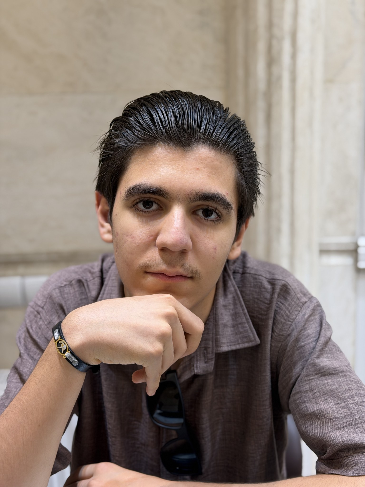

# personal-006

Краткий перевод рассказа автора.

Фото сделано в ювелирном магазине Ahmadian на iPhone 16 Амира Ахмадияна, сына Давуда. Магазином занимаются братья Давуд и Реза Ахмадиян. Мы с братом-близнецом работаем и учимся там без оплаты, освоив продажу золотых украшений. Тогда я зачёсывал все волосы назад; это единственный мой снимок с такой причёской. По моей памяти, мы начали в месяце дей десятого класса, а к моменту рассказа прошло около двух лет.

[Все истории](README.ru.md)
