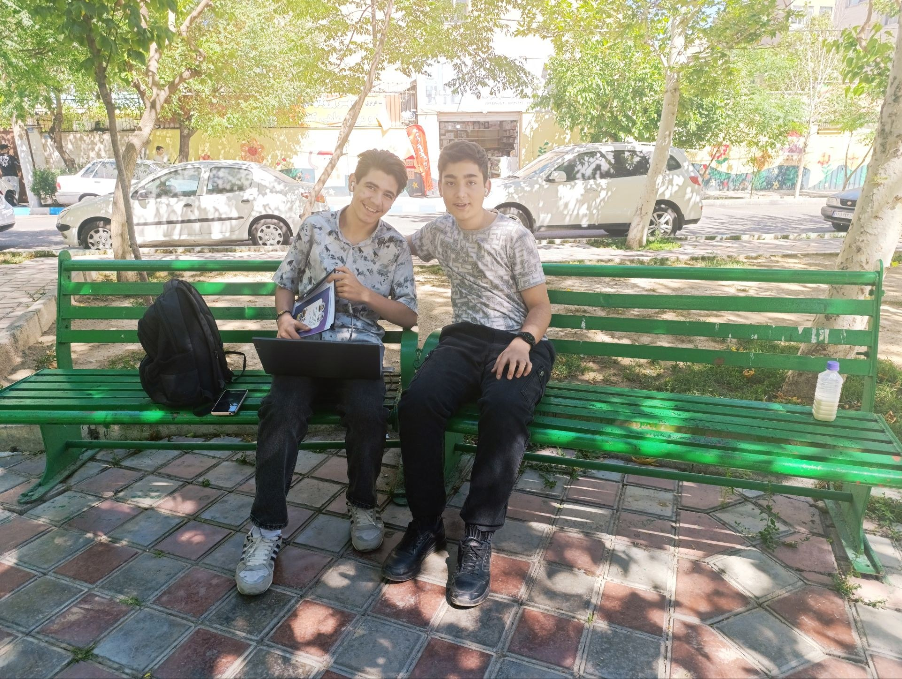

# personal-012

این عکس‌های نیمکت پارک، خاطره‌ای مهم از دوستی و همکاری من با علی دهقان‌نژاد، با نام هنری Alivexor هستند. علی تهرانی است و امروز او را بهترین دوست و همکارم می‌دانم. آن موقع پایهٔ دهم بودم و حدود پانزده یا شانزده سال داشتم؛ علی هم حدود پانزده سال داشت و یک پایهٔ تحصیلی پایین‌تر از من بود.

برای همکاری روی THE APEX، پروژهٔ سرور داستانی ماینکرافت ما، با کمک مادرم که وکیل است یک قرارداد آماده کردیم. به تهران رفتم تا علی و پدرش آن را امضا کنند؛ هر دو نوجوان بودیم و خانواده‌هایمان هم در این کار همراه بودند. دایی‌ام، سیامک نورنژاد، همراهم بود. او برای بردن مادربزرگم پیش پزشک هم به تهران می‌رفت و من با آن‌ها همراه شدم.

آن روز پدر علی و دو برادر کوچک‌ترش را دیدم. وسط پارک نشستیم و شیرموز خوردیم. خوش‌تیپ کرده بودم و دایی‌ام موهایم را حالت داده بود. برای من این‌ها فقط چند عکس روی نیمکت نیستند؛ یادگاریِ یک دوستی مهم و کارهایی هستند که می‌خواستیم با هم بسازیم.

[All stories](README.md)
