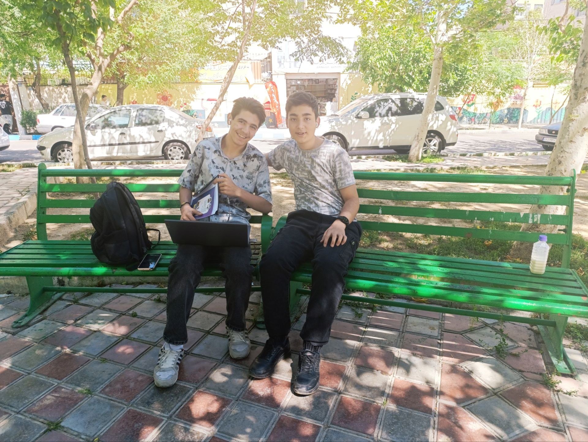

# personal-012

Краткий перевод рассказа автора.

Эти фотографии на скамейке — важная память о дружбе с Али Дехганнежадом, известным как Alivexor. Он из Тегерана; сегодня я считаю его лучшим другом и коллегой. Я был в десятом классе, примерно в пятнадцать–шестнадцать лет, Али было около пятнадцати, и он учился на класс младше.

Моя мама-юрист помогла подготовить соглашение о совместной работе над сюжетным Minecraft-сервером THE APEX. Я приехал в Тегеран, чтобы Али и его отец подписали его: мы были подростками и участвовали вместе с семьями. Со мной был дядя Сиамак Нурнежад; он также вёз бабушку к врачу, и я присоединился к поездке.

Я познакомился с отцом Али и двумя его младшими братьями. Мы сидели в парке и пили банановое молоко. Я нарядился, а дядя уложил мне волосы. Для меня это память о близком человеке и работе, которую мы хотели построить вместе.

[Все истории](README.ru.md)
