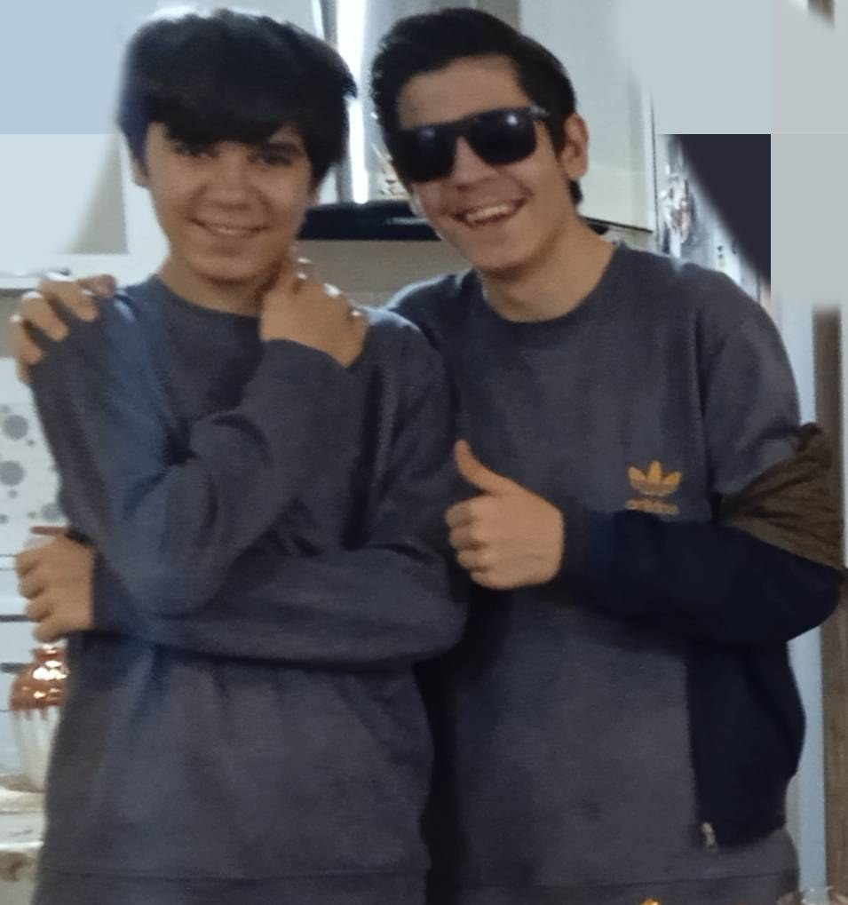

# personal-014

Краткий перевод рассказа автора.

Первый день Новруза 1405, момент наступления нового года дома. Дядя Саджад пришёл к нам и сделал эти снимки. В солнечных очках — я, рядом без очков — мой брат-близнец Армия.

[Все истории](README.ru.md)
