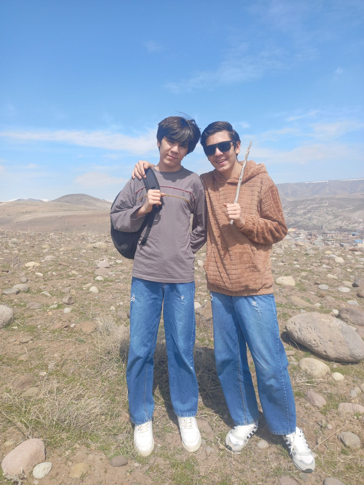

# personal-016

This photograph is from Sizdah Bedar, the thirteenth day of Nowruz 1405 in the Iranian calendar. We went to the dam near Maragheh with my father and his extended family: my two aunts, uncle and his wife, grandmother, my father’s maternal uncle Masoud and his family, cousins and other relatives.

My father, my twin brother and I went up the mountainside, and my father took this photograph of us. Once again, I am the one wearing sunglasses; the other person is my brother Armiya.

[All stories](README.md)
