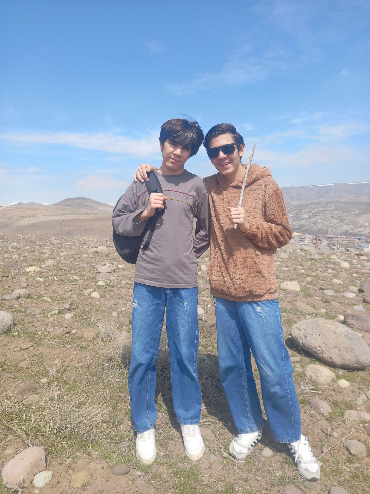

# personal-016

Краткий перевод рассказа автора.

Сиздах-бедар, тринадцатый день Новруза 1405. Мы ездили к плотине около Мараге с папой и его большой семьёй: тётями, дядей и его женой, бабушкой, родственником Масудом и другими родными. Мы с папой и Армией поднялись по склону, и папа нас сфотографировал. В солнечных очках — я, другой человек — Армия.

[Все истории](README.ru.md)
