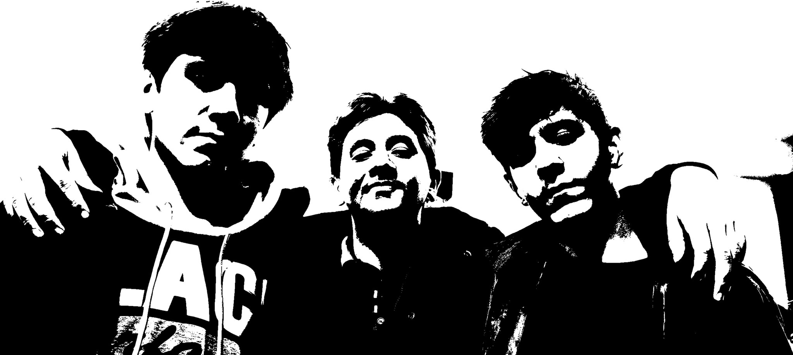

# personal-020

Краткий перевод рассказа автора.

Серия из дождливого школьного дня; кажется, начало шахривара, но точную дату я не помню. В школьном дворе во время бури я слушал музыку в наушниках и воображал себя могущественным героем, а в класс вернулся с мокрыми волосами.

Ашкан Мохаммад Алипур сфотографировал на свой телефон меня, моего брата и Амира Хосейна Садега. Ашкан — мой монтажёр и помогает с After Effects и Blender. Амира я тогда называл SenpaiXD; он часто меняет творческое имя. Ашкана и Садры Шахи в этой серии нет. Часть снимков я сам сделал более тёмными и чёрно-белыми.

Сразу после фото день стал тяжёлым: по моей памяти, школьный администратор господин Азизи забрал телефон и наушники до следующего дня. Я очень расстроился и плакал. Поэтому снимки хранят и радость с друзьями, и неприятное продолжение дня.

[Все истории](README.ru.md)
