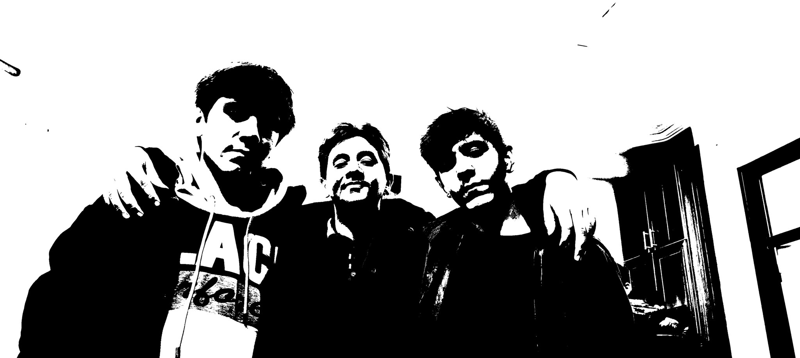

# personal-021

This image belongs to a series from a rainy day at school. I think it was early Shahrivar, though I am not sure of the exact date. I had brought my earbuds and was listening to music in the schoolyard during the storm, imagining myself as a powerful character. I came back into class with wet hair.

My friend Ashkan Mohammad Alipour took photographs on his phone of my brother, Amir Hossein Sadegh and me. Ashkan is also my editor and helps with After Effects work and Blender animations. At the time I called Amir Hossein “SenpaiXD”; he often changes his artistic name because he dislikes repeating the same thing. Ashkan and our friend Sadra Shahi are not in this series. I later edited some of these images myself into a darker black-and-white style.

The day became much harder immediately after the photographs. As I remember it, the school administrator, Mr Azizi, took my phone and earbuds and kept them until the following day. I was deeply upset and cried. These pictures hold both the excitement of that moment with my friends and a difficult memory from later that day.

[All stories](README.md)
