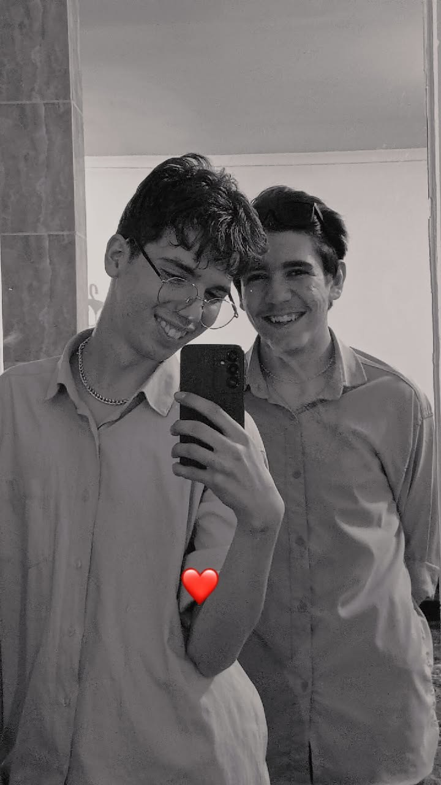

# personal-022

Краткий перевод рассказа автора.

Первый визит в гости к Али Хейдари, который учится на класс старше. Я в солнечных очках и кремовой одежде, Али — в обычных очках. Армия не пришёл; мы вдвоём играли и разговаривали. Было очень здорово, хотелось бы повторить. По памяти, я был там примерно с пяти до девяти вечера. В тот день сильно болел живот, но я терпел; дома принял лекарство, отдохнул и почувствовал себя лучше.

[Все истории](README.ru.md)
