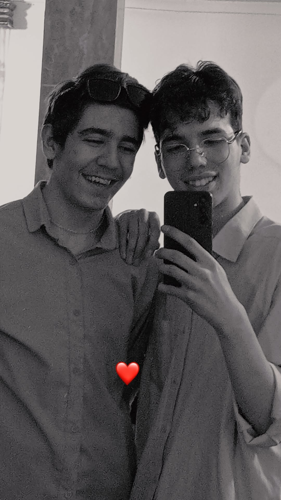

# personal-023

These photographs are from my first visit to my friend Ali Heydari’s home. Ali is one school year ahead of me. I am the one wearing sunglasses and a cream-coloured outfit; Ali is wearing glasses. My twin brother Armiya did not come with us, so it was just the two of us playing games and talking. I had a wonderful time and hope we can do it again.

I remember the visit as roughly five to nine in the evening, though I am not certain of the times. I was struggling with a severe stomach upset that day and tried to manage it during the visit. After I got home, I took medicine, rested and felt better.

[All stories](README.md)
