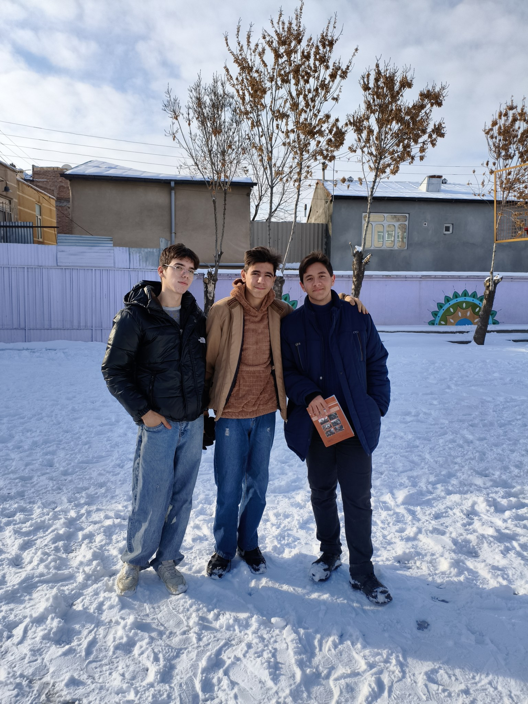

# personal-026

この写真は、イラン暦1404年のデイ月、学校の前期試験の時期に撮りました。雪が降ったきれいな日でした。中央が私で、写真の右側がAmir Hossein Sadegh、左側がAli Heydariです。

その日は髪を整えず、帽子をかぶっていました。帽子を取ると髪がぐしゃぐしゃになっていましたが、友人たちが写真を撮ろうと言ってくれたので、私も賛成しました。ArmiyaとAshkanが私たちの写真を撮ってくれました。

[All stories](README.md)
