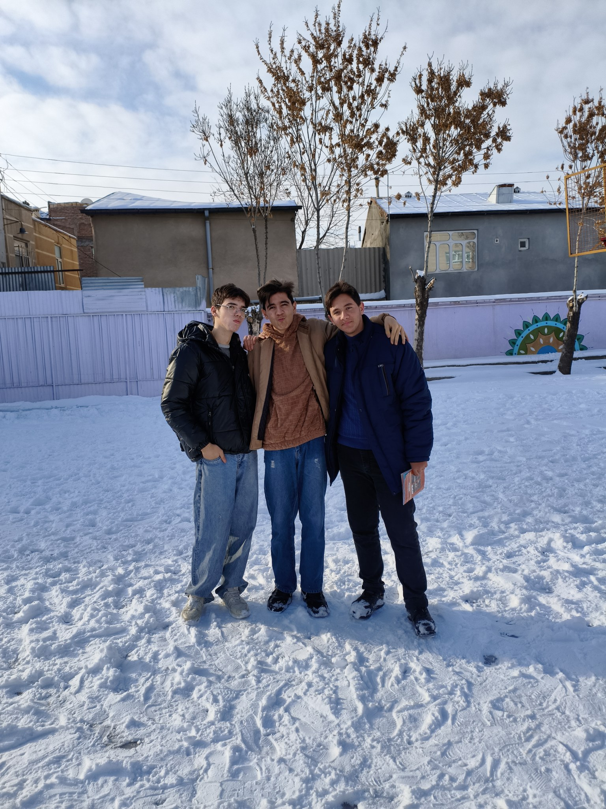

# personal-027

Краткий перевод рассказа автора.

Дей 1404, экзамены первого полугодия и красивый снежный день. В середине я, справа на фотографии Амир Хосейн Садег, слева Али Хейдари. Волосы я не укладывал, носил шапку, а после неё причёска растрепалась. Друзья предложили сфотографироваться; снимали Армия и Ашкан. Я помню этот день как день экзамена по математике.

[Все истории](README.ru.md)
