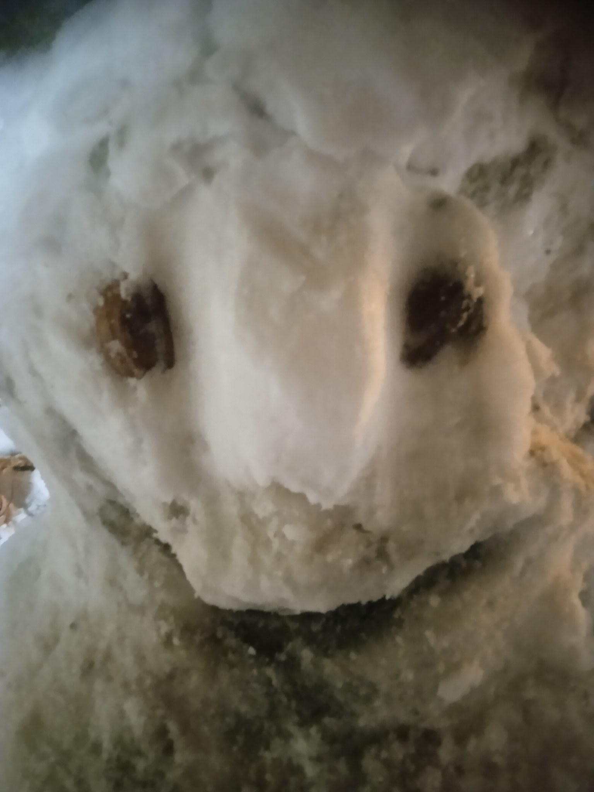

# personal-030

これらの写真は、イラン暦1404年のデイ月、学校の試験の時期のものです。写真personal-027に関係する数学の試験の翌日に雪が降ったと覚えています。その夜、家の前へ出て、何時間もかけて一生懸命この雪だるまを作り、写真を撮りました。

私の記憶では、翌日、近所の子ども2人が雪だるまを壊してしまいました。何時間もの努力が消えてしまい、悲しかったです。この写真は、苦労して作った雪だるまの思い出として残っています。

[All stories](README.md)
