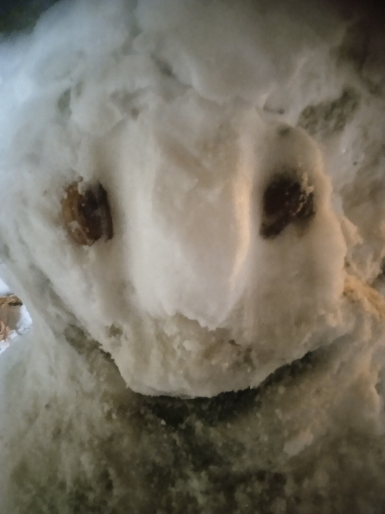

# personal-030

Краткий перевод рассказа автора.

Фотографии снеговика во время экзаменов в дее 1404. По моей памяти, снег выпал на следующий день после экзамена по математике, связанного с фото 027. Вечером у дома я несколько часов старательно лепил этого снеговика. На следующий день двое соседских детей его испортили; мне было обидно за столько труда. Фотографии — то, что сохранилось от моей работы.

[Все истории](README.ru.md)
