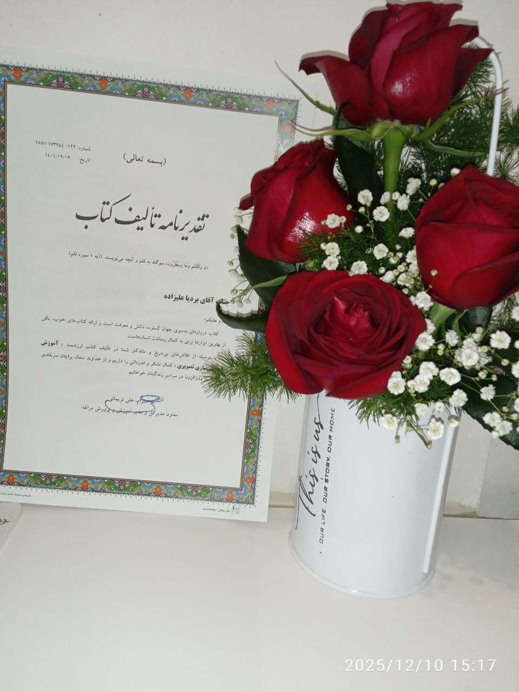

# personal-034

These photographs show the book-authorship appreciation certificate and the flowers from a day that meant a great deal to me. I had given the education department a copy of my book months earlier. When the authors’ recognition event finally came, I was told I was the only fifteen-year-old in the group and that perhaps I should not attend among the adults. I felt that having a young author should have been a reason to welcome me, and I insisted on going.

We went from school to the education department. I remember feeling overlooked on arrival and having to explain that I was an author. After roughly an hour of names being called, mine was called last. By then, as I remember it, some people had left and others were looking at their phones. I felt that the moment had passed without the attention I had hoped for. This is my personal memory of the day, rather than a claim about anyone’s intentions.

I remember receiving 500,000 tomans with the certificate. My book was priced at 350,000 tomans, and I had already given them a copy as a gift. In my disappointment I compared those figures: 150,000 tomans above the price of the book I had donated. To me, the recognition felt small compared with the work and anticipation behind it.

The bouquet made me happy. My uncle Siamak, who was there, bought it for me. My mother and Akhtar Amir Sadeghi—whom I call “Aziz”—were also present. My father could not come. My mother took these photographs that night. Alongside the disappointment, I remember the warmth of my family and the flowers.

Date note: I recall the event as late Dey 1404, close to Bahman. The photographed certificate itself is dated 1404/09/09; its printed date and my recollection of the ceremony date are kept separate pending clarification.

[All stories](README.md)
