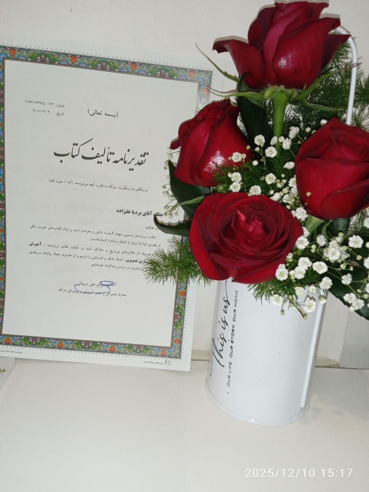

# personal-034

Краткий перевод рассказа автора.

Грамота за книгу и цветы напоминают мне о дне с противоречивыми чувствами. За несколько месяцев до церемонии я подарил управлению образования книгу. Мне сказали, что я единственный пятнадцатилетний среди взрослых авторов и, возможно, мне лучше не приходить. Я настоял: молодой автор, как мне казалось, тоже заслуживал приглашения.

Я помню, что по прибытии чувствовал себя незамеченным и объяснял, что я автор. Примерно через час моё имя назвали последним. Часть людей уже ушла, другие смотрели в телефоны; внимания оказалось меньше, чем я надеялся. Это моя личная память, а не утверждение о чьих-либо намерениях.

Вместе с грамотой, по моей памяти, дали 500 000 томанов. Книга стоила 350 000, а экземпляр я уже подарил, и от разницы в 150 000 мне было обидно. Зато букет от дяди Сиамака очень порадовал. Мама и Ахтар Амир Садеги, которую я называю Азиз, тоже были рядом; папа не смог прийти. Вечером мама сделала эти снимки.

Я вспоминаю церемонию как конец дея 1404, близко к бахману. На самой грамоте напечатано 1404/09/09; дата документа и моё воспоминание о церемонии сохранены отдельно.

[Все истории](README.ru.md)

[Armiya’s video of receiving the certificate](personal-video-09.en.md)
