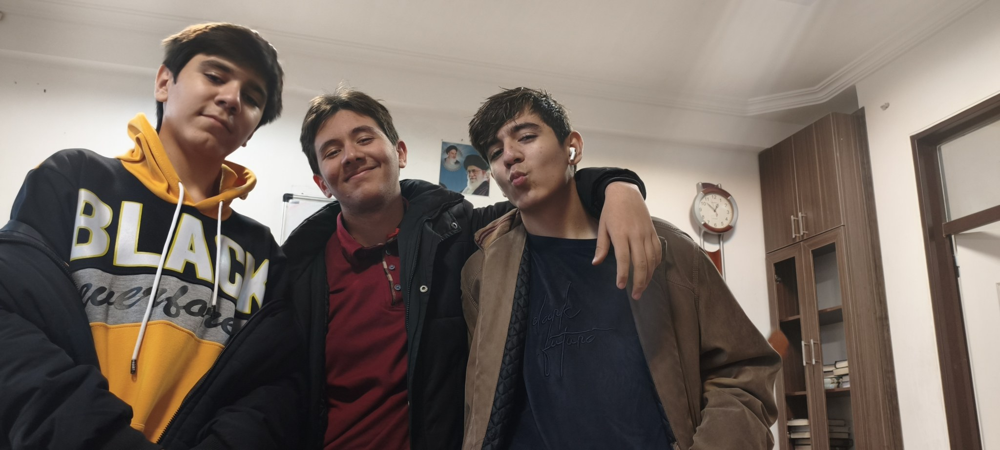

# personal-036

この画像は、学校で過ごした雨の日の写真シリーズの1枚です。確かシャフリーヴァル月の初め頃でしたが、正確な日付には自信がありません。イヤホンを学校に持っていき、嵐の校庭で音楽を聴きながら、自分を力強いキャラクターとして想像していました。教室に戻ったとき、髪はぬれていました。

友人のAshkan Mohammad Alipourが、自分のスマートフォンで私と双子の弟、Amir Hossein Sadeghの写真を撮ってくれました。Ashkanは私の編集も担当し、After Effectsの作業やBlenderのアニメーションでも手伝ってくれています。当時、私はAmir HosseinをSenpaiXDと呼んでいました。同じものを繰り返すのが好きではなく、活動名をよく変える友人です。Ashkanと友人のSadra Shahiは、この写真シリーズには写っていません。その後、私は一部の写真を自分で、より暗いモノクロのスタイルに編集しました。

写真を撮った直後、その日はつらいものになりました。私の記憶では、学校の生活指導担当のAzizi先生が私のスマートフォンとイヤホンを預かり、翌日まで返してくれませんでした。私はとても悲しくなり、泣きました。この写真には、友人たちと過ごした瞬間の高揚感と、その後のつらい思い出の両方が残っています。

[All stories](README.md)
