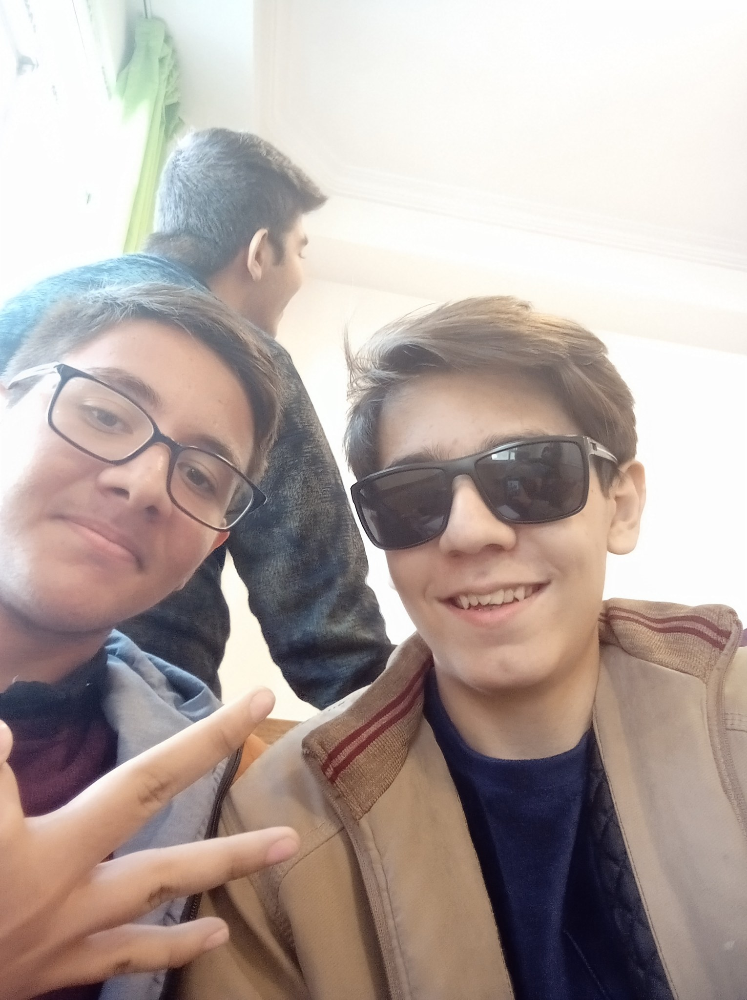

# personal-047

Краткий перевод рассказа автора.

Мы с Амиром Хосейном Садегом в школе в десятом классе. Он предложил сфотографироваться на память. Солнце помешало хорошо передать его лицо, но снимок остался памятью о нас.

[Все истории](README.ru.md)
