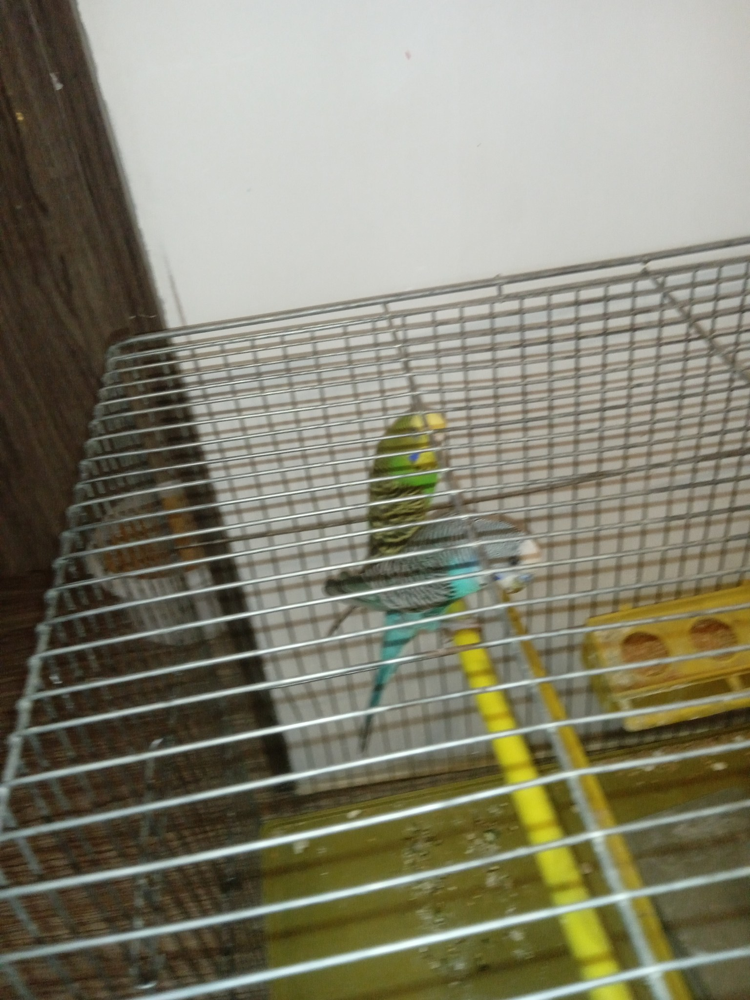

# personal-048

Photograph personal-048 shows the parent budgies from the bird family we used to keep.

We had kept the blue budgie and a white one since about seventh grade, when I was around thirteen. They were together for roughly three years without laying eggs. The seller had described them as a pair, but I later suspected that both were male. I tried vitamins and different things, and eventually the white bird died.

Later, my father found a green budgie in the street. It seemed unwell, with an uneven beak and claws, so I took it to a vet. As I remember the conversation, the vet described it as a very old female in poor health with little prospect of recovery. We later exchanged it for a younger female. After she joined our blue bird, they bred and laid eggs. I remember about five chicks, with three hatching on one occasion and two on another; some eggs did not hatch. The chicks looked like their father.

Eventually the birds became very noisy, and we sold them. These are among the last photographs I kept of that little bird family.

There is an earlier childhood memory too. When my brother and I were about three or four, our aunt bought us two budgies, a golden one and a white one. A cat caught the golden bird at our grandmother’s home. We brought the white bird home and kept it for several years. I remember it later dying after eating a persimmon. These are my memories of what happened, not established veterinary explanations.

[All stories](README.md)
