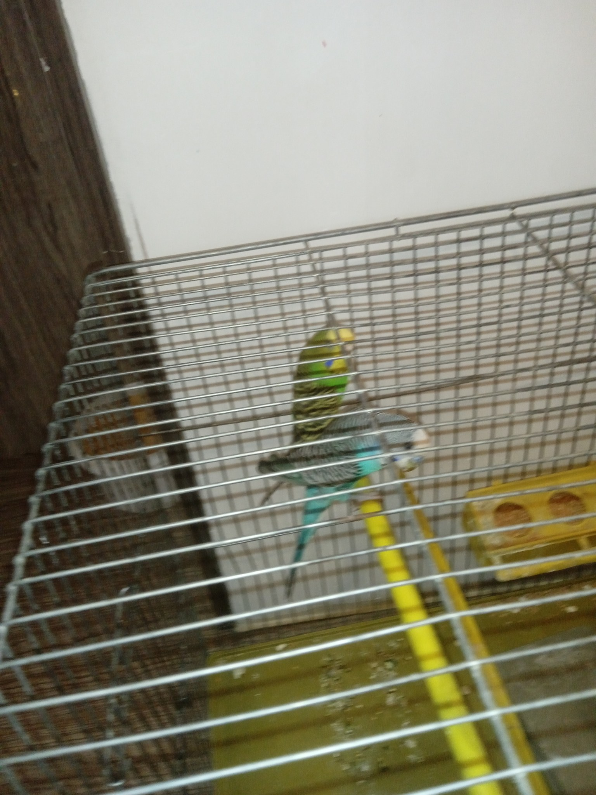

# personal-048

Краткий перевод рассказа автора.

Это взрослые волнистые попугайчики, которых мы держали. Синяя и белая птицы жили у нас примерно с седьмого класса около трёх лет без яиц. Продавец назвал их парой; позже я подумал, что обе были самцами. В конце концов белая птица умерла.

Позже папа нашёл на улице зелёного попугайчика с неровным клювом и когтями. По моим воспоминаниям, ветеринар счёл её очень старой и больной. Мы обменяли её на молодую самку, и у синей птицы появилась пара. Я помню около пяти птенцов — три в одном выводке и два в другом; часть яиц не вылупилась. Птенцы были похожи цветом на отца. Птицы стали очень шумными, и мы их продали. Это одни из последних их фото.

Есть более ранняя история: когда нам с братом было три–четыре года, тётя подарила золотистого и белого попугайчиков. Золотистого поймала кошка у бабушки; белый жил с нами ещё несколько лет. Я помню его смерть после хурмы, но это воспоминание, а не установленное ветеринарное объяснение.

[Все истории](README.ru.md)
