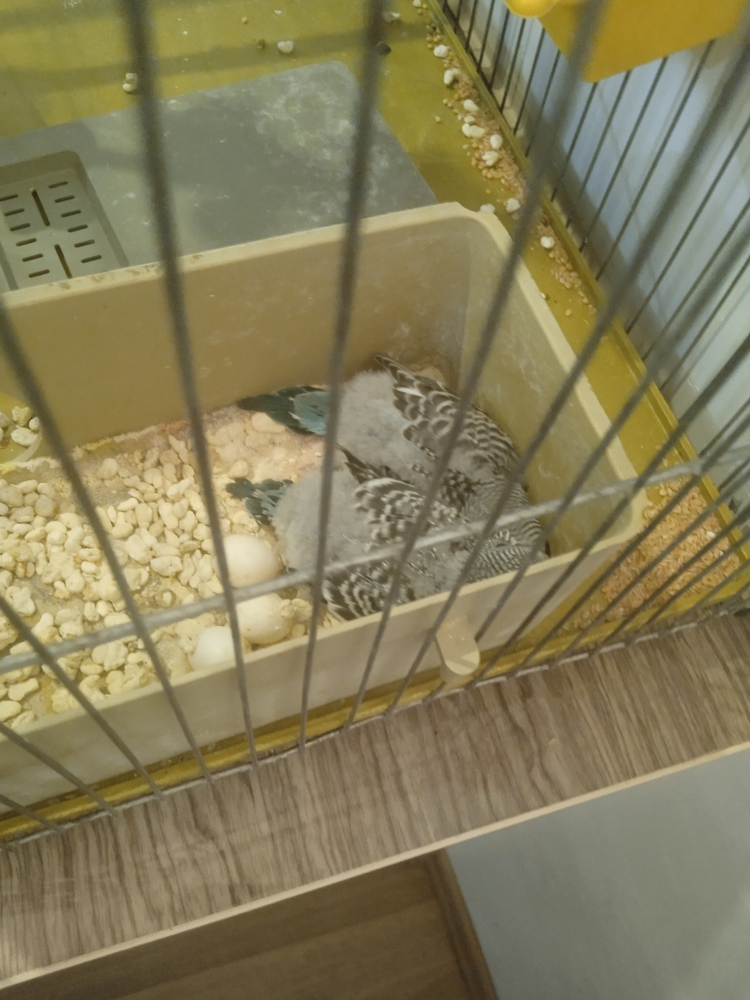

# personal-049

Краткий перевод рассказа автора.

Два птенца из нашей семьи волнистых попугайчиков; я помню, что они цветом пошли в отца. Это потомство синего попугайчика и молодой самки, появившейся у нас после истории со старой больной зелёной птицей. Около пяти птенцов вылупились в двух выводках; некоторые яйца не вылупились. Из-за шума птиц позже продали, и эти фотографии остались на память. Подробная семейная история — на фото 048.

[Все истории](README.ru.md)
