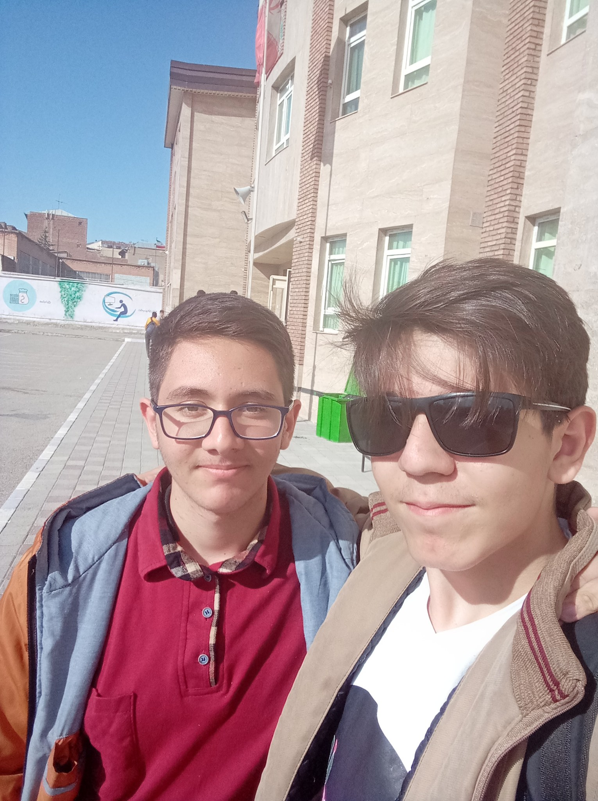

# personal-050

Краткий перевод рассказа автора.

Снимались с Амиром Хосейном Садегом после школы в десятом классе, по его предложению. На моей белой футболке — мой дизайн бренда и канала: кактус и фиолетовая надпись LOVE. Я разработал и заказал печать в девятом классе; по моей памяти, это стоило около двух миллионов томанов.

[Все истории](README.ru.md)
