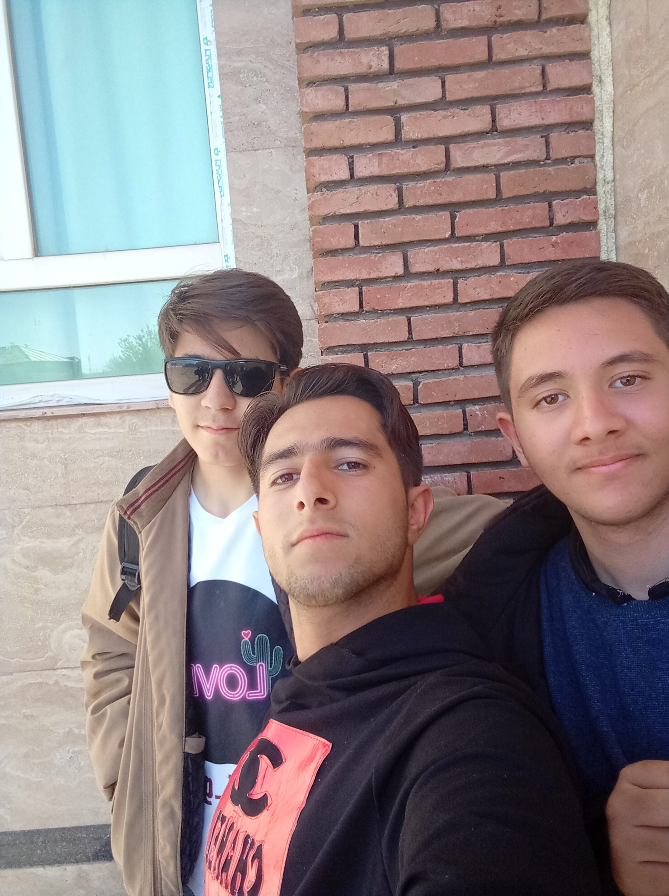

# personal-051

Краткий перевод рассказа автора.

Тот же выход из школы в десятом классе: мы с Амиром Хосейном Садегом фотографировались, а ученик одиннадцатого класса присоединился к нам посередине. Кажется, его звали Наджаф, но я не уверен. На мне моя футболка с кактусом и фиолетовым LOVE, разработанная и напечатанная в девятом классе.

[Все истории](README.ru.md)
