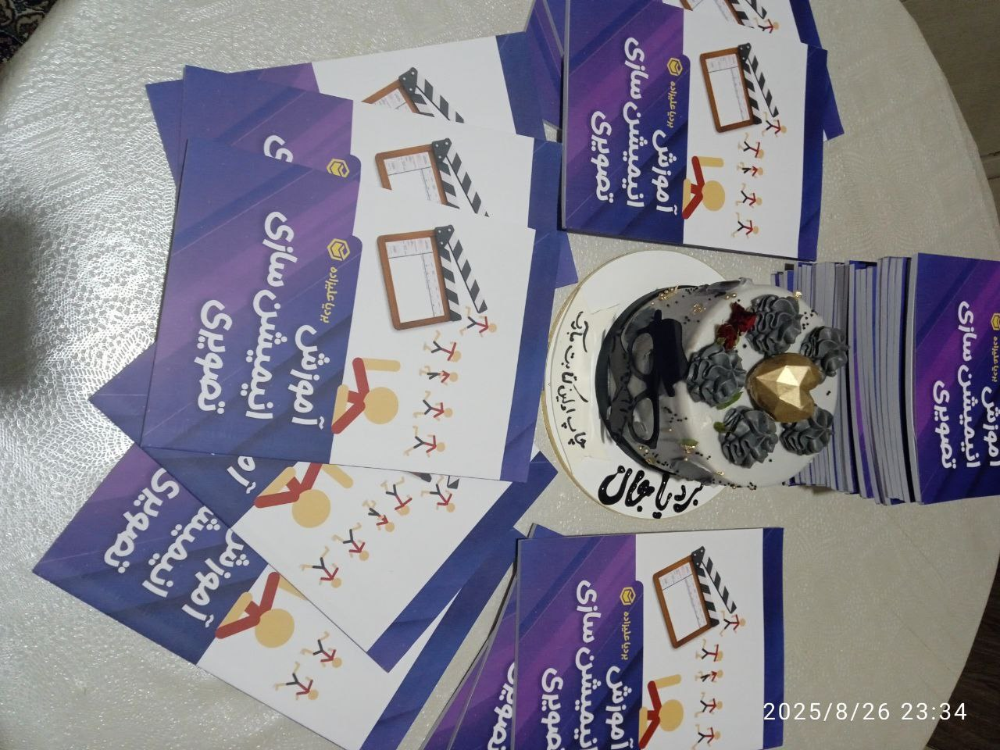

# personal-056

Краткий перевод рассказа автора.

Вечером, когда прибыли первые 50 печатных экземпляров моей книги, мама купила торт. Мы втроём — я, брат-близнец и мама — отметили это, сделали фотографии, выложили сторис и съели торт. Небольшой семейный праздник первой книги в печати.

[Все истории](README.ru.md)
