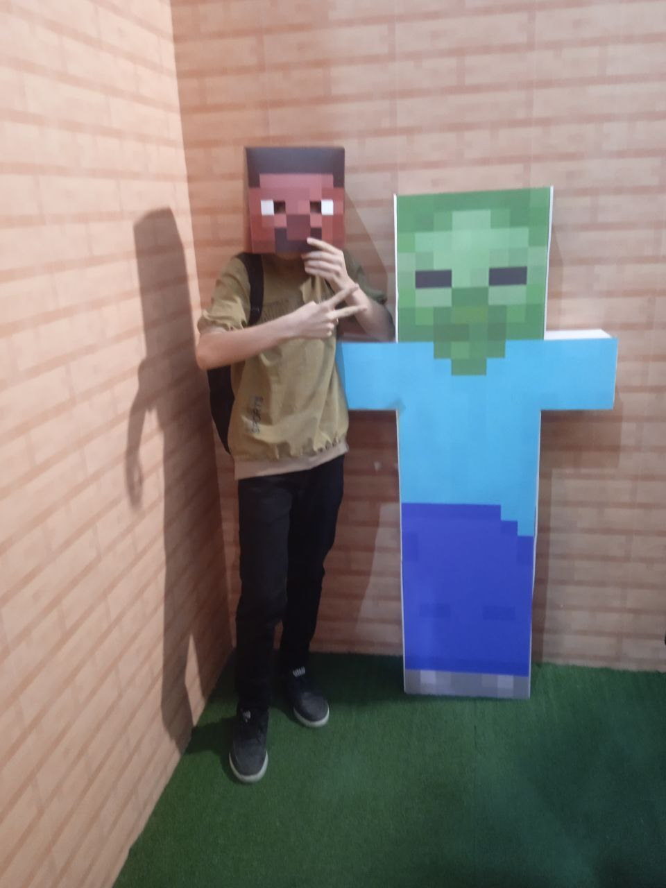

# personal-060

Краткий перевод рассказа автора.

Книжный фестиваль в Тегеране в 1404 году. У Classino была Minecraft-зона с зомби и шапками Стива: фото с зомби и сторис давали участие в розыгрыше. Я не выиграл, но сохранил снимок и шапки как память о поездке.

[Все истории](README.ru.md)
