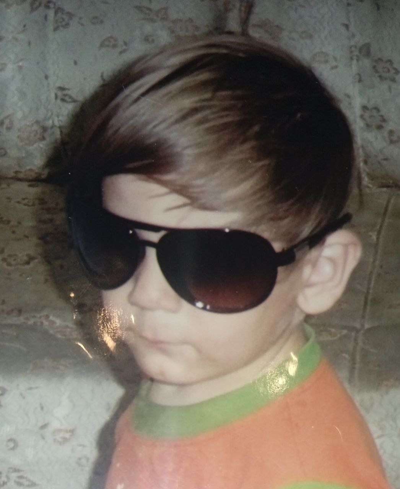
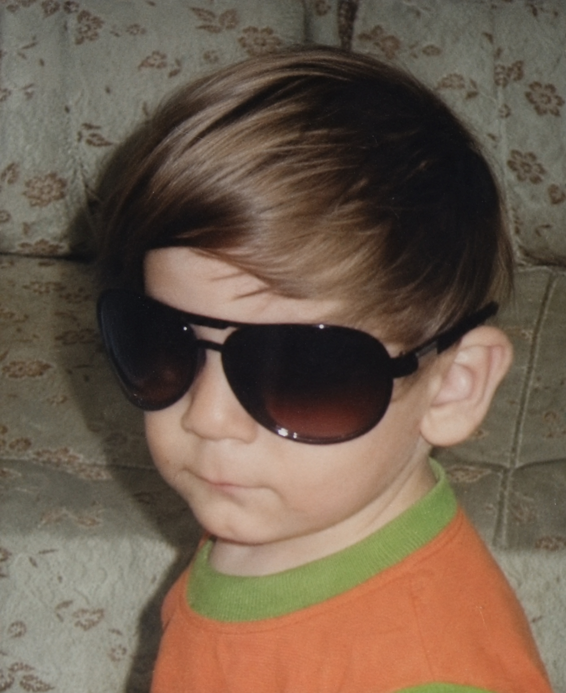

# personal-061

Краткий перевод рассказа автора.

Детская фотография меня примерно в один–два года. Позже я переснял альбомный отпечаток телефоном, поэтому качество ухудшилось и появился блик. Я попросил сделать отдельную, явно обозначенную реставрацию, сохранив предоставленный вариант.

[Все истории](README.ru.md)

## AI-restored version · reflection reduced and clarity enhanced

