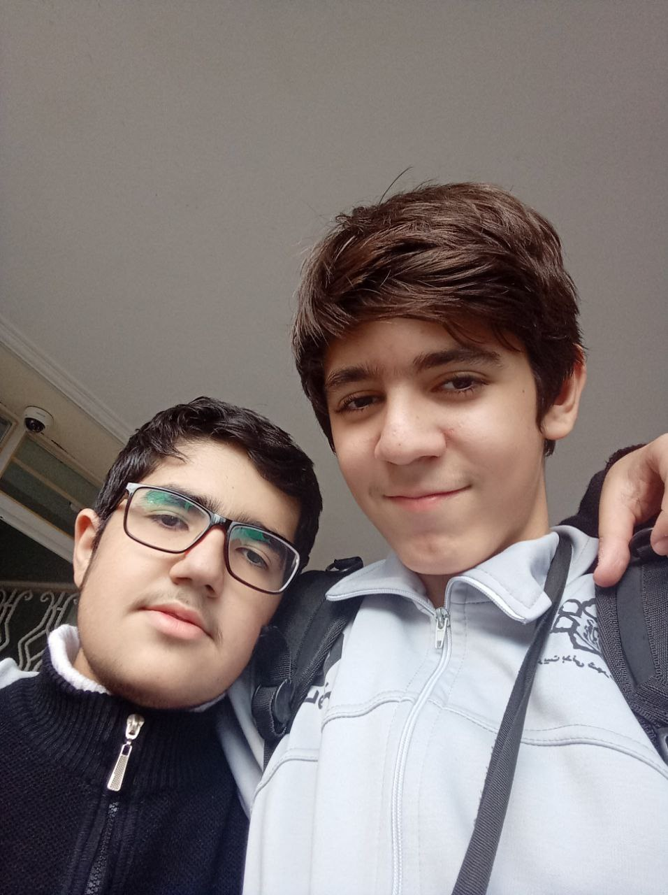

# personal-062

Краткий перевод рассказа автора.

По моей памяти, девятый класс, примерно 1402 или 1403 год; точный год не уверен. Серая спортивная форма напоминает понедельник с физкультурой первым уроком. На выходе я понял, что у меня нет хорошего фото с Али Ата, с которым дружу с седьмого класса, и предложил снимок. По-моему, оба вышли не лучшим образом, зато дружба гораздо лучше фотографии! Он один из лучших друзей, о которых можно мечтать.

[Все истории](README.ru.md)
