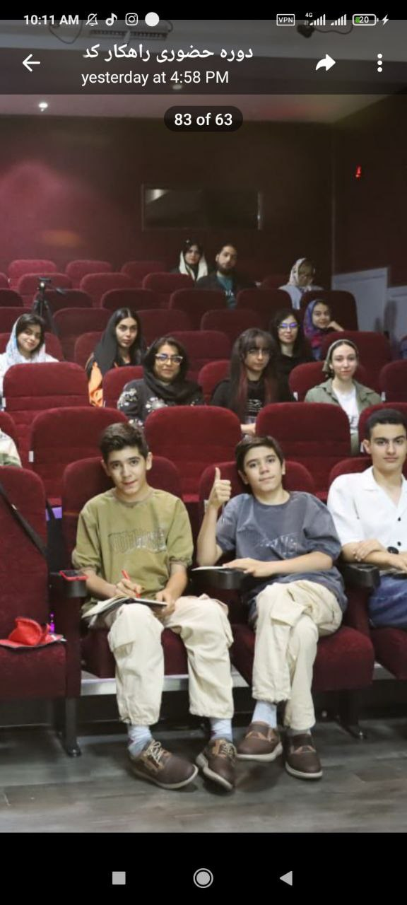

# personal-077

Краткий перевод рассказа автора.

Память о десяти занятиях ораторского мастерства у Тахи Бамшада, которые мы с Армией посещали летом, в мордаде и шахриваре 1403 года. Это был переломный период: я стал увереннее, меньше стеснялся, свободнее говорил и выражал себя. Курс изменил моё поведение и представление о себе.

[Все истории](README.ru.md)
