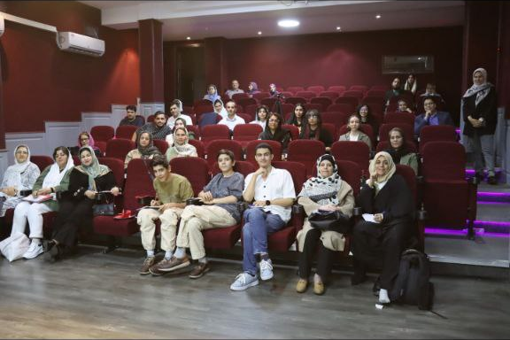
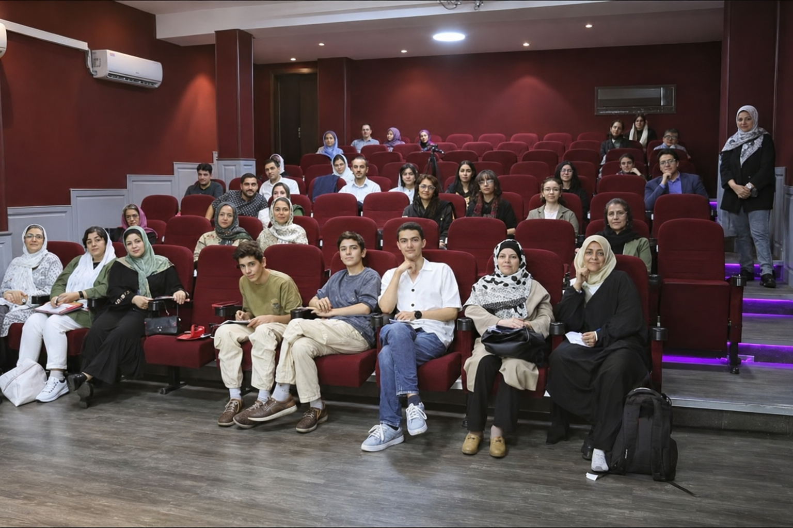

# personal-103

This group photograph is from the Taha Bamshad public-speaking class that my twin brother and I attended. It is a memory of the summer 1403 course and the people in that classroom. I supplied it as a phone screenshot and asked for its top and bottom margins to be removed, leaving the class photograph. A separately labelled enhanced version may be available alongside the cropped source photograph.

[All stories](README.md)

## AI-enhanced version · fine details may be reconstructed

