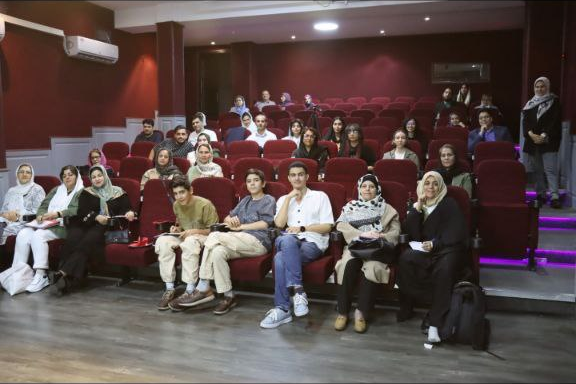
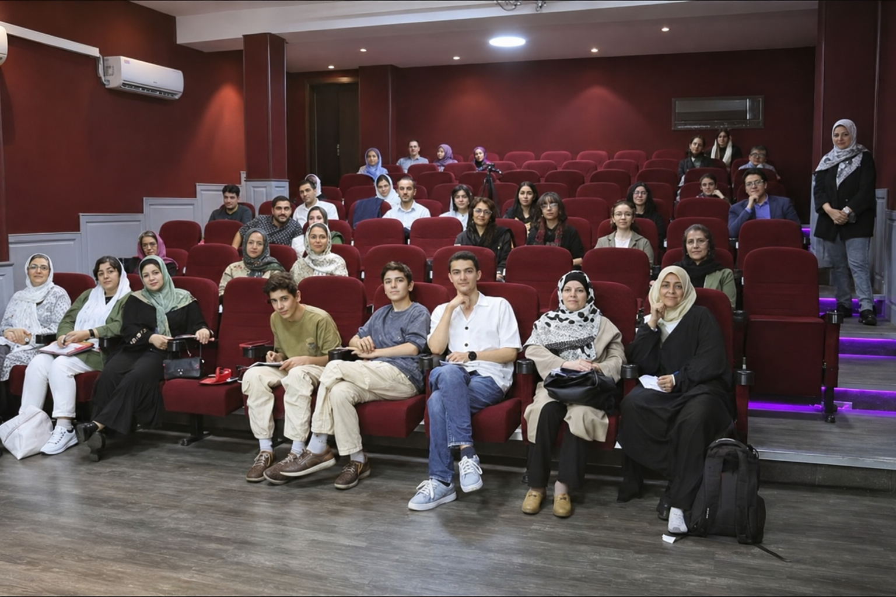

# personal-103

این عکس گروهی مربوط به کلاس فن بیان طاها بامشاد است که من و برادر دوقلویم در آن شرکت کردیم؛ یادگاریِ دورهٔ تابستان ۱۴۰۳ و جمعِ آن کلاس. فایل ارسالی اسکرین‌شات گوشی بود و خواستم حاشیه‌های بالا و پایینش حذف شوند تا خود عکس کلاس باقی بماند. نسخهٔ بهبودکیفیت‌یافته، اگر در دسترس باشد، جدا از عکس اصلیِ برش‌خورده و با برچسب مشخص نگه داشته می‌شود.

[All stories](README.md)

## نسخهٔ بهبودکیفیت‌یافته با هوش مصنوعی؛ جزئیات ریز ممکن است بازسازی شده باشند

