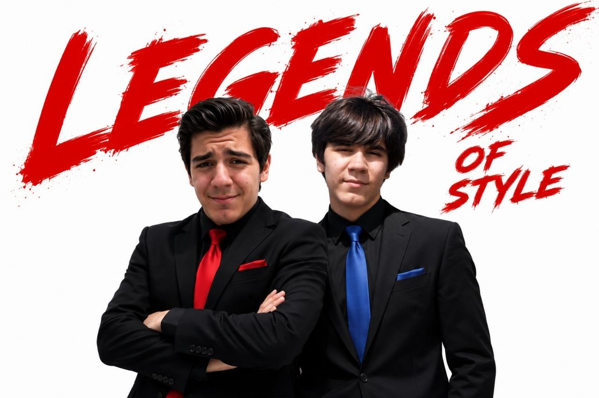

# personal-118

این تصویرها از نخستین تجربه‌های من در تصویرسازی با کمک هوش مصنوعی هستند. آن موقع با Photoshop کار می‌کردم و می‌خواستم برای یک آلبوم اینستاگرام از خودم و برادر دوقلویم ارمیا تصویر بسازم. دوربین خوبی نداشتم، برای همین از عکس‌های خودمان و نسخهٔ پولی ChatGPT برای ساخت، ادیت و بازطراحی تصویرها استفاده کردم و بعد منتشرشان کردم. هنوز هم نتیجهٔ این تجربه‌های اولیه را دوست دارم.

در تصویر ۱۱۸، ارمیا همان شخصیتی است که جزئیات آبی دارد.

[All stories](README.md)
