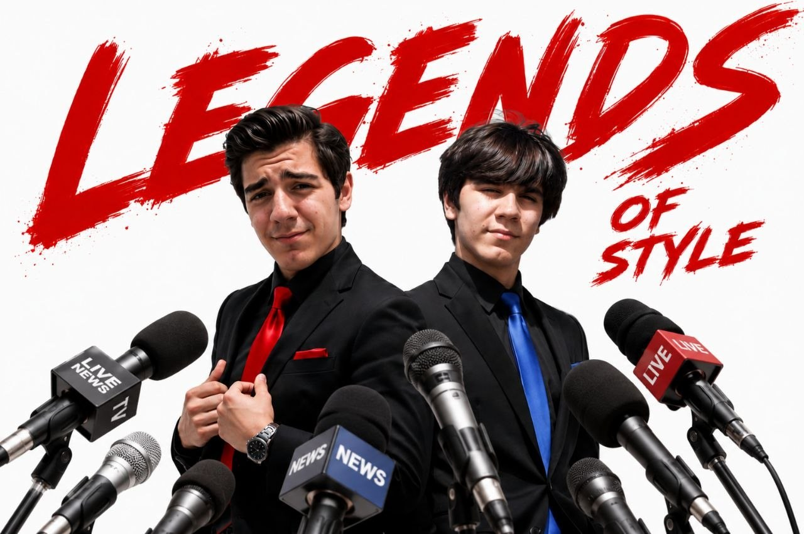

# personal-120

These images are among my earliest experiments with AI-assisted image-making. I was already working with Photoshop and wanted to create an Instagram album featuring my twin brother Armiya and me. I did not have a good camera at the time, so I used existing photographs of us with the paid version of ChatGPT to create, edit and redesign the images. I then published the album. I still like how these early experiments turned out.

[All stories](README.md)
