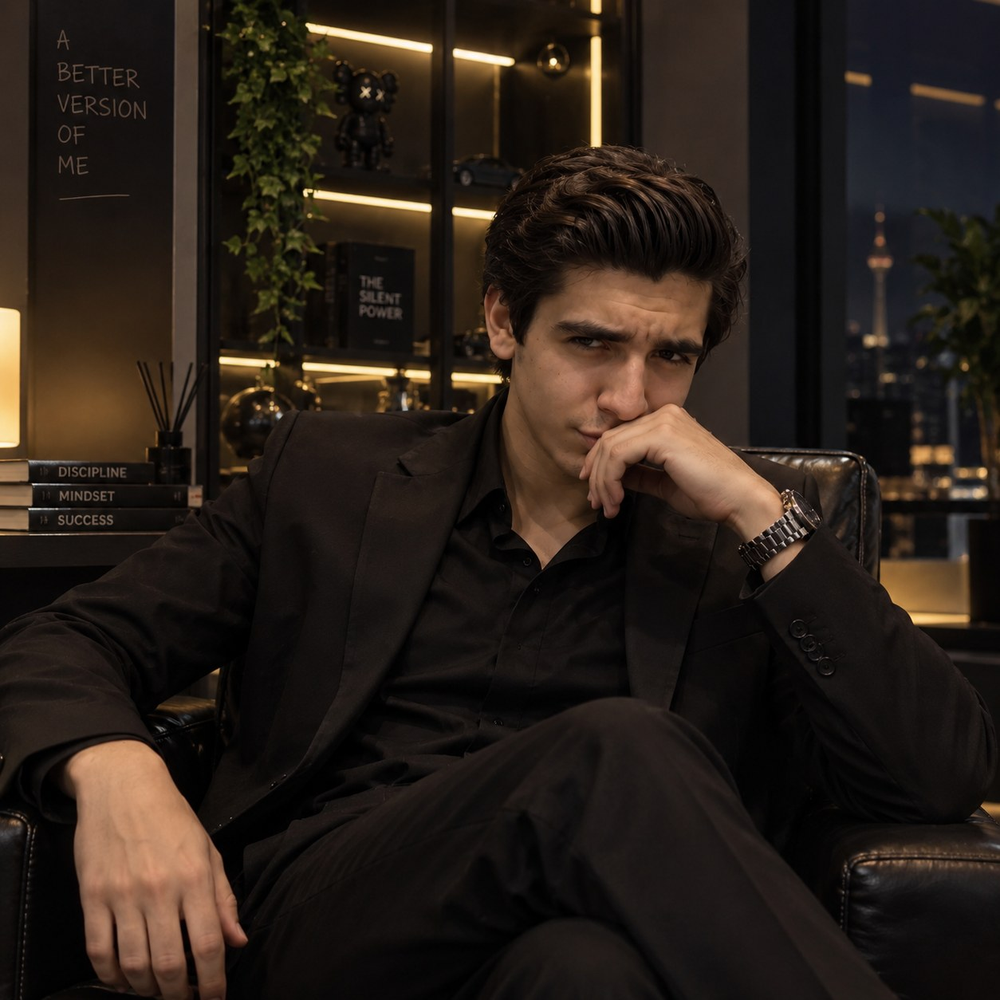

# personal-137

Краткий перевод рассказа автора.

Основой была настоящая фотография: я сел в этой позе и снял себя. Затем поработал над качеством в Blender, отредактировал в Photoshop и с ИИ изменил одежду и окружение. Поза — из исходной съёмки; итоговый образ — творческая обработка несколькими инструментами. Мне очень нравится. 😎🎨

[Все истории](README.ru.md)
