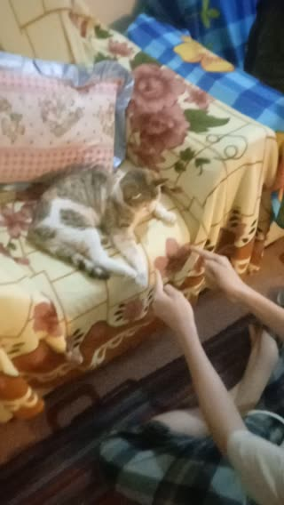

# Gol ya Pooch with Grandma’s cat. · personal-video-05

[Watch the full video](https://farlandgame.github.io/Personal-Portfolio/?lang=en#personal-video-05) · [MP4](../videos/personal-video-05.mp4)

Gol ya Pooch with Grandma’s cat. 😸🎥

The cat in this video belongs to my grandmother, whom I call Aziz. One of my three aunts, Mansoureh Nournezhad, lives in Mahabad. When Aziz and my aunt Haleh Nournezhad went to visit her, they brought this cat back with them. To me, she sometimes seems almost human, as if she understands what we say.

Apparently she was pregnant when she arrived and gave birth to five kittens. Later she had another litter of five, mostly female. Many of the kittens have since died or gone away, but the mother cat is still around. I found her especially funny when she first arrived, though she later became a bit more of a handful.

That day she was lying on the sofa, and I wanted to see how she would handle Gol ya Pooch: a Persian game in which a small object is hidden in one hand after being moved between the hands, and the other player guesses where it is. I sat in front of her and played while my twin brother Armiya filmed with my phone. She guessed wrong a few times, then found the object. Once she realised it was nothing to eat, she lost interest and left. Apparently the prize committee had failed to arrange snacks! 😹

The published copy is silent at my request; the complete video picture is retained.

[Video stories](videos.md)
