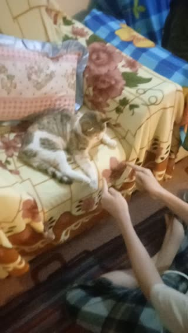

# گل یا پوچ با گربهٔ عزیز! · personal-video-05

[تماشای ویدئوی کامل](https://farlandgame.github.io/Personal-Portfolio/?lang=fa#personal-video-05) · [MP4](../videos/personal-video-05.mp4)

گل یا پوچ با گربهٔ عزیز! 😸🎥

گربهٔ این ویدئو مال مادربزرگم است که او را «عزیز» صدا می‌کنم. من سه خاله دارم؛ یکی‌شان منصوره نورنژاد است که در مهاباد زندگی می‌کند. وقتی عزیز همراه خاله هاله نورنژادم به دیدن خاله منصوره رفتند، این گربه را با خودشان آوردند. به نظر من گاهی انگار آدم است و زبانمان را می‌فهمد!

گویا موقع آمدنش حامله بوده و پنج بچه به دنیا آورده؛ بعدتر هم دوباره پنج‌قلو زاییده که بیشترشان ماده بوده‌اند. خیلی از بچه‌ها بعداً مردند یا رفتند، ولی خود گربه هنوز هست. مخصوصاً اوایل خیلی بامزه بود، هرچند بعدها کمی هم اذیت‌کننده شد.

آن روز روی مبل خوابیده بود و من کنجکاو شدم ببینم گل یا پوچ بازی می‌کند یا نه. یک چیز کوچک را بین دست‌هایم جابه‌جا می‌کردم و او باید حدس می‌زد در کدام دست پنهان شده. جلویش نشستم و بازی کردم؛ ارمیا، برادر دوقلویم، هم با گوشی من فیلم گرفت. چند بار اشتباه کرد و بالاخره گل را پیدا کرد. وقتی فهمید خوردنی نیست، دیگر اهمیت نداد و بلند شد رفت. ظاهراً کمیتهٔ مسابقات، جایزهٔ خوراکی را فراموش کرده بود! 😹

نسخهٔ منتشرشده به درخواست من بی‌صداست؛ تصویر ویدئو با مدت کامل حفظ شده است.

[Video stories](videos.md)
