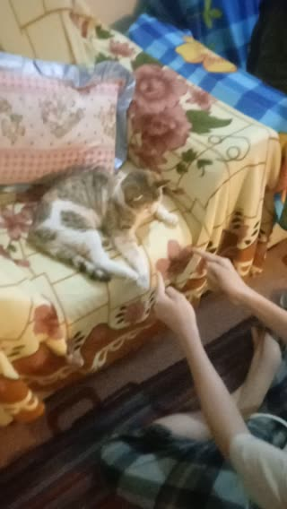

# おばあちゃんの猫と「Gol ya Pooch」。 · personal-video-05

[動画の全編を見る](https://farlandgame.github.io/Personal-Portfolio/?lang=ja#personal-video-05) · [MP4](../videos/personal-video-05.mp4)

おばあちゃんの猫と「Gol ya Pooch」。😸🎥

この猫は、私がAzizと呼ぶ祖母の猫です。3人いる叔母のひとり、Mansoureh NournezhadはMahabadに住んでいます。祖母と叔母Haleh Nournezhadが彼女を訪ねたとき、この猫を連れて帰ってきました。私には、ときどき人間のように言葉が分かる猫に思えます。

来たときには妊娠していたらしく、5匹の子猫を産みました。その後も5匹を産み、そのときはメスが多かったそうです。子猫たちの多くはその後亡くなったり、いなくなったりしましたが、母猫は今もいます。来たばかりの頃は特に面白く、後には少し手を焼くこともありました。

その日はソファで寝ていたので、イランの遊び「Gol ya Pooch」ができるか試してみたくなりました。小さな物を両手の間で移し、どちらの手に隠れているかを当てる遊びです。猫の前に座って遊ぶ私を、双子の弟Armiyaが私の携帯電話で撮影しました。何度か外したあと、猫は隠した物を見つけました。でも食べ物ではないと分かると、興味をなくして立ち去ってしまいました。どうやら大会委員会がおやつの賞品を用意し忘れたようです！😹

公開版は私の希望で音声を取り除いています。映像は全編を残しています。

[Video stories](videos.md)
