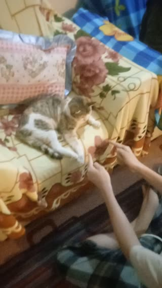

# Игра с кошкой Азиз · personal-video-05

Краткий перевод рассказа автора.

[Смотреть целиком](https://farlandgame.github.io/Personal-Portfolio/?lang=ru#personal-video-05) · [MP4](../videos/personal-video-05.mp4)

Игра «гол-я-пуч» с кошкой бабушки Азиз. Азиз и тётя Хале привезли её из Махабада после визита к тёте Мансуре Нурнежад. Кошка, по моим воспоминаниям, приехала беременной: родила пять котят, потом ещё пять, в основном девочек. Многие котята позже умерли или ушли; мама-кошка осталась. Иногда казалось, что она понимает человеческую речь.

Когда она лежала на диване, я спрятал маленький предмет в руке и предложил угадать, где он. Армия снимал моим телефоном. После нескольких ошибок кошка нашла предмет, поняла, что это не еда, потеряла интерес и ушла. Призовой комитет явно забыл про угощение! 😹 По моей просьбе опубликованная копия без звука; видеоряд сохранён полностью.

[Истории всех видео](README.ru.md)
