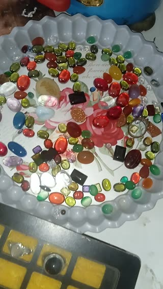

# A look inside the silver-jewellery workshop. · personal-video-06

[Watch the full video](https://farlandgame.github.io/Personal-Portfolio/?lang=en#personal-video-06) · [MP4](../videos/personal-video-06.mp4)

A look inside the silver-jewellery workshop. 💍

This video is from the workshop where I attended ring-making classes for a while. It shows the surroundings and the stones kept there—a small record of the place where I was learning to make rings with silver.

It belongs with photo 089, which shows me working during that learning experience. I attended the course with my twin brother Armiya. Together, the photo and this video preserve both the hands-on work and a glimpse of the workshop itself. A little sparkle for the archive! ✨

[Related ring-making photo · 089](personal-089.en.md)

[Video stories](videos.md)
