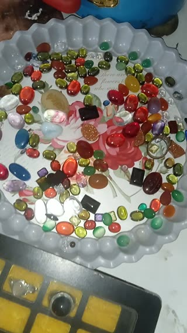

# نگاهی به کارگاه جواهرسازی نقره. · personal-video-06

[تماشای ویدئوی کامل](https://farlandgame.github.io/Personal-Portfolio/?lang=fa#personal-video-06) · [MP4](../videos/personal-video-06.mp4)

نگاهی به کارگاه جواهرسازی نقره. 💍

این ویدئو مربوط به همان کارگاهی است که مدتی برای کلاس انگشترسازی به آن می‌رفتم. فضای آنجا و سنگ‌های داخل کارگاه را نشان می‌دهد؛ یک یادگاری از محیطی که در آن ساخت انگشتر با نقره را یاد می‌گرفتم.

این ویدئو کنار عکس ۰۸۹ قرار می‌گیرد که در آن مشغول انگشترسازی هستم. همراه ارمیا، برادر دوقلویم، در آن دوره شرکت کرده بودیم. عکس، خودِ کارکردنم را ثبت کرده و این ویدئو هم بخشی از فضای کارگاه را نگه داشته است. یک کم درخشش هم سهم این بخش از آرشیو! ✨

[عکس مرتبط از انگشترسازی · ۰۸۹](personal-089.fa.md)

[Video stories](videos.md)
