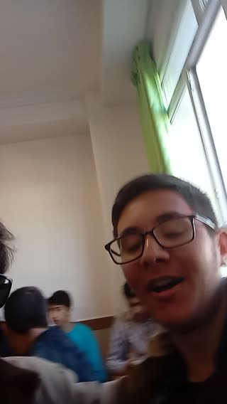

# Sunglasses, friends and a classroom hair review. · personal-video-08

[Watch the full video](https://farlandgame.github.io/Personal-Portfolio/?lang=en#personal-video-08) · [MP4](../videos/personal-video-08.mp4)

Sunglasses, friends and a classroom hair review. 😎🎥

This is a memory from tenth grade at Shahram Faraji High School. I am the one wearing sunglasses and filming. Beside me, in the red top, is my good friend Amir Hossein Sadegh. When I turn the camera towards my other good friend, Sadra Shahi, he wants to see his hair and then complains about how it looks. A quick camera turn, and suddenly the classroom has its own hair-review segment! 😂

Ashkan does not appear in this video. My twin brother Armiya had not come that day either; I do not remember exactly why. What remains is a short keepsake of that class and the friends who were there. Their voices and those ordinary, spontaneous moments are part of what makes it worth keeping.

The video’s sound is retained at my request.

[Video stories](videos.md)
