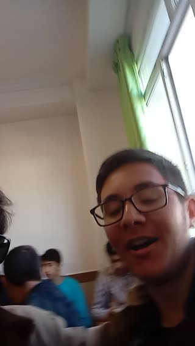

# عینک آفتابی، رفیق‌ها و بررسی مدل مو وسط کلاس! · personal-video-08

[تماشای ویدئوی کامل](https://farlandgame.github.io/Personal-Portfolio/?lang=fa#personal-video-08) · [MP4](../videos/personal-video-08.mp4)

عینک آفتابی، رفیق‌ها و بررسی مدل مو وسط کلاس! 😎🎥

این ویدئو یادگاریِ دهم، در دبیرستان شهرام فرجی است. آن کسی که عینک آفتابی دارد و فیلم می‌گیرد، خودم هستم. کنارم با بلوز قرمز، دوست خوبم امیرحسین صادق است. بعد دوربین را سمت دوست خوب دیگرم، صدرا شاهی، می‌برم؛ می‌گوید «موهامو ببینم» و بعد هم از موهایش شاکی می‌شود: «گند زده به موهام»! یک چرخش دوربین و کلاس، صاحب بخش بررسی مدل مو شد! 😂

اشکان در این فیلم حضور ندارد. ارمیا، برادر دوقلویم، هم آن روز نیامده بود؛ دقیق یادم نیست چرا. این کلیپ کوتاه، یادگاری خوبی از آن کلاس و رفیق‌های آن روزهاست. صدای بچه‌ها و همین لحظه‌های معمولی و بی‌برنامه، بخشی از ارزش این خاطره‌اند.

صدای ویدئو به درخواست من حفظ شده است.

[Video stories](videos.md)
