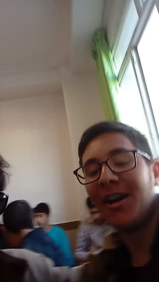

# Десятый класс: друзья и причёски · personal-video-08

Краткий перевод рассказа автора.

[Смотреть целиком](https://farlandgame.github.io/Personal-Portfolio/?lang=ru#personal-video-08) · [MP4](../videos/personal-video-08.mp4)

Десятый класс, школа Shahram Faraji. Я в солнечных очках и снимаю; рядом в красном — мой друг Амир Хосейн Садег. Поворачиваю камеру к Садре Шахи: он хочет посмотреть причёску и недоволен результатом. Обычный класс внезапно превратился в обзор причёсок! 😂

Ашкана в видео нет; Армия в тот день тоже не пришёл, точную причину не помню. Спонтанные разговоры и голоса друзей — важная часть воспоминания, поэтому звук оставлен по моей просьбе.

[Истории всех видео](README.ru.md)
