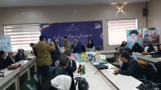

# Receiving recognition for my book—a bittersweet memory. · personal-video-09

[Watch the full video](https://farlandgame.github.io/Personal-Portfolio/?lang=en#personal-video-09) · [MP4](../videos/personal-video-09.mp4)

Receiving recognition for my book—a bittersweet memory. 📖🎥

My twin brother Armiya filmed this moment at the Education Department’s book-authorship recognition ceremony. My name is called, I walk up to receive the certificate of appreciation, pose for a photograph and return. It is the moment of receiving the certificate whose story I shared with photos 033 and 034.

I feel both happy and sad about that day. I was glad that my book was being recognised, but I also remember feeling overlooked and disappointed with how I was welcomed and introduced. As I recalled in the photo story, my name was called last, after a long wait, and I felt the moment received less attention than I had hoped.

Alongside that disappointment, I remember my family’s support and the flowers my uncle Siamak bought for me. This video preserves the brief moment of receiving the certificate; the photographs hold more of the day’s story. Both feelings belong to the memory.

The day’s story and photos: [033](personal-033.en.md) · [034](personal-034.en.md)

[Video stories](videos.md)
