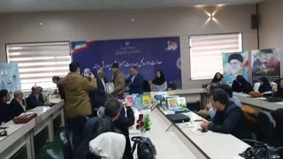

# Вручение грамоты за книгу · personal-video-09

Краткий перевод рассказа автора.

[Смотреть целиком](https://farlandgame.github.io/Personal-Portfolio/?lang=ru#personal-video-09) · [MP4](../videos/personal-video-09.mp4)

Армия снял, как на церемонии управления образования называют моё имя, я подхожу за благодарственной грамотой за книгу, фотографируюсь и возвращаюсь. Это тот день, о котором рассказал с фото 033–034. Радость признания смешалась с разочарованием: по моей памяти, меня назвали последним после долгого ожидания, и внимания было меньше, чем я надеялся. Помню также поддержку семьи и цветы дяди Сиамака. В короткой записи — вручение, а в фотографиях и рассказе — остальная история. 📖🎥

The day’s story and photos: [033](personal-033.en.md) · [034](personal-034.en.md)

[Истории всех видео](README.ru.md)
